# 吴恩达《AI for Good专业课程》 AI与公共卫生、气候变化、灾难管理｜中英字幕 - P32：31_空气质量最邻近方法.zh_en - GPT中英字幕课程资源 - BV13u411F7xZ

In this video we'll wrap up the design phase by working out a methodology to make estimates for pollutant levels between the sensor stations。

 so just like with the issue of missing values at a given sensor station。

 it's good to first think about what is a very simple baseline that we can implement what would this look like and want to established this baseline then we can think about how you might improve it with machine learning。

So imagine you're somewhere in the city of Boatar and you're trying to make an estimate of what the air pollution levels are at your location。

 perhaps the simplest method for making an estimate would just be to look up the most recent measurement from the nearest air quality sensor and then assume that the same holds for you are this is in fact what you used as a baseline in the previous lab except now instead of making an estimate at one sensor station closest to another。

 you're making an estimate at any location in the city。

We've been calling this nearest neighbor method in the lab and in fact that's what we call it in machine learning as well the nearest neighbor method is a common approach for making estimates when you believe that nearby neighbors in your data set are likely to have something in common with the given area that you're focusing on and this could be neighbors that are nearby in physical space like what we're doing here or nearby in time or nearby in some other characteristic or dimension that you can measure。

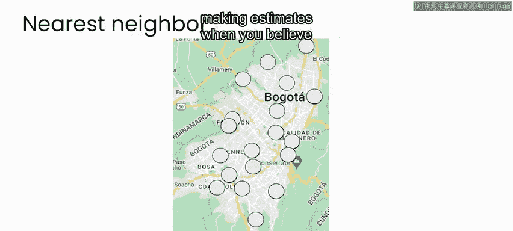

So this method makes some intuitive sense when considering air pollution measurements because it seems reasonable that characteristics of the air at any given location are probably most similar to the characteristics at the neurosensor locations。

 of course this may not necessarily be true， but as a baseline it seems like a reasonable first guess so this is what you'll try out first in the lab。

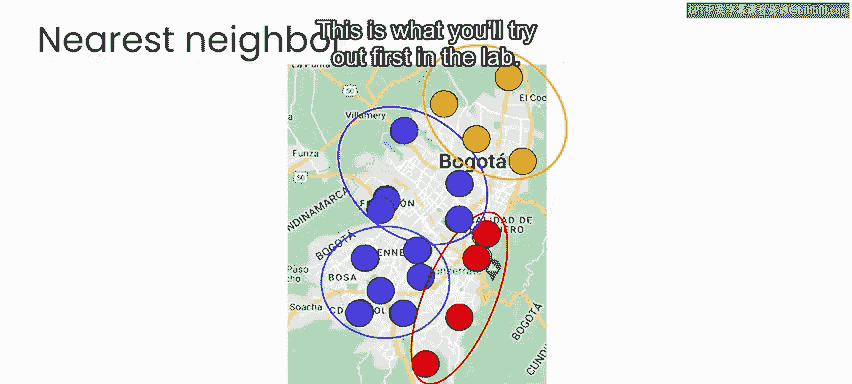

If you think about how you might improve on this method。

 given that there are multiple cus stations throughout the city。

 you could consider not just one nearest neighbor， but two or three or even more nearest neighbors to come up with an estimate for air quality at your location。

 This extension of the nearest neighbor method is called K nearest neighbor or K and N for sure where K is the number of neighbors you consider for each estimate。

 So then the question arises how should you make an estimate given more than one neighbor you could take a simple average of all the neighbor values but for something like air quality measurements you might also assume that measurements made by the nearest neighbors should we give more weight than neighbors which are further away In fact。

 this is exactly what is commonly done in rural applications of nearest neighbor techniques today。

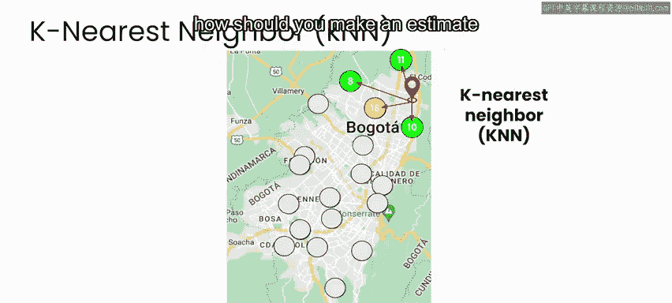

While there are a number of weighting schemes you could consider for this week's lab。

 you'll use inverse distance weighting where you assign a weight to each neighbor equal to the inverse square of the distance of that neighbor from the location that you want to make an estimate at。

Let's jump into the lab and see this method in action。

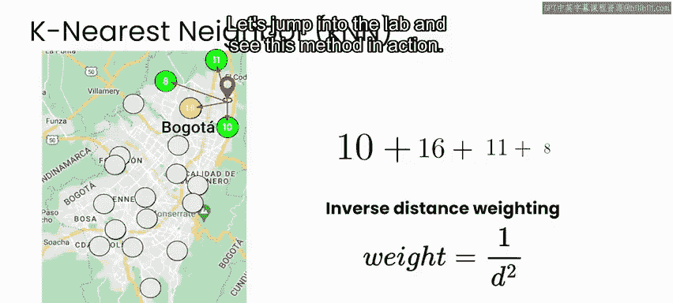

As in the previous labs， you will start by running the first cell here。

 which will import all the packages that you need for this lab。

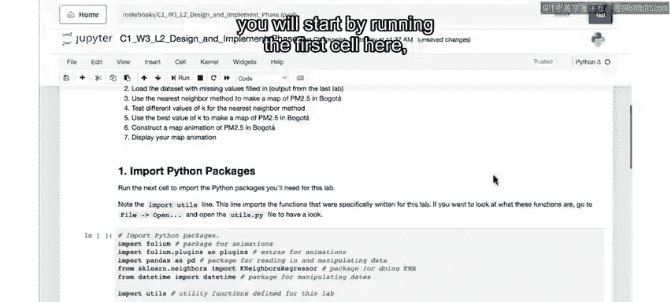

Once you've run that， you'll read in the data set and print out the first five lines to spot check that everything has been imported okay。

Now you can see here that this is the data set that you generated at the end of the previous lab。

 where you estimated missing values for PM2。5 using your neural network model。

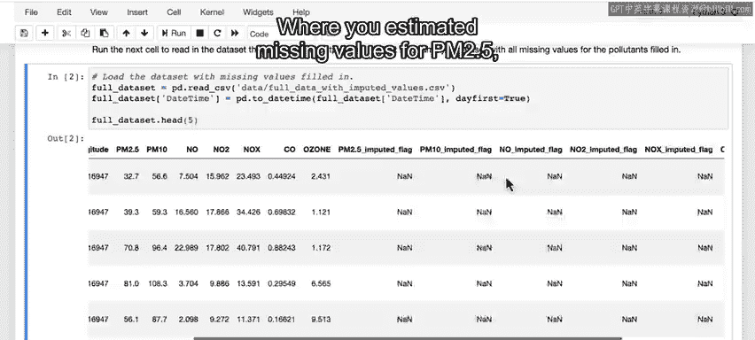

Now you have all the information from the original data。

 plus latitude longitude for each of the measurements。

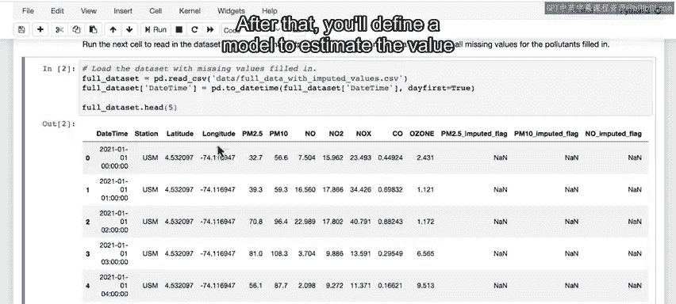

After that， you'll define a model to estimate the value of PM2。5 in between sensors。

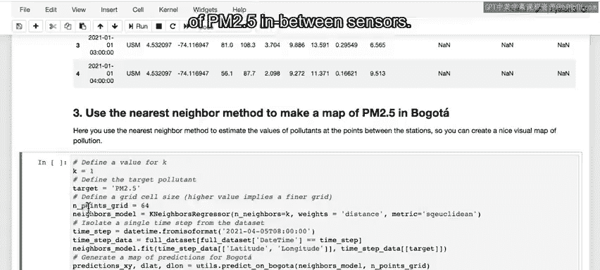

Here， you'll first create a grid of the cityio Bogota and estimate the value of PM2。

5 inside of each grid cell based on the nearest neighbor method， in this case with k equals 1。

This is similar to what it did in the previous lab。

 we were trying to estimate what the missing value at a particular station could be based on the nearest neighbor。

 but now you're estimating across a grid covering the entire city with values of PM2。5。

 given the nearest neighbor， so let's run that。So now you have a map with the c station locations and a color codeed grid overlaid on the city。

You can click on a station location to see the measured value of PM2。5 at that station。

 and when you see a station with a whiteboard around the circle that indicates a direct sensor measurement。

And a black border around a circle represents a value estimated by your neural network。

And so you can see it also says estimated here in the pop up when you click on that station。

In this case you're isolating a single timestamp in the data， in this case。

 your timestamp is the date and time and you can change that if you want to up here to see the result for a different date and time。

 and so you can imagine this could be a feature in your mapping application where someone could choose a date and time and see a map of PM2。

5 in the city。An so with this grid over the city of Bogaar， given the nearest sensor station。

 you filled in an estimate for each value of PMm2。5 in each grid cell based on the nearest station measurement。

And you can see this intuitively in the map here where the measurements change at about the halfwaypoint between each of the stations。

So the city is broken up into a grid and inside of each of the grid cell is an estimate for PM2。

5 that simply reflects what the closest station is measuring。

This is perhaps the simplest way that you can make estimates across the entire city for PM2。5。

 just based on whatever happens to be the measurement of the nearest station。Now。

 what you do running in this next cell is to calculate the mean absolute error first associated with k equals1。

And then step through a number of different scenarios for different values of K。So let's try that。

Once that is run， you will see that you get an estimate for mean absolute error of close to eight。

 which is similar to what you found in the last lab when you estimated the error on your baseline method。

So in this case， using K equal to 1， you find that your estimate of PM2。

5 levels is that any location in the city is off on average by about8 in the PM2。

5 measurement units of micrograms per meter cubed。The way that you are calculating this error is to run this for each of the sensor station locations and see what your estimate would be based on nearest neighbor versus the actual measurement at that station。

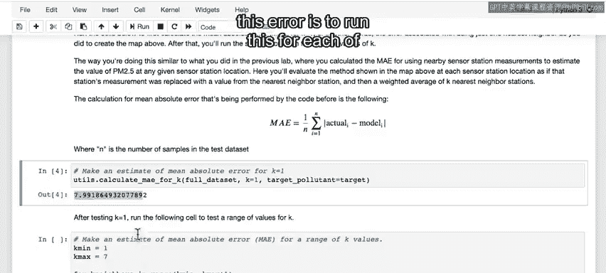

What you can do next is change this value to another value of k to see what the result looks like。

We've set that up for you in the next cell here where you're running through a range of k values from one to seven。

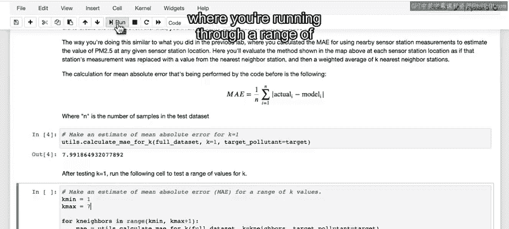

In this case， though， you could try other values。What this cell will print out is that same calculation。

 the main absolute error for H K value。So after running this。

 you can see that it looks like your error improves a little bit with high values of k。

 but that there's not much improvement beyond k of 304。Up here。

 when you mapped out the city with k equal to1， your map looks like this。

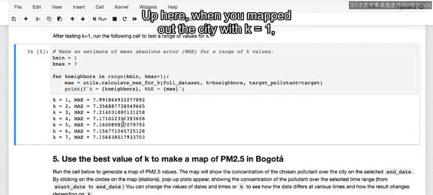

So now let's try a higher value of k like three。And that just means that instead of considering only the nearest station。

 you're actually going to for each grid cell in this map。

 consider the three nearest stations and take a weighted average。Let's run that。

What I'll get when I do this is what it looks like a smoother representation a P of 2。

5 estimates within the city， The difference here of course。

 is that rather than just taking into consideration one nearest neighbor for each grid cell in the map。

 for example， this grid cell or this grid cell， you are taking into consideration the three nearest neighbors。

So for this cell， for example， the three nearest stationations， this one over here。

 one over here and one over here， and for this one you have this value。

 here we have this value and this one at this value。And the cell in between。

 given the distance to each of these。Is shown here。

 and that's based on the distance weighted average of the three nearest sensor stations。Similarly。

 if you increase k to four or5 or some other number。

 then you're making an estimate based on that number of nearby stations and weighting the average by the inverse square of the distance to each of those sensor stations。

With that， you basically have your design phase complete。

You have now designed a neural network method for estimated missing values。

Where there is no sense of measurement at a particular station。

You have also designed a system where you can estimate the value in between sensors based on some of the nearest neighbors。

You've displayed all that in a nice map here and that could be your user interface。

Now it's worth mentioning that there are other algorithms that you could try when it comes to estimating between the sensor stations or even different weighting schemes that you could try with the K nearest neighbors method and you might even be able to do a little bit better in terms of the main absolute error using another approach。

But in this case， there is a very real physical constraint on the problem that you're trying to address。

 namely that you don't actually know what the pollutant levels are in between the sensors。

 so any model you adopt no matter what the aromametric suggests will only be a rough estimate and it's possible that you won't be able to improve very much over the k nearest neighbor method that you used here。

Nice work you've established a baseline using a K value of1 and then worked out a slightly more sophisticated algorithm using a higher value of k and a distance weighting to make even better estimates of their pollution levels at any location in the city of Bogota and so with that you completed the design phase of your project join me in the next video to wrap up the design phase by revisiting the key questions that you need to answer before moving on to implementation。

😊。