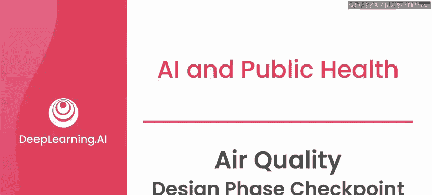
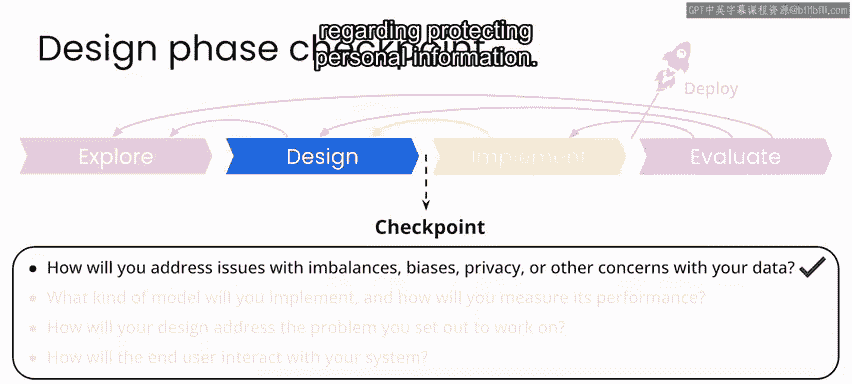
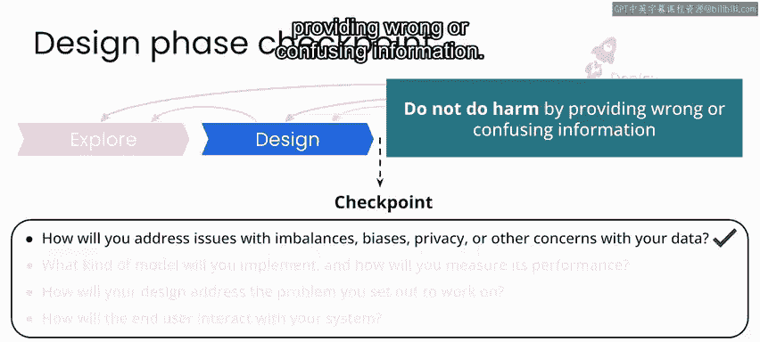
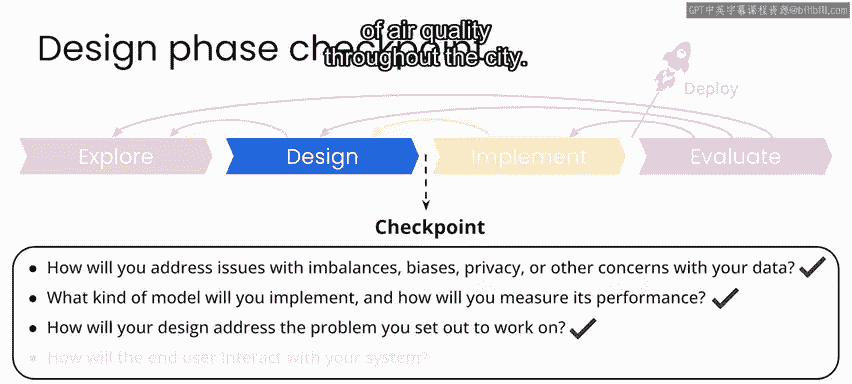

# 吴恩达《AI for Good专业课程》 AI与公共卫生、气候变化、灾难管理｜中英字幕 - P33：32_空气质量设计阶段检查点.zh_en - GPT中英字幕课程资源 - BV13u411F7xZ

Congratulations on completing the design phase for the Bogota Air Qity project in this phase of the project。

 you're prototyping your solution， considering how to deal with any issues in the data regarding privacy or personal information which in this case should be minimal and your designing the user experience Nice work。

At this point you should be able to answer the following questions before moving on to implementation first how you address issues with imbalances。

 biases， privacy or other concerns with your data， what kind of model will you implement and how you measure its performance。

How will your design address the problem， is it how to solve。

 and how will the end user interact with your system？As mentioned before。

 you always need to do a thorough analysis of data regarding data privacy。

 security bias or other concerns for this project you' work with publicly available data from scientific instruments so there aren't any major concerns regarding protecting personal information keep in mind however that just the fact that a data is publicly available it doesn't mean that it can do no harm the application that you are working on is intended to be part of a broader public health initiative regarding air quality in the studio of Buatar。

 so you need to be sure that at the very least your product does no harm by providing wrong or confusing information and I think you can consider some other potential misuses of this information that you could discuss with stakeholders For example。

 if you are able to come up with much more accurate estimates of sudden bursts of pollution this could be associated with illegal manufacturing。

an illegal burnoff or some other criminal activity that could attract surveillance use cases。

 not just surveillance for pollutants， but surveillance for crime。

 and if this information is then used to prosecute people for crimes or identify criminals。

 then the community might understandably lose trust in these censs and there will be resistance towards trust in the census data or even having future censs installed。

 and so for any use case， even if you know it doesn't have personal information to begin with。

 you should spend time with the stakeholders， thinking about potential risks and what are the potential downsides of providing a richer experience with machine learning。

Through the lab here， you came up with a model design for both estating missing values in sensors and estimating the PM2。

5 between the sensors， and you use the mean absolute error to establish your model's performance against the baseline。

With this design you're aim to address the problem we set out to work on by providing the city of Bogota with an application that allows citizens to get real-time estimates of air quality throughout the city。

 and those end users will interact with your system via a webable mobile application this will then allow them to see current estimates as well historical data from individual sensor stations。

Now， of course， the actual design that you've been working on in the labs is still very much a prototype。

 but over the course of these labs， you've been able to demonstrate a system that can estimate missing sensor values。

 estimate pollution levels in between sensors， and provide a snapshot of historical data if you click on a sensor station location。

And with that you've completed the design phase for this project now it's time to put it all together in the implementation phase。

 so please join me for the next video to walk through the lab section on implementing your product。

