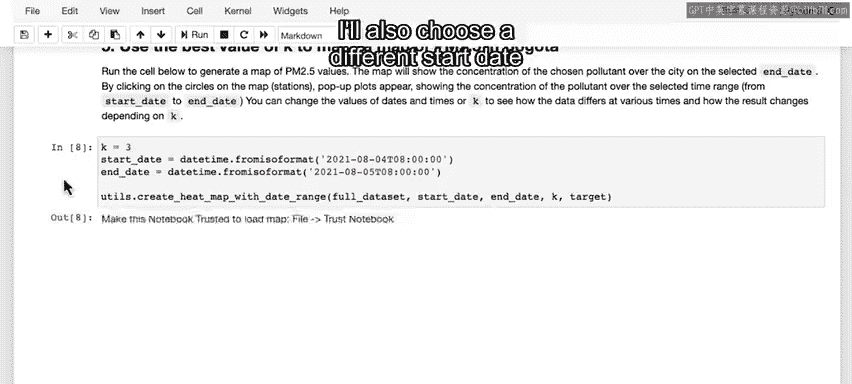
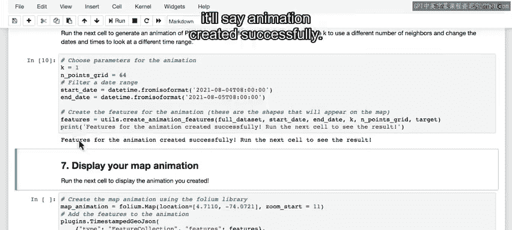
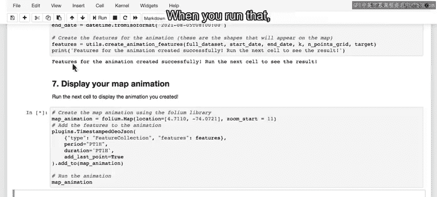
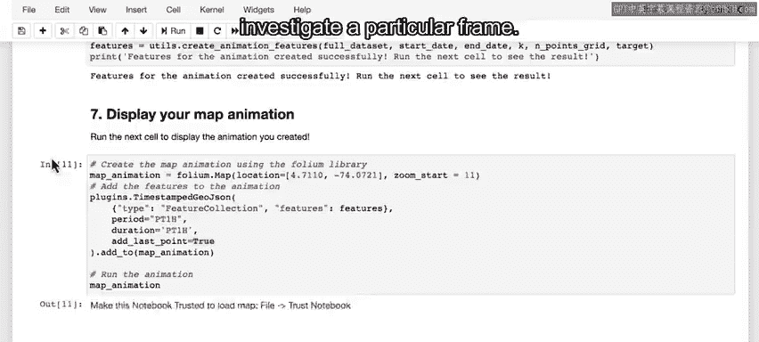

# 吴恩达《AI for Good专业课程》 AI与公共卫生、气候变化、灾难管理｜中英字幕 - P34：33_空气质量实施阶段.zh_en - GPT中英字幕课程资源 - BV13u411F7xZ

For the implementation and deployment of an air quality monitoring application like when you've be developing in these labs。

 there are going to be a number of practical challenges and many of them will be technical in nature So these are going to be things like how do you deploy your system on a cloud or hosted server。

 how will you receive and process the data stream of current sets of measurements。

 how you monitor for uptime how will you deal with outliers which are different to the kind of errors you've seen before and more practical user experience things like how you display the user interface on a web or mobile application depending on how somebody accesses it All of these things would be technical challenges that you would need to overcome to actually go into a production for a system like this one for the purposes of these courses we would be spending time on those technical strategies。

 but we will be reminding you that they exist however if you do have some software engineering experience or you're part of a team who does then you could think about。

how you might go ahead and deploy your mapping application into production to wrap up this project we'll jump back into the lab and add a couple of small features of the mapping application that you've been working on and then spend some time discussing what else you might be concerned with in some final implementation evaluation of your project but first let's head back over to the lab。

If you've already been working in the lab here and you've run the cells up to this point。

 then you can go ahead and start right here by running this code cell if you're just opening this lab now。

 then what you'll need to do is go ahead and start at the top and run these code cells in order。

Starting here with the inputs and then run in each of these until you get down to here。

And now at this point， what you're going to do is choose a value for K。

Define a start and end date and when you run this you'll generate a map that shows you the current PM2。

5 levels。Which is to say the levels at the end date timestamp at each sensor station as well as the interplateulated values between the stations and again。

 when the border around the circle showing a sensor station is white that indicates a direct measurement and when the border is black that indicates an estimate generated by your neural network model。

And now， in addition to the map， you can click on each sensor station to see a plot of the historical values back to whatever spot that you choose。

So in this case， we're grabbing 24 hours in the month of August 2021。

 and you've created a map representation using a particular value of k k equals1 in this case to interpolate in between the sensors。

And so now， based on the analysis above， I'm going to change my k value to3。Because up here。

 it looked like beyond k of three or four， things really didn't improve that much。

 but you can choose whatever value of K you like。I'll also choose a different start date to show more history in the plot。

And once I've run that， you can see I've got a smoother interpulation map and when I click on a census station now I have more historical data in the plot。

 So this is still a little prototypy where're just running code in a Jupyter notebook。

 but you can start to imagine how this might look in a slightly nicer user interface where maybe the user has pull down menus to select a start date or maybe where they want to see the past week or month of data in the plots。

And you can imagine that the map is regularly updated to show the most current values similar to what you saw before in the purple Air app。

So that's just an idea for what the user application could look like。

 so what you can do here is try different dates and try different values of K and have a look at the example user interface that you'll generated。

And next， what you'll do is create an animation of a particular time range。

 in this case the past 24 hours between the start date and end date indicated here。And again。

 you can choose a value of k。I'll just run this first using K equal goes one again。

So when you run this cell， you're building the animation that will be displayed below。

And so once it's finished running， it'll say animation created successfully。

And then you can run this last cell to display your animation。And when you run that。

 you'll see something like this where now you can pause the animation to investigate a particular frame。

Or you can advance that frame one at a time。Or you can play the animation and change the speed here and so again it's a little prototypy。

 but in principle， it's similar to what you'll find in a lot of air quality mapping applications that are online right now。

And this is something where again， you could let the user specify the dates that they wanted to see animated or click into the sensorensus stations to see more information about these recent measurements。

I'll run this again for K equals three and let's see how that looks。

And here you can see that smoother interpulation between the different senses。

This is also something if you build out for a forecasting aspect of your application。

 you might wanting to be used to animate the future forecasts of air quality。As mentioned before。

 when it comes to deploying something like this online to a wearable mobile application。

 there are a number of software development challenges that will come along with that。

But you can imagine just like some of the other air quality monitoring applications that are online。

 we have a little help from a designer and some number of engineers。

 you could have an interface where someone is able to either see animation like this or interact with the map that allows them to see something about the current measurements。

You could also look at the history of sensor measurements at a particular location or estimates at other locations within the city。

And so that's what it looks like with the smoother map created using a k value of three。

And that's it for the implementation phase of the Bogota Air quality project Of course there would be many more details to consider in an actual implementation of a system that you're taking into production to support citizens in the city of Bogota or the health professionals there who care about air quality。

 but I hope at this point you feel like you've gotten a sense of what it might look like at least at a high level to see a project like this through from the initial exploration to the design and the eventual implementation。

😊。