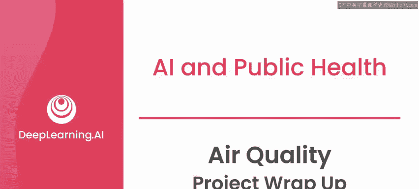
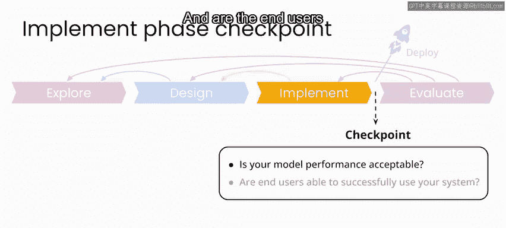
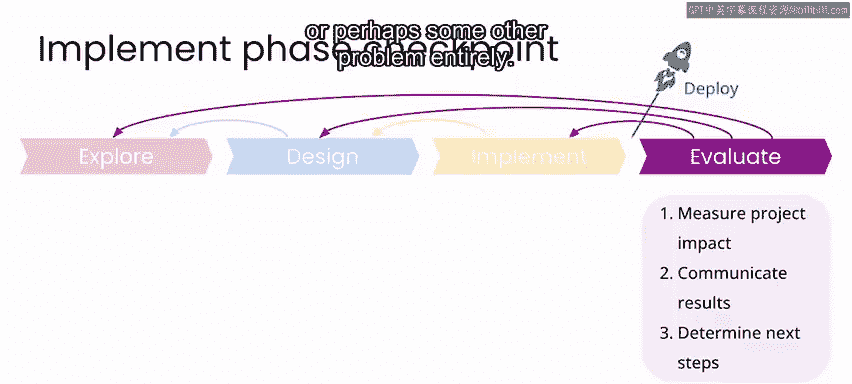
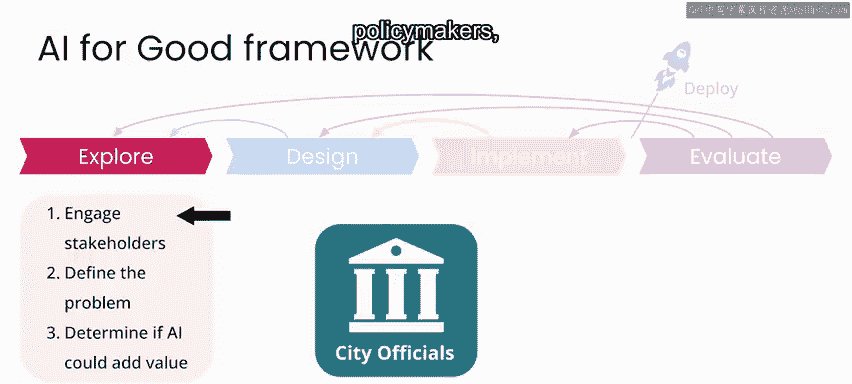
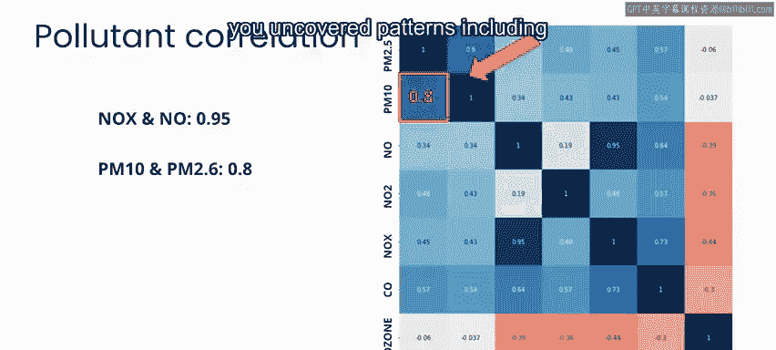
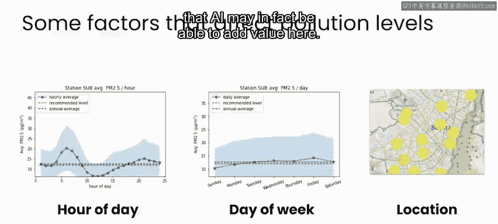
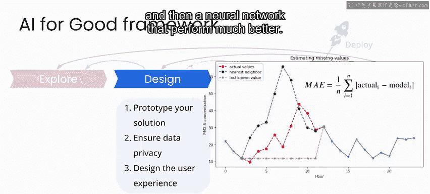
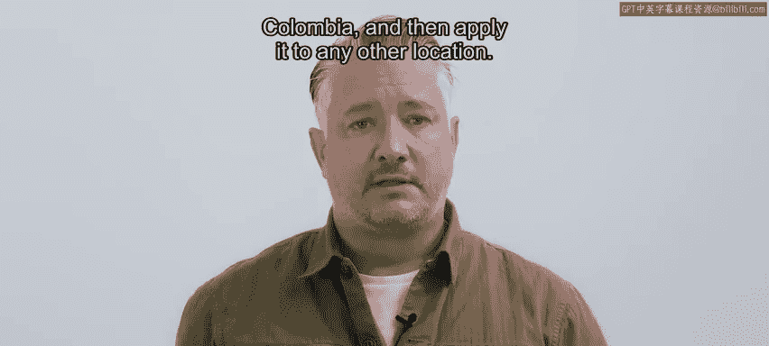
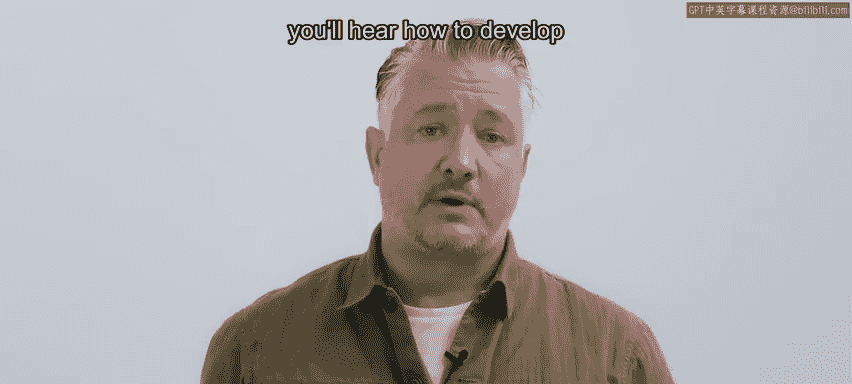

# 吴恩达《AI for Good专业课程》 AI与公共卫生、气候变化、灾难管理｜中英字幕 - P35：34_空气质量项目总结.zh_en - GPT中英字幕课程资源 - BV13u411F7xZ

You're now at a point where you've explored， designed and implemented your air quality monitoring system。

 Let work at this point before deploying your system out into the real world。

 there are a couple of questions that you'll need to address before moving forward。

The two questions that you'd like to be able to answer in the affirm at this stage are。

Is your model performance acceptable and are the end users able to successfully interact with your system？

In this case， you found that your models for both estimated missing values。

 as well as est pollution in between the sensors have associated errors on the order of  four to7 micrograms per meter cube。

When estimated PM2。5 levels。Having an estimate with this sort of associated error is most likely better than having no measurement at all and for the purposes of advising the public or whether the area is safe to breathe。

 we can make the assumption in this course that this is a reasonable margin of error keep in mind that different error estimates like mean squared error or accuracy measures like precision and recall might be more appropriate for different kinds of projects and this will all depend on your particular project goals and the individual specifications and stakeholders。

😊，When it comes to how end users are interacting with your system。

 you would have to do some end user testing to see how things are going。

 are they comfortable with the way that they're interacting with the software。

 are they interacting with it in the way that you thought that they would。

 as well as talk to other stakeholders to learn whether your product is sufficient to serve their needs。

Deppened on what you find when you speak to the end users and other stakeholders。

 you might decide to work on an updated implementation， develop a new design for your system。

 or start over to explore another aspect of the problem of air pollution。

 or perhaps some other problem entirely。

While working on estimating the air quality of Bogaar。

 you went through all of the steps of our AI for good framework。In the explore phase。

 you looked at who the relevant stakeholders might be in a project like this withve included public health officials。

 policymakers， people managing the air quality sensors and the citizens。

 you formulated a problem statement and you explore the data to determine whether it looked like AI could in fact add value to this project。

In your exploration of the data， you uncovered patterns。

 including correlations between different pollutants。

 as well as trends and pollutant levels that depended on things like the time of day。

 week and the census station location， and all of this gave you a strong indicator that AI may in fact be able to add value here。

In the design phase， you investigated missing data more deeply and developed models to estimate missing sensor measurements。

 first， a simple baseline model and then a neural network that perform much better。😊。

After using your models to estimate missing values across all the pollutants in the data set。

 you developed a method for estimating pollution levels in between the sensor stations。

In the implementation phase， you put your models to work generated maps that would be useful to the end user when it comes to knowing what pollutant levels are right now。

 as well as how pollution levels might have been changing in recent days or hours across the city。

If you feel it inspired to keep working on some of the challenges that you encountered in the air quality monitoring project that I think that's great。

 you could think about things like downloading more data from the city of Boggoar or even looking for some air quality data for the area where you live at this point。

 I'd also encourage you to take a moment to think about what kind of projects you might be interested in and how might you approach those projects using the same framework that we've been working on throughout this course So for example。

 you could be thinking about who would the key stakeholders be and how would I contact them what kind of problem would you be addressing is there likely to be a data component to this problem and with these questions in mind your well and your way to getting started。

😊，Before you wrap up this course we have another project spotlight for you Tipewa Chawewei is a technology strategist who has worked in air pollution in South Africa。

 so like we said you can take this project that you worked on for Bogota。

 Colombia and then apply it to any other location in the next video you'll hear how Tipewa developed a solution in his home country of South Africa。

