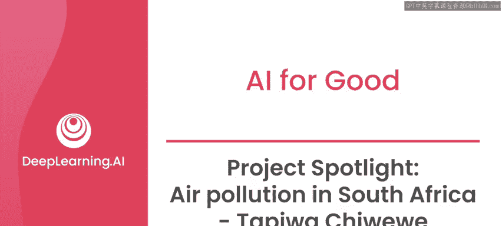
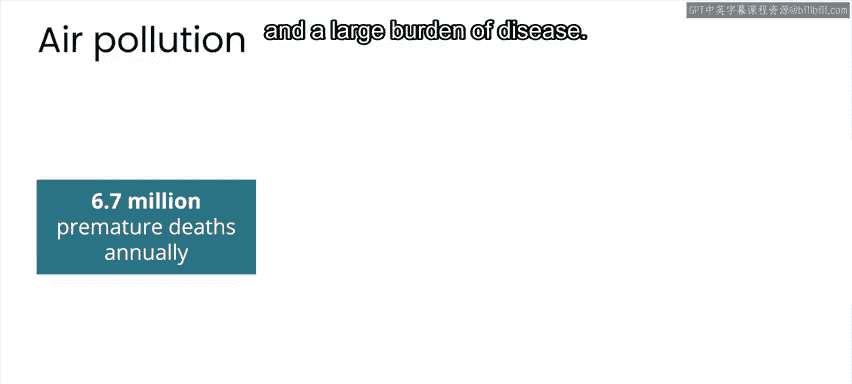
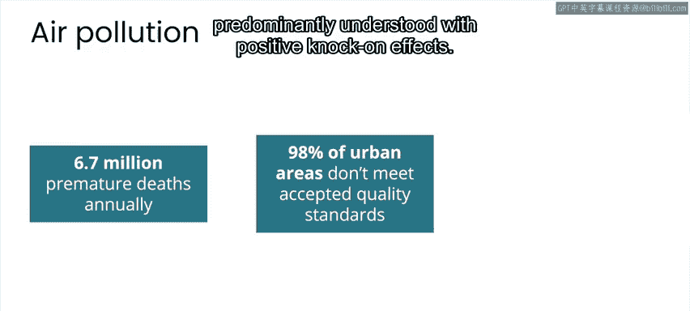
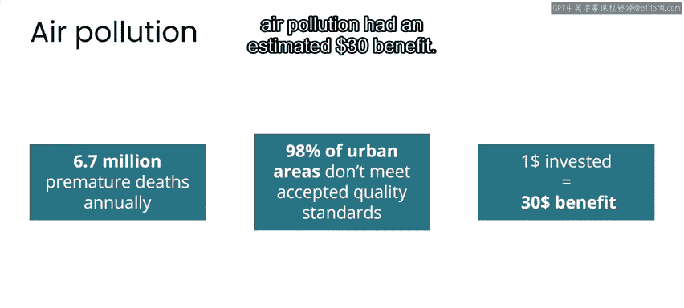
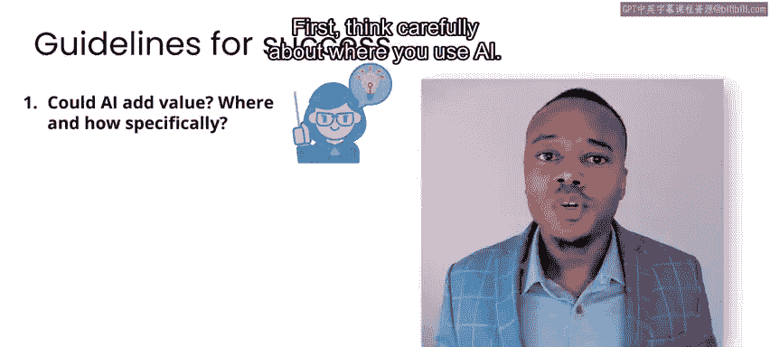
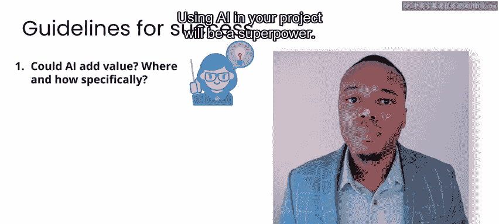
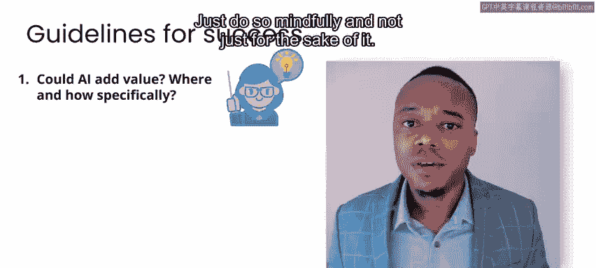

# 吴恩达《AI for Good专业课程》 AI与公共卫生、气候变化、灾难管理｜中英字幕 - P36：35_Tapiwa Chiwewe南非的空气污染.zh_en - GPT中英字幕课程资源 - BV13u411F7xZ

Hi there。 I'm Tapea Chiwewe。A breath of fresh air。 What comes to mind when you hear that？

The literal meaning refers to something we can easily take for granted。

But imagine a world where each breath you take is toxic。I got a glimpse of this some years ago。

 as I was striving to work one winter morning in Johannesburg and noticed an ominous cloud of pollution hanging over the city。

 This piqued my curiosity。 and at that moment， I felt an urge to do something about it。

 but I didn't know what。All I knew was I couldn't understand Alili by。

I started by learning more about air pollution。 I was surprised to learn that World is responsible for millions of deaths annually and a large burden of disease。

Dig know that 98% of urban areas in developing countries don't meet accepted equality standards。

The good news is that solutions to air pollution are predominantly understood with positive knock on Eths。

 In fact， every dollar invested in controlling air pollution had an estimated $30 benefit。

Given my computer engineering background， I developed an idea of creating an AI powered air quality management solution。

 however， I was pretty sure I couldn't call my way out of this air pollution problem and soon realized that a collaborative approach was needed。

So I decided I'd better get to know some people working within the field。

I ended up connecting with ordinary citizens， policymakerrs， technicians， lawyers， and so forth。

The engagement process I embarked upon helped me to develop a deeper understanding of the Prominence space and the stakeholders。

It helped me to avoid the trap of being quick to apply a technology before having firmly grasped the problem at hand。

 Now， the process of creating a solution。 It can be harder times。

 The key is to persevere and never lose sight of the big picture。 together with my collaborators。

 armed with over a decade' worth of air quality and weather data。

 We developed a cloud based sy solution that could analyze air quality data to uncover trends and predict future levels of different pollutants such as oxide of carbon。

 nitrogen and sulfur， as well as other pollutants such as ozone and particular matter。

This meant that citizens and officials could make better decisions concerning activities and policies at the microbe and macro levels as they relate to personal and environmental health。

This shows how an AI power tool can enable us to better care for our communities and our environment。

Only a handful of organizations and people got access to the solution。

 due parts to restrictions around licensing and data use。

An open data and open source approach may have allowed for broader access。

I would of like to have spent more time developing the solution and getting more stakeholders on board。

 All in all， the way the work resonated strongly with society was very humbling now。

One day you might find yourself in a similar situation as I was。

 or maybe you already feel that you want to contribute to an AI project with a positive societal mission。

All you need to start is to generally care about and be interested in the specific problem at hand and to have a desire to achieve a well defined positive outcome。

If this is there， the risk starts to fall into place。When I worked on the air quality project。

 I used my technical background to my advantage。You too can use your background to your advantage。

 whatever it is。Your outside expertise may hold the key to solving big challenges within a particular domain。

Here are three guidelines you can use to hit the ground running first。

Think carefully about where you use AI。

AI is a frontier technology with broad application that offers exciting new capabilities。

So using AI in your project will be a superpower。

Just do so mindfully and not just for the sake of it。

Second， make use of technology platforms that enable you to create your own solutions。

This will free you out from reinventing the wheel and enable you to create value faster and at a lower cost。

Jumpt your work by reusing， localizing and building upon what's already been developed， for example。

 in open source projects。You can leverage foundation models and cloud platforms。

 there are also no code tools available that enable you to describe data and create AI models without writing any code third。

Follow a multidisciplinary community approach。No one person or organization can solve the multitude of problems out there。

 so look for ways to take advantage of the abundant talent and resources in communities worldwide。

As you can tell， you don't have to be an AI expert to collaborate on AI projects。

You also don't need to get involved with AI directly。

 it could be that you understand the problem context， have access to data。

 can translate the needs of communities and so on， these other dimensions are required to create sustainable solutions that are a good fit。

They also ensure that human values are preserved in the AI solutions that we create。So。

Feel confident to work on what you're enthusiastic about that is a deep societal purpose。

 I wish you the best in your AI for good projects。May they be a figurative bread of ratio。

