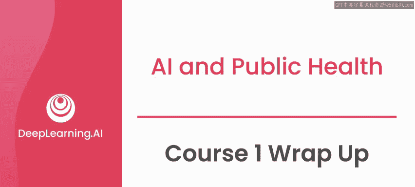
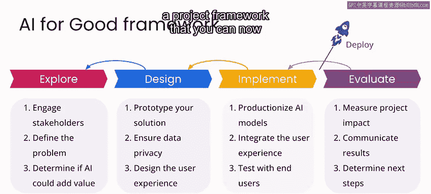

# 吴恩达《AI for Good专业课程》 AI与公共卫生、气候变化、灾难管理｜中英字幕 - P37：36_课程总结.zh_en - GPT中英字幕课程资源 - BV13u411F7xZ

Congratulations on finishing this first course in the AI for Good specialization with this course。

 you've gotten a handle on what AI for good means in a practical sense and you saw some examples about what AI can do and understood some of the limitations you've explored some case studies and seen some exciting impactful projects I hope that through the exploration of the topics presented here and the air quality projects that you've worked on directly that you've gained some new insights into some of the key aspects of projects like these and you feel better prepared when it comes to take these learnings to your own projects。

By going through each phase of the air quality project in detail。

 you've seen what some of the key considerations might be in building an AI assisted air quality solution for a city like Bogota。

 more importantly， you move step by step through a project framework that you can now take to whatever project you're interested in working on。

😊。

If you're feeling inspired to start thinking about a project of your own。

 but you're not a software developer or an AI practitioner， don't let that hold you back。

 I would certainly encourage you to try your hand learning how to code or connect with people who can help you with some of the technical aspects of a project that you might be thinking of and if you are already familiar with software development in AI and you feel inspired to get involved in AI for good project then I would encourage you to reach out to domain experts in the field that you're excited about to see if there is a way that you can get involved in their work on a project that interests you if you like what you found in this course I'll hook youll join me for the next course in this specialization AI and climate change where we'll be working with global temperature data and looking at case studies focused on renewable energy and biodiversity so I'll see you in the next course。

