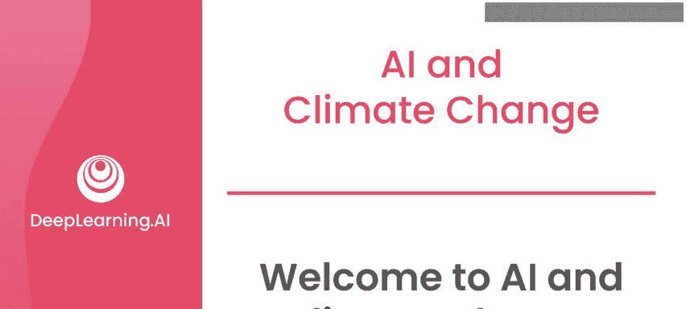
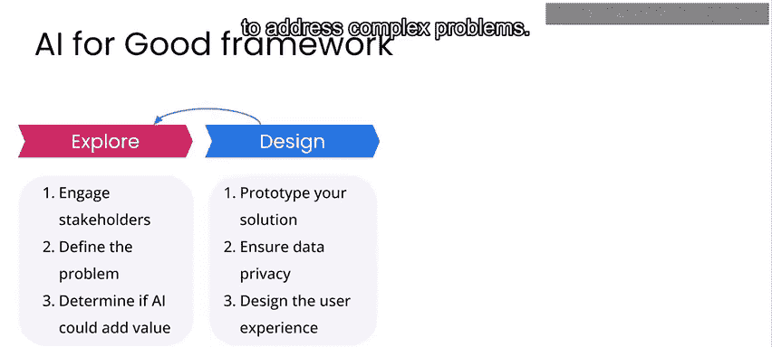
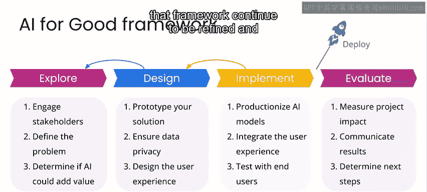

# 吴恩达《AI for Good专业课程》 AI与公共卫生、气候变化、灾难管理｜中英字幕 - P38：0_欢迎来到人工智能与气候变化.zh_en - GPT中英字幕课程资源 - BV13u411F7xZ

Welcome to AI and Climate Change， the second course in the AI for Good Specialization。In this course。

 you see how AI can be part of the solution for challenges that we face with climate change。

Climate change is already impacting human populations and natural ecosystems through droughts。Fs。

Wildfires。Rising sea levels and other adverse phenomenon。And in this course。

 you work through case studies and see how teams around the world are approaching the problems presented by climate change。

 and you see where AI can be applied to applications in renewable energy and biodiversity monitoring。

I'll throw that once again， we have as your instructor， Robert Monaak。Thanks Andrew。

 it's great to be here and I think this is one area where you might have more expertise than me。

 I think you've done some work in AI for climate change in the past。 Yeah in fact。

 my collaborators and I wrote quite a few papers on using satellite imagery to understand drivers of deforestation and methane emissions and so on。

 So I think climate change in addition to being important to every persons also the technical aspects near and dear to my heart that's great that's very similar to the use cases that we'll have here today so we'll talk about biodiversity monitoring and wind power forecasting both of these are very important topics in understanding how we can reduce reliance on fossil fuels and monitor the impact of climate changes on the bio biosphere In fact you wind power forecasting is one of those techniques where AI is already having a significant impact on the operation of wind farms and on planning electrical grid is really。

😊，and as an AI person I feel proud about few for you know having that impact Yeah it's incredibly exciting I think we've got to a point now where producing electricity and methods where the low impact on fossil fuels like wind and solar is becoming very effective however the prediction components are very hard we don't always know how sunny it's going to be or what the wind is going to be like and these are the kind of problems that lend themselves really well to machine learning solutions because you're essentially taking a large number of signals more than you could write a rule-based human system to really combine and you can use machine learning to get better predictions and even a few percentage improvement in wind or solar can have incredibly large impacts in things like the reduction amount of carbon emissions because they can better forecast know there's certain time in the next few hours the next few days how much solar how much wind they're going decide to ramp。

😊，or down high polluting plants and just optimize the power grid maybe you can charge people's electric vehicles at a better time of day so this information is flowing through the grid in a way that I find extremely exciting thats just making the power more efficient Yeah I think that's a really good way to look at it the power grids built on fossil fuels will often only have a variance of a couple of percent any higher or lower and people start getting blackouts or brownouts and so we're really rethinking what power grids look like when we can have distributed power from people's batteries in their homes or in their cars and power that can be shared across multiple grids based on what renewable energies were able to produce power at lot times。

😊，And so in thiscourse you'll learn more about that aspect of trying to address climate change and then the second major project is biodiversity monitoring it's also important to think through how climate change is already affecting biodiversity to say more about that project Yeah the second project is really fun so we are looking at images from a national park in South Africa trying to gauge the number of animals so this can tell us what is the environmental impact or the other human impacts which are reducing the number of animals in a given location and I think it's a good example both in the positive and negative this is an area where we can very effective lead deploy existing machine learning technologies but also we have to ask ourselves what is the most important thing to look at so for a lot of biodiversity monitoring and we care about plants or bacteria but that's harder to do so I think this is fun we're looking at what I've heard been called。

😊，Charismatic megafaunner so it's fun looking at these animals and we have good object detection methods that can be used for that but at the same time we have to think well okay there are reasons that we can detect large animals better than we can detect small ones with current machine learning technologies so it's also a good way to think about where the gaps are today and hopefully that'll inspire people to think about ways of addressing those gaps in the future。

😊，So I think in the previous course you started to see a systematic framework for how to address complex problems and so in this course you see that framework continue to be refined and adapted to these two really exciting applications of wind power forecasting as well as biodiversity monitoring。

And so with that， I'm excited to have you learn about these topics。

 please jump in and let's go on to the next video。