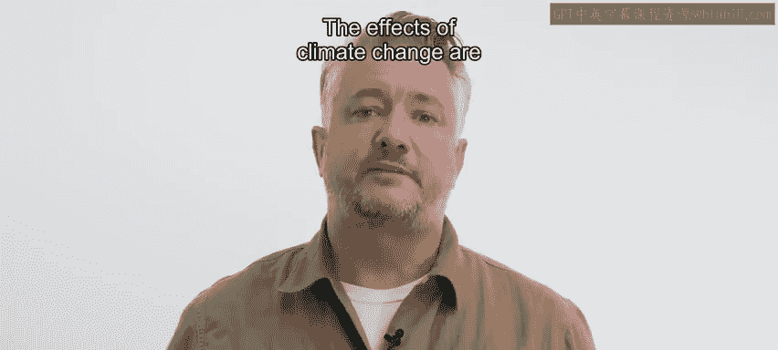
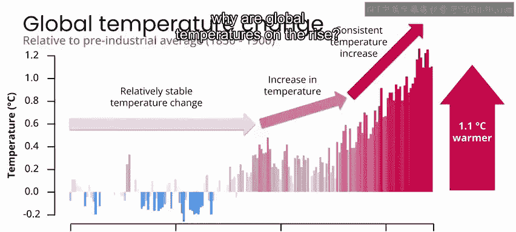
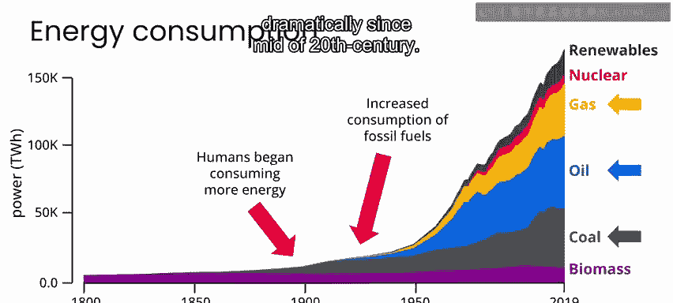
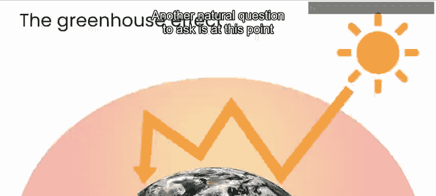
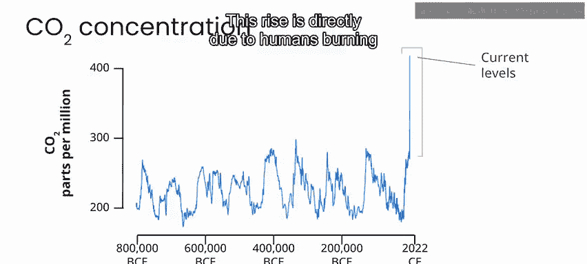
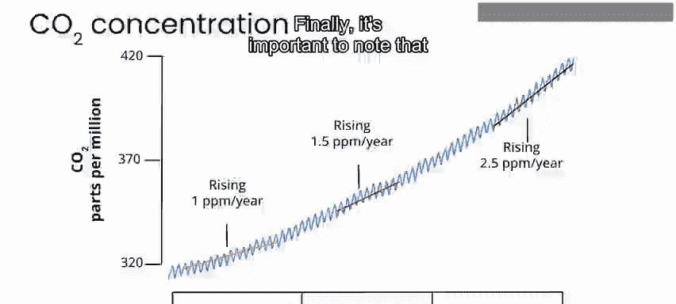

# 吴恩达《AI for Good专业课程》 AI与公共卫生、气候变化、灾难管理｜中英字幕 - P39：1_什么是气候变化.zh_en - GPT中英字幕课程资源 - BV13u411F7xZ

Climate change is a global phenomenon and if you've been paying attention to the news。

 then you've no doubt been hearing about climate change and how it's impacting populations and ecosystems around the world。

 as well as what kinds of policies and commitments various countries have put it in place to help address climate change for the purposes of this course I'm assuming that they you already know many things about climate change。

 and you're here to learn more about how AI can help address some of the problems。To get started。

 though， I'd like to go through a brief overview of climate change。

 What factors are contributing to it and what generally needs to happen in order for us to avoid the worst outcomes in the future。

 The effects of climate change are wide ranging and might include seemingly contradictory phenomena like extreme drought in one location and heavy flooding in another。

Underneath it all， however， the one thing driving all the manifestations of climate change is the fact that global temperatures are on the rise。

 on average， year after year。This plot shows the global average temperature and degree Celsius relative to the pre industrial average。

 as measured from 1850 to 1900。 So the zero here on the vertical axis marks the 50 year average。

 leading up to the 20th century。And then these red and blue bars here show the annual average relative to that zero point。

 where the red bars indicate years that were warmer than that average。

 and the blue bars show years that were cooler。And you can see from this plot that up until the early 20th century。

 some years are a little warmer and some were a little colder。

 but the long term global average was relatively stable。Then at some point in the mid 20th century。

 the annual averages started to be consistently higher than that preindustrial average。

 and in recent decades， global temperatures have been increasing in steadily。

 So when you look across that how far we have come in terms of global average temperature rise。

 You can see that it's about 1。1 degree Celsius warmer now than it was an average 100 years ago。

 That might not sound like a big change， but it requires a tremendous amount of energy to raise the temperature of the entire earth by  one degree Celsius。

 And it's that new energy in the global climate system that's causing extreme weather。

 dangerous heat waves， melting glaciers and polarized caps， which。

 in turn is leading to sea level rises。The natural question to us then is。

 why are global temperatures on the rise？

Well， if we look at another phenomenon that's been evolving over the past couple hundred of years。

 namely our energy consumption， you can see that a similar looking trend exists。

 namely that sometime in the early 20th century， humans started consuming more energy year after year and that energy has mostly come from fossil fuels。

 these are fuels like coal， oil and gas。What you can see clearly from this plot is that the consumption of fossil fuels has increased dramatically since made 20th century。

The reason all this fossil fuel consumption is concerning is that burning fossil fuels releases gases into the atmosphere。

 gases like carbon dioxide， carbon monoxide， and methane。

 and all these gases contribute to an increasing greenhouse effect in the atmosphere of the Earth。

The way this works is that when sunlight comes down and warms the earth。

 the earth radiates that heat away towards space， with increased greenhouse gases in the atmosphere。

 more of the heat gets trapped and the atmosphere warms up as a result。

After many decades of pouring greenhouse gases into the atmosphere。

 we have captured a huge amount of extra heat from the sun。 And as a result。

 we see annual global average temperatures that are higher now by about 1 degree Celsius。😊。

Another natural question to ask is， at this point， just how much greenhouse gas have we added to the atmosphere or simply put where are we relative to normal？

To this question， you can look at the long term average levels of CO2 in the atmosphere。

CO2 is not the only greenhouse gas in the atmosphere。

 but it is the most important contributor to global wine。

Well it might sound pretty amazing that we can measure CO2 in the atmosphere going back 800。

000 years， and this is actually done with a clever technique of drilling deep into the Antarctic ice sheet where each layer of ice can be thought of like a ring on a tree marking its age and within that ice there are little air bubbles and there are like little atmospheric examples literally frozen in time。

😊，So we have direct measurements of CO2 in the atmosphere going back hundreds of thousands of years。

 and what you can see in the data is that there are some interesting periodicities and other behavior here。

 But on the whole， the level of CO2 in the atmosphere has been incredibly stable for many millennia until now that is in very recent times。

 the last hundred years or so， the amount of CO2 has gone much higher than ever measured in the past。

😊，And this rise is directly due to humans burning fossil fuels and emitting these gases into the atmosphere。

You can zoom in on recent decades to get a closer look at what this rise in CO2 looks like。

What you find is that not only is the level of CO2 in the atmosphere rising strongly。

 but with each passing decade， it's rising faster than ever before。

 or in other words the rise is accelerating。This means that each year we capture even more of the sun's energy and that energy will go into a global temperature rise that will be greater on average in years to come than it has been in the past。

Finally， it's important to note that the surface temperature on Earth is not changing uniformly。

To visualize this， scientists at NASA put together this animation of global temperature anomalies from the late 1800s to the present。

Here， the blue areas show where the earth is cooler than average for a particular year。

 and red areas show where the Earth is warmer than average in a particular year。

And you can see here that， as years go by， some regions are Walmar and others are cooler than average。

 but towards the end of the 20th century into the 21st， much more of the globe is warmer on average。

And the woman is stronger in general over land than it is over sea and stronger over the Northern polar Ca than anywhere else on earth。

Warming being stronger over land is expected simply because water is better at reflecting sunlight than land。

Why the poles are warming faster than anywhere else on earth is a matter of some debate。

 but generally is believed to have something to do with the changing reflectivity of the region due to melting sea ice。

 as well as atmospheric patterns and weather systems in those regions。

And that in brief is the what and the why of global climate change。

 I'm sure you've had a lot of this stuff before， but I wanted to start with this little refresher so that we're all on the same page with regard to the basics before we dig into the details of addressing the problem of climate change。

😊，Beyond just talking about global warming， I also want to give you a chance to play with some of the actual global temperature data。

 so that's what's coming up next join me in the next video to walk through the first lab in this course which is exploring global temperature data。

