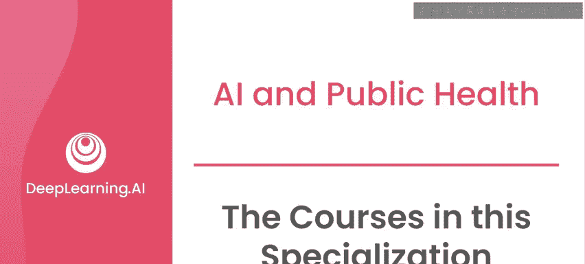
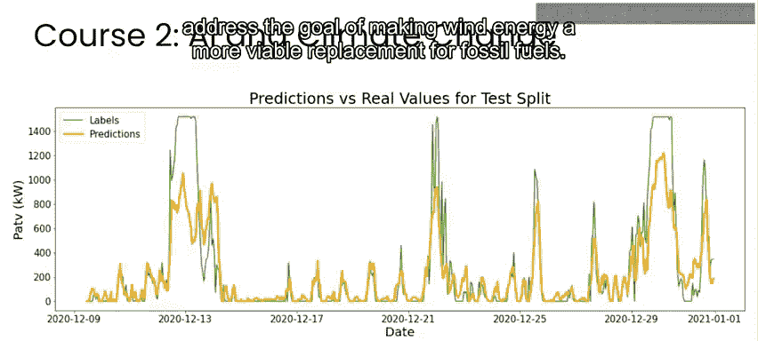

# 吴恩达《AI for Good专业课程》 AI与公共卫生、气候变化、灾难管理｜中英字幕 - P3：2_这个专业化中的课程.zh_en - GPT中英字幕课程资源 - BV13u411F7xZ

This specialization includes three courses in this first course as you get familiar with what AI is and how it can be used to address rural problems。

 I'll introduce you to a framework for thinking through AI for good projects and really this is a framework for thinking about any kind of project you're interested in that might involve AI first you'll get a quick overview of the AI for good framework while looking at a case study focused on when I was working in maternal and infant health in Nigeria and you'll get an understanding where AI can be used to help healthcare providers process large volumes of text messages and from their patients。

Next in this course， you'll dive into a project focus on monitoring air pollution levels using sensorens data air quality monitoring sensors have been deployed in cities around the world with a goal of informing citizens as to any public health risks due to air pollution and informing policies that can be enacted to mitigate air quality problems in the lab activities in weeks two and three of this course。

 you'll use AI to improve real-time air quality estimates in Bogota Columbia。

Co two of this specialization focuses on AI and climate change。

 shifting from fossil fuels to renewable sources of energy can help reduce global carbon emissions and one way to accelerate the adoption of renewable sources like wind and solar is to make those energy sources more predictable。

With the first case study in course2， you will use AI to make wind energy forecasts and in doing so address the goal of making wind energy a more viable replacement for fossil fuels。

 Then you'll shift gears to biodiversity monitoring in the context of climate change。

 The preservation of natural ecosystems has been identified as one of the most powerful ways in which we can mitigate climate change and biodiversity can be considered a measure of the health of natural ecosystems。

Teams around the world are using various techniques to monitor biodiversity。

 and in the lab activities， you'll use computer vision techniques to monitor biodiversity with camera trap data from South Africa。

In the third course， you'll be exploring my personal area of expertise。

 which is disaster management and response you'll be using satellite imagery to assess damage after Hurricane Harvey in the United States。

In 2012， I actually employed a similar system in the aftermath of Hurricane Sandy。

 so we'll talk about that as well。 and in the second case study of Co3。

 you'll look at how to manage resource allocation by doing automatic interpretation of text messages collected in the aftermath of the 2010 earthquake in Haiti right after the earthquake people needed help and they use text messages as their primary means of communication。

 The majority of the messages were in Haitian Creole。

 a language that many of the responders didn't speak。

 I'll show you how I organized a team to combine AI with human volunteers to create an automated translation system that helped the responders react quickly and deliver help。

Throughout the courses， we will be featuring a series of project spotlights where you'll have the opportunity to hear from different experts about how they are applying AI to their specific projects。

The next video will be your first project spotlight where you will hear from Charles Unu of Uennowa Health about how he and his team are making it possible to diagnose critical health issues in newborn babies using a cell phone app to listen for telltale signs of illness in the sounds of a baby's cry。

And keep in mind with this and the other project spotlight videos。

 you'll probably hear some technical terms that you don't understand。

 but there's no need to worry the goal of these videos is really just to give you a high level insight into some of the interest projects in the AI for good space and you'll become a lot more familiar with a lot of this terminology throughout these courses。

