# 吴恩达《AI for Good专业课程》 AI与公共卫生、气候变化、灾难管理｜中英字幕 - P40：2_Jupyter Notebook实验室简介.zh_en - GPT中英字幕课程资源 - BV13u411F7xZ

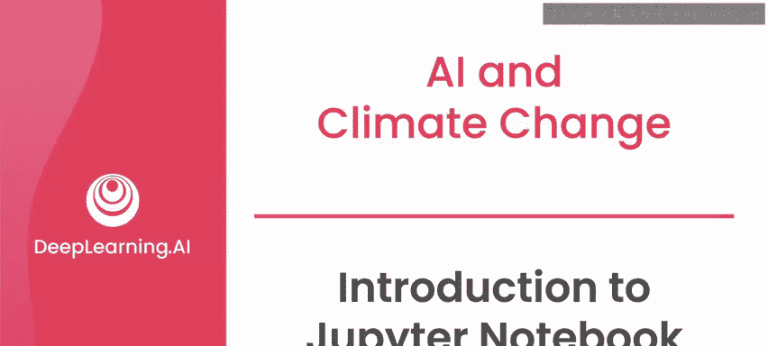

If you already took course one of this specialization。

 then you will already be familiar with the Jupyter notebook lab environments that we've been working on in this video I'll provide a quick overview of how the lab environment works。

 and then we'll jump into exploring global temperature data in the next video if you're already familiar with Jupyter notebooks then feel free to skip ahead to the next video When you clicklaun notebook your lab will open up a new browser tab that will look something like this This is a really popular format for prototyping programming applications known as a Jupyter notebook which is an open source web application that you can use to create and share documents that contain code visualizations and text now on I'll be referring to this environment simply as your notebook。

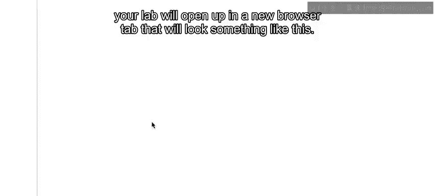

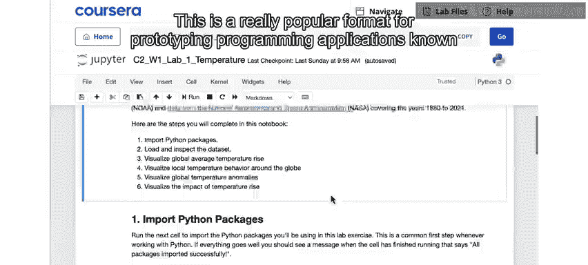

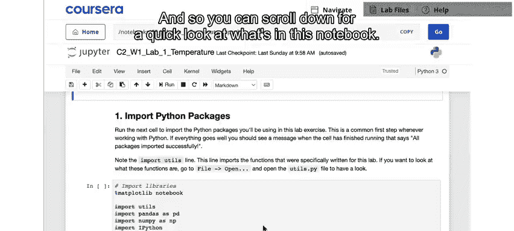

And so you can scroll down for a quick look at what's in this notebook。

 You will notice that there are blocks of text and blocks of code。 and in general。

 the text will include instructions or descriptions of what the code is doing。

 As you run each of the code cells。 you'll see some output from the code。 In general。

 the notebook will be in a folder with some other files like data sets and other code files。

 and you can see what else is in the folder by clicking up here on the Jupyter icon。 So in this case。

 we have a folder with the data in it。

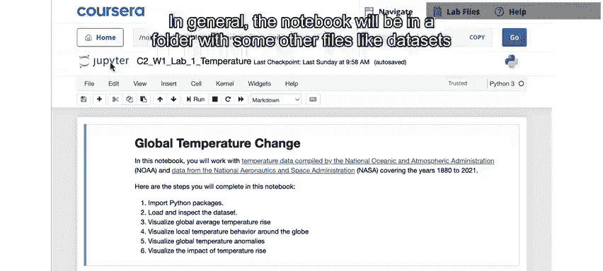

And this file right here， it is now shown as a so called comma separated values or CSv format file This file that ends in I PYNB is the notebook itself that you're just looking at and then in this file called uils。

 Pi we'll put some of the code you'll be using in this notebook。

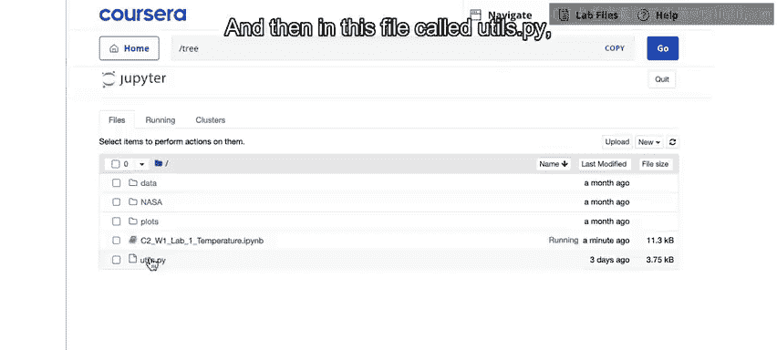

But you don't need to worry about what's in the code here。

 I just wanted to show you because it's a functionality that we put behind the scenes so as not to clutter up your actual notebook。

 Now， I can click on the Jupyter icon and then this notebook file。

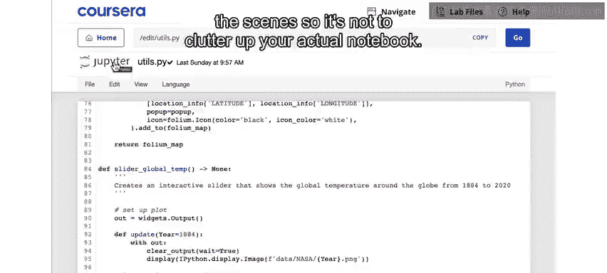

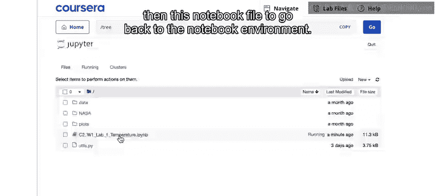

To go back to the notebook environment。The way these notebooks work is that you need to start at the top and run each of the code cells sequentially。

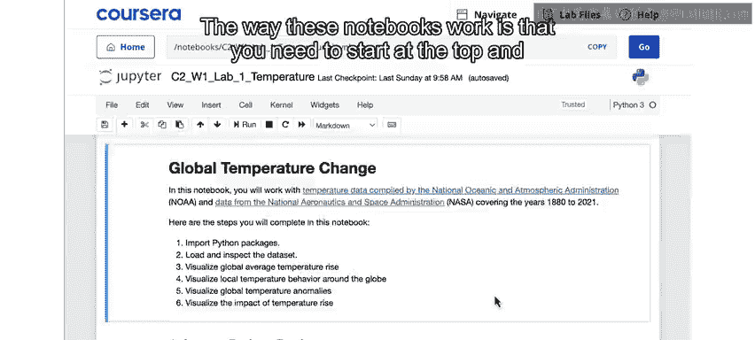

Each of the subsequent code cells will be able to build on the actions you took in the previous cells。

 So if you're familiar with programming， but not notebooks。

 you can think of this as a step function pausing through your application rather than not running all in one go。

 the way to run a code cell。Is to first select that cell and then press the run button here at the top。

You can also press the shift and enter keys together as a keyboard shortcut to run the code cell。

 so I'll go ahead and run this first code cell at the top of the notebook。

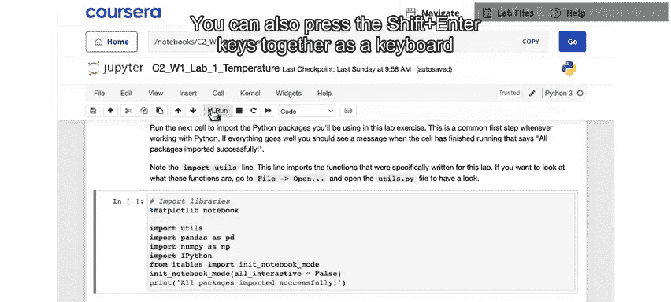

And what this cell is doing now is just importing a bunch of Python packages that we'll need for this lab。

 and this is a common first step when running Python programs in a Jupyter notebook。

 the first step is importing the various packages that you'll need。

And you can see we're also importing that Us file that you saw just a minute ago to be able to use the functions in that file as well。

 like I said that code could have been in this notebook。

 but it's not something we're looking at or changing here。

 so it's just for convenience that we've put it into a different file。

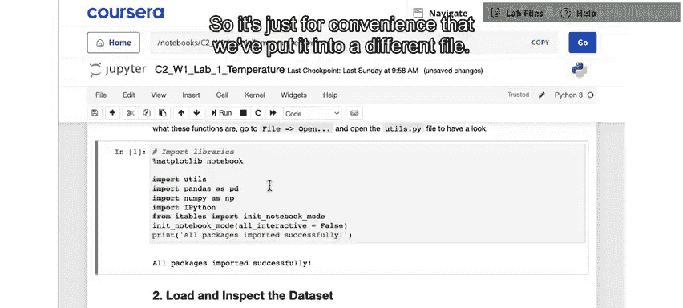

Now it's possible that while clicking around in here and running the code。

 you inadvertently introduce a tyypo into the code。

 like even something as simple as adding an additional space。

 which is something that Python is very sensitive to。

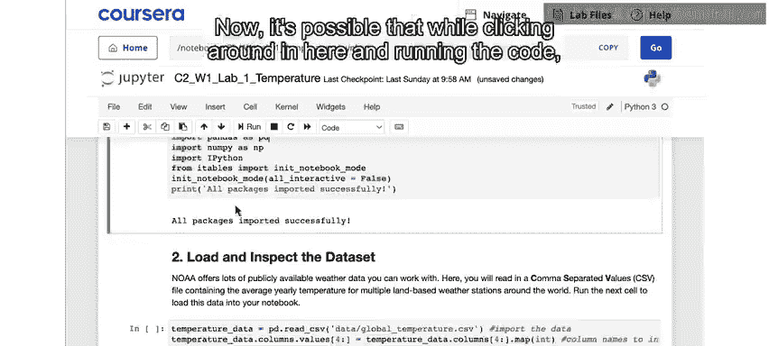

Then when you try to run the cell， you'll get an error like this。

When Python throws an error like this， it'll try to give you an idea of what went wrong in this case and in this case correctly saying it's an indentation error。

 that's what the additional space has done， but if you're not familiar with Python。

 these error messages might look a little bit confusing。So if you do see an error at some point。

 don't worry， that's totally fine and it probably just means that there's a typo somewhere in the code cell。

You can try to figure out why the errors is occurring and correct it。

 or if you can't figure it out and get stuck， you can just reset the lab and stop over to reset the lab。

 you do that by going up here to the help menu and choose get latest version that will return you to the last。

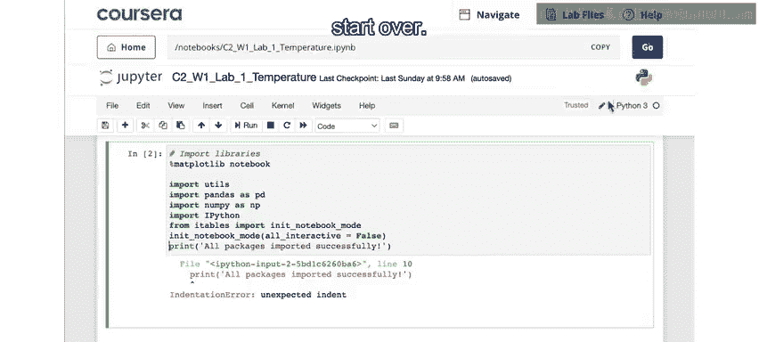

Fresh version of the lab。If there was in fact a new version of the lab。

 you'd be able to update to that new version here， but you can also just use this functionality to refresh your lab and get a new fresh copy that should allow you to clear any errors they might have introduced while editing the code and that's about all you need to know to be successful in working through the labs in this course please join me in the next video to jump into exploring the data。

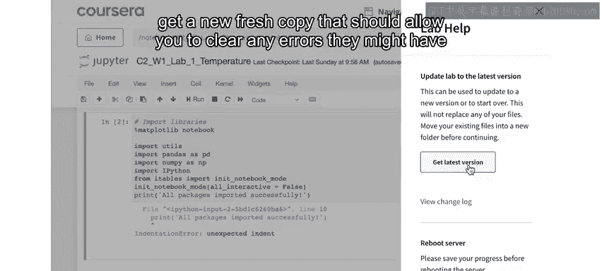