# 吴恩达《AI for Good专业课程》 AI与公共卫生、气候变化、灾难管理｜中英字幕 - P41：3_全球气温变化.zh_en - GPT中英字幕课程资源 - BV13u411F7xZ

Now it's time to explore the data of global temperature change In this lab。

 you'll get a chance to directly explore actual temperature measurements which have been recorded at hundreds of locations around the globe since the late 19th century。

 This lab is not part of a case study like the labs you saw if you took the first course of the specialization。

 Instead we put this lab together G so you could get a bit more of a handson experience with global temperature change and explore this phenomenon more deeply。

😊。

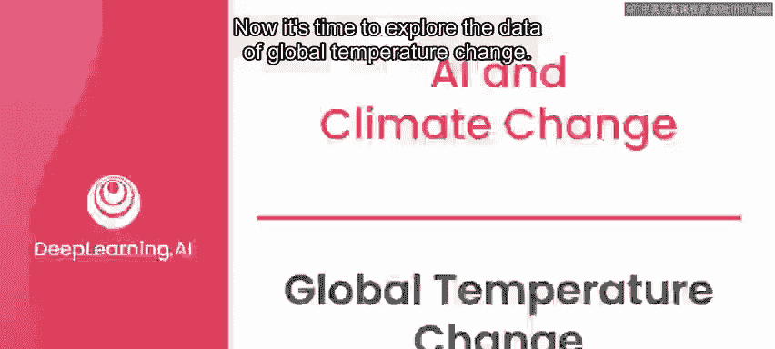

Here at the top， you can find a link to where the data was downloaded from that we're using for this lab。

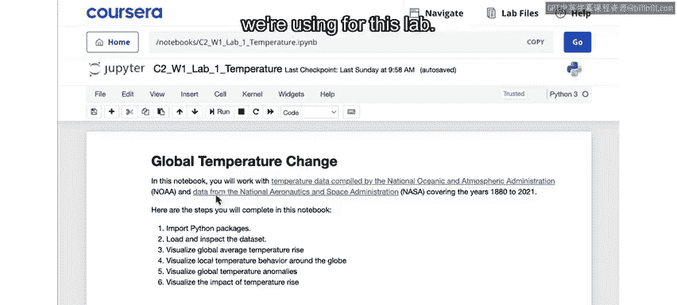

Before we get started， I just wanted to point out that if you are a Python programmer。

 you might be interested in checking out the U file that you can find by clicking on the Jupipyter icon here。

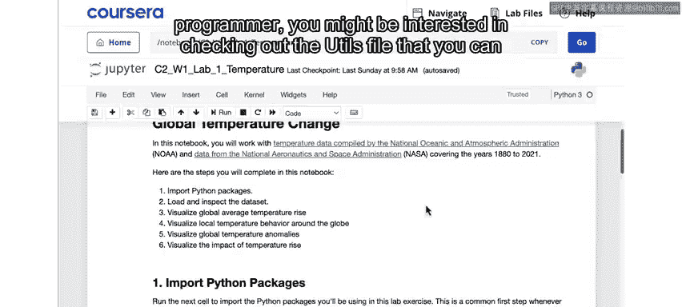

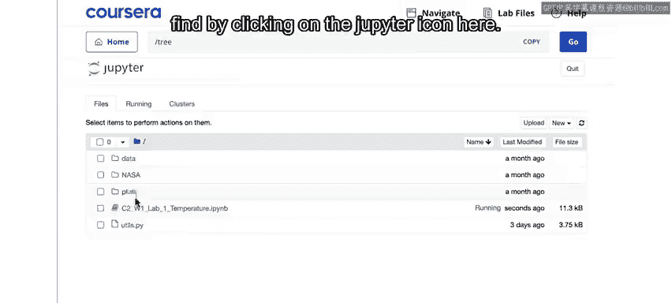

This is a file where we've written some of the functions that you'll be using in the lab Each lab you'll see in this course has usuals file like this。

 where we'll put some of the code to avoid cluttering up the notebook。

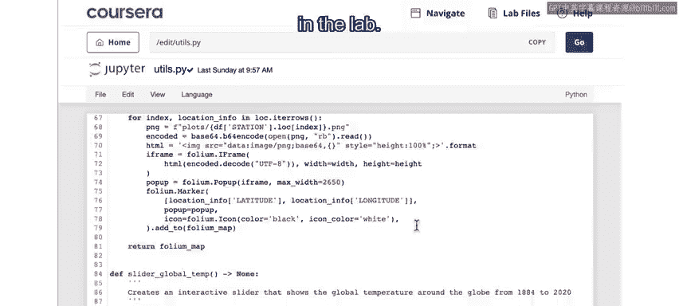

In general， you don't need to worry about what's in here， but if you're curious， by all means。

 take a look and see how some of the visualizations or modeling steps are carried out。

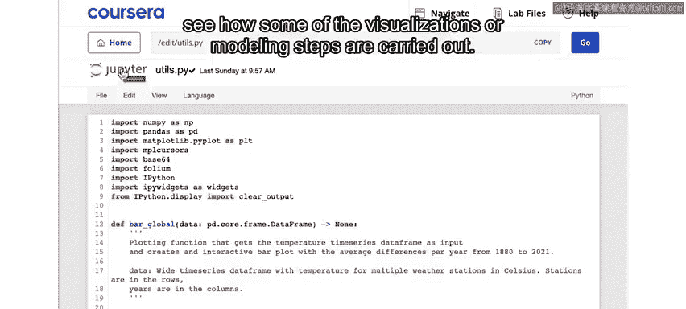

And similarly， you should also see a data sheet describing the specific data， its provenance。

 its encoded methods that we're using for this lab。

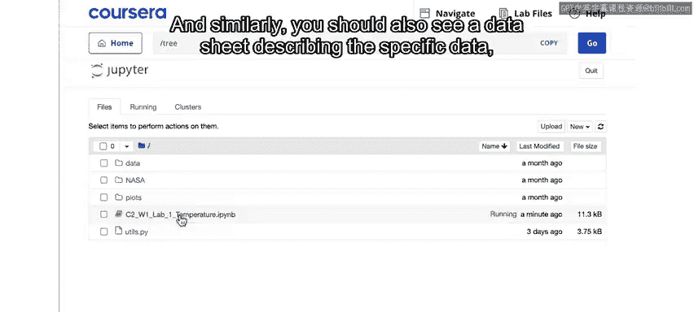

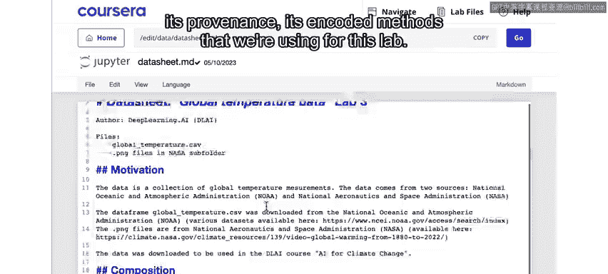

As always， you can navigate back to the notebook that we're working in by clicking on the Jupyter icon and then on the notebook file name here。

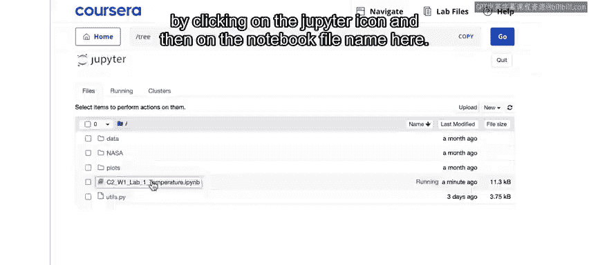

Once you're back here， you can run this first cell and you'll see this little print out of all packages imported successfully if everything goes well。

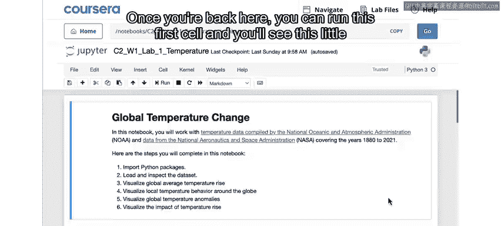

With this Excel cell， you'll read in the global temperature data and print out the last few lines of the data set to verify that everything was read in OK。

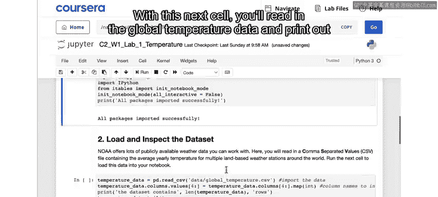

When you've read in the data， you can spot check here and see that it contains a list of station IDs and station locations。

😊，And then you have the latitude and longitude of each station and the average temperature in degree Celsius at that location for each of the years listed up here。

The years run from 1880 to 2021， so you have around 140 years worth of temperature data for 790 four stations around the world。

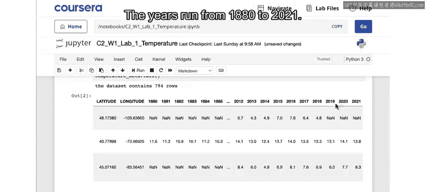

What dataset you're looking at it' always good to think about what the biases might be。

 like in this case what might have changed over the past 140 years when it comes to temperature measurements around the globe take some time to think about what the biases might have been and what data cannot get measured is's a little quiz where you can think about what might impact which measurements were actually taken whatever data you're looking at it's good to think about what the biases might be in data collection so in this case what might have changed over the past 140 years when it comes to measuring temperature around the globe has our ability to measure temperature got more accurate。

 other distributions about where measurements were taken and how might the location of different measurements be biased by what happened to have been wealthier societies at different points in history。

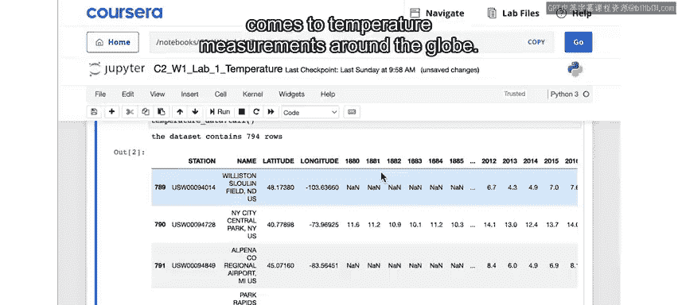

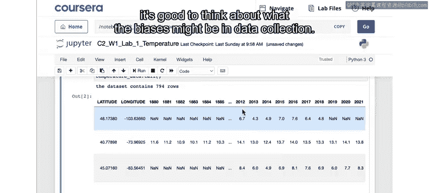

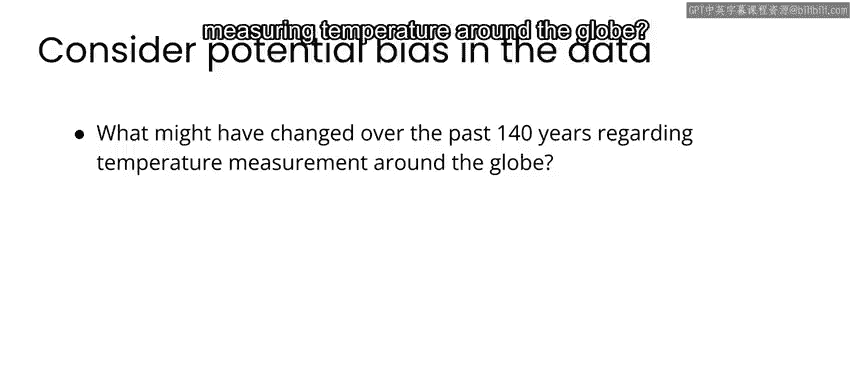

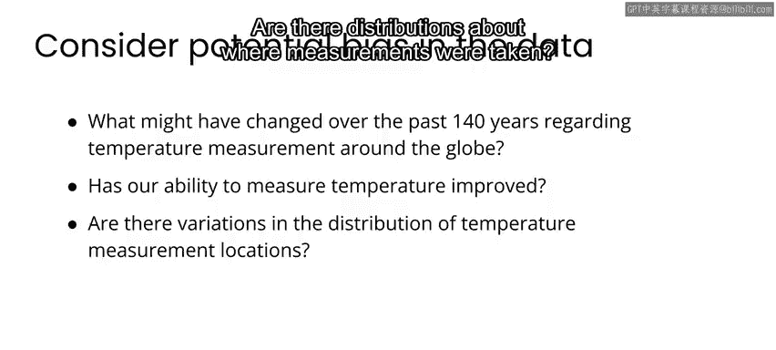

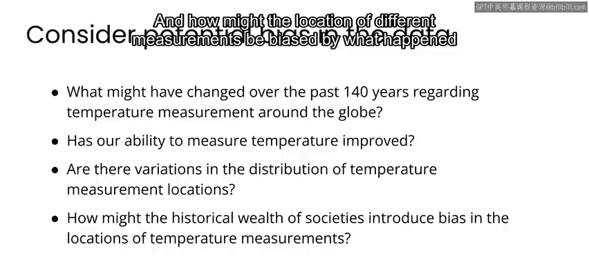

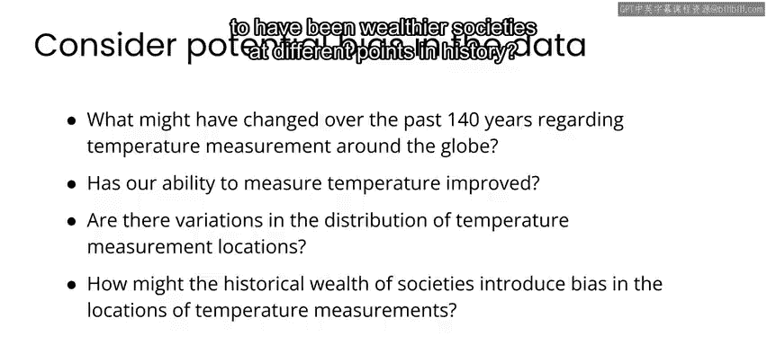

You'll see in many cases that this Nn or not a number listed here。Instead of the temperature。

 which just means that there's no recorded data for that location in that year。

And course part of the specialization， you saw air pollution sensor measurement data that also had missing values and in some senses are similar。

Now you have temperature sensors instead of air pollution sensors。

 and sometimes there's not recorded data either because the sensor did not yet exist in that location or the sensor was offline for some reason。

So you don't have temperature measurements for all years in all locations。

 but we restricted this data set to only include locations where there were at least 90 years of data from the time range this choice of threshold to include only stations with 90 years or more of data was arbitrary。

 you could choose to look at more station locations using a lower threshold or if you stations but with a higher completeness in the data using a higher threshold here we chose 90 years or more to include only stations where at least about two-tds of the years on record had a valid temperature and I encourage you to play around and see if there are any location biases in the stations that do happen to have a longer history of temperature recordings。

With this exc cell you'll plot the global average temperature from all the stations in this data set combined。

 and the detail in the text here is that in general。

 when you hear people talking about global average temperature rises of 1 degrees or2 degrees。

 they are talking about a rise relative to a baseline calculated for the preindustrial period between 1850 and 1900。

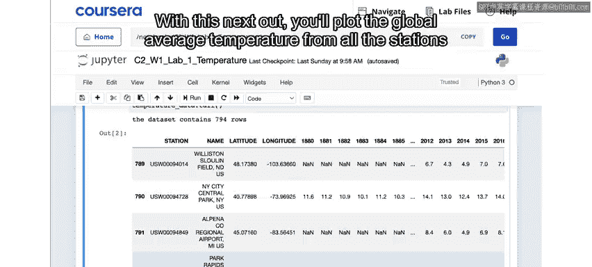

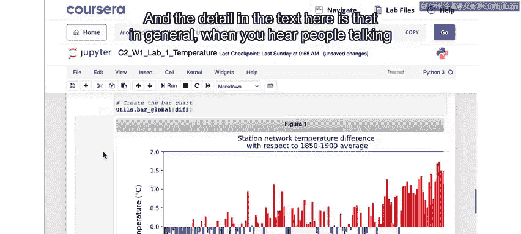

Now， in reality， the data for that time range before the 20th century around the globe is spae。

And so the way this baseline is calculated in practice is to take an average of modern values from 1981 to 2010 and subtract 0。

69 degrees Celsius， which has been established as the conversion factor between those recent decades and the preindustrial period。

You can check out the reference in the link here to see more about how that conversion was established。

And so that's what you're doing here as well， taking an average from 1981 to 2010 and subtracting a constant 0。

69 and then subtracting the resultant value from the average for each individual year to get this plot where each bar is a bit above or below the zero point。

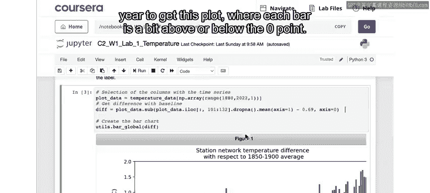

And so zero here represents the pre industrialstr baseline。

 and these red and blue bars indicate average annual temperatures that will higher or lower than that baseline for a particular year。

And you can click on those bars to see a little bit more detail about each measurement。

Similar to what you saw in the last video， temperature is on the rise here， however。

 it looks like temperatures have increased around 1。

5 degrees on average from the baseline as opposed to the roughly one degree rise you saw in the previous video。

This is because all the temperature measurements in this data set are from land tobased measurement stations and indeed the average temperature over land has increased more than the global average。

 and so that's what you're seeing in here。

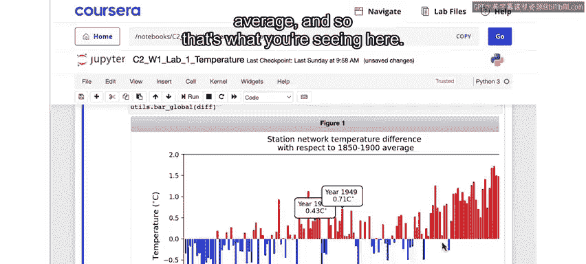

When you run this next cell， you'll create a map representation of the data where you can zoom in to see the locations of the temperature sensors that you're using。

 and you can click on any sensor of location to see the average temperature at that location over time。

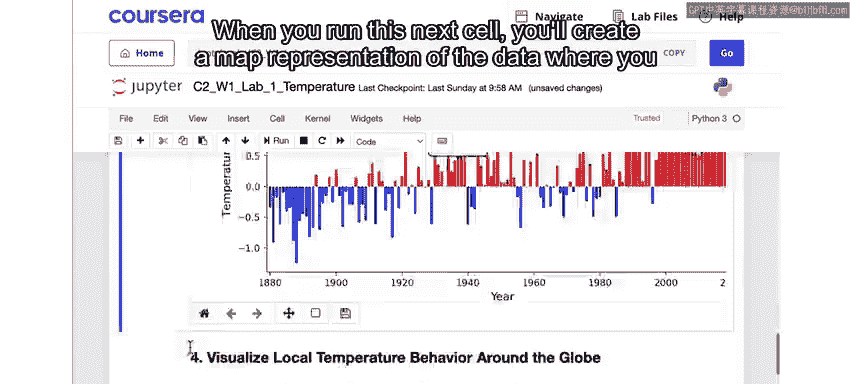

Note that you're now looking at a different scale on the vertical axis。Here。

 each plot is set to zero based on the average at that station location across the whole data set。

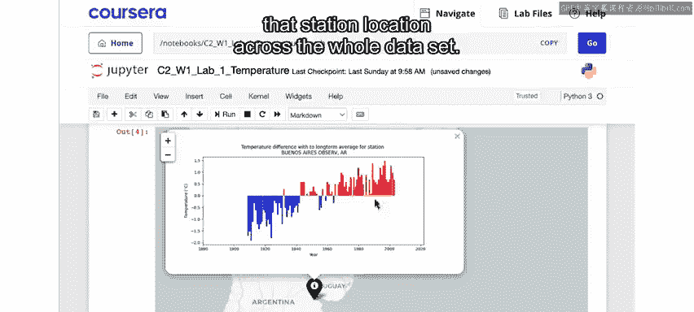

The thing to pay attention to is the large scale trend。

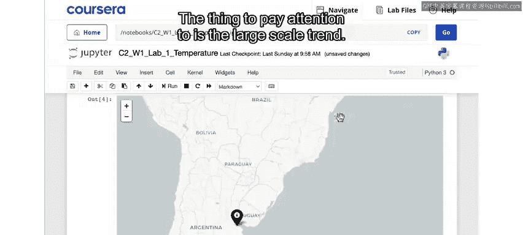

What you'll find is that in many cases， the temperature is rising over time。But in some cases。

 it looks flat。And in a handful of cases， it's even going down a little bit。

 this is reflecting the fact that temperature evolution is not uniform over the surface of the Earth。

So have a look around at how temperature is changing in different locations around the globe。

When you run this next cell， you'll create a visualization of the data that NASA put together of temperature evolution over the past 140 years or so across the whole surface of the Earth。

And so you can use this slider to move back and forth across the years and see how temperature has changed over time around the globe。

And finally， here at the bottom， you can run each of these cells to look at images of the long term effects of global warming in uncertain certain areas。

You can use this slide， for example， to compare the effect of ice melting into a global warm。

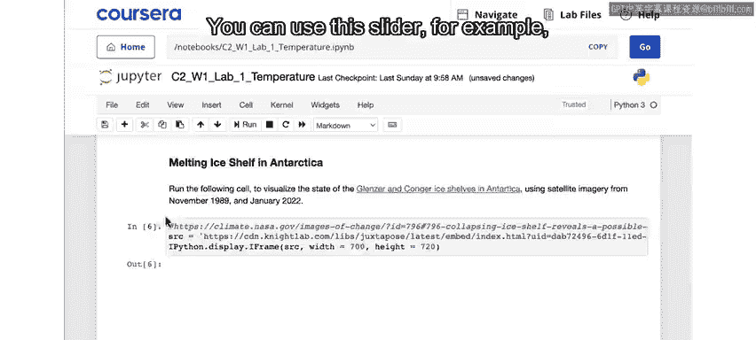

So this first one is showing the Glenier Con ice shelf in Antarctica between November 1989 and January 2022。

This next one is shown origin in Tibet where glaciers are melting。

 in this case it's between October 1987 and October 2021。

And this last one shows the Grand Pau gllaciier in Alaska from September 1984 to September 2019。

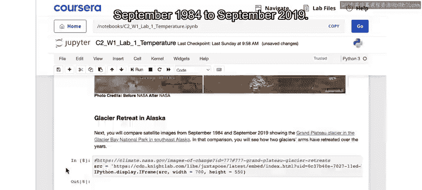

And that's it for this week's lab， I hope you appreciated the opportunity to explore the global temperature data next up we'll look more at the effects of climate change and what can be done about it and how AI might be able to help。

