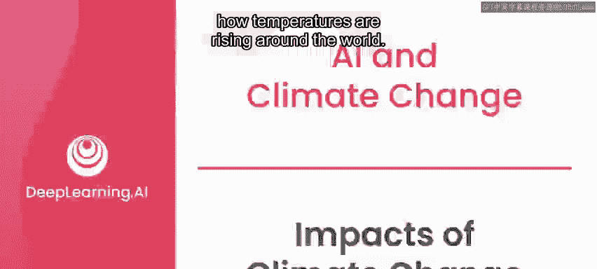
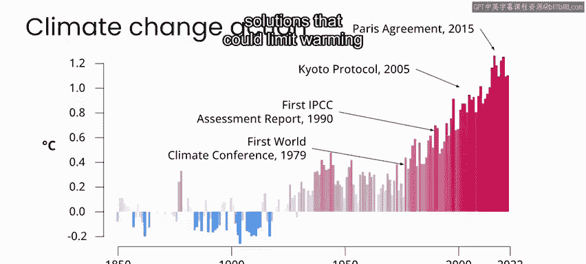
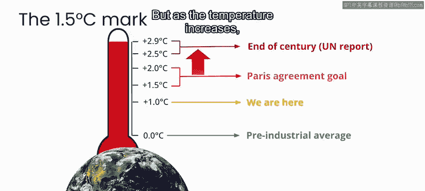
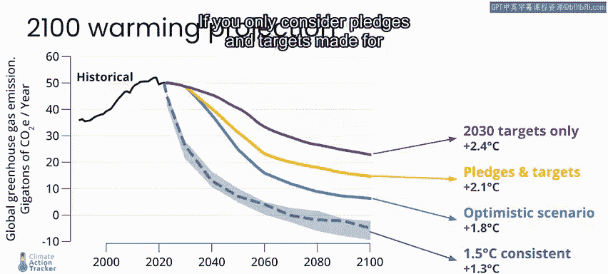
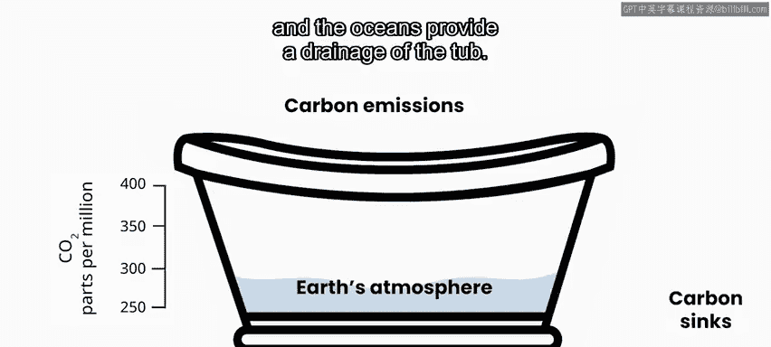
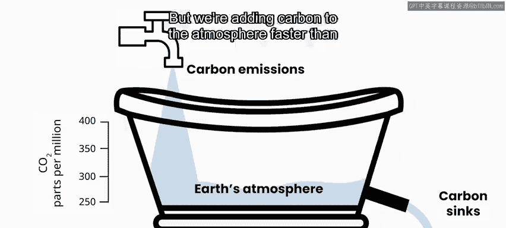
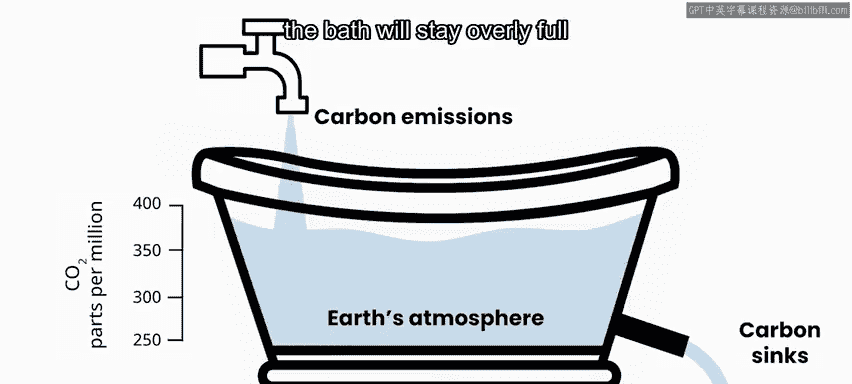
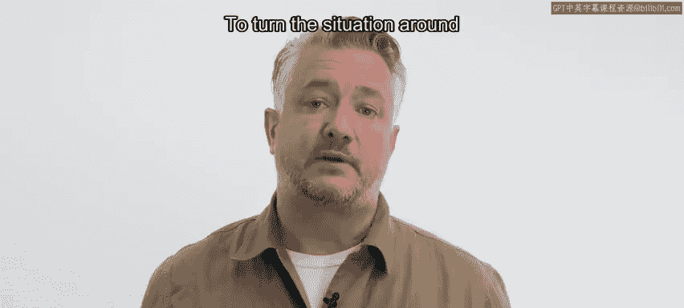
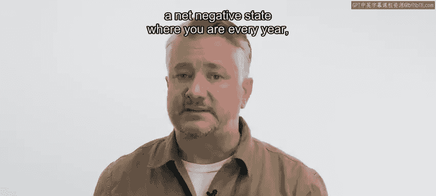
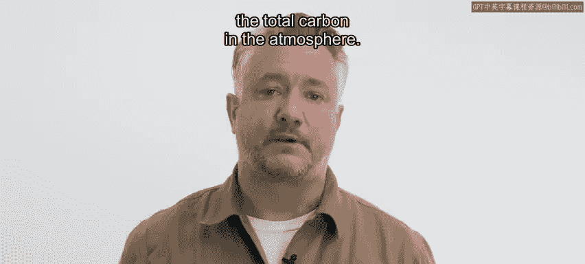

# 吴恩达《AI for Good专业课程》 AI与公共卫生、气候变化、灾难管理｜中英字幕 - P42：4_气候变化的影响.zh_en - GPT中英字幕课程资源 - BV13u411F7xZ

In the previous lab， you explored how temperatures are rising around the world。

 saw that temperatures are generally increasing more over land than over the oceans and that temperatures are rising faster in the far north than they are anywhere else on the planet。

 There are a lot of resources out there to learn more about the impacts of increasing global temperatures and we include some of these in the resources section at the end of this week。

😊。

Like we saw， with just 1 degree Celsius of global temperature rise to date。

 the impacts of global warming are already manifesting in a dramatic way around the world。

 by sheets and glaciers of melting， causing sea levels to rise and threatening coastal communities and in some areas。

 making entire islands uninhabitable。😊，Excessive heat and drought are causing wildfires that are larger and more frequent than in the past。

 and heat waves are causing more deaths and facilitating the spread of disease with more heat energy in the atmosphere。

 extreme weather events have become more frequent and more severe。

 with powerful hurricanes causing more damage， and floods becoming more intense。😊。

In Pakistan in 2022， for example， extreme floods attributed to climate change displaced millions of people for months。

As oceans get warmer， many coral reefs are dying， leading to extreme biodiversity loss in underseaat ecosystems。

So climate change is already causing many problems around the world。

 and people started paying attention to the rising trends in temperature decades ago。In fact。

 the First World Climate Conference happened in 1979 and in 1990。

 the first report of the Intergovernmental Panel on Climate Change or APCC was issued。In 2005。

 in Kyoto， and in 2015， in Paris， countries from all over the world came together and made pledges to reduce greenhouse gases and combat climate change。

With the Paris Agreement， countries agreed to aim for a goal of limiting the global warming to less than two degrees Celsius and to work towards solutions that could limit warming to just 1。

5 degrees Celsius。

As you have seen， we're now at a point of roughly one degree of temperature rise。

 So the Paris agreement represents an aggressive goal of turning the tide on global warming and stopping current trends to keep the overall warming in the 1。

5 to 2 degree range In a recent report published by the Un N。 however。

 with current trends or reach 2。5 degrees or more of an increase in temperature by the end of this century and the impacts on humans and natural ecosystems will be catastrophic。

For a picture of how various scenarios look like going forward from today in terms of a reduction of greenhouse gases versus temperature increases。

 you can first plot out how greenhouse gases have been increasing in recent decades。

And so here on the vertical axis， you have a measure of what's known as CO2 equivalent。

 or in other words， combining all greenhouse gases into an equivalent measure of CO2 added to the atmosphere in units of gigatats per year。

And you can see that for the past few decades， greenhouse gas emissions have been on a steady rise。

This little drop you see here is actually due to the COVID 19 pandemic。

 but now that things are returning to normal， we're increasing emissions once again。

A group called Climate Action Tracker has put together a way of visualizing different future scenarios in terms of total greenhouse gas emissions。

In order to reach the goal of keeping warming to 1。5 degrees Celsius。

 this is what the future of greenhouse gas emissions would have to look like。 As you can see。

 this would imply starting now on a steep downward trajectory and cutting emissions by roughly 50% by the year 2030。

By the end of the century， under this scenario would actually be net negative in terms of emissions。

 and that would be accomplished by both reducing emissions and removing greenhouse gases from the atmosphere。

 This will be with protecting forests and planting trees as well as new carbon capture technologies。

 However， this sort of dramatic change in trajectoryduct is clearly pretty unlikely given current trends。

If you consider some optimistic， but perhaps not unrealistic assumptions about how fast we can turn emissions around。

 a scenario for reaching total warming of 1。8 degrees would look like this。

If instead you consider the effect of all the pledges and targets made by various countries in the Paris Agreement。

 you arrive at a scenario that looks like this where totalddle Wo is at 2。1 degrees。

If you only consider pledges and targets made for 2030， what mean would likely be around 2。4 degrees。

And if you extrapolate current trends and policies， you're looking at a total woman of 2。5 to 2。

9 degrees as reported by the UN。You'll be hearing more about reducing emissions or removing carbon from the atmosphere in units of gigatons of CO2 equivalent per year。

 which is what's shown on the vertical axis here， and so number to keep in mind is a reductional removal of 30 gigatons per year by 2030。

 and this is what it would take to be on the most aggressive trajectory shown here towards a rise of just 1。

5 degrees。If through a combination of reduced emissions and carbon removal from the atmosphere。

 we can reach a total reduction of 30 gigatons per year by 2030， on this best case N trajectoryory。

Anything less and we're headed for one of these other futures。

One simple way to think about the situation we're in is to imagine the Earth's atmosphere as a bathtub and that this bathtub is a big reservoir of carbon。

The natural sinks of carbon， like plants and the oceans， provide a drain to the tub。

But where adding carbon to the atmosphere faster than it can drain out like a tappo into the tub。

 such that the level of carbon in the atmosphere is rising over time。

If we can reduce emissions to net zero， meaning carbon is drained out of the atmosphere as fast as it's pouring in。

 that will stop the level of carbon from increasing further。

 but warming will continue due to the overall increase in carbon in the atmosphere。

 or to put it another way though the bath will stay overly full。

 even though water is both going in and going out。

To turn the situation around and cool the earth back down。

 what we'll need is to achieve a net negative state where year over year。

 we're able to actually reduce the total carbon in the atmosphere。 So clearly。

 we are now at a critical point where the actions that we take will have consequences for generations to come。

AndIt might seem obvious what the right choices are are given these circumstances。

 but taking action to reduce greenhouse gas emissions will have very real economic costs for many governments。

 businesses and individuals thus making change hard。

Still many groups around the world are working on solutions to help mitigate or adapt to climate change in many cases AI can be part of those solutions join me in the next video to look at potential actions that can be taken to mitigate and adapt to climate change and where AI might be able to help。

