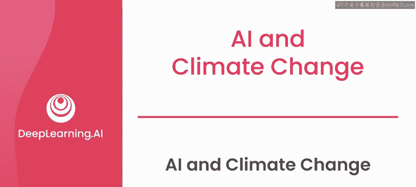
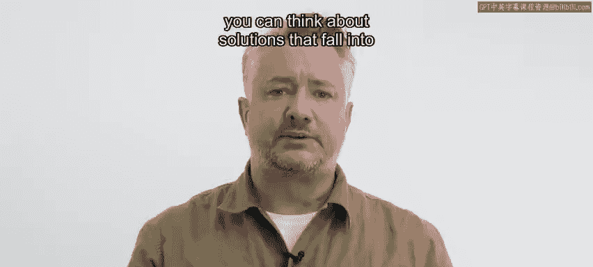
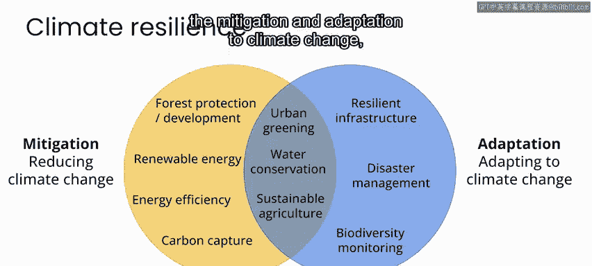
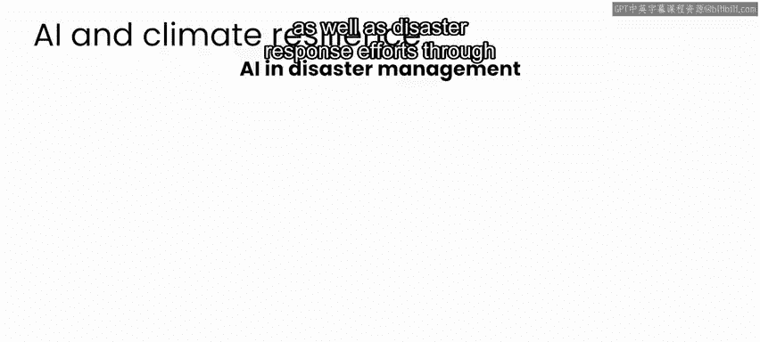
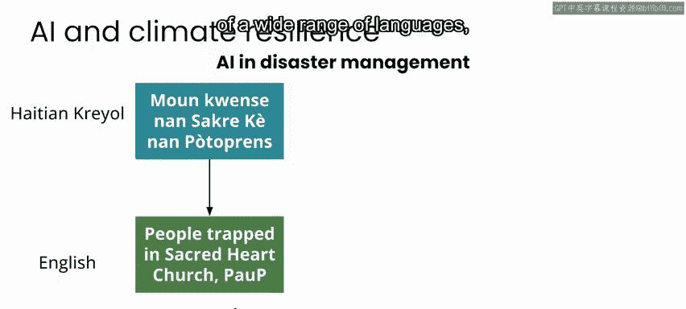
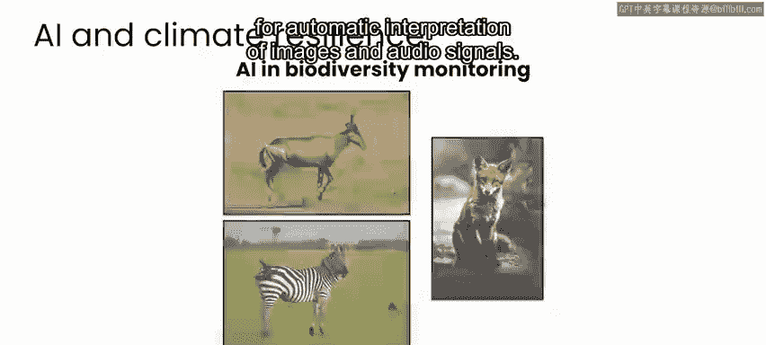
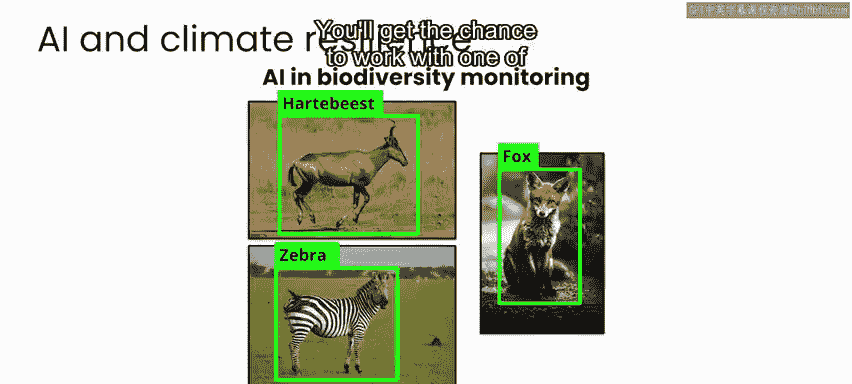
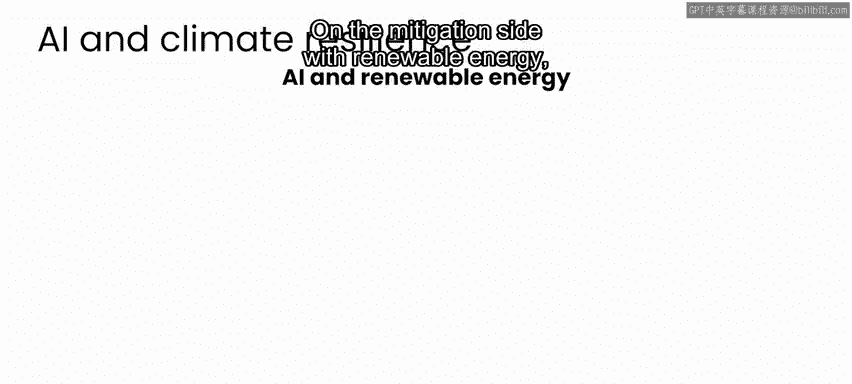
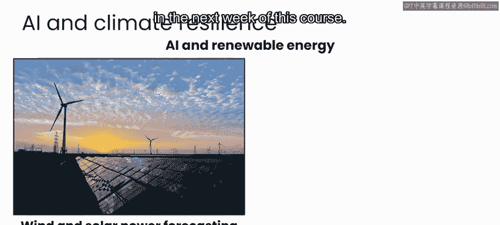

# 吴恩达《AI for Good专业课程》 AI与公共卫生、气候变化、灾难管理｜中英字幕 - P43：5_人工智能与气候变化.zh_en - GPT中英字幕课程资源 - BV13u411F7xZ

The problems presented by global warm and climate change arise at local。

 national and global levels any solutions to these problems are going to be complex and require collaboration across individuals。

 organizations and governments。😊，Similar to the case studies that we presented in the first course of this specialization。

 when it comes to addressing the problems of climate change。

 there are definitely some areas in which AI can help。

 but in pretty much every case it's going to be just one part of a much larger and more complex solution。

So in this video， I'd just like to touch on a few examples of where AI can be part of a solution to climate change。

First of all， when it comes to addressing the problems of climate change。

 you can think about solutions that fall into two broad categories， mitigation and adaptation。

First， those that will help mitigate climate change address the cause of the problem。

 which generally amounts to reducing greenhouse gases in the atmosphere。

 second are solutions that will help us more easily adapt and live with the impacts of climate change。

On the mitigation side， you have things like protecting and replanting forests。

 which is currently our best mechanism for removing greenhouse gases from the atmosphere。

Replacing fossil fuels with renewable energy sources and moving to our energy efficient systems are our best way of reducing greenhouse gas emissions。

😊，And it's possible that new carbon capture technology will also play a role in the future when it comes to removing greenhouse gases from the atmosphere。

On the adaptation side， you have things like building more resilient infrastructure and proactive disaster management that will make it possible to withstand or more easily recover from the floods or fires or storms or disease outbreaks that are driven by or amplified by climate change。

You also have biodiversity monitoring， which is to say monitoring ecosystems such as animal populations or the prevalence of plant species in order to identify trends and inform policies that can help protect those ecosystems from the impact of climate change。

There are a number of potential solutions that have the characteristics of both mitigation and adaptation。

 like urban greening， which refers to adding plants and trees to urban landscapes urban greening helps to cool and clean the air。

 as well as reduce greenhouse gases in the atmosphere。

At this intersection you also have water conservation。

 this helps reduce the impact of water scarcity and protect ecosystems as well as reduce the carbon footprint of water distribution infrastructure。

Another approach is investing in sustainable agriculture。

 which is to say agriculture that uses less land， less water， less energy。

 and is ultimately less impactful on the environment。

Sustainable agriculture helps to reduce the consumption of critical resources and greenhouse gas emissions。

 while in many cases， also adapting agricultural practices to a changing climate。

And this is just a partial list， for more details on the possible approaches to the mitigation of an adaptation to climate change。

 check out some of the resources listed at the end of this week。

When it comes to how AI can help with these solutions。

 there are a range of opportunities on both the mitigation and the adaptation sides of these spectrums。

With disaster management， for example， AI can play a crucial role in early warning systems as well as disaster response efforts through the automatic translation interpretation of a wide range of languages。

 as well as damage assessment and resource allocation through the analysis of images and other data immediately following the disaster。

You'll see examples of both of these applications in the next course of this specialization。

AI has been deployed in a large number of applications on land and at sea for the purposes of biodiversity monitoring through automatic interpretation of images and audio signals。

 and you'll get the chance to work with one of these systems in the second half of this course。

On the mitigation side， with renewable energy， AI can play a crucial role in wind and solar power forecasting。

 making these renewable resources more valuable and more viable as replacements for fossil fuels。

And you'll work on wind power forecasting in the next week of this course。

AI can also help in the planning of new commercial solar installations to be optimally productive and minimally impactful。

These are just a few examples of where AI can play a role as part of a broader solution to mitigate and or adapt to the impacts of climate change In the next video you'll hear from Caleb Robinson。

 who is a researchhe scientist at the Microsoft AI for GoodL。

 working on a project where they use AI computer vision techniques to analyze existing commercial solar power installations to then identify the potential risks and opportunities when it comes to largescale installations of solar power。

