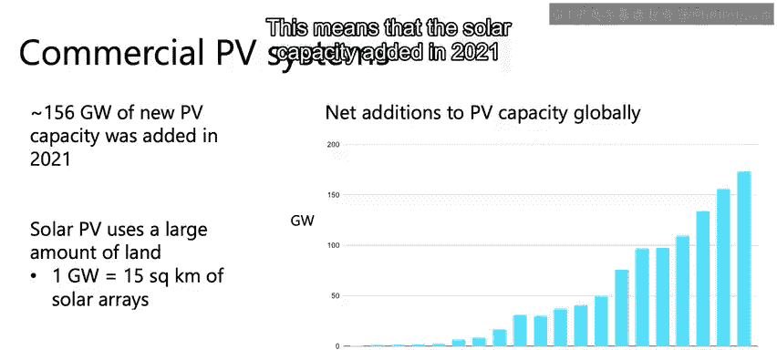
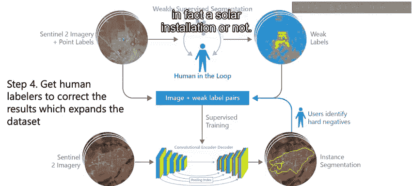
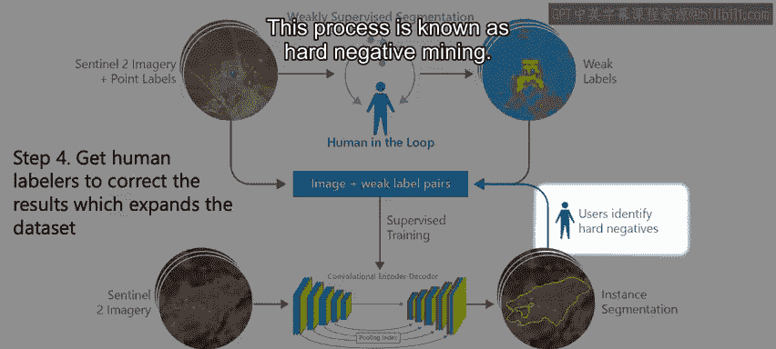
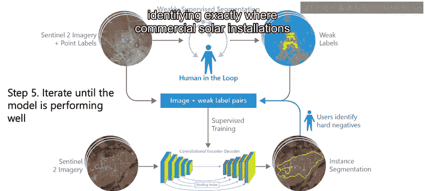
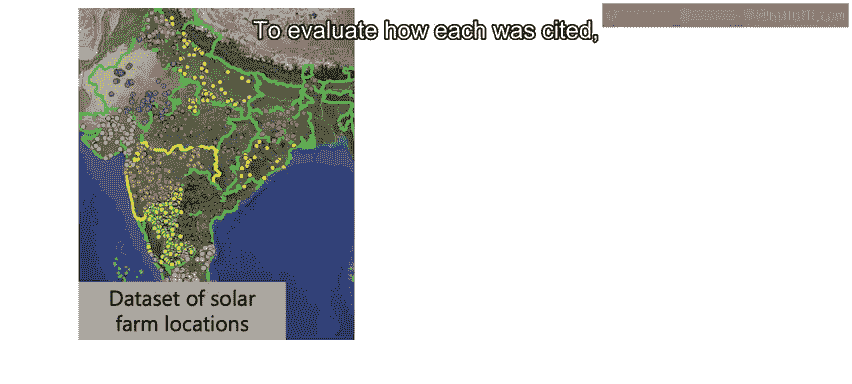

# 吴恩达《AI for Good专业课程》 AI与公共卫生、气候变化、灾难管理｜中英字幕 - P44：6_Caleb Robinson 可再生能源选址.zh_en - GPT中英字幕课程资源 - BV13u411F7xZ

Hi， my name is Kaeb Robinson and I'm a research scientist at Microsoft AI for Good Research Lab。

I'm really excited about the potential impact that machine learning and satellite imagery has for solving impactful problems around the world。

I'd like to tell you about a problem that we worked on where we use deep learning based methods for identifying solar panels in satellite imagery and why this is an important problem to work on。

Merial photovoltaic systems or PV systems for short generate electricity from sunlight。

This type of renewable energy provided around 2% of the world's electricity demand in 2019。

This is a key renewable energy technology for achieving goals in sustainability。

 such as the UN Sustainable Development goal number seven。

 which is increasing the share of energy demand that is met by renewable energy sources。

So the great news is that solar energy is cheap and the rate of solar energy construction is increasing。

According to the International Energy Agency World Energy Outlook。

 Solar PV is now the cheapest source of electricity in history。

 provided you build in an area that receives a lot of sunlight。Because of this。

 solar PV installations are expanding rapidly in 2021。

 around 156 gigawatts of new solar power capacity was built throughout the world。However。

 solar panels take up space， using the stats from India's largest solar plant。

 creating one gigawatt of solar capacity requires roughly 15 square kilometers of land。

This means that the solar capacity added in 2021 alone took roughly 2400 square kilometers of land。

Where these solar systems are being built is important， if they aren't cited correctly。

 this can cause conflict in local communities or damage to existing ecosystems。

And it's really a balancing act on one hand， renewable energy is vitally important to replacing fossil fuels in the mitigation of climate change。

 and on the other hand， needs have to be taken into account， for example。

 replacing cropland with solar PV installations can reduce food security and cutting down trees to make room for solar PV can harm ecosystems and threaten biodiversity。

The first step in understanding this process is determining where each solar panel currently exists and the type of land use or land cover that it replaced when it was built。

This data doesn't currently exist， we currently only know aggregated estimates of solar capacity at a country level。

 not where each individual solar farm is。And this is where satellite imagery and artificial intelligence can help。

We can train machine learning models to identify solar PV installations in satellite imagery。

 then run these models over imagery covering entire countries over time to build data sets of solar PV installations and where they were constructed。

This figure， for example， shows satellite imagery of cropland that was converted to a large solar installation sometime between 2016 and 2020。

Now the question is， how can we train models to accomplish this given that we don't have much data to start with？

In our work， an artificial intelligence data for solar energy locations in India published in Nature scientific data。

 we use a human in the loop approach to do this。Here。

 the first step is to get humans to generate rough labels given a small data set of known solar locations。

Using this， we can create an initial training data where each pixel in the satellite imagery is labeled as solar PV or background。

The third step is to use the existing data set to train a deep learning model。

 then use that model to make predictions over large amounts of satellite imagery。

These predictions won't be great as our initial training set wasn't great。

 but we can engage human labelers again to identify whether each of the model's predictions is。

 in fact a solar installation or not， then add these newly labeled samples back into our data。

This process is known as hard negative mining。

Now， within an expanded data， we can repeat the previous two steps and iterate until our model performs well at identifying exactly where commercial solar installations appear in satellite images。

Using the previous approach， we trained a model and ran it over imagery covering the entire country of India to build a data set of 1363 solar PV farms。

The locations of these are shown in this figure where each colored point represents a solar farm。

To evaluate how each was cited， we combined the data set of solar farm locations with land use data in our analysis we found that over 74% of solar development in India is built on land cover types that have value in terms of natural ecosystem preservation or agriculture。

This data set and insights are crucial inputs into the S right tool built by the Nature Conservancy for India。

Siterite helps policymakers， developers and financial institutions reduce unintended socioecological impacts and associated risks through lower impact sighting of new solar and wind projects。

And finally， we're expanding the effort that we started in India globally with a tool that we're calling the Global Renews Watch check it out at globalrenewswatch。

org。