# 吴恩达《AI for Good专业课程》 AI与公共卫生、气候变化、灾难管理｜中英字幕 - P45：7_第1周总结.zh_en - GPT中英字幕课程资源 - BV13u411F7xZ

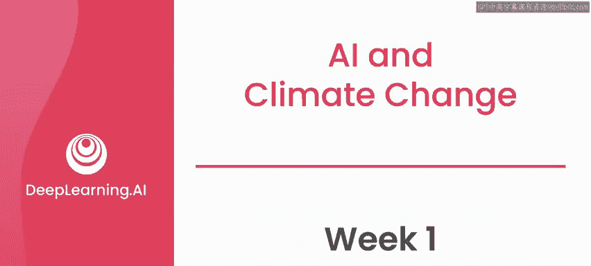

This week has been a brief overview of climate change。

 its impacts and what needs to be done in order to avoid the worst consequences in the future。

 plus we've touched on some of the areas where AI can be part of that solution。

We begin with the fact that climate change is driven by global warming and global warming is driven by increased greenhouse gases in the atmosphere。

And that this increase in greenhouse gases is driven primarily by burning fossil fuels。

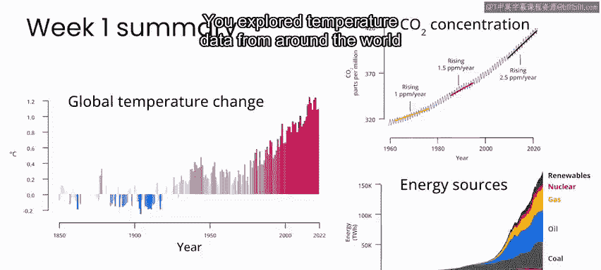

You explore temperature data from around the world to get a clearer sense of how a rising global average temperature looks over time and how it takes on different characteristics in different parts of the world。

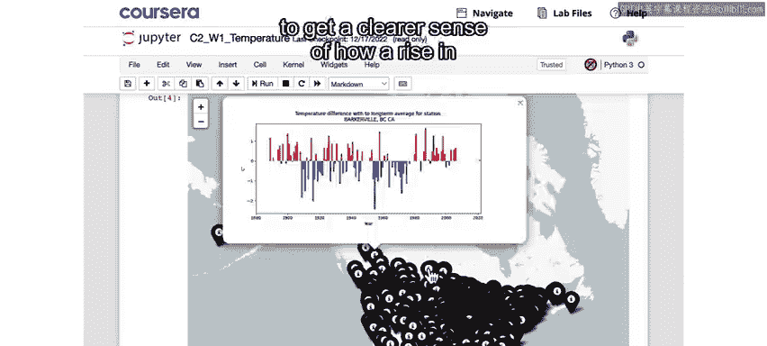

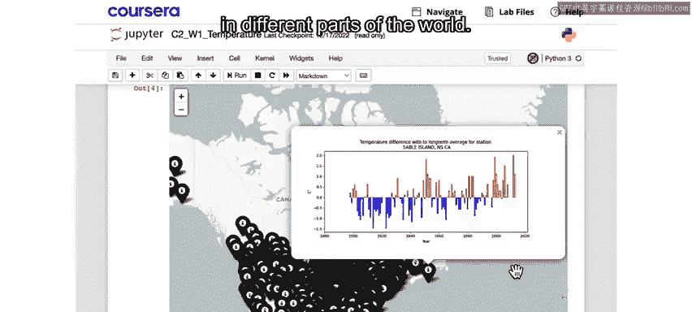

You looked at the impacts of climate change， from floods and droughts to biodiversity loss and the spread of disease。

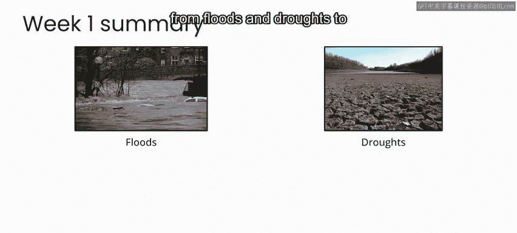

In terms of actions to combat climate change， you saw that in order to limit global warming to 1。

5 degrees Celsius， we will need to see a reduction in emissions and an increase in carbon removal from the atmosphere total in about 30 gigatons of CO2 equivalent per year by 2030。

And we will need to reach net negative emissions before the end of the century。

We identified the categories of mitigation and adaptation and some actions that would fall into either category as well as actions that could be considereded forms of both mitigation and adaptation。

😊。

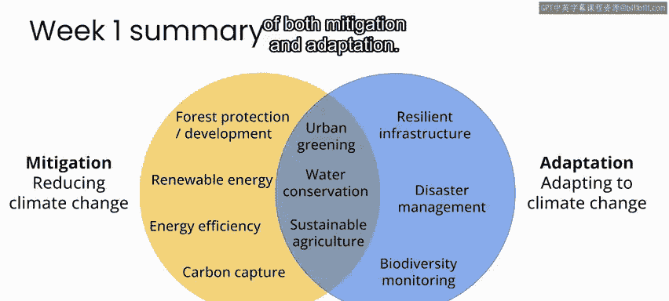

When it comes to how AI can help， I briefly mentioned some examples such as predicting wind energy。

 disaster preparation and response and biodiversity monitoring these are just a few examples of areas where AI could contribute to climate change solutions It's important to keep in mind as you think about potential approaches to the mitigation and adaptation to climate change that even potential solutions can be the source of new problems。

 for example， like you saw in Caleb Robinson's presentation in the last video commercial solar farms which are a potential way to reduce carbon emissions。

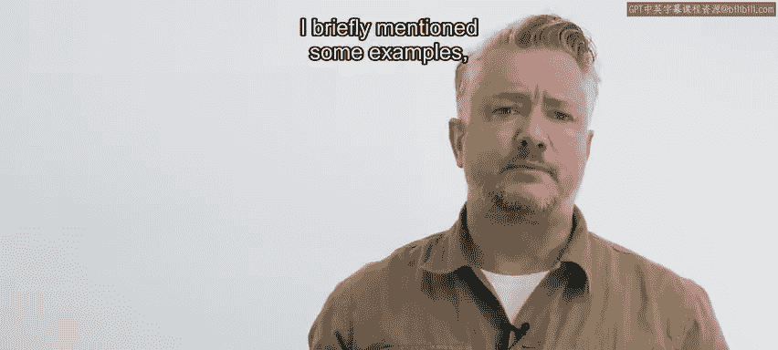

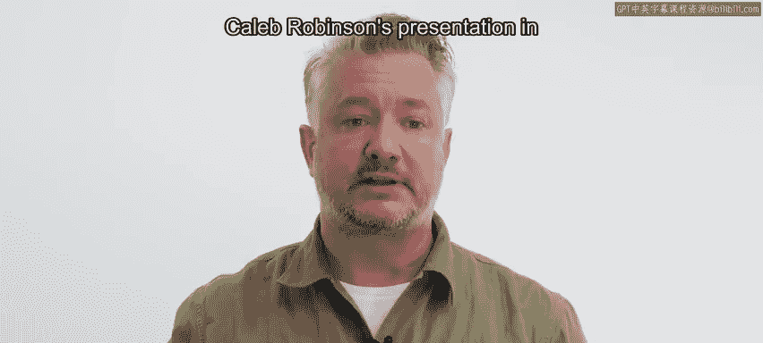

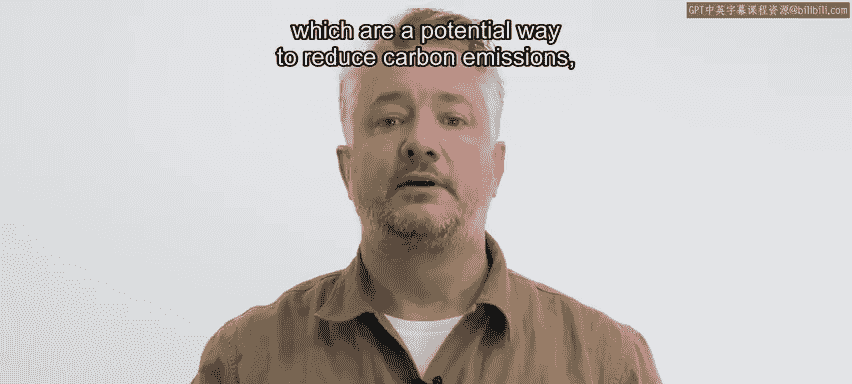

Can also end up being responsible for the destruction of forests and crop lands if the locations of their solar installationss are not carefully considered in this sense。

 you still need to keep the do no harm principle top of mind at all stages of your projects to ensure that you don't end up creating new problems for people or for the environment。

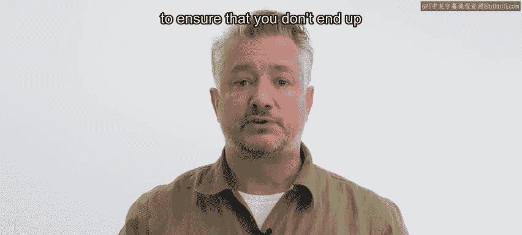

And with that in mind， throughout the rest of this course you'll focus on two case studies。

 one of wind power prediction and another of biodiversity monitoring the techniques you'll work on in these case studies are not unique to these applications but rather can be adapted to many types of solutions so please join me in week two of this course to dive into wind power forecasting。

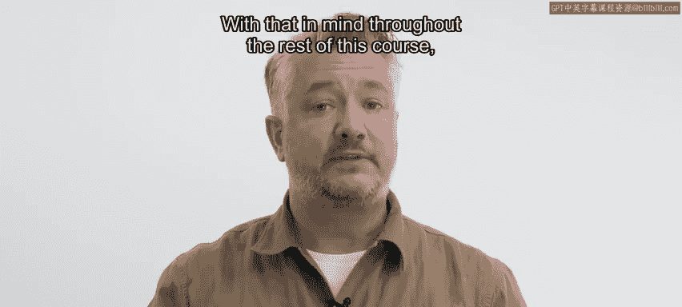

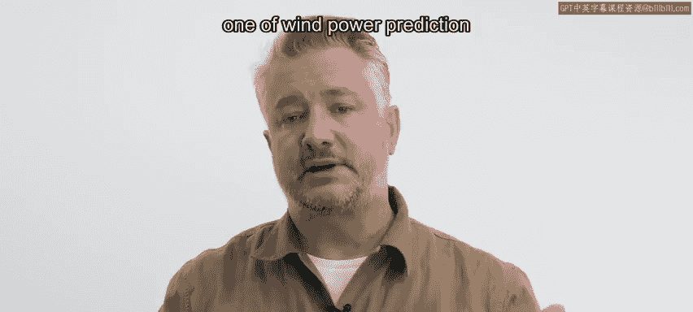