# 吴恩达《AI for Good专业课程》 AI与公共卫生、气候变化、灾难管理｜中英字幕 - P46：8_风力发电简介.zh_en - GPT中英字幕课程资源 - BV13u411F7xZ

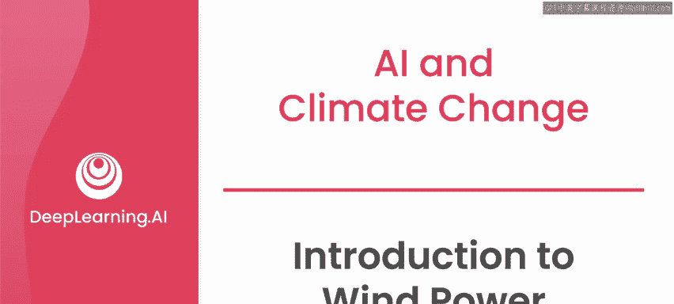

Welcome to week two of this course on AI and climate change This week you'll be working through a case study focused on wind power forecasting。

Wind energy has a tremendous potential as an alternative to fossil fuels。

 but there are some unique challenges to making wind energy a reliable alternative。

 One of the biggest challenges is the simple fact that it's hard to predict how strong the wind will blow tomorrow or even in an hour on top of that。

 even if you new in advance， how strong the wind will blow and it can be complicated to determine exactly how that will then translate into the power output from each individual turbine on a wind farm。

And just a quick aside here before we dive in， you've probably heard me say wind power and wind energy just now in the lessons that follow you'll hear me use the words power and energy in the description of this project in a technical sense。

 these words are not equivalent。Power is the rate at which energy is generated or consumed。

And so the physical units of energy are something calledjoules。

And the units of power are joules per second， which is also commonly known as Wats。

 And so you might hear kilowatts or megawatts when talking about the power that is being generated。

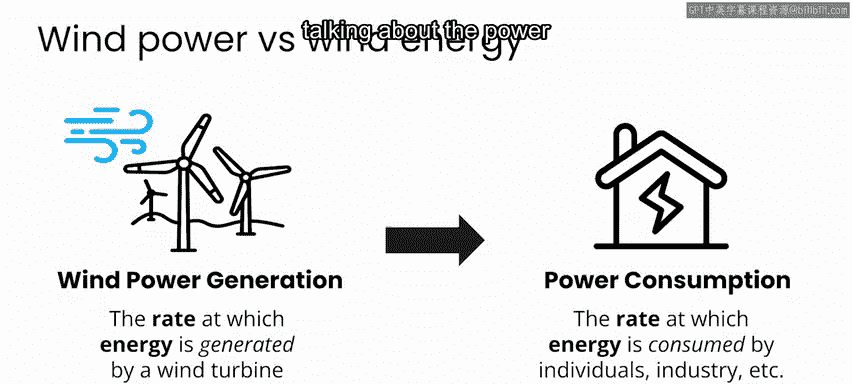

So for a simple example to think through the difference。

 if you have a power source like a wind turbine， you could charge a battery from that power source and that battery could store a certain amount of energy。

Then if you connect that battery to something like a light bulb that operates at a particular power level like 40 watts。

 then your battery will be able to power that light bulb until the battery runs out of energy。

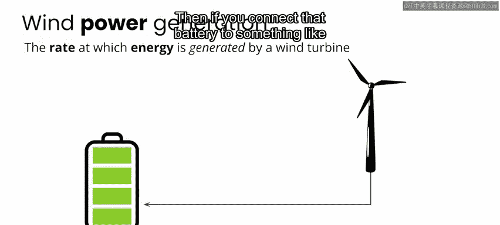

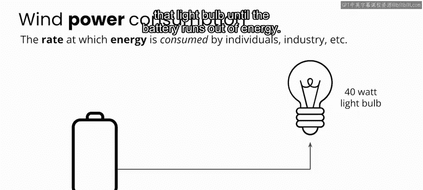

That may sound a little bit confusing， but don't worry。

 the distinction between power and energy is not critical for your work in this week's material。

 but for those of you who are aficionados when it comes to terminology in physical units this week you will be predicting wind power。

 but you might hear me say wind energy when it comes to the bigger picture of replacing fossil fuels with renewable resources。

😊，Predicting how much wind power will be available in the near future。

 like a day or two in advance is crucial to making wind a reliable power source。

 because in order to provide for an uninterrupted power supply to all users on the grid。

 the wind power must be balanced with other sources， including fossil fuels。

 and this will ensure that the supply is sufficient to meet demand at any given moment。

 This requires。

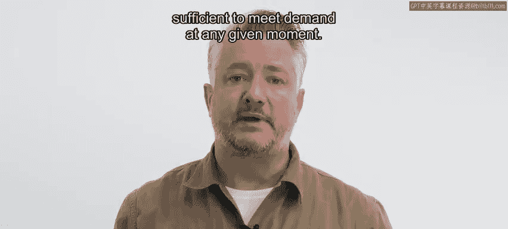

Not only knowing how the wind will behave， but also how that behaviour will be translated into power output。

 Given other meteorological factors and the specific characteristics of each turbine in the wind farm。

In fact， being able to reliably predict wind power is such an exciting potential solution that AI researchers and renewable energy companies around the world have been studying this problem in depth for some time now。

 in one recent example， a group at Google's Deep Mind published a paper demonstrating that using weather forecasts and historical data from wind turbines on the wind farms were able to effectively increase the value of wind energy by about 20%。

 given the increased reliability with which they could forecast power output from the wind farms up to 36 hours in advance。

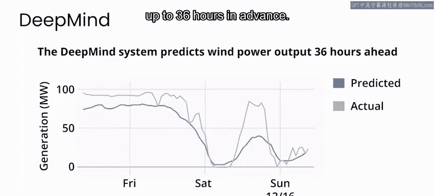

In China in 2022， the Long Yuan Power Group， which is China's largest renewable energy company。

 partnered with Baidu， a large Chinese tech firm to launch a competition where they published a data set that included historical data from a wind farm in China with challenges to individuals in the AI community to use that data to develop a model and predict wind power output and researchers who participated in the original submissions had a chance at winning $35000 in prize money。

 So teams around the world competed in this exciting challenge and in the labs this week。

 you'll be working with that same competition data set to try your hand at predicting wind power。

 In this lesson you'll be exploring the data and considering who the relevant stakeholders are how to form an appropriate problem statement and whether AI looks like it could add value as part of a solution After that。

 you'll design your wind power forecasting solution。

 before we go into more detail about generating wind power we're gonna to have a quick diversion to predicting solar power。

 This is an area that I've worked in in。

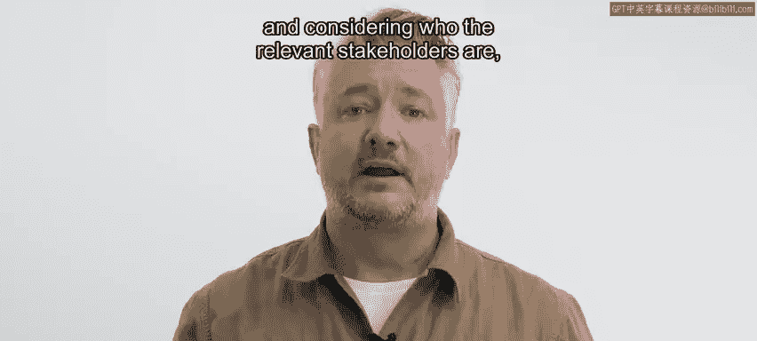

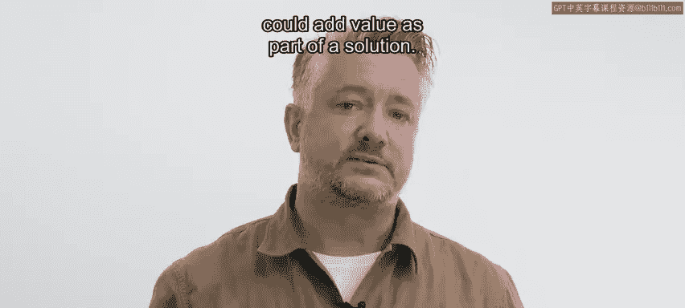

sted in a very manual way so about 20 years ago now I was working for the United Nations and for organizations operating in West Africa in Liberia and in Sierra Leone and we're installing solar power systems predominantly at schools and at health clinics at that time it was really hard for us to predict what the energy consumption might be and so we have to over provisionvis a lot of what we're installing In fact。

 we spent more money on batteries than we did on the solar panels themselves so that we could be sure that with the variable energy input from the solar panels we had enough power generation capacity even if there were。

 for example clouds for many days and it's exciting now that there have been a large number of advances in projecting and predicting what solar and wind energy might be right down to the hour and how that can determine exactly what combination of。

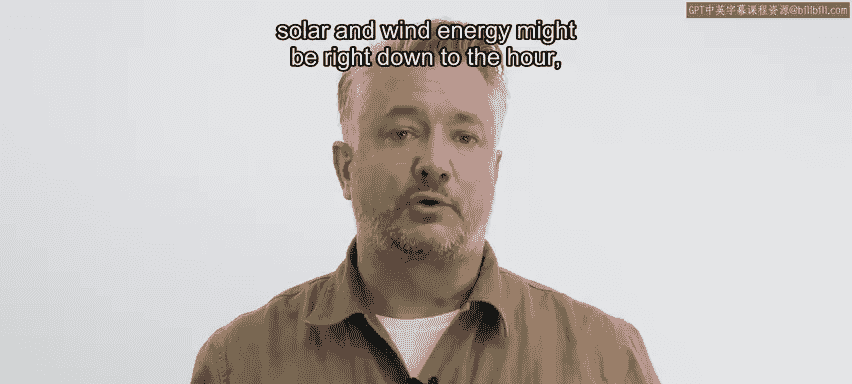

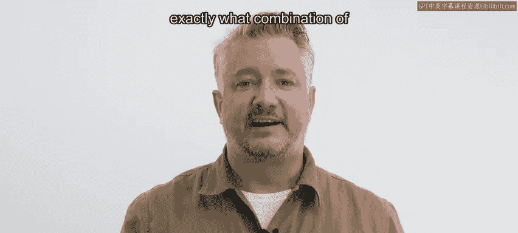

Renewable and fossil fuels might be needed in this next spotlight video Jack Kelly from Open Climate Fix is doing exactly this he will talk about how he and his team approach the problem of forecasting solar power output to make solar energy a more predictable and valuable replacement for fossil fuels。

😊。

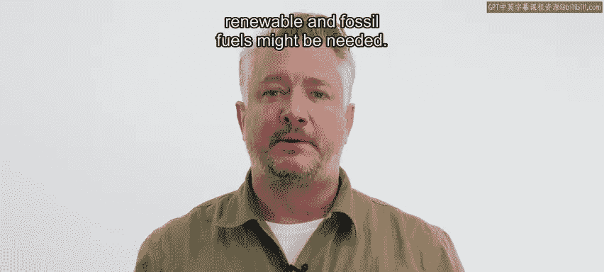

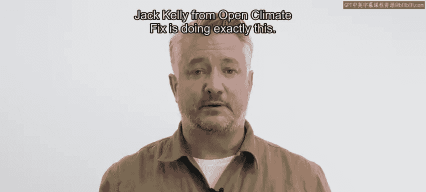

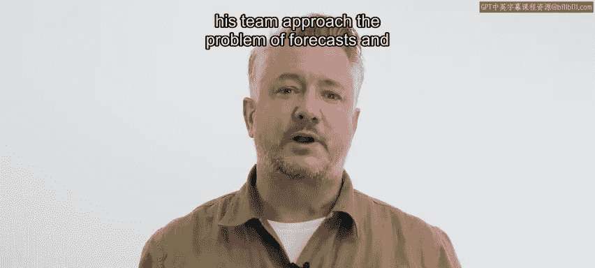

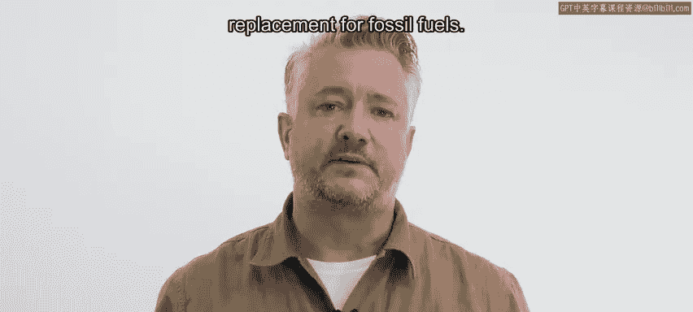