# 吴恩达《AI for Good专业课程》 AI与公共卫生、气候变化、灾难管理｜中英字幕 - P47：9_Jack Kelly使用机器学习预测太阳能.zh_en - GPT中英字幕课程资源 - BV13u411F7xZ

Hello， I'm Jack Kelly， I'm cofounder of Open Climate F。

 and I just want to tell you a little bit about my background and the work we're doing at Open Climate F。

😊，So in general， I say that I'm a machine learning researcher who's terrified by climate change and Kes do something to help that。

So I did a PhD in electricity deaggregation where we try and give people an itemized electricity bill itemized by appliance。

 so you might get an email saying hey。You spent 10 pounds of electricity on your fridge and two pounds on your TV。

And the hope there is that people would act in an economically rational way So after my PhD I did a short postdoc then went to work at Google Deep Mind on forecasting wind power。

 absolutely loved that work and then left Google Deep Mind set up or cofo open Cl fix at the very beginning of 2019。

And one of the main reasons behind open climate fix or one of the main reasons for setting it up and doing it as a nonprofit is because we believe that there are lots of people。

 probably like lots of you watching now who passionately want to help fix climate change。

 but maybe blocks because they don't have access to the right data or don't know exactly which problems to work on。

And so if we can unblock some of those folks， at least， then we can get this sort of。

Fast amount of collective knowledge and intelligence working towards solving these problems。

So at the moment we're working on solar electricity now casting。

 so this is where we are trying to produce a forecast for solar electricity generation over the next few hours Why is that useful Why does anyone care about better electricity forecasts quite a few reasons but the one that we're most focused on at the moment is helping electricity grid operators to do a better job at scheduling what's called dispatchable generation So typically thats large generators powered by natural gas and at the moment whenever there's any solar electricity generation on the system。

 the folks who are scheduling the grids， no full well that at any moment a large black cloud could come along and wipe out a huge amount of electricity generation a gigawatts over a minute or so and the physics of the grid dictate that every moment supply must exactly match demand and we let demand do pretty much whatever it wants。

 there's a bit of modulation， but we let it do pretty much whatever it wants So the task is to try and。

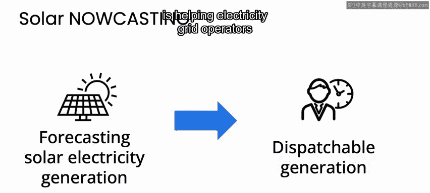

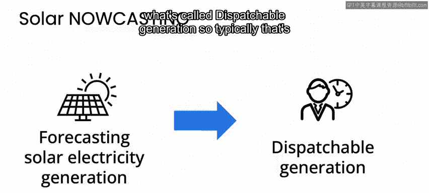

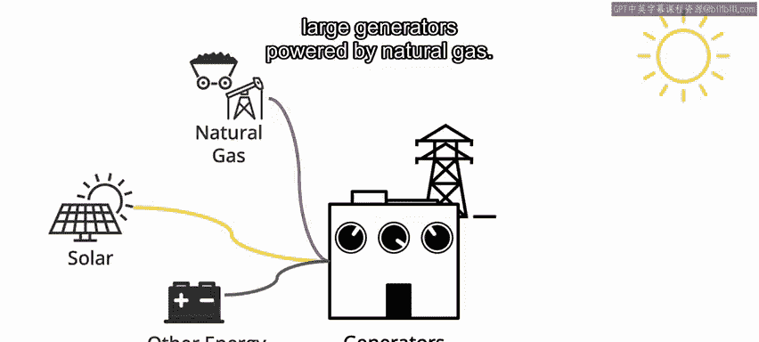

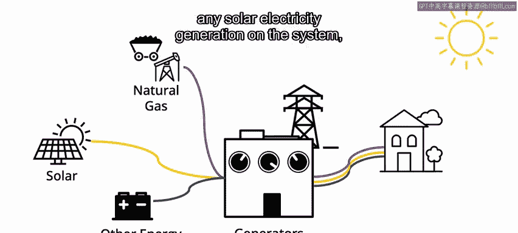

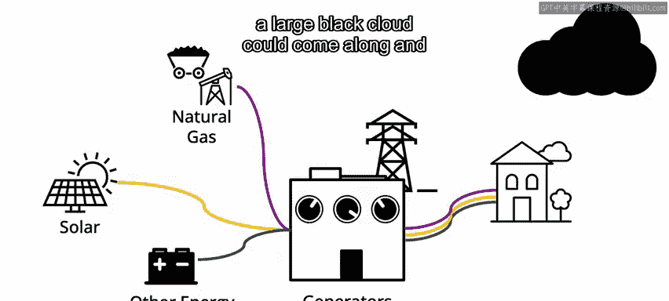

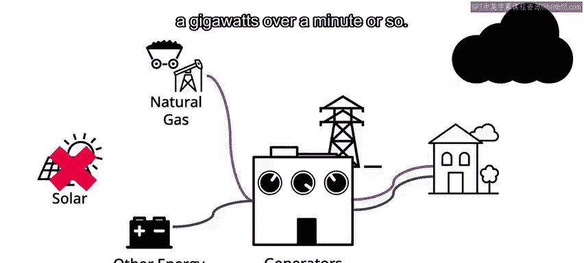

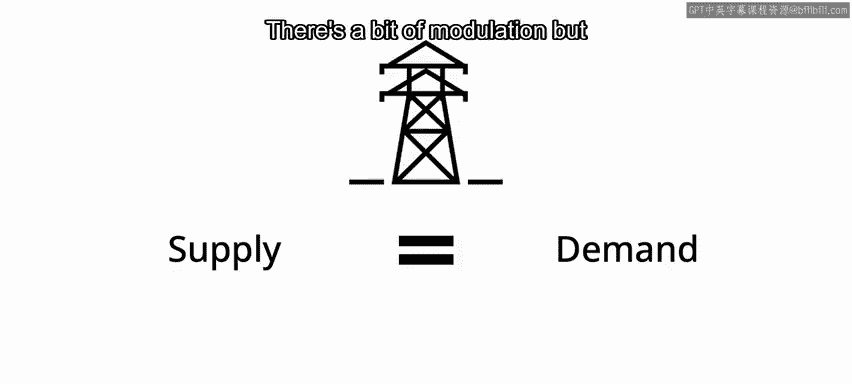

Schedule generation so that it follows demand。 But a lot of these big。

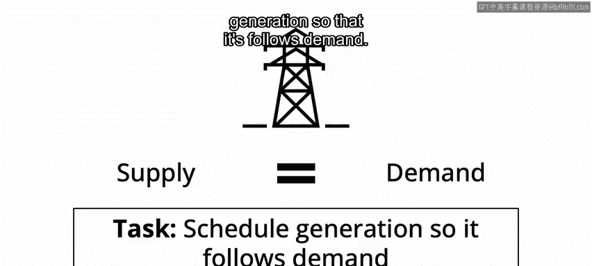

Deispatchable generators take quite a long time to turn on from colds。

 like some of them can take multiple hours to turn on from cold。So you can't decide。

Sort of just in time to go and turn on that huge， great big power plant because a big cloud to come along and just wiped out lots of PV generation。

 lots of solar generation。Instead， you need to keep these big generators。

Ticking over but ramped down so they might be generating at say 50% of their max output。

 So in that state they're clearly hot and running and there are people in their control rooms and in that state they can ramp up quite quickly。

In the order of minutes。 And in that state， they're kind of referred to collectively as spinning reserve。

 So pretty literal， it's just reserve generation， which is spinning and synchronize to the grid and in a state where it can quickly ramp up。

 But it turns out that those gas fire generators are about half as efficient， half as fuel efficient。

 when they're ramped down to 50% as compared to when they're running at 100%。

 So if we had better forecasts， we could run fewer gas plants at higher to their max outputs because we would be more confident that we know what solar generation is going to do over the next few hours。

 So we can optimize away some of that slack in the system， that sort of。😊。

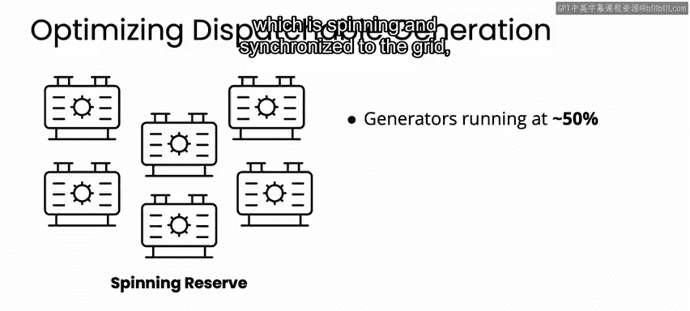

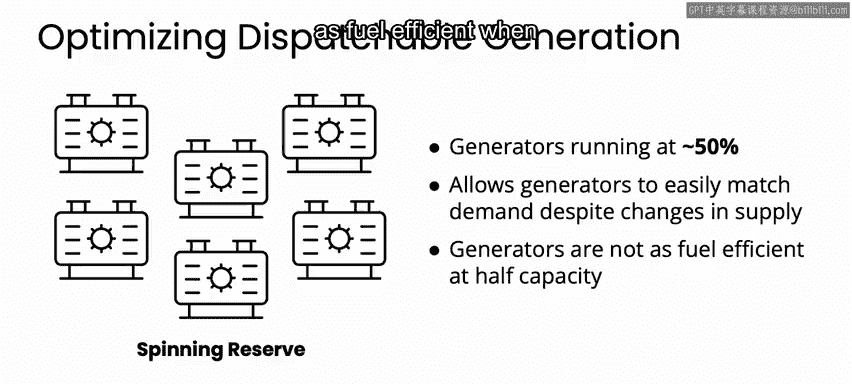

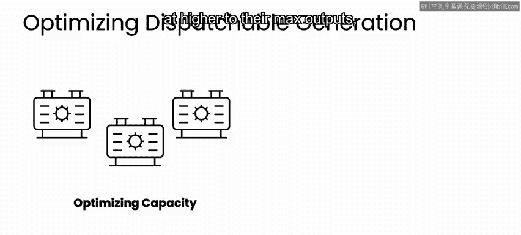

Large amount of headroom for the spinning reserve generators and that should both reduce costs for end users because it's us energy users who pay those balancing costs and also importantly should reduce carbon emissions that's really why we're focused on solar electricity generation and in particular we're using satellite images so you get a satellite image every five minutes。

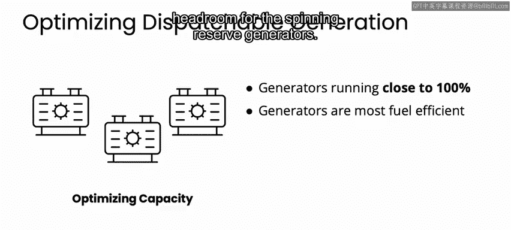

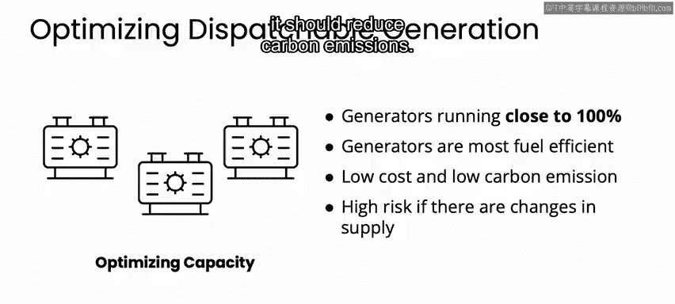

And what we think of the fairly recent machine learning models。

 so at the moment we're experimenting with the Perr IO model。

 which came out from Deep Minds late summer 2021 so in the perceiver IO paper they talk about combining video and audio and getting great results and in energy forecasting。

 we have a hunch that you still want to use this kind of multimodal idea whereby your modalities are things like measurements from weather stations and satellite images and numerical weather predictions and all these sort of things these can all be considered different views of the same physical system。

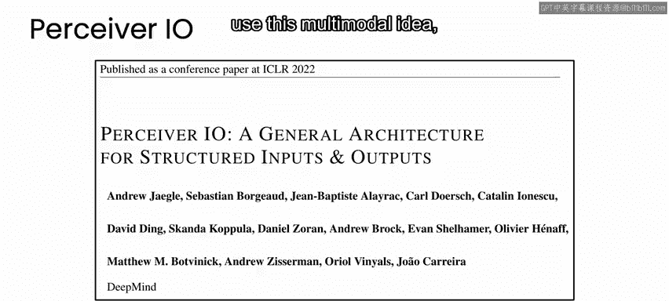

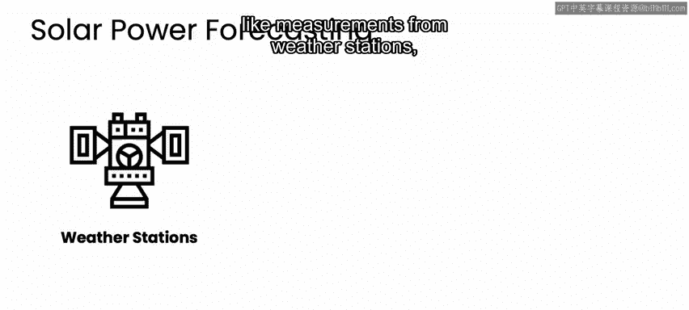

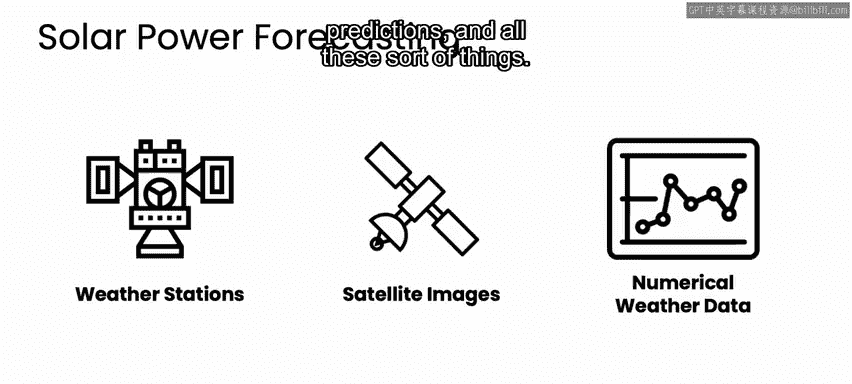

And so， justs。For a long time in AI， people are believed that to have a really intelligent agent that can navigate the real world。

 you need to train it on more than just。A single modality。

 It needs to be able to handle images and sound and touch。

 because then you can get a sort deeper understanding of the physical world。

We have a hunt that the same is probably true for energy forecasting whereby you probably want。

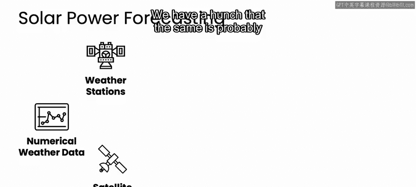

All these different views of the same physical system so we're really excited about perceived Rio and we're really grateful to deep mind for publishing that paper and for making time to chat to us。

😊。

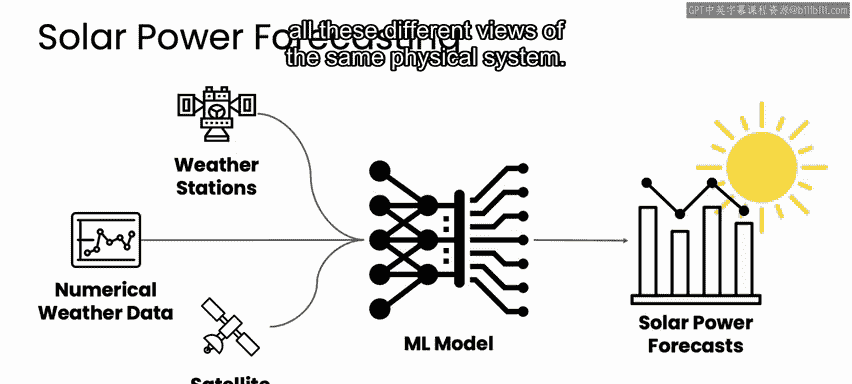

And so yeah， that's what we're working on and everything's open source and on GitHub so we absolutely welcome contributions if you just go to Gitthub。

com/opclimatefiix all one word then you'll find our stuff。😊。

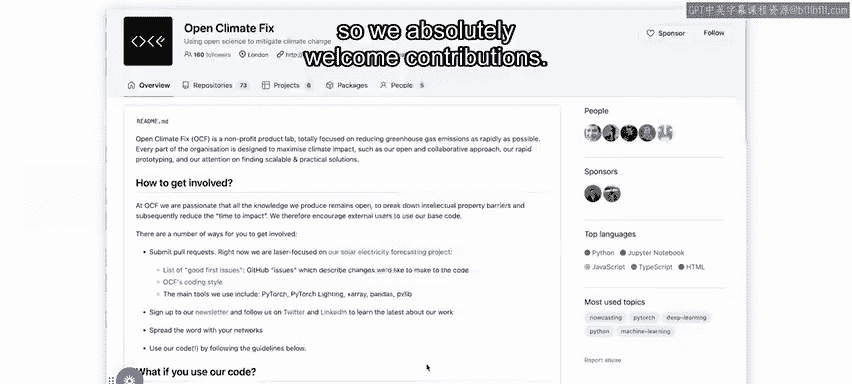

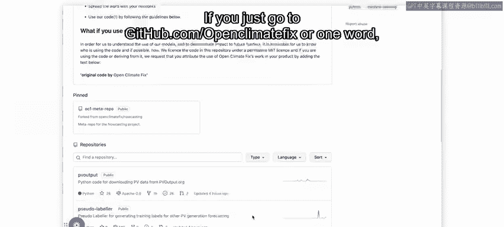

And yet lastly I just really want to thank you guys for doing this course for taking the time and effort to think about ways of using machine learning to it sounds really cheesy but to make the world a better place we need more people like you and I'm really excited that you're doing this so thank you very much and yeah hopefully see you around Thank you goodbye。

😊。