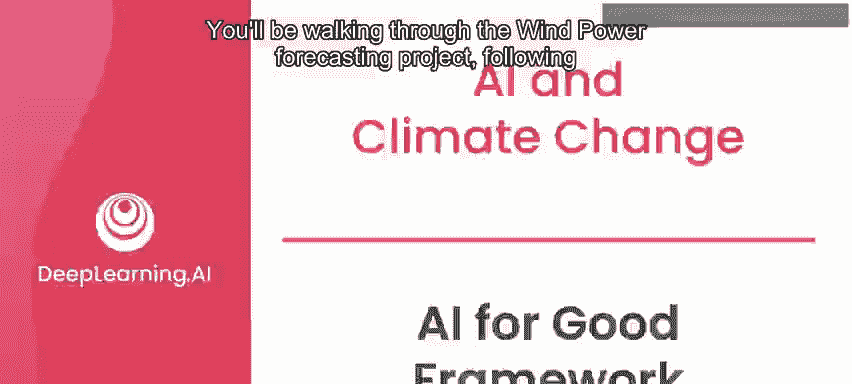
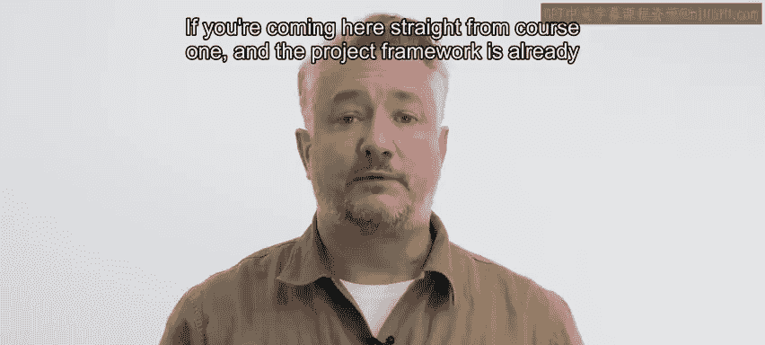
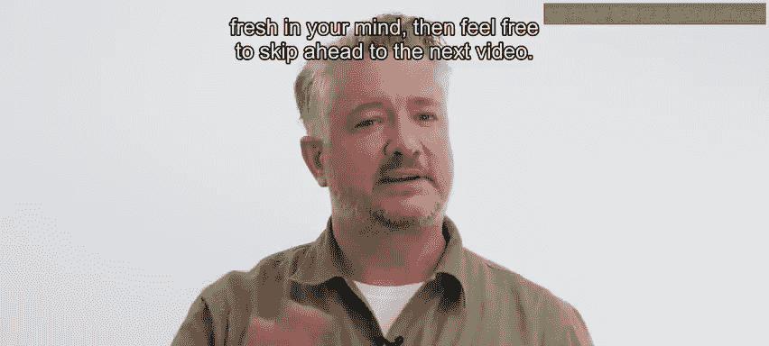
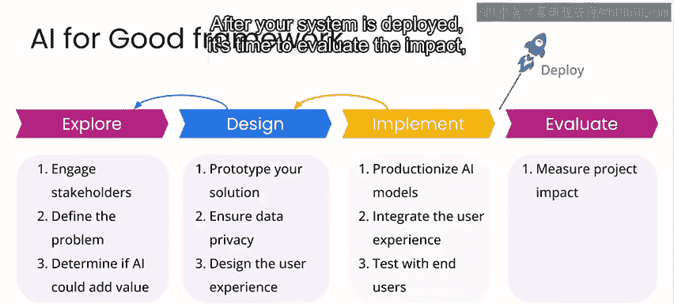

# 吴恩达《AI for Good专业课程》 AI与公共卫生、气候变化、灾难管理｜中英字幕 - P48：10_人工智能为善框架.zh_en - GPT中英字幕课程资源 - BV13u411F7xZ

You'll be walking through the wind Power forecasting project following the framework that was introduced in course one of this specialization there you step through the four phases to explore。

 design， implement and evaluate your project。

Here， I'll just quickly recap each of the stages of the project framework before we get started so they're all on the same page as to the steps that you're going to consider for each new project that you work on。

 If you're coming here straight from Colan and the project framework is already fresh in your mind。

 then feel free to skip ahead to the next video。 So this week you'll begin by exploring the problem of wind power forecasting。

 And after that you'll design your solution。😊。

First， an explore phase where you're connecting with stakeholders。

 defining the problems that you want to work on， evaluating feasibility。

 and determining whether AI can add value as part of a solution。

 then if your exploration of the project looks promising。

 you can move into the design phase where you're prototyping your solution。

 developing your model strategy， investigating the data further。

 and thinking about how you ensure data privacy as well as how potential users will be interacting with your system。

Now it's possible that within the design phase you'll realize that some of your assumptions coming out of the Exp phase aren't holding up and you'll need to go back and explore further。

 have more discussions with stakeholders， it maybe iterate on your problem statement。If so。

 adding this little arrogant backwards here from design to explore to suggest that this can be an iterative process。

 and sometimes you might need to go back to a previous phase if you discover that you don't have what you need to complete work in the phase you're in。

In this model once you've settled on a design you'll move into what I'm calling the implement phase where you do what I'm calling productionizing your models and this really just means taking what you've been designing in some sort of testing environment and getting it ready for deployment and integration with your user interface and then you'll also test your system for performance and usability again here it's possible that through your work in the implement phase realize some aspects of your design just aren't going to work out you need to go back to the design phase and that's okay。

So Me there's other little error here go in from implementple back to design because that can be a path you take as you iterate towards your final product。

😊，Once you've got the implementation you're happy with you're ready to deploy now of course there's a lot more of deployment in terms of technical details than just pressing a button and going live。

 but for the purposes of this course I'll just draw this little rocket chip taking off here to indicate deployment and note that there are a whole other courses out there on the technical aspects of a successful machine learning product development but we're not going to be talking about those details here。

😊，After your system is deployed， it's time to evaluate the impact。

 communicate your findings and then decide what to do next at this point a number of things might have happened。

 most commonly perhaps you' have discovered through deploying your system that there's something you would like to tweak about the implementation so you go back to the implement phase and eventually relaunch an updated version of your product。

Or it's possible that you discover something about your design ultimately didn't meet your expectations you decide to return to the design phase and rethink certain components of your system before implementing the new solution。

😊，Or it's possible that you decide to explore a new aspect of the problem you're initially working on or go explore a new problem altogether all of these could be very common outcomes and I can say from an experience that when you're working on a real project things can in a lot more chaotic than this relatively simple diagram might seem to indicate What I can also say is that you keep this framework in mind at every stage of the project。

 then you'll be much more likely to write that successful outcome or at the very least realize while youll get off track and then be able to get up and get back on track as effectively as possible join me in the next video to begin the explore phase for wind power forecasting。

😊。