# 吴恩达《AI for Good专业课程》 AI与公共卫生、气候变化、灾难管理｜中英字幕 - P49：11_风力发电探索阶段.zh_en - GPT中英字幕课程资源 - BV13u411F7xZ

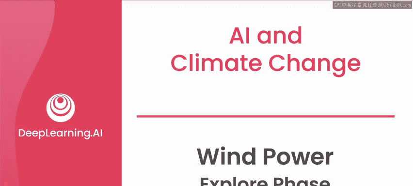

So we've been harnessing wind power for millennia， but it's only been a little more than a century since we started converting wind power into electricity in recent decades wind power generation has grown into a scale where it now makes up a significant portion of the energy of the electrical grid of many countries。

In the US for example， when energy is now provided about 10% of the total electricity。

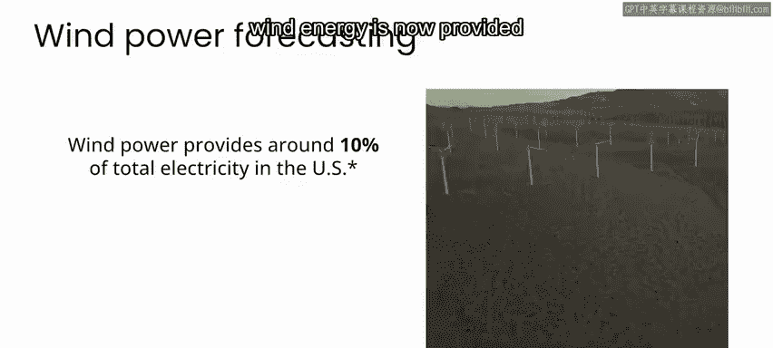

Unlike fossil fuels， however， we can't choose how much wind power will be available on any given day。

 and so that makes it difficult to replace fossil fuels entirely with wind energy。

 What we can do now， however， is use weather forecasts and sensor measurements that describe how individual turbines behave under different conditions in order to predict how much wind power will be available。

The better we can do this， the more viable wind energy becomes as a replacement for fossil fuels。

To better understand how this works， let's take a look at a simplified version of how the electrical grid works for a hypothetical city。

On any given day， there will be a certain demand for electricity that goes up and down throughout the day depending on things like what kind of appliances people use in their home。

 how much heating or cooling is needed， as well as what industry and other infrastructure is drawing in terms of electricity。

And the electric company needs to monitor that demand and be ready to increase or decrease the suppliers needed。

The way that the grid operators at an electric company accomplish this is to combine power output from various sources。

 These sources include fossil fuels like coal and gas。

 along with other sources like nuclear and renewables like wind and solar。

 such that the total amount of power being served with the grid at any given time is sufficient to meet demand。

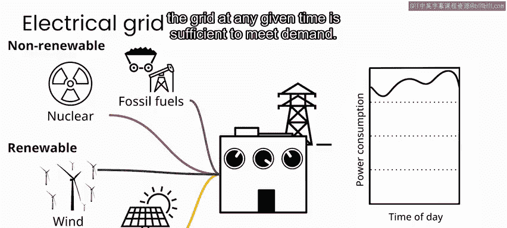

Nowadays， most electric companies would be serving the vast majority of demand through fossil fuels and then nuclear might make up another 10% or so。

 or wind could power another 10%， and might be a little bit from other sources like solar or hydroelectric。

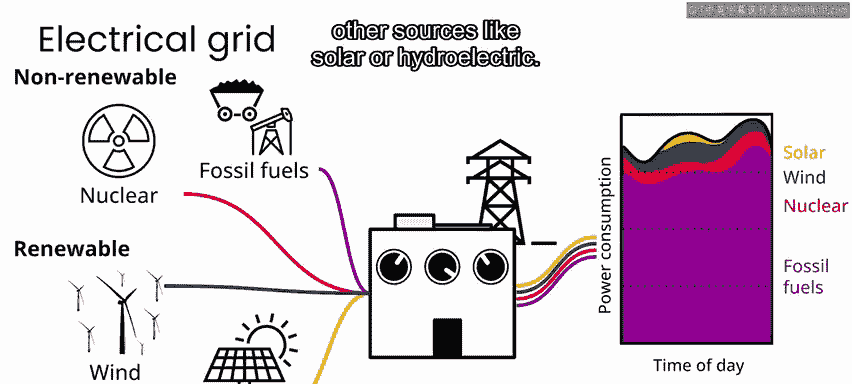

And so the combination of energy sources that is providing electrical supply on the grid is changing throughout the day。

 and making renewable energy sources more predictable therefore allows the electric company to not oversupply with fossil fuels。

The amount of wind power that's available at any given time is largely dependent on how strong the wind is blowing。

 obviously， but it also depends on other factors like atmospheric temperature and pressure。

 as well as the characteristics of the wind turbines themselves。

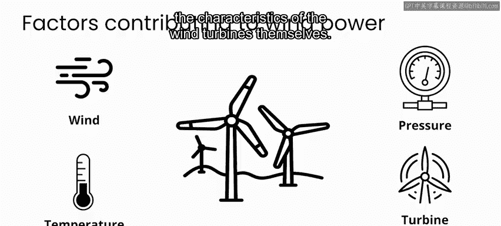

For wind power to be considered a reliable energy source。

 electric companies need to know many hours ahead of time， like at least 24 hours in advance。

 approximately how much wind power will be available。

That way they can plan for enough input from other sources to meet a change in demand。

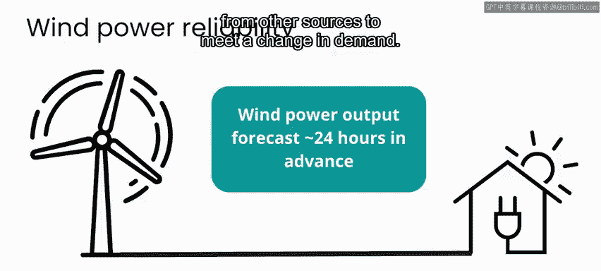

The reason for this is that for now at least there is nowhere to store excess energy on the scale that's required to power entire cities。

 and so that means that power generation needs to be constantly scaled up and down to match demand fossil fuel and nuclear power plants generally take some hours to turn on and so if less wind power than was predicted ends up being available。

 it can leave an electrical company scrambling to make up the difference or being forced to leave some users without power for a period of time。

 on the other hand， if more power than was predicted is generated that's also a problem because the excess of energy can destabilize a grid and getting rid of electricity is not straightforward。

 I've even seen cases where electrical grids are pay in other grids to take the electricity for them。

With that being said， as battery technology improves and scales up。

 we can look forward to a time when it's more possible to store the power generated by wind and solar farms in large batteries for undermine use to learn more about the challenges of balancing the grid in the age of renewable energy。

 check out the resources section at the end of this week。For now though。

 let's get back to the problem of predicted wind power。

You're now in the explore phase of your project and you're starting to get an idea of who the key stakeholders are。

 like the people running wind farms and other energy production facilities。

 the grid operators at the electric company， as well as weather forecasters and perhaps others。

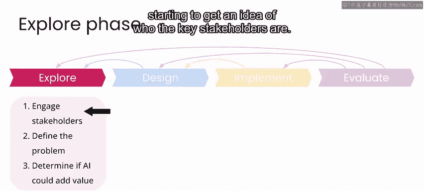

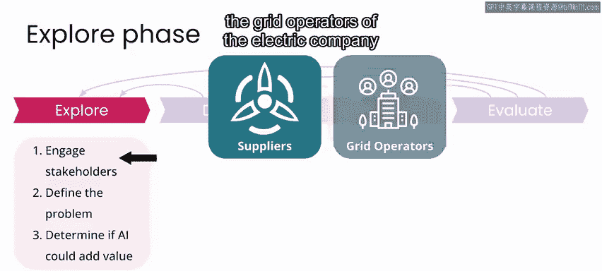

You are also starting to get a sense of what your problem statement might look like；

 a good problem statement should be clear， concise and specific。

Express the reward world situation or problem that you hope to address。

 as well as key people or groups involved。But without getting into the specific technology that you might use to address the problem。

Your problem statement should also provide a clear sense of what a successful outcome would look like for your project in terms of the specifics。

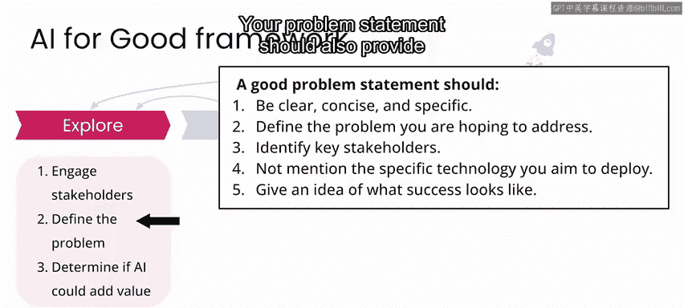

Electrical grid operators need to know some number of hours or days in advance how much wind power will be available and exactly how long in advance will depend on the scenario you're working with。

 but for the labs this week we've chosen 24 hours in advance as the timeframe required for forecasts。

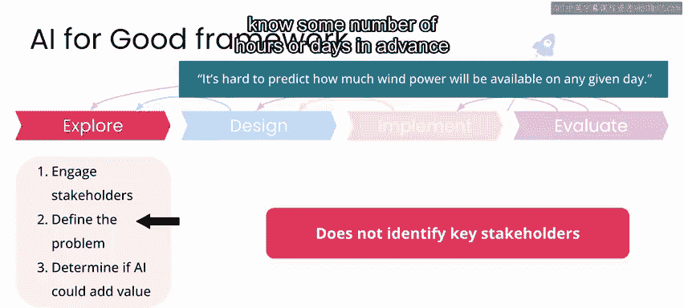

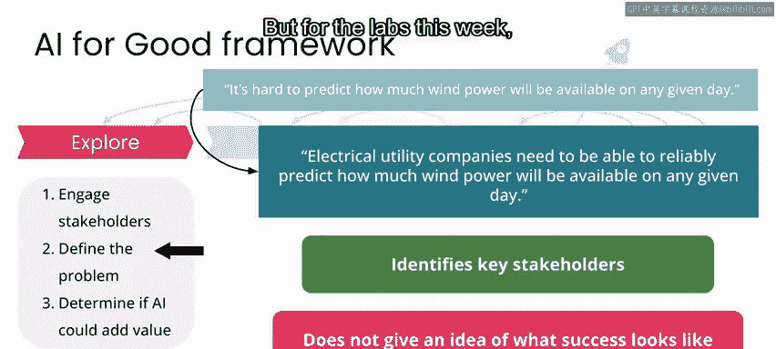

So given the stakeholders that you've identified and what you know so far， in this case。

 a good problem statement might be， electric utility companies need reliable predictions of wind power output at least 24 hours in advance in order to better plan the requirements for other power input sources into the electrical grid right in a good problem statement is an important early step because you can get off track very quickly in the rest of your project development if you're not super clear about the problem that you are trying to address A clear problem statement like this allows you to see what a successful outcome would look like for your project and will help you and your team stay focused on building a solution that addresses this problem for the stakeholders involved。

😊，It will also help you through the rest of the explore phase as you identify additional domain experts who can evaluate the impact of your product so in identifying and engaging with stakeholders and defining your problem statement。

You've completed the first two steps of the explore phase。

 and really you don't need to think about these first two steps as been sequential， rather。

 you might have first been looking at renewable energy in general and learned that wind energy is a promising alternative to fossil fuels。

 A logical next step could have been to connect with others who have worked on this problem in the past。

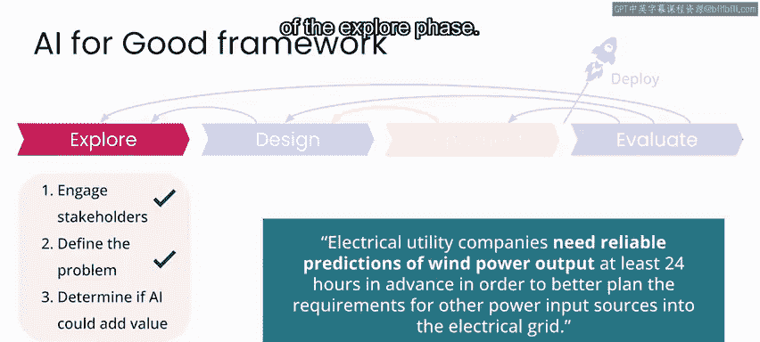

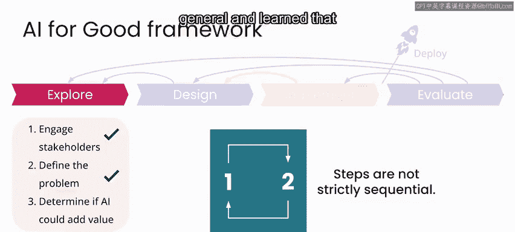

Then maybe you have reached out to wind turbine experts。

 people responsible for planning electrical grid supply and professional weather forecasters to learn more about how all of these things work through iterating on these first two steps in the explore phase。

 you've refined your problem statement brought it back to the relevant stakeholders and made sure that you're all aligned on what the goal looks like At this point you will have also started to determine what kinds of success metrics will be relevant to measure at the end of your project and these will include all the ways you ultimately demonstrate that you have successfully addressed the issues that you detailed in your problem statement and how these relevant to the stakeholders With that you've completed the first two steps in the Exp phase Jo me in the next video to consider if and how AI might add value to your project。

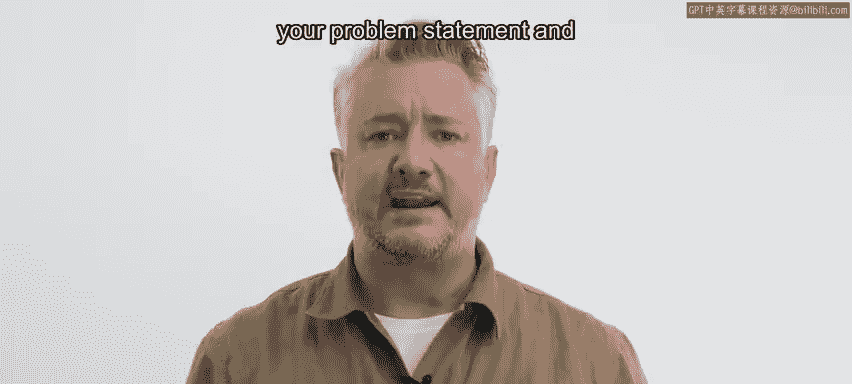