# 吴恩达《AI for Good专业课程》 AI与公共卫生、气候变化、灾难管理｜中英字幕 - P4：3_Charles Onu识别婴儿哭声中的窒息.zh_en - GPT中英字幕课程资源 - BV13u411F7xZ

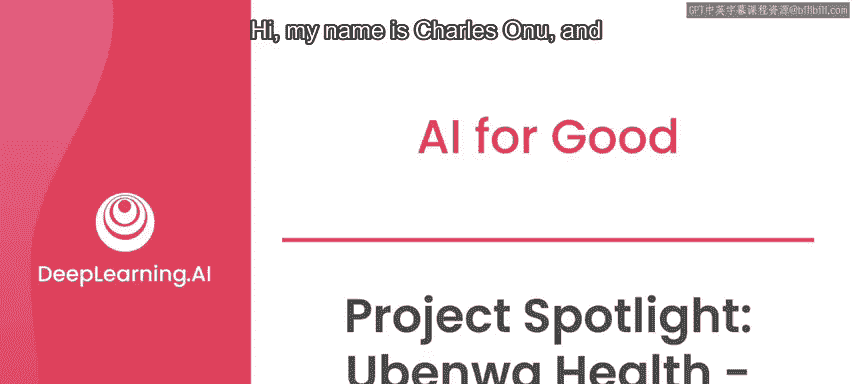

Hi， my name is Charles Onu and I'm founder and head of AI at Tubanno Health。

 Uwa's mission is to bring about the world in which every baby has access to rapid medical diagnostics regardless of where they are born in the world。

 So the first issue we are tackling is that of neonatal asphyxia。

 which is one of the top causes of sudden death and disability in infants。

 asphyxia basically results when the newborn is unable to sustain spontaneous breathing and this could be due to a variety of underlying causes。

 What happens is that it's a really critical situation where the brain cells are not getting enough oxygen and if that continues for an extended period it could result in irreversible brain damage Today。

 medical diagnose for aphyxia requires expensive equipment specialized personnel typically involving in blood analysis and the neurological exam。

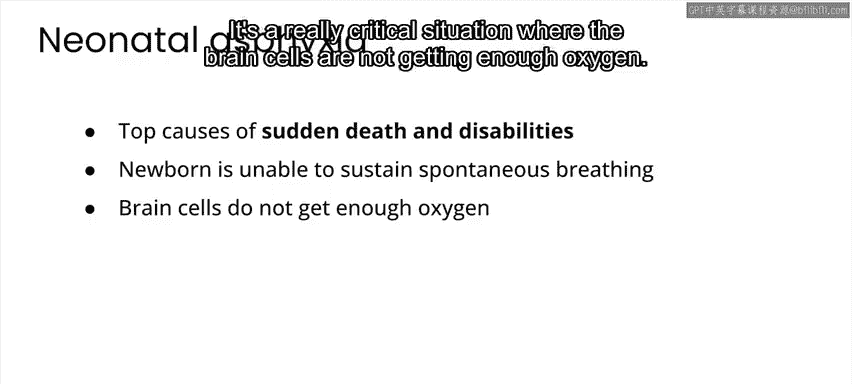

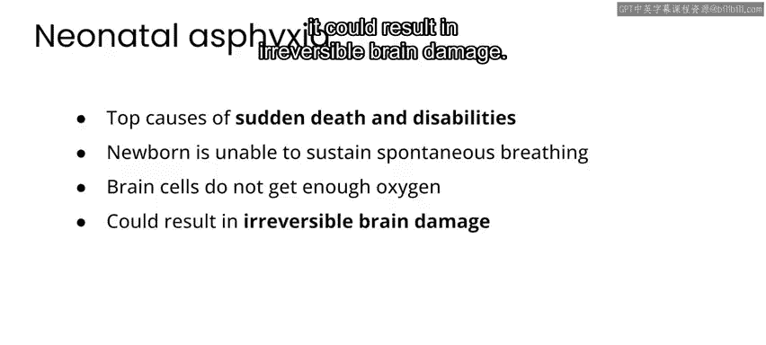

And conducting such tests on a routine basiss a big limitation for medical centers in developing countries and on the other hand。

 even in developed countries， if an infant suffers asphyxia outside of a well- resourced hospital。

 for instance， at home， it could still be fatal。And so for these reasons the global casualty due to neonaal asphyxia is quite high every year over 1 million babies die and another 1。

2 million developed conditions like hearing loss， paralysis。

 learning difficulties and others I personally first encountered asphyxia during my work with NGOs in my home country in Nigeria and I can say that it was bad and led me to clinical data about the physiology of cry production。

 the connection between the voice and the brain and how conditions like asphyxia effectively alter the patterns of the infant's crysounds and so today my team at Tubannoa is focused on helping newborns to survive and thrive by paying attention to the messages that their crysounds carry So what exactly is our solution to Bennoa we have developed a smartphone app for parents and caregivers to rapidly identify or detect the early signs of neurological anomalies。

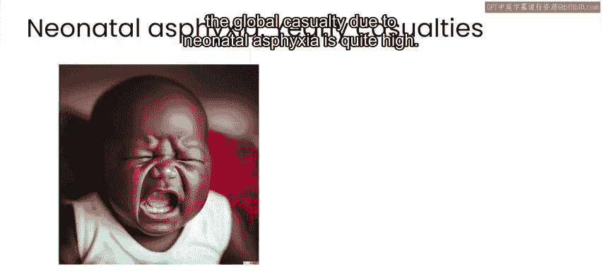

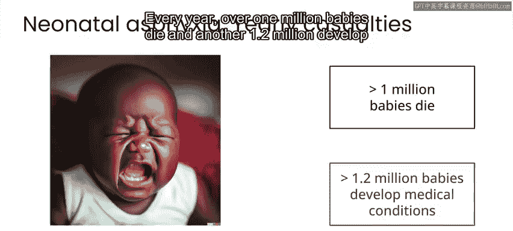

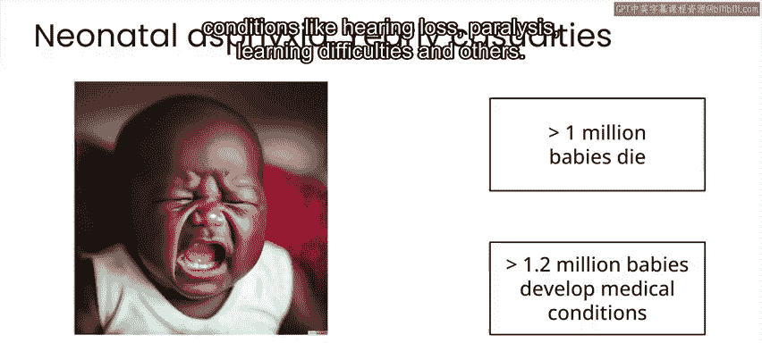

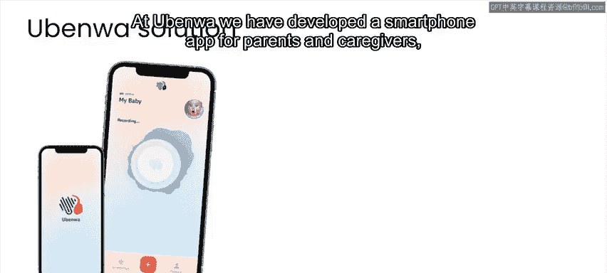

Using a simple recording of the babys cry， and the idea is that babies can be identified early。

 then they can be treated on time。And when you compare these to the current methods of screening。

 you the app offers at least three key benefits， one it is fast fating early detection two it is cost effectiveff。

 meaning global access， more precede can use it regardless of their economic status and three its noninvasive so causes no harm to the patient and it can be the test can be repeated as needed to develop Uno AI and machine learning has played a very important role this is because the changes in cry characteristics caused by neonaal asphyxia。

 are very complex and so even though we know small these characteristicsact like the high pitch of fundamental frequency。

 there are several others which will be non-trivial to extract by hand engineering but which are important to really develop in an accurate system and so what's machine learning and specifically deep learning is allowing us to do is to build a neural network that automatically learns these features from cry recordings and then internal。

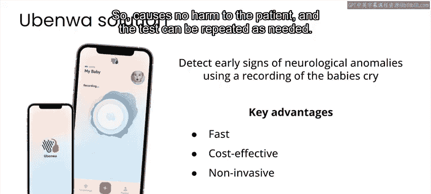

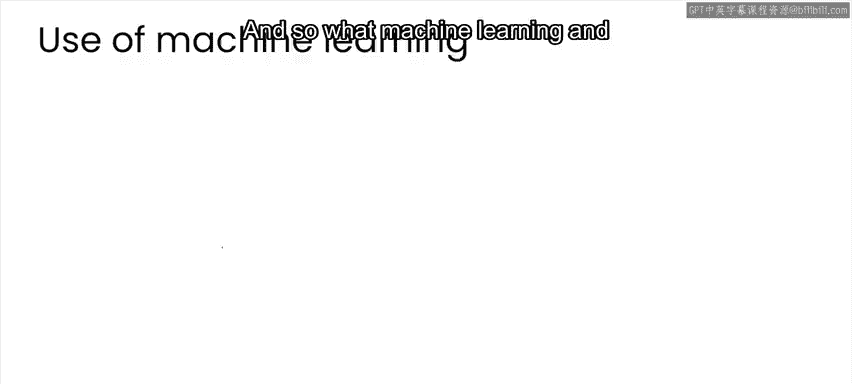

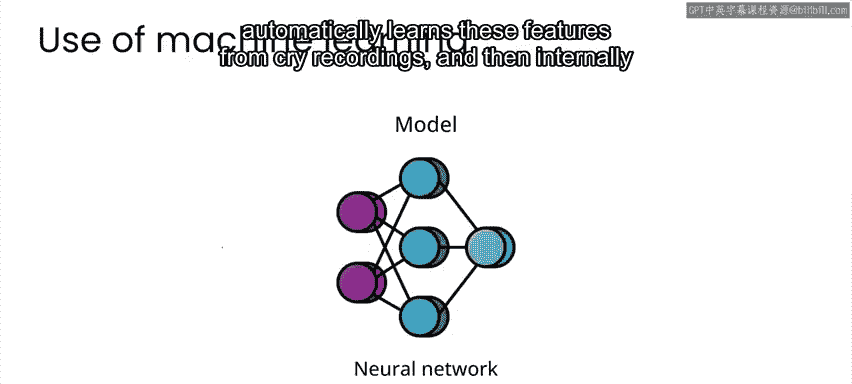

fiures out how they should be combined mathematically to make a classification and in practice this typically involves training a convolutional neuro network a CNN on specttrogram representations of the impute audio signals the data used to train the CNN is probably the most important component of this setup it has to be large and diverse because cry patterns vary from individual to individual and we want to learn features that are truly global and also the data has to be strongly annotated else the resulting model may not have a clinical utility。

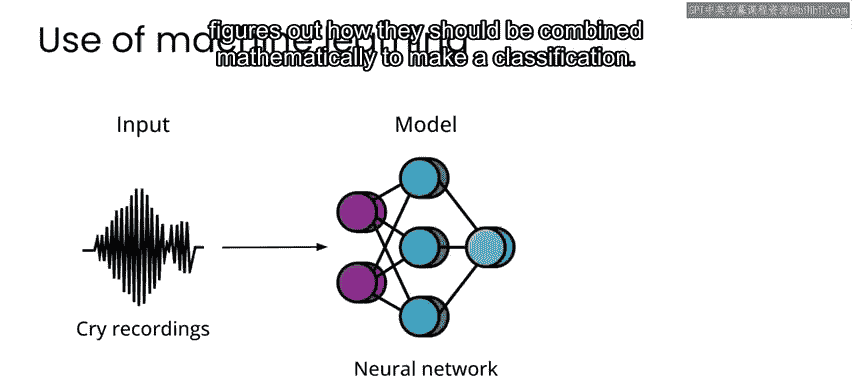

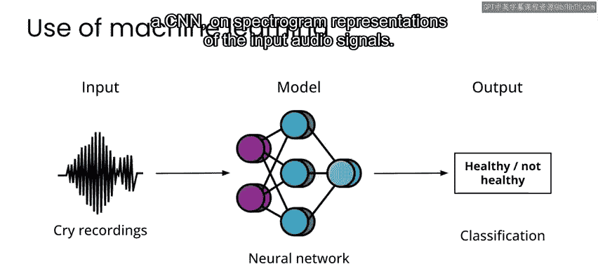

So to this end we partnered with immunonatologists in different hospitals across three countries。

 Brazil， Canada and Nigeria， and with them we have now developed the largest database of clinically unnotated infant cry soundsunds。

 which has now played a vital role in the development and the training of machine learning models。

 you have learned about why we are developing Ubeno Ubeno is actually an expression in my native language it will which means the cry of a baby。

 when not just developing in a single mobile application。

 but actually a flexible software platform that can be deployed onto a range of devices to really leverage the cry of a baby as a vital sign。

 we hope that in no distant time will be able to save and improve the lives of millions of babies all over the world。

