# 吴恩达《AI for Good专业课程》 AI与公共卫生、气候变化、灾难管理｜中英字幕 - P50：12_风力发电探索数据.zh_en - GPT中英字幕课程资源 - BV13u411F7xZ

The final step in the explore phase is to determine whether AI could help with the problem that you're hoping to address so in reality you would have been thinking about this all along as you learn more from stakeholders and refine your problem statement and as with the other use cases here in the real world this process could be weeks or more likely months。

Ultimately the question of whether AI could add value as part of any solution will depend in a large part on what kind of data you have access to With that being said data or not。

 there are many projects in which AI simply does not add value and so it's important to recognize this as early as possible to end up wasting your time and perhaps more importantly your stake's time working on a project design that ultimately isn't going to be successful。

In the case of wind power forecasting， many groups around the world are already applying AI to the problem and achieving promising results。

 so it's safe to assume that there's at least some significant potential here in the first course of this specialization you saw that for AI to play a role in addressing a problem you need to have access to data。

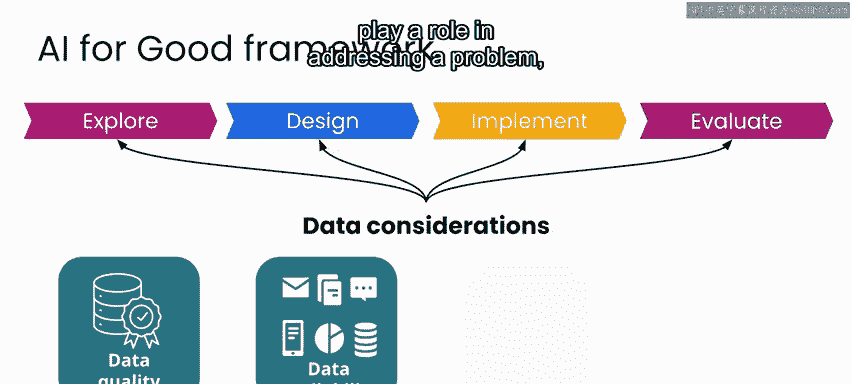

And this data is what you use to develop and test potential models。

 and so regardless of whether other groups have had success in addressing the problem that you hope to work on。

 you need to look carefully at the data that you have access to in order to determine whether you have what you need to proceed。

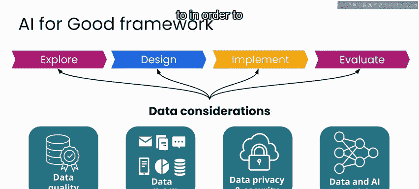

For wind power forecasting， a data set might consist of a historical record of wind speed predictions and actual recorded wind speeds。

 as well as other meteorological data and sensor measurements from control systems on both each of the wind turbines。

This is then combined with how much power was being produced by each turbine and any given time to be your target function for this project。

 the competition data set that you'll be working on has historical data on wind speede turbine control system sensor measurements and power output Let's head over to the lab and jump into the Jupyter notebook to explore the data that you'll be working on with this case study For this project。

 the data that you'll be working with is called the special dynamicmic wind power forecasting data set。

Following this link， you can find a paper that describes the data set in detail。

The data itself was provided by the Longyuan P Company in China for the KDD Cup challengeenge that they hosted in collaboration with Baidu in 2022 you can find more information about the competition by following this link here。

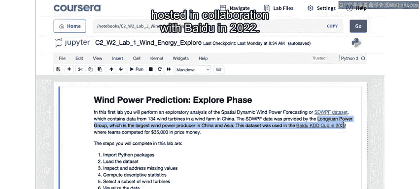

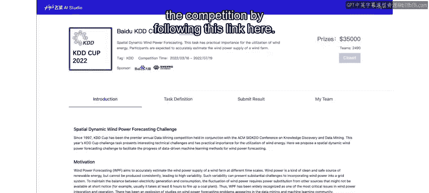

The next step in this lab， as in all the labs is to import the python packages that you'll need and that's what you're doing in this for yourself cell。

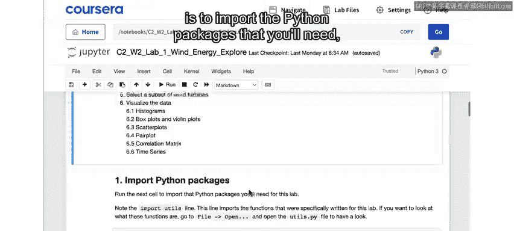

And here you can see that you're import in a file called UTs that we created for you as with the other labs you can see what's in this file by clicking up here on the Jupyter icon and opening the file in general we've provided a UTLs file like this in each of the labs to put some code in it that you don't necessarily need to look at within the notebook itself and so you don't need to aware it whats going on in here but if you are a Python programmer by all means go in check out the UTLs file for each of the labs to investigate the code that's operating behind the scenes and you might find something that could be useful for some of your future projects。

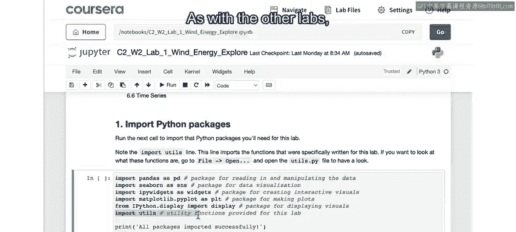

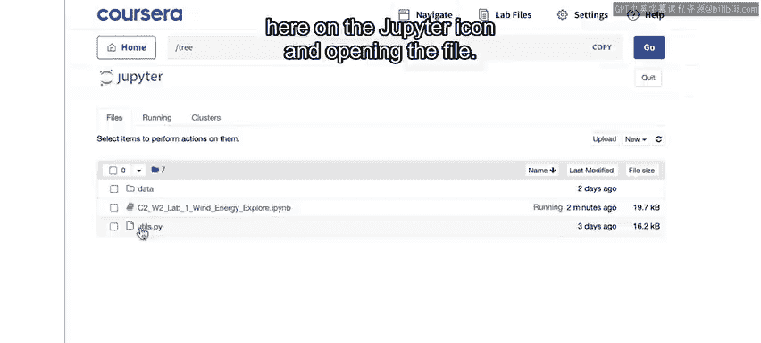

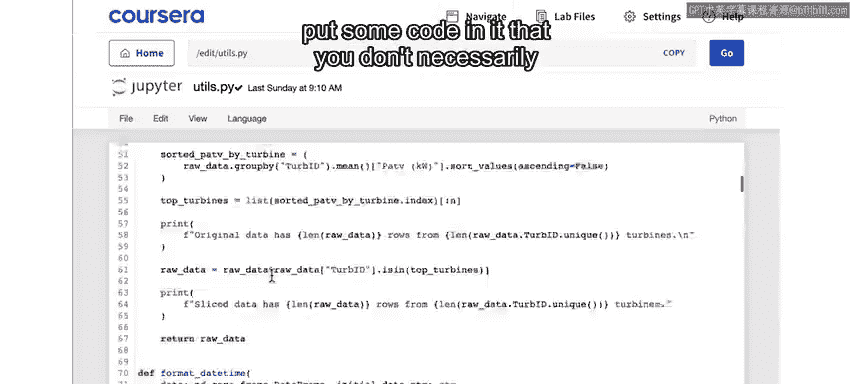

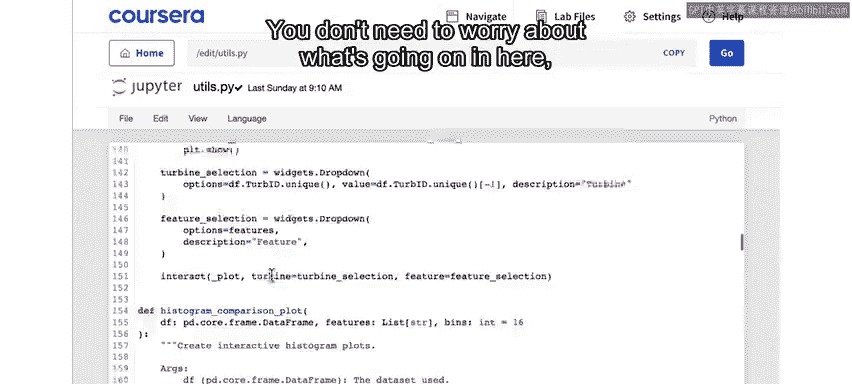

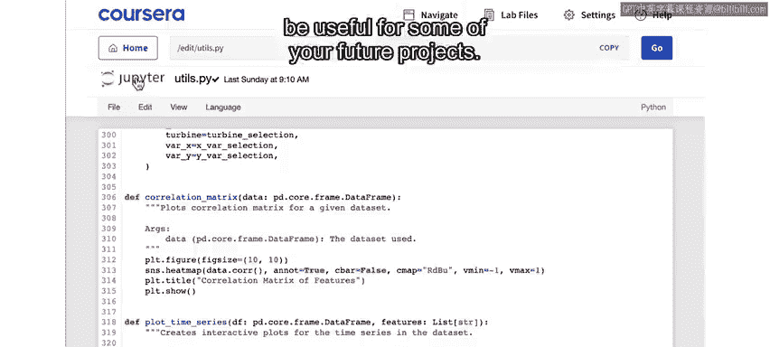

And again， as with all of the other labs， you'll be able to find the data in this directory here and the data sheet which describes the nature of the data set that you will be working with。

Coming back to the lab here， when you run this first cell and see all packages imported successfully。

 you are ready to begin。

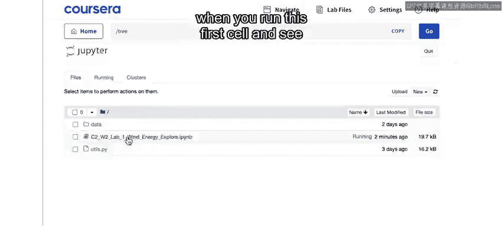

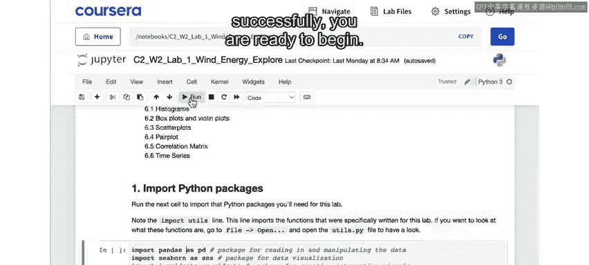

With this Excel cell you'll read in the data set and print out the first few lines of that data。

 it's important to keep in mind that with whatever project you're exploring。

 even if a data is public， that does not necessarily mean that at one contains sensitive data or information that could be used to do harm。

In this particular case， the Longyuan Power group has not revealed the location of the wind farm where the data was recorded。

 so in some sense， the risk of revealings for proprietary information has been minimized。

 but is's still worth considering any potential risk of doing harm with any data set that you're working with。

 digging into the data here。

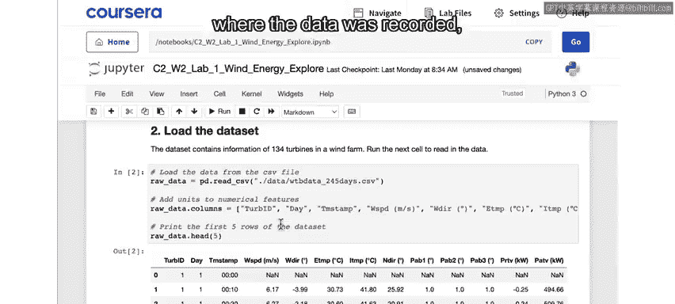

What you'll find is that you have a column for turbine ID。Day number， wind speed。

 wind direction and some temperatures and other values。

 as well as power output in these last two columns。

Down here you can see more details on what each column in the data set contains。

 and again you can look at this paper for more details on the data。As a next step。

 you'll print out how many of the missing values there are in each column of the data。

You'll see that the number of mission values is the same across all columns。

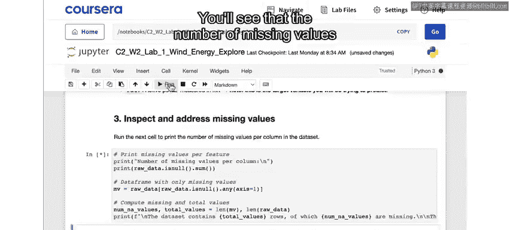

And a logical next question would be whether this indicates individual rows of data are entirely missing or if missing values are spread out among the rows。

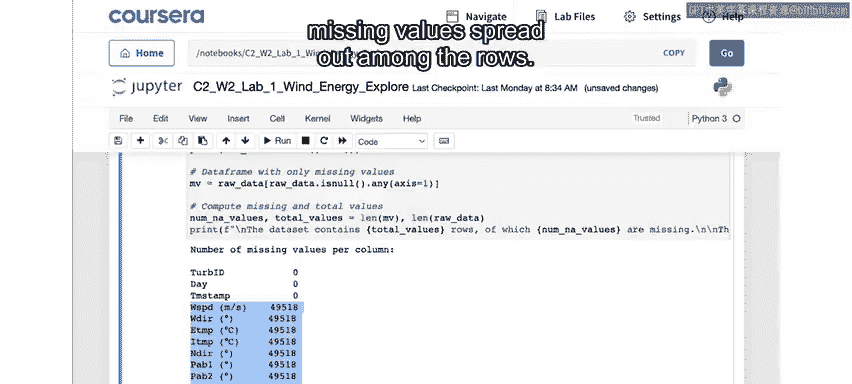

With this next cell， you can use this inspect button to grab five rows at random where missing values are present。

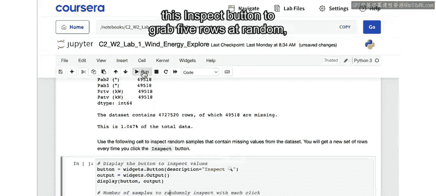

Each the time you click inspect， you'll get a new redtina set of rows to look at。

This is a really good spot check and the takeaway here is that it looks like when a row contains missing values all the values are missing and so these look like rows that will not be helpful in your analysis。

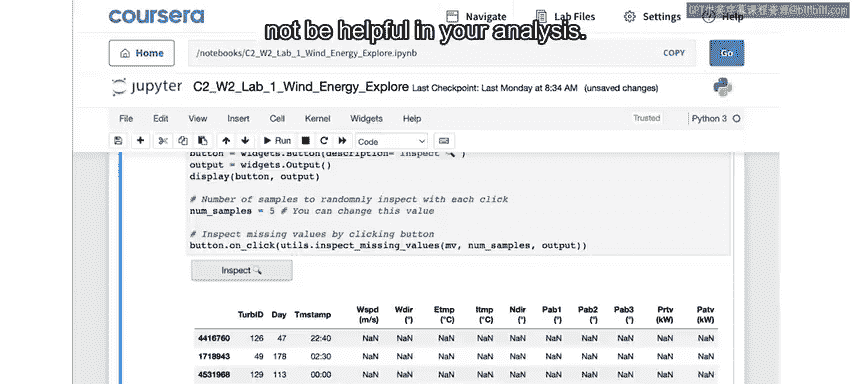

For building an application that's going to run in real time。

 you would need to further understand where these missing values are coming from and start thinking about a plan to deal with them in your design。

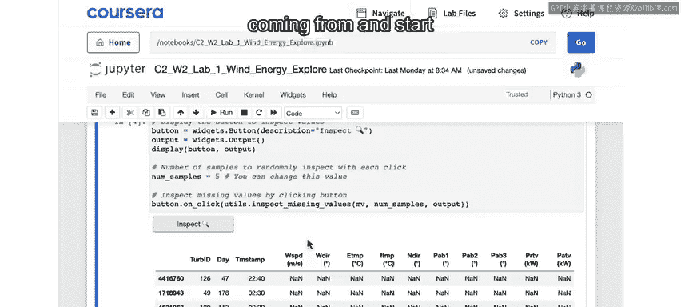

But for now， we just note that missing rows of data make up about 1% of the total。

 so in running this next cell you'll drop all the rows that contain missing values。

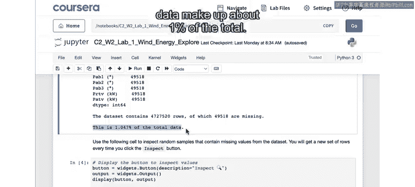

And you should be able to confirm that that worked here where you again print out the number of missing values and should find that it's zero across all of the columnms。

Run this Excelel here to compute descriptive statistics for all of the numerical columns in the data set descriptive statistics are things like the minimum maximum median or quartiles。

 the main or the average and the standard deviation。

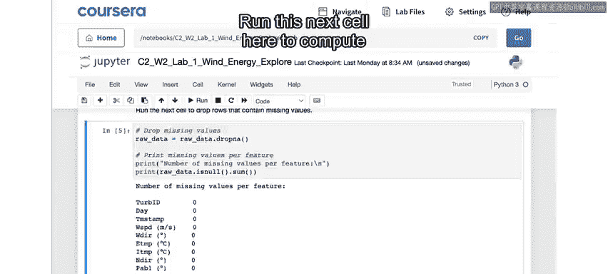

By looking at the statistics， you can get a sense of some of the characteristics of the data set and look for anomalies。

 like for example， you might wonder why the minimum temperature recorded is around negative 273 degrees。

Or why the range of wind direction runs from negative 3000 to over 2000。

I'm not sure what that's all about。In some cases， these may just be values you can safely ignore。

 but it's important to have a sense of both the characteristics of your data and any anomalies for the purposes of developing a model。

😊，This data set contains information on the output of 134 wind turbines。

 and if you are working on predicting output from the entire wind farm。

 you would ultimately need to come up with a solution that incorporates all of the turbines。😊。

For the purposes of exploring the data in this course， we'll just work on a subset of the data。

 The default subset here is to choose the top 10 performing wind turbines in terms of power output。

 or that you could choose more or less by changing this number。And with that。

 you're ready to start visualizing the data， join me in the next video to continue through the rest of this lab and visualize your windpower forecasting data app。

