# 吴恩达《AI for Good专业课程》 AI与公共卫生、气候变化、灾难管理｜中英字幕 - P51：13_风力发电可视化数据.zh_en - GPT中英字幕课程资源 - BV13u411F7xZ

In the previous video， you began exploring the wind Power forecasting data set that you'll use for this week's project。

Now you will take a closer look at the data through a series of visuals。

If you already have the lab open and you've run all the cells up to this point。

 you're ready to continue if not and you're just opening up the lab now。

 be sure to run all the cells down to this point in order to prepare your data。

Now that you've selected a subset of turbines， you can run this next cell to generate a histogram from one column of data for a particular turbine。

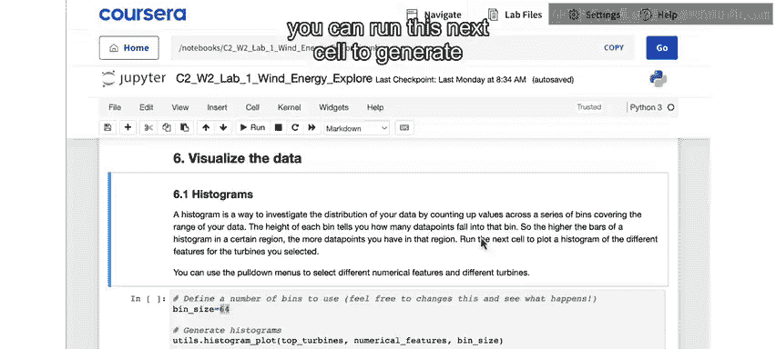

You can use these pull down menus here to explore the distribution of different columns of data for each of the turbines。

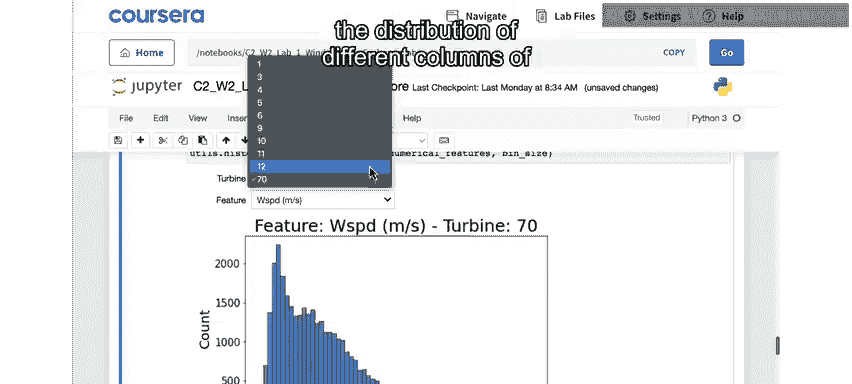

It's also interesting to directly compare the distributions across turbines。

 so in this next cell you can select two turbines to compare to each other and the particular column that you want to look at click around with a few different turbines and features and see what you find in terms of the similarities or differences in the distribution between turbines。

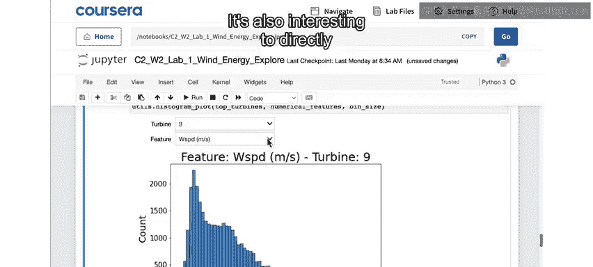

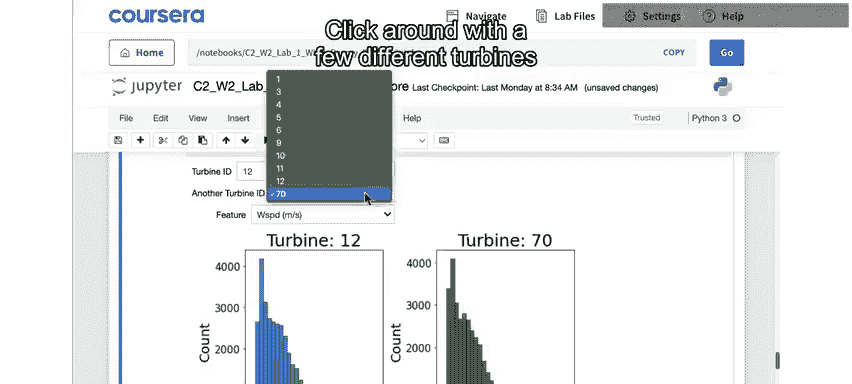

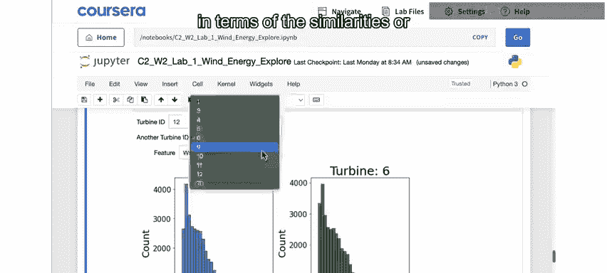

And keep in mind that in the data exploration process for any project。

 you may not be coming in with clear expectations for what you will see when you are looking at various aspects of the data。

 like in this case， the distribution of individual columns of data。

 or when looking at descriptive statistics or missing data as you did above。

The important thing at this point is not to try to make complete sense of the data。

 but rather to keep an open mind and be looking for anomalies or patterns or any other characteristics that stent out as you'll explore further。

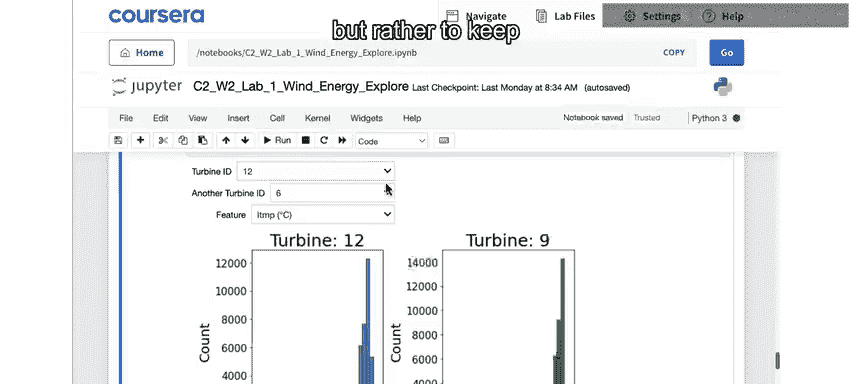

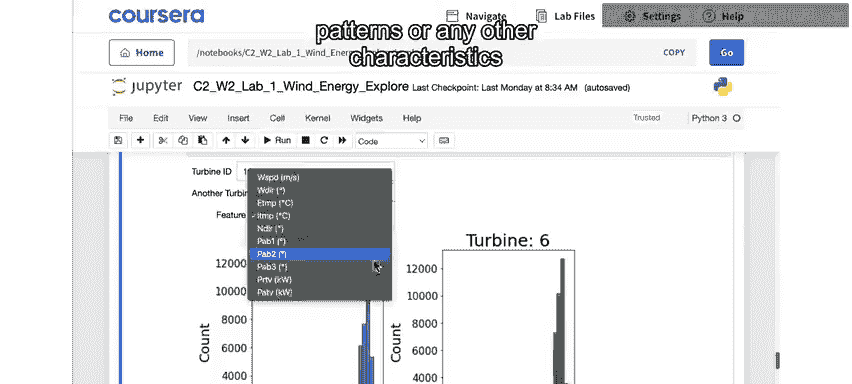

It can also be useful to compare distributions across all turbines simultaneously。

 and you can do that by running this Nel。

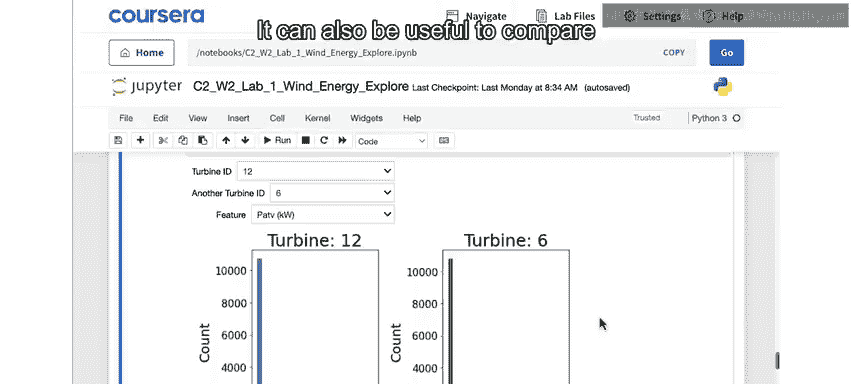

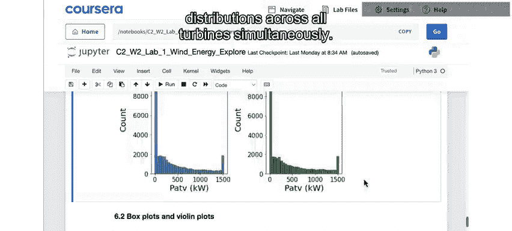

Here you have a choice of looking at a box plot or violin plot representation of the data。

With a violin plot， you're now looking at the data distribution along the vertical axis。

And each of the individual turbines along the horizontal axis。

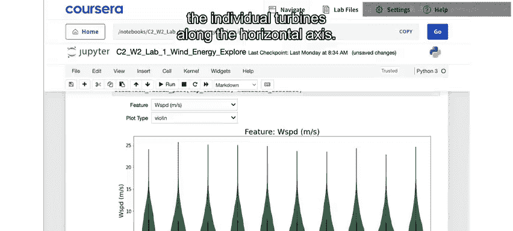

You can think of a violin plot as sort of showing you the histogram laid out vertically and mirrored across the vertical axis so that it looks symmetrical。

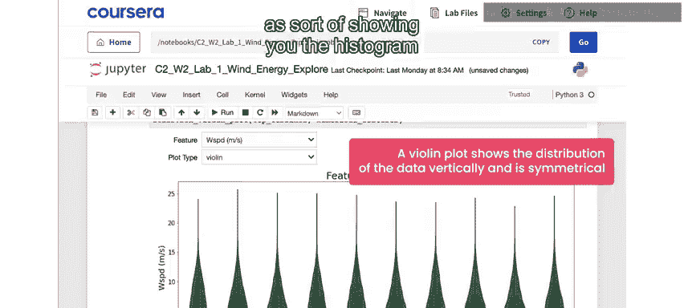

And so the white parts of the violin show where the most data exists in the distribution and the thinner parts show where there is less data for box parts。

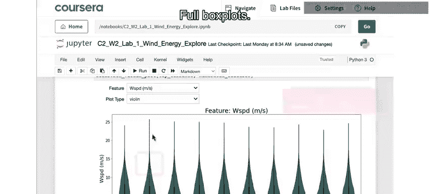

The box shows you the range spanned by the central 50% of the data。

 and these whiskers sticking out here showed the full range of the data。

So what I've been noticing so far in the debtor exploration is that it looks like there's a high degree of consistency between the distributions of different sensor measurements and power output between the turbines。

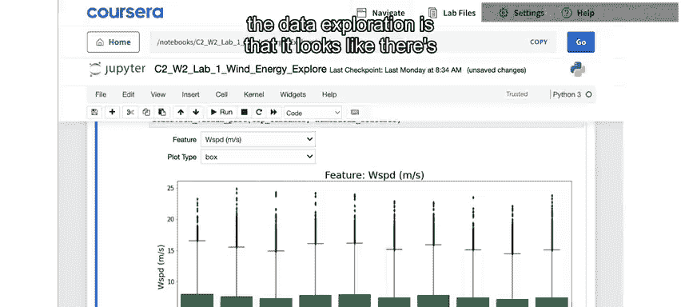

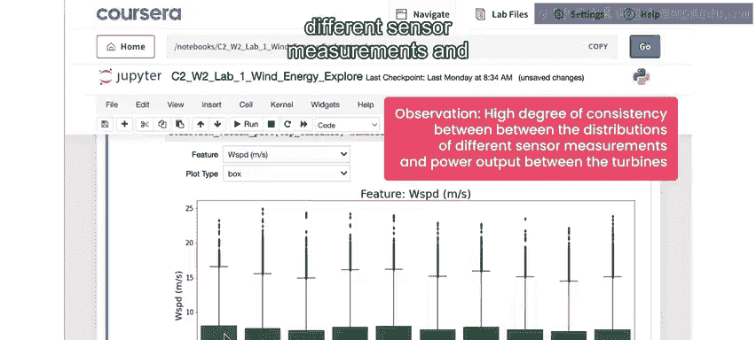

In principle， that seems to suggest that perhaps we could focus on building a model for the output of just one turbine in the hopes that the same or a similar model could apply to others as well if each turbine behaved completely differently。

 then of course you might want to prototype across a large number of different turbines。

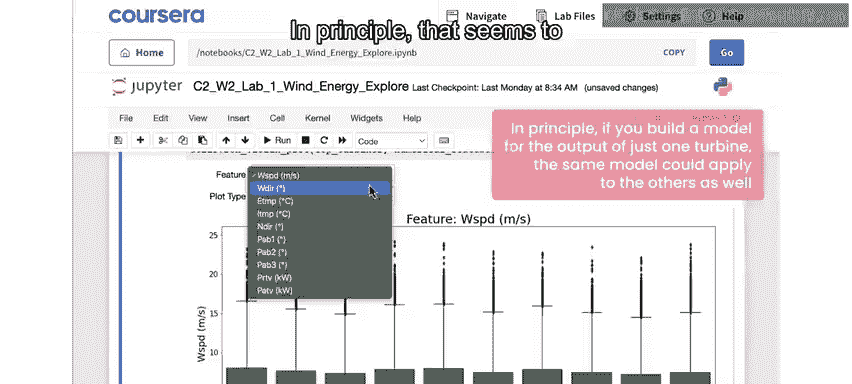

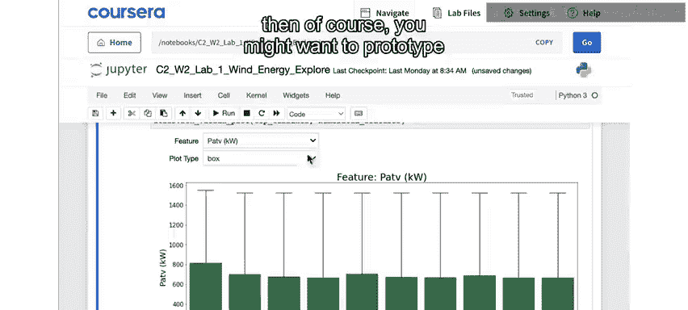

Keep in mind， however， they were only looking at the top 10 performing turbines here as a sample。

 and so you would need to investigate further to see if this consistency actually holds among all the turbines in the data set。

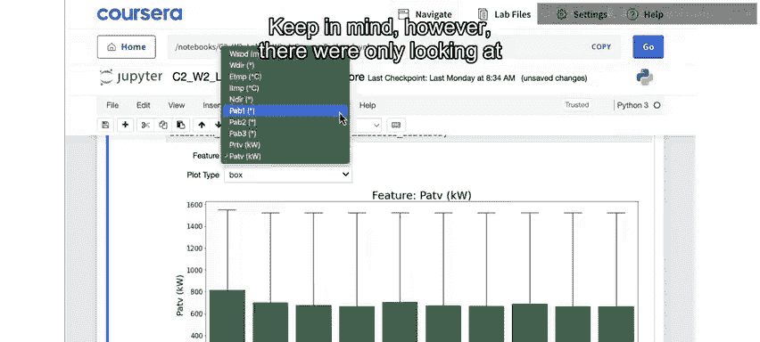

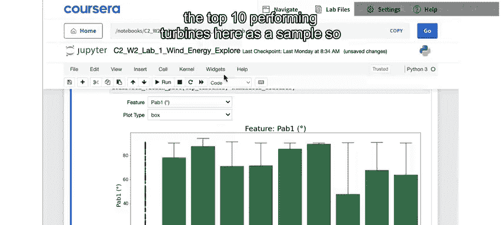

In your data exploration， it is also interesting to look at individual columns of data plotted against one another in a scatter plot。

 and you can do this by running this next cell。

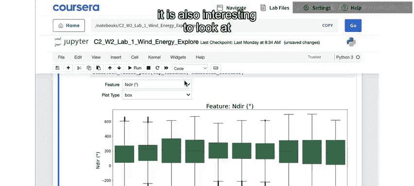

Here you are looking at wind speed versus power output for a particular turbine。

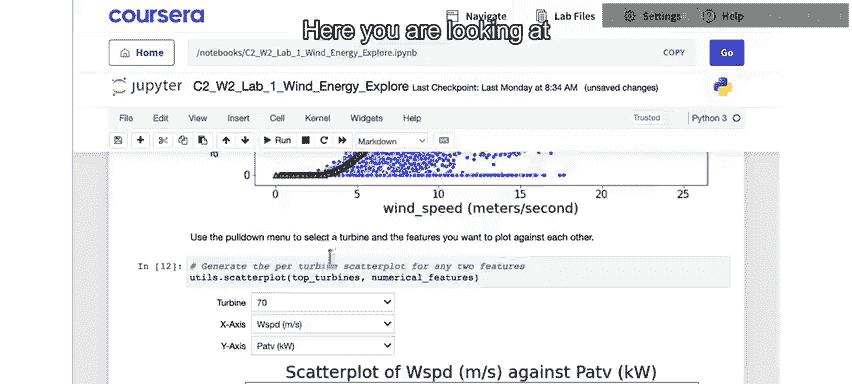

You can use these pulldowns to choose between different variables for different turbines。

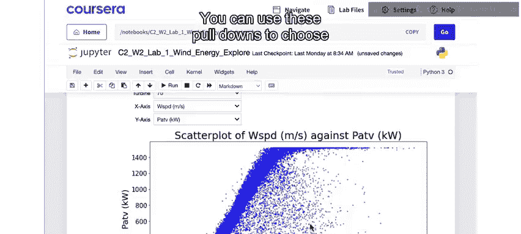

Here we're including this example scatter plot to show you what wind speed versus power output looks like for a typical wind turbine。

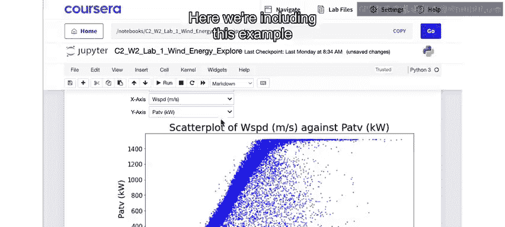

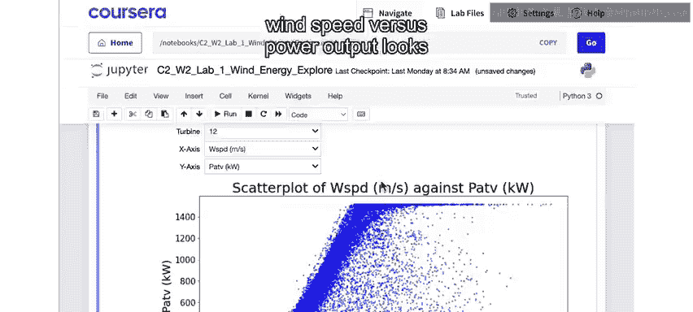

As well as the theoretical output for that turbine at different wind speeds。

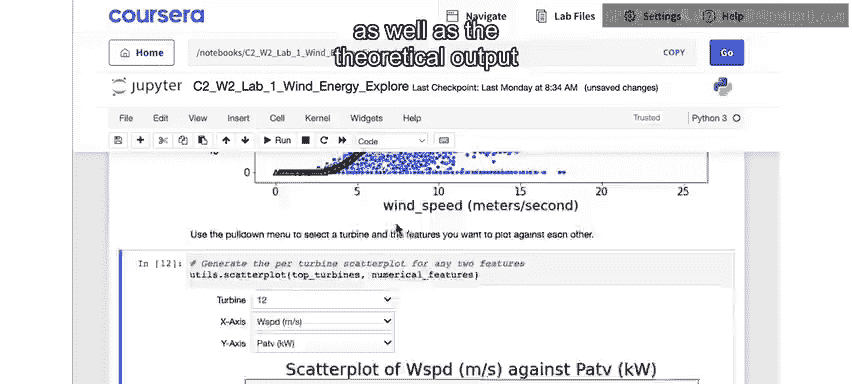

And perhaps unsurprisingly， you can see a strong correlation between wind speed and active power here。

 the blue points show the power output as measured at different wind speeds and in orange the theoretical power curve is shown。

 which is the power output that is expected theoretically for any given wind speed。

Just a flag that the data in this example is not taken from the data set that you're working with。

 you can see that the ranges of the horizontal and vertical axes here are different from what you see in the plots of your data。

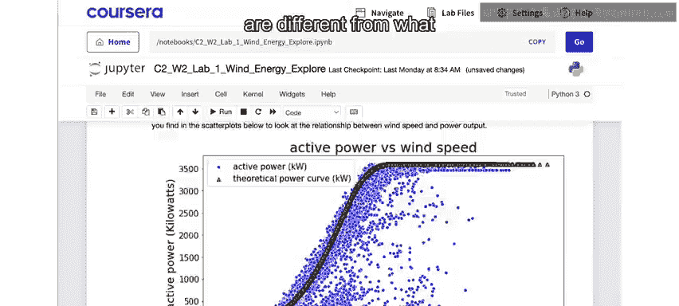

For the data set that you're working with， the Longyon power group did not provide information on the theoretical power curve。

 but you can look at the wind speed versus power output and get a sense of what it might look like here。

So the way to read this plot is that for this particular turbine。

 the range of wind speed recorded were from0 up to about 25 meters per second。

 and the power output ranged from 0 to about 1，500 kilowatts。And so in some cases。

 the turbine was apparently not operating， and no matter how hard the wind blew。

 the power output was0， which is shown by these points along the bottom here。

And then over a certain range of values， you can see that it looks like as the wind blew hotter。

 the turbine typically generated more power output。

 maybe 10 or9 meters per second here is where it starts to max out at 1，500 kilowatts。

And then beyond that， no matter how hard the wind blows， the power generation never exceeds 1。

500 kilowatt。

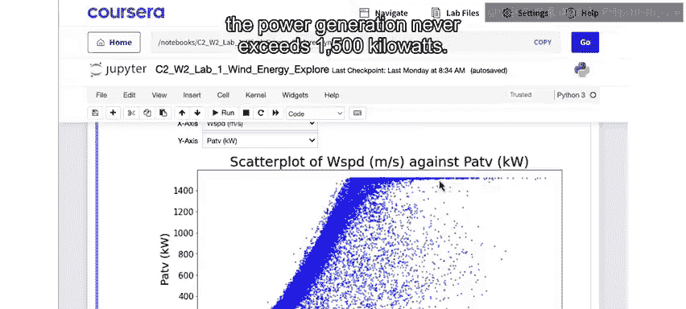

And so that's what this theoretical power curve is showing here for any given wind speed as the expected power output from this wind turbine。

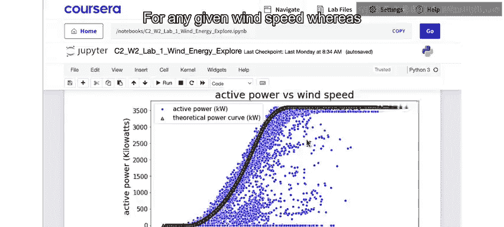

And like I said， you don't have a theoretical power curve， the data that you're working with。

 but given a plot like this， you can make a pretty educated guess as to what the theoretical power curve might look like。

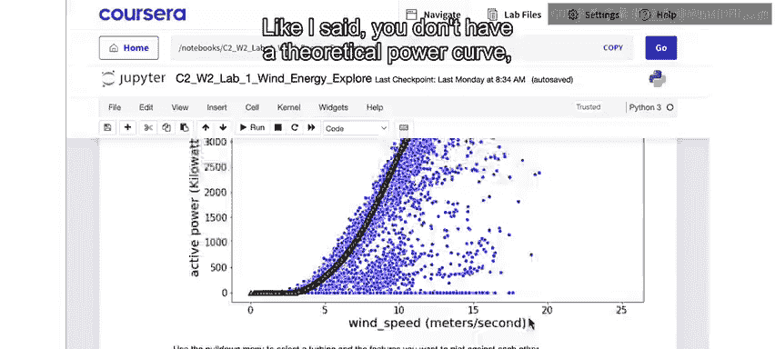

You can also look at other scatter partss here， like the pitch angle of the turbine blades versus the power output to see what this looks like。

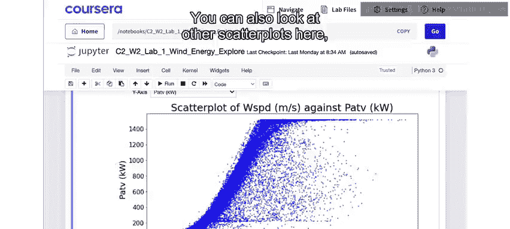

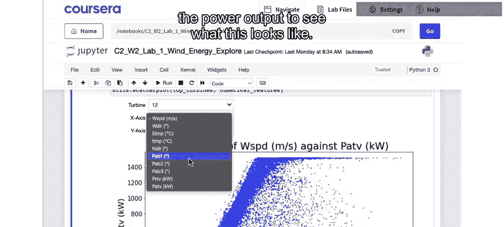

So explore some different scatter plots for different variables plotted against one another。

 for different turbines and see what you find。

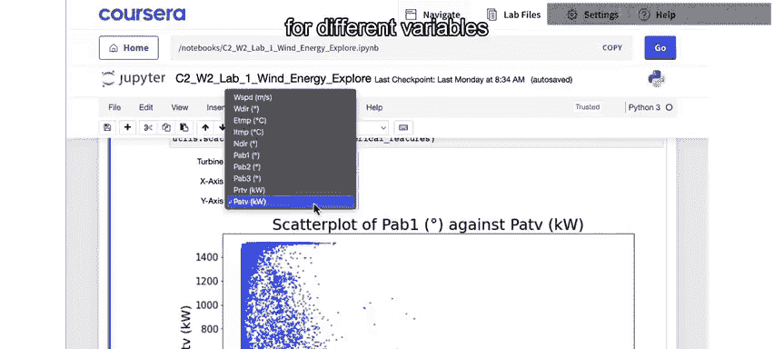

It can also be useful to able histograms and scatter plots across all numerical features in your data all at once。

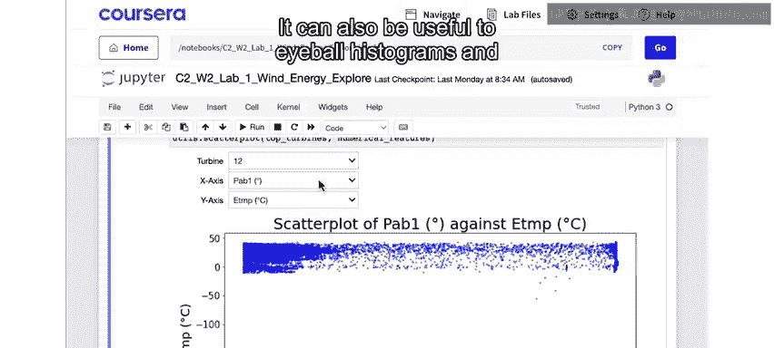

When you run this next cell， you'll generate a grid of plots similar to what you did in the air quality monitoring project in course one of this specialization。

Where here along the diagonal， you have the histograms of each variable。

 and in the grid cell you have a scatter plot of the feature or variable listed on the vertical axis against the feature listed on the horizontal axis。

And as in course one， in some sense， this grid is redundant because you have that diagonal mirror image up here in the upper right。

 as you do in the lower left。But this can be a nice way of looking at the distributions and relationships in your data really quickly One thing you're looking for in these scatter plots are potential correlations between variables。

 and so it can also be useful to run a correlation analysis to see exactly what these correlation coefficients look like。

When you run this Nxo， you're now culating the Pearson's correlation coefficient for each numerical feature combined with every other feature Again。

 this is mirrored along the diagonal。

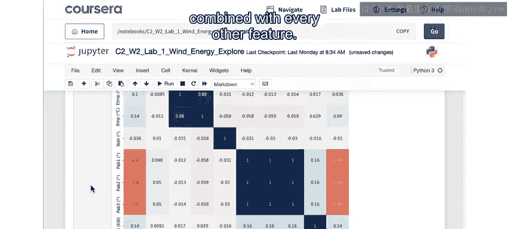

And the diagonal itself of the ones just indicate that each feature is， of course。

 perfectly correlated with itself。

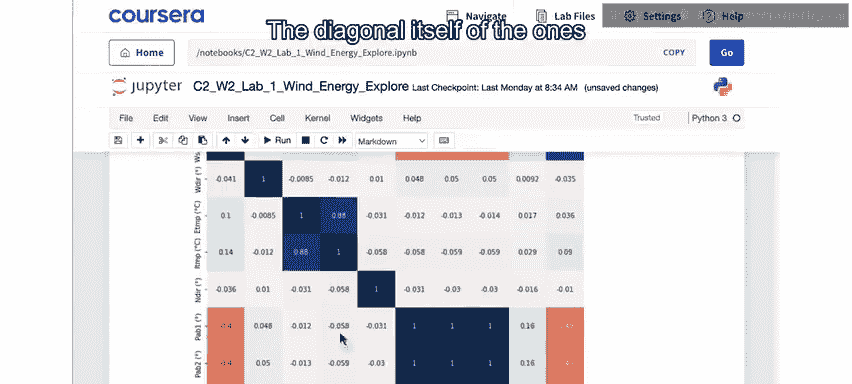

But in all these other grid cells， you have a measure of the relationship between two features where values close to negative one or one indicate stronger correlations and values near zero indicate no significant correlation。

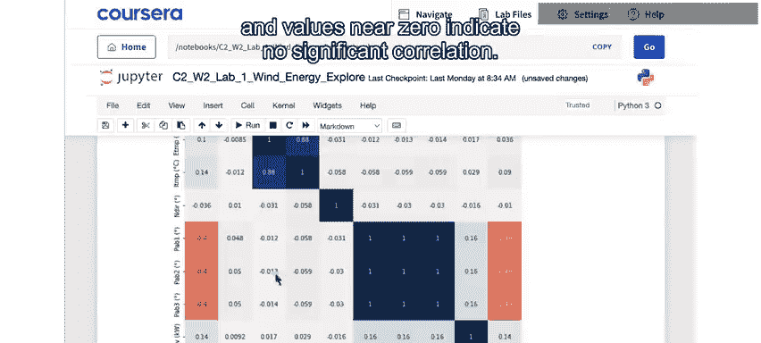

In this color scheme， red or orange is showing negative correlations and blue is showing positive correlations。

Some of the things that immediately jump out that there are a number of ones off the diagonal here。

 which just means that these are redundant features In this case。

 these three features are given the pitch angle of each of the three individual blades of the turbine so it must be that all three blades move together in these particular turbines such that they're always at the same pitch angle。

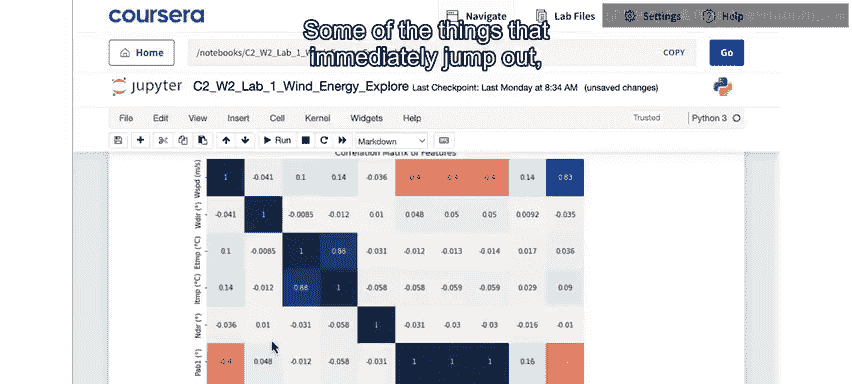

And perhaps unsurprisingly， the strongest correlation with power output is wind speed。😊。

Have a look at the other correlation value shown here and compare them with the scatter plots above just start thinking about which other features might be important for a predicted wind power output。

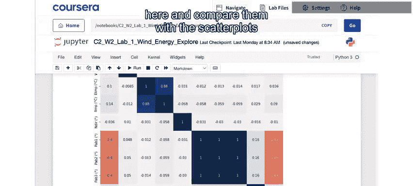

And finally， you can look at time series plots of each day variables in your data Act。

 the first thing to do here is to combine the day and timestamp columns into a single daytime feature。

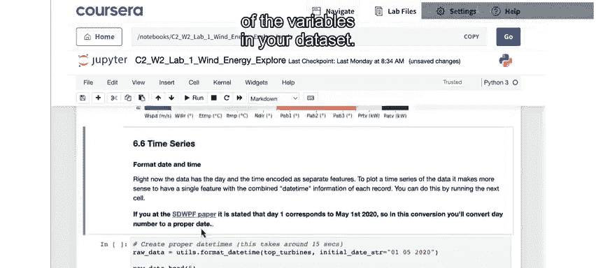

If you look at the paper describing this data set， you'll see that the first date in the data set is May 1 2020。

 so in running this next cell you'll create date times starting from that date。

Then when you run this next cell， you'll plot a time series for a particular turbine。

So here you're now looking at the entire eight months or so of data contained in this data set for a particular feature and a particular turbine。

You can select other turbines and look at the time series for each of the variables。

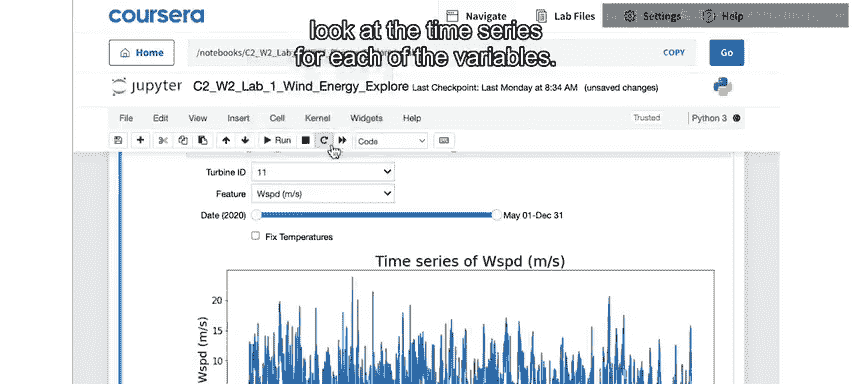

For your convenience。We've added this fixed temperatures button to fix a problem that we noted above that temperatures seem to have a very low minimum value that doesn't look representative。

 so this button allows you to fill in those values with interpulation for easier of visualization。

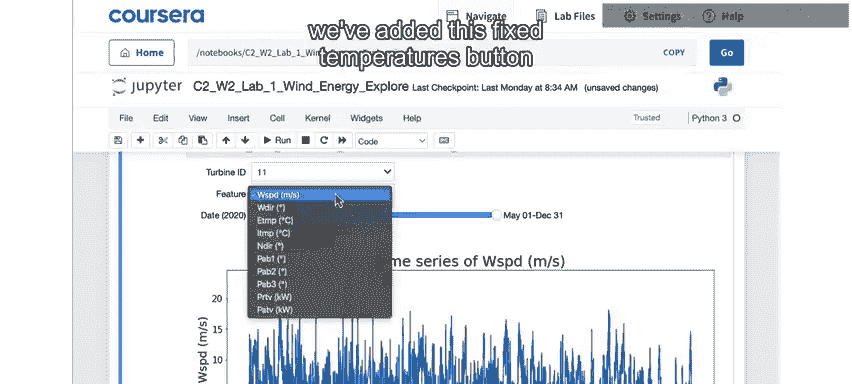

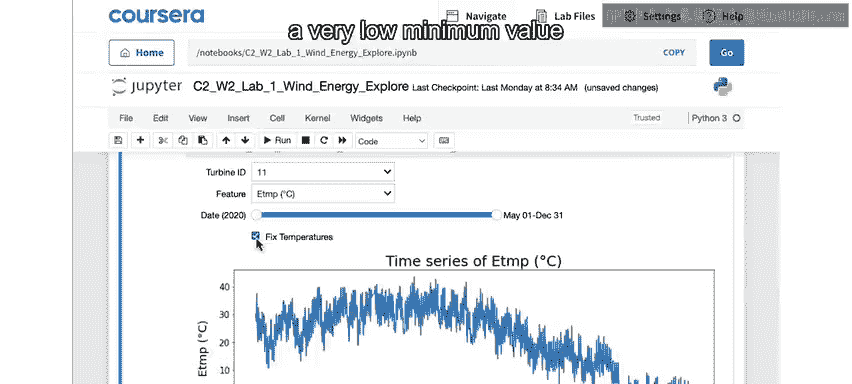

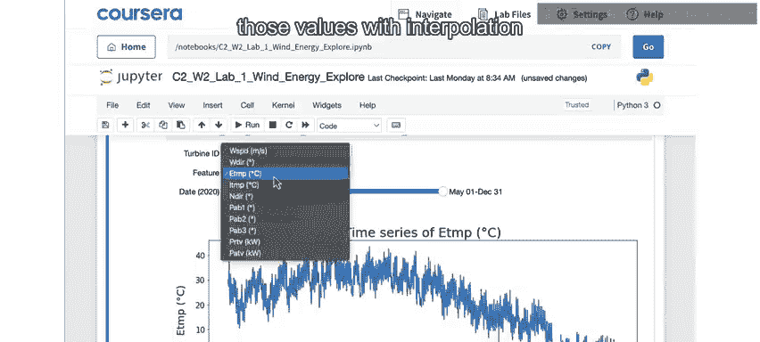

And you can use these letters to zoom in on specific date ranges。

Have a look at the different turbines and run this out below to compare a single variable time series across two turbines。

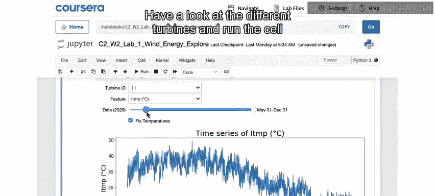

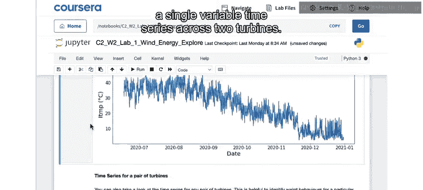

And with that， you've wrapped up the data exploration lab for wind power forecasting the key things to take away at this point is that it looks like you have some strong correlations between variables。

 in particular the expected correlation that wind speed and power output are strongly related to each other。

😊，Given the relationship between wind speed and power output。

 being able to make power output forecasts will have a lot to do with being able to make wind forecasts。

😊，In this case， one critical component that's missing from your data set is where forecasts。

This would normally be included in any wind power forecasting solution。

When you move into the design phase， you'll first look at potential solutions that include only historical data。

 but after that you'll create synthetic wind forecasts to see how that improves your model performance。

