# 吴恩达《AI for Good专业课程》 AI与公共卫生、气候变化、灾难管理｜中英字幕 - P52：14_风力发电探索阶段检查点.zh_en - GPT中英字幕课程资源 - BV13u411F7xZ

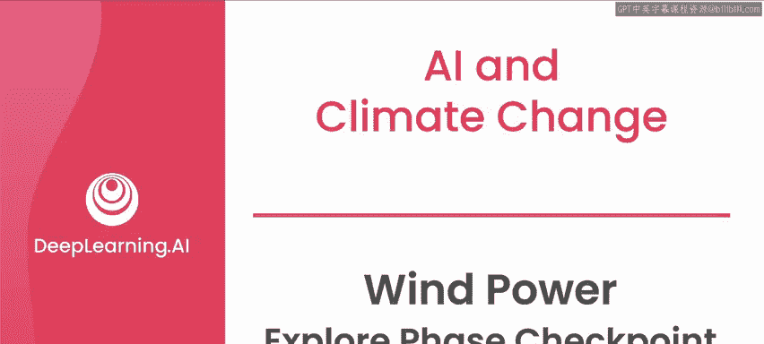

In this lesson， you walked through the lab for exploring your data for wind power forecasting At this stage of the project。

 your goal is now to determine whether you have everything that you need to move on to the design phase。

In your exploration of the data， you saw that some of the variables in the dataset set are correlated。

 and， in fact， there is a strong correlation， but a nonlinear one between wind speed and power output。

 These patterns and relationships in the data are now a good indicator that AI might be useful in using some collection of these variables to predict your output。

😊。

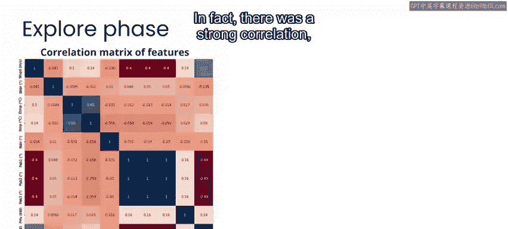

Now， in reality， like we saw， there are many groups around the world using AI to do wind power forecasting and the results are promising。

 so this makes it a safer bit to say that in general。

 AI can add value to the problem of wind power forecasting and for a project like this it would be important that in addition to a direct stakeholders like wind farmm operators and power companies。

 you reach out to see if you can get connected with other groups who have approached this problem and learn from them what works best and what to avoid。

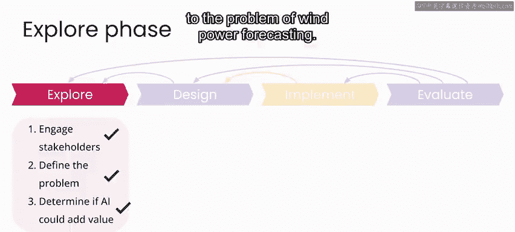

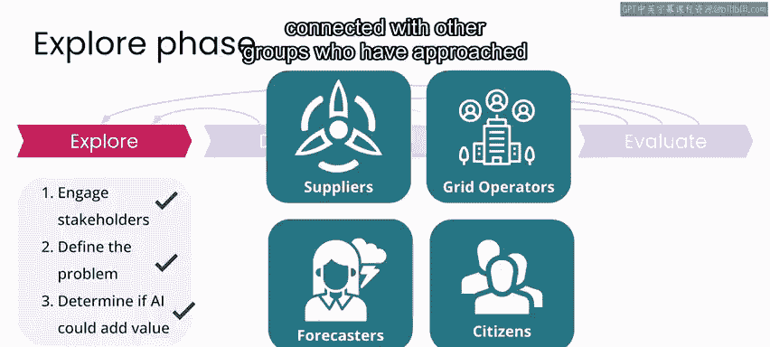

In any case， even if other groups have had success。

 you'll still need to determine whether the data that you have access to will be sufficient for building a solution。

In your consideration of whether AI can add value as part of the solution。

 it's important to also start thinking about the Do No harm principle and considering what any negative impacts of your work could be。

It may not be immediately obvious at the start how your work could end up doing harm。

 but if you are considering potential negative outcomes at every phase of your project development。

 you'll be more likely to avoid those negative outcomes。At the end of each phase in the framework。

 there are a series of questions that you should ask yourself and your team to ensure that you have what you need to move on to the next phase。

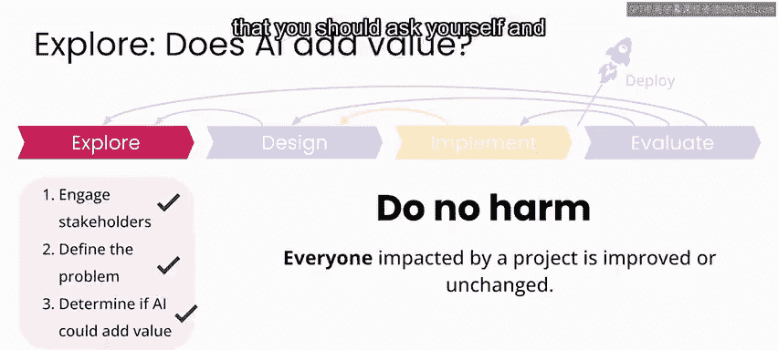

At the end of the explore phase， you need to be able to answer these questions。First。

 what is the specific problem you are addressing？Second， who are the stakeholders？Third。

 do you have access to or can you obtain the necessary data？Fourth， could AI add value。

 where and how specifically， and then finally， how does the Donohan principle come into play here？

In the wind power example that you're working on here。

 the specific problem that you're working on is electric utility companies need reliable predictions of wind power output at least 24 hours in advance in order to better plan their requirements for other power input sources to the electrical grid。

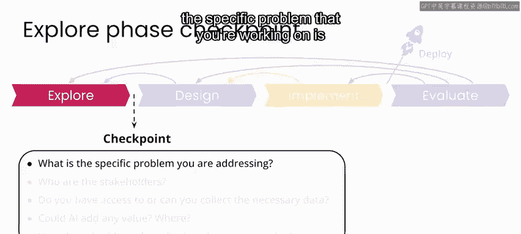

The stakeholders here would include the companies that build。

 maintain and deliver power from wind turbines， weather forecasters。

 and individuals within the electric companies that will be responsible for balancing wind power with other sources。

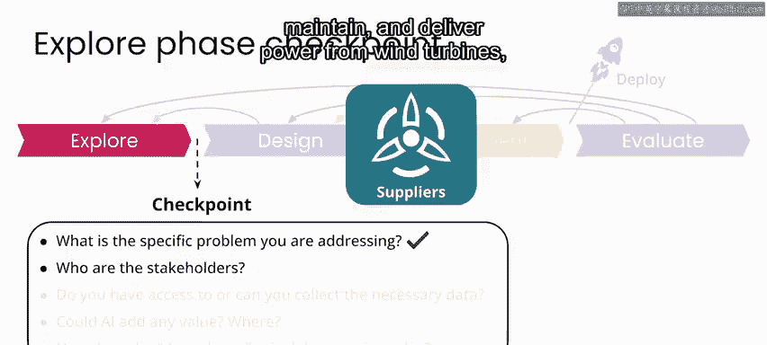

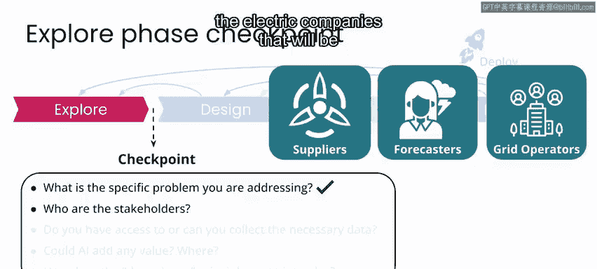

As well as groups who have worked on this problem in the past or are currently working on this problem。

😊，The data you need to approach this problem has made available by the company running the wind turbines。

 so you do have access to the necessary data。

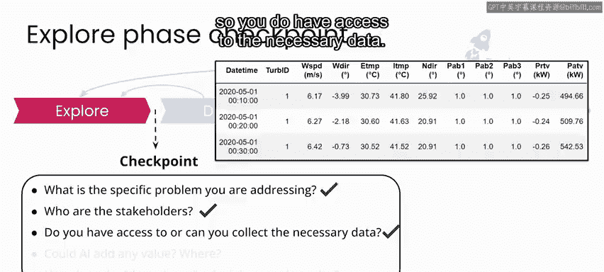

In your exploration， you identified complex relationships and patternss in the data。

 which means AI might be able to learn from those patterns。

It's also true that many groups around the world are applying AI to this problem and getting promising results。

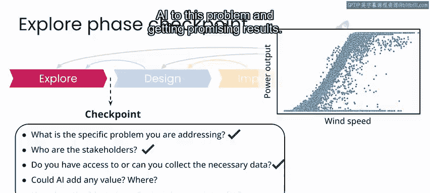

In terms of Dunno Hung， you already saw an example in a spotlight video of where the placement of solar farms could potentially impact the environment in local communities。

 and the same is true for wind farms。In the particular use case that we're looking at here。

 we are looking at increasing the efficiency of existing wind power systems， not。

Looking for places to install new ones， but if your research is part of the solution to predict where new wind farms could go。

 then you will need to consider these and other potential harms。

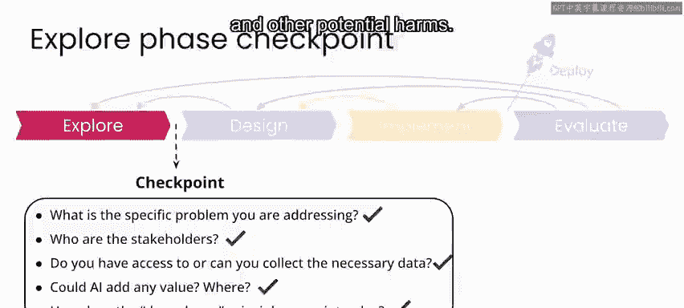

So if you find yourself exploring another project in the future and the answers to some of these questions remain unclear。

 it's best to spend more time exploring the problem until you've gathered all of the information that you need to comfortably move forward。

😊，In this case you're ready to move on to the design phase for windpower forecasting。

 join me in the next lesson to dive into the design phase。

