# 吴恩达《AI for Good专业课程》 AI与公共卫生、气候变化、灾难管理｜中英字幕 - P53：15_风力发电建立基准模型.zh_en - GPT中英字幕课程资源 - BV13u411F7xZ

You will now enter in the design phase for the wind power forecasting project in the Exp phase in the previous lesson。

 you looked at who the key stakeholders were， you wrote down a clear and concise problem statement。

 you consider the D Na harm principle and you explore the data to determine whether or not AI can play a role as part of a solution。

Now in the design phase， you'll be doing a deeper investigation of the data and you'll start to test out some different modeling strategies。

Along the way， you'll be thinking about what the end user experience will be like。

In the next lab activity， you'll begin by simply trying to estimate wind power output given all the data in your data set。

 and this includes wind speed， temperature and the configuration of each wind turbine。

Note that this is not yet we power forecasting here you're working with data to see how well you can model the problem without yet worrying about forecasting into the future。

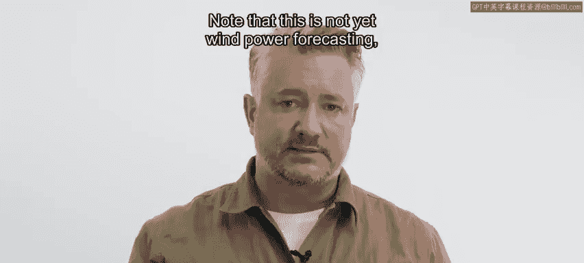

You'll begin by cleaning up the data to remove abnormal values and other anomalies。

 and then you'll establish a baseline， which is to say a measure of how well you can do just modeling this problem with the simplest。

 sensible model that you can think of There are a number of reasons to establish a baseline with a simple model before you start exploring more complicated solutions。

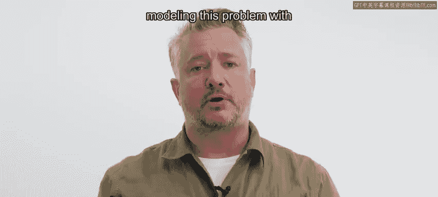

For starters。You might discover that a simple model provides a result that is good enough for your end use case。

In this case， you't need to worry about working on a more complicated solution。

 and so you can potentially save time and money， both in developing the solution and in supporting long term。

 such that your model results are also more understandable and interpretable。

In the case that you do move on to more complicated modeling efforts。

 your baseline can provide a quantitative way of demonstrating just how much of a performance improvement you're getting from that investment in a more sophisticated model。

Let's take a look at establishing a baseline for estimating wind power with a data that you've been looking at in the previous lab where you explored the data。

 you found that wind speed and power output are unsurprisingly strongly correlated。

One of the simplest ways to represent the relationship between correlated variables is with a linear model。

 which is just to say you will draw in a straight line that is the best fit to the data。

 So in this case， of wind speed versus power output， it might look like this。As you can see。

 the relationship between wind speed and power output does not follow straight line。

 but as a simple baseline， this is a perfectly reasonable starting point。

 and so this will be the first step in the upcoming lab。

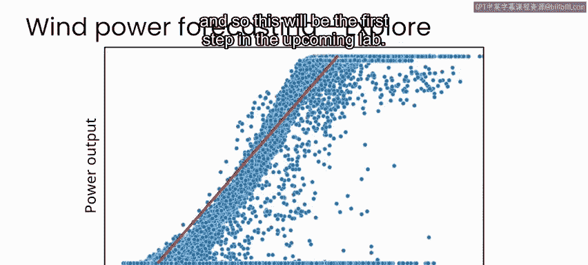

After that， you'll perform some feature engineering to prepare your data set for modeling using all of the features first for a linear model and then with a neural network。

So let's head over to the lab to work through preparingial data and establish it in that baseline。

Here again， you are working with a special dynamic wind power forecasting or SDWPF data set that you explored in the last lab。

The first step， as always， is to import all the python packages that you'll need and you can do this by writing the first cell。

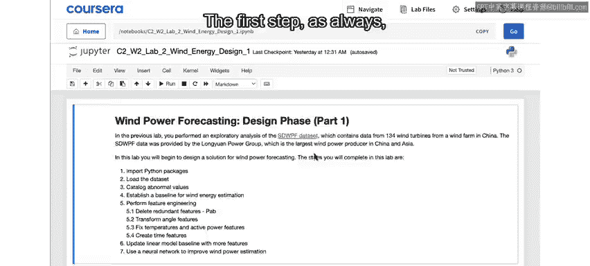

Next， you're reading the data and run a couple of operations that used in the Los lab。First。

 to reduce the number of turbines in the data set to just the top 10 in terms of power output and to convert the day and timestamp columns into a proper daytime。

Then with this last line here， you'll print out the first few rows of the data set to spot check that everything looks okay。

The next step is to identify and ultimately drop abnormal values from the data set。

If you take a look at the paper that describes the data。

 you will actually find a section called caveats about the data。

 which identifies cases of missing unknown or abnormal entries in the data that should be excluded from your analysis。

The characteristics of such entries are shown here， and with this next code cell。

 you'll identify entries that meet those criteria by adding a column to the dataset set called include。

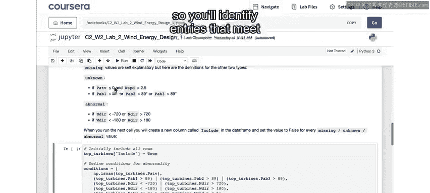

Where false indicates that an entry is missing， unknown or abnormal。

 and true indicates a row of good data。In a real world application。

 you would need to think about how youre going to deal with these missing or abnormal values in your processing pipeline。

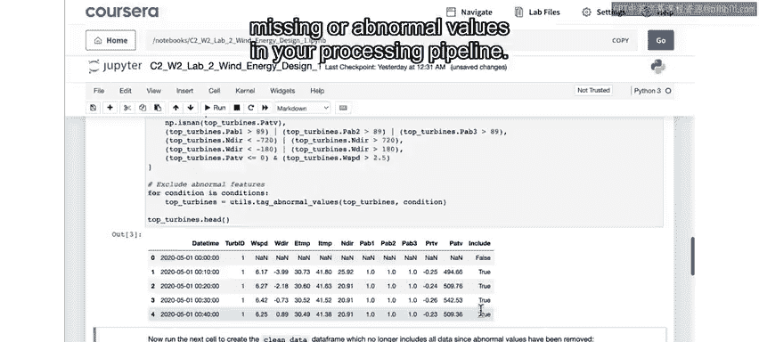

For the purposes of this lab， we'll just drop all the values where include is false and you can accomplish that by running this next cell。

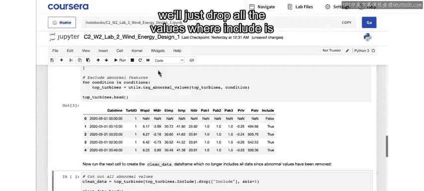

And with that， you are ready to establish a baseline。

 run this next cell to fit a simple linear model to the wind speed versus the power output data。

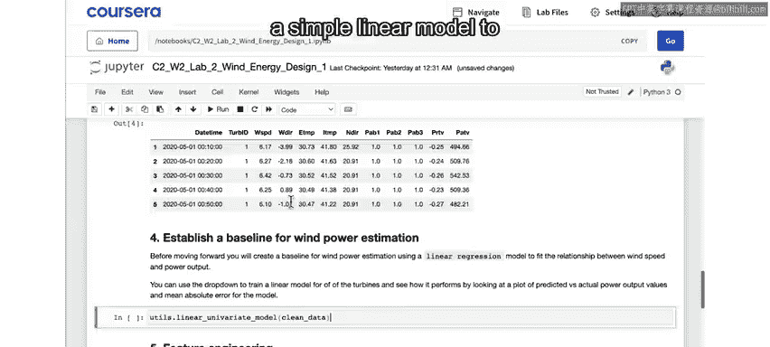

You will run this for one turbine at a time and you can look at the results for different turbines by choosing from this pull down menu here on the left。

 you have wind speed in me per second on the horizontal axis and power output in kilowatts on the vertical axis。

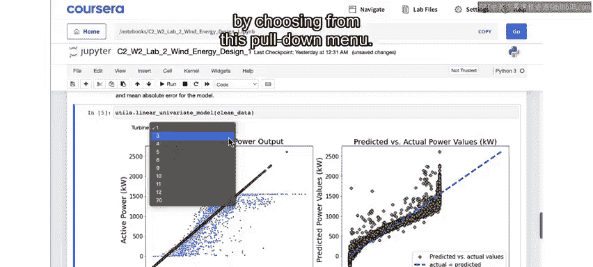

The real data is shown in these blue data points， and the best fit linear model is shown as these orange points。

So the way this works is that for a particular wind speed。

 your linear model would estimate a power output that falls along this line of points。

On the right here is another way of looking at this same result。

 but now you have the actual power output on the horizontal axis and predicted power output on the vertical axis。

And now each orange data point represents an estimate from your model。If your model was perfect。

 all the model points would sit right on this dashed line where actual equals predicted。

But in this case， you have some model estimates that are below the line。

 meaning that the model underestimated actual output power and some points that are above the line。

 meaning that your model overestimated the output power for that particular wind speed。

The takeaway here is that while a linear model is far from perfect。

 it can serve as a reasonable baseline， and so down here you can see a printout of how well your model is doing in terms of mean absolute error in units of power output in kilowatts。

So for turbine 3 here， your model is on average off by about 147 kilowatts。

 and if you look at the Y axis here， you can see that this is probably about maybe 10 to 20% error to give you an idea of the scale here。

So try this for different turbines to get a sense of how well your simple linear model is performing。

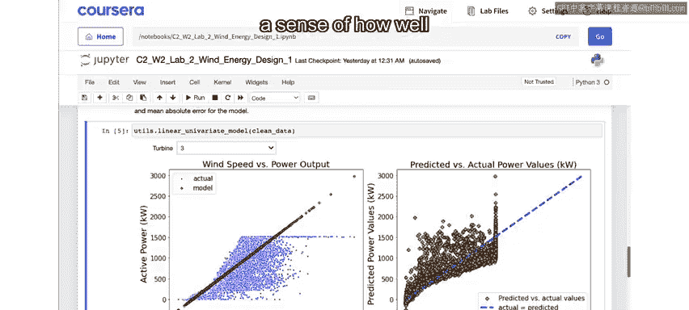

So you've got a baseline and now you'd like to see how you might improve on that baseline with a more sophisticated model to that end。

 the next step is to clean up your dataset set and do a bit of what's called feature engineering to prepare your data for modeling。

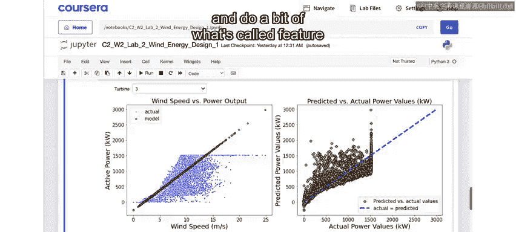

Each of the columns in your data set that might contain information about the variable you aim to predict。

 which is power output known as fidges， and so that's what I'll be referring to them as going forward。

First half in the last lab， you saw that these turbine blade pitch angle features were all perfectly correlated。

 meaning that they're redundant， so we can run this next cell to reduce these three features down to just one。

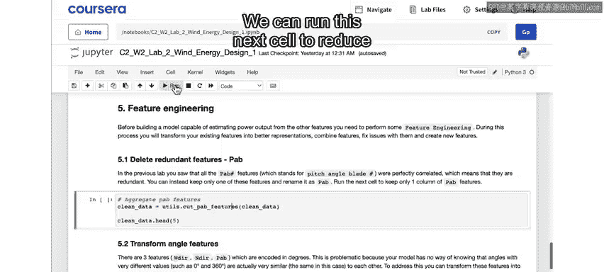

Next， you'll have a number of features that are expressed as angles in degrees。

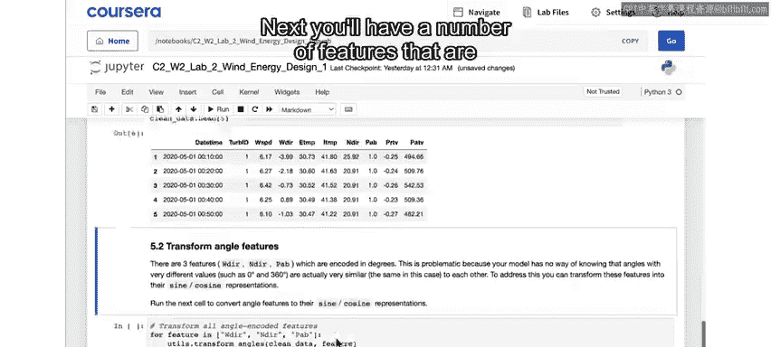

The problem here is that to your model these are just numbers。

 so while you might recognize that0 and 360 degrees are actually indicating the same direction。

 your model will think that these are far apart， the solution is to convert these into new features that contain the signine and cosine of each of these angle features。

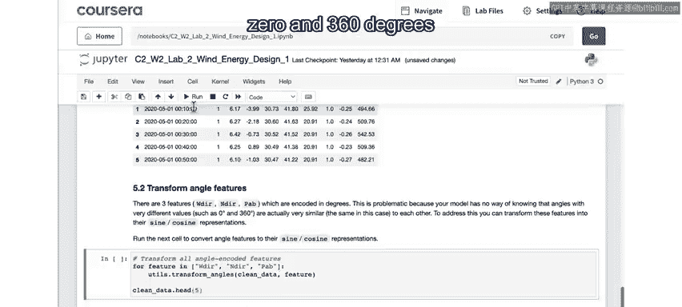

In other words， the sine and cosine of 0， 360， 720， etc， are all the same。

 and so by performing this conversion， your model will be able to recognize numerically when two angles are close together。

 even if they look quite different when expressed in degrees。

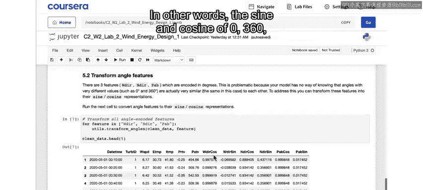

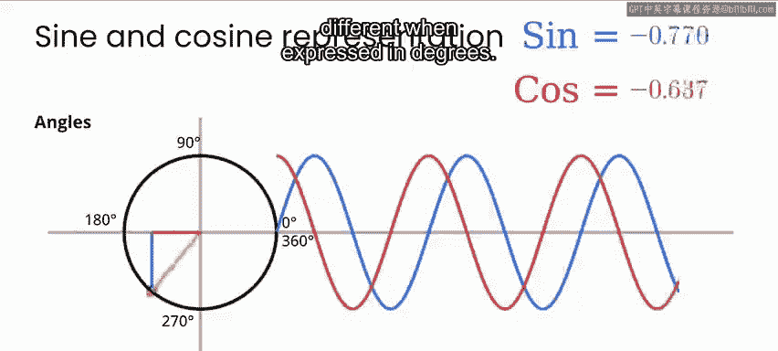

So after you run this out， you will see how you have gotten rid of the old features and now you have new columns representing the sign and cosine of each of the angle features you had previously。

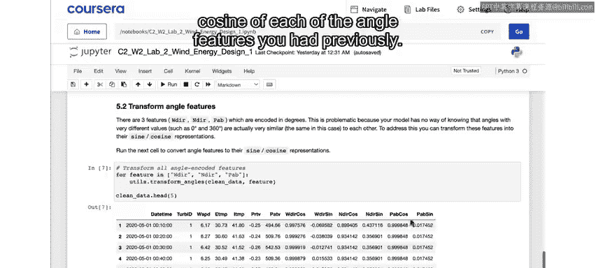

Next， you'll fix some issues with the temperature and active power columns you saw in the loss lab that oftentimes the temperature columns contain values around negative 273 degrees Celsius。

 which is clearly an anomaly。You'll fix these values by simply interpating between the data that looks like valid sensor measurements。

And then in some cases， you also have active power readings that are negative。

 which you can just set to zero。Run this next cell to clean up the temperature and active pal features。

And we are doing a lot of this for you and you're fortunate that the paper that comes along with this data set tells us what these anomalies are。

 identifying anomalies and trying to interpret them is something that is often a very complicated and very time intensive process。

But skipping that in this course as the final step here。

 you're converting the time of day to assigning cosine representation。

 much like you did for the angle features that were recorded in degrees。😊。

And this is for a very similar reason in that in a 24 hour clock。

 the time is 2359 and 001 are very close， but to your model they would look quite different if we didn't do this conversion。

 so were converted into sin andcosine representations as if the hourss of the day represented angles around the circle。

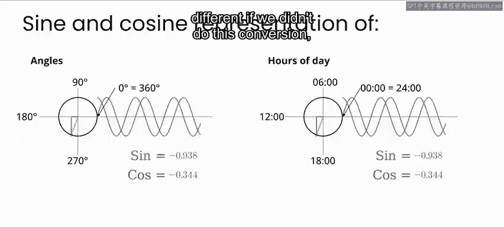

And finally， you just need to rearrange the columns a bit。

 so you have all the features that you want to use for prediction on the left and the target variable that you want to predict active power in this case on the right。

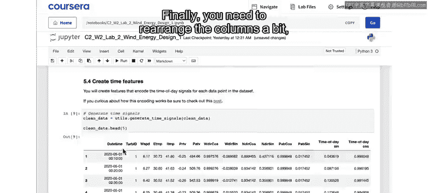

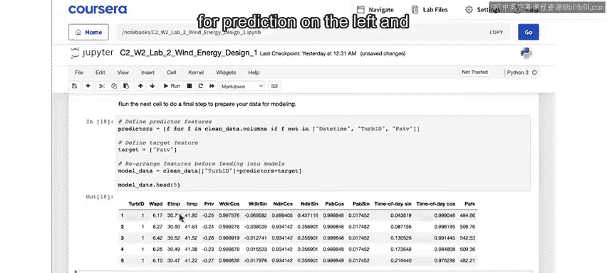

Bun this Excel to rearrange your data in this manner。Okay， that was a lot。

 but now you're ready to start testing new models， join me in the next video to try out a linear model using all the features in your data set and then neural network models。

