# 吴恩达《AI for Good专业课程》 AI与公共卫生、气候变化、灾难管理｜中英字幕 - P54：16_风力发电改进基准模型.zh_en - GPT中英字幕课程资源 - BV13u411F7xZ

In the last video， we walked through the first part of the design lab for wind power forecasting there you first cleaned up your dataset to remove anomalous values and then established a baseline using a simple linear model to fit the relationship between wind speed and power output from a wind turbine。

After that， you perform some feature engineering to better prepare your data for use in a more sophisticated model。

The first step in the next part of the lab is to try out a linear model with more than just one feature。

In two dimensions， it is relatively easy to visualize what a linear model looks like。 again。

 just a straight line。 But if you go into three dimensions。

 your linear model actually becomes a plane and in high dimensions。

 there is no good way to visualize it， but you can just think of this high dimension linear model as a model that is still simple but using more information to try to estimate your target of power output。

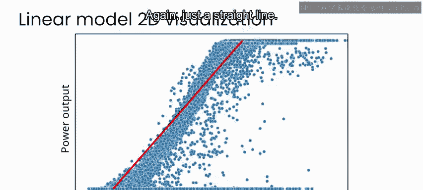

So in some sense， you can think of this as still a simple baseline。

 but using more of the information in your data okay， back in on notebook。

 at this point you've prepared your data for developing a model using all of the features apart from just wind speed to predict power output。

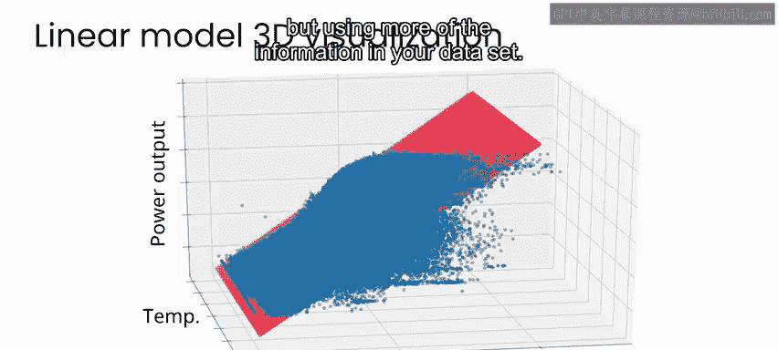

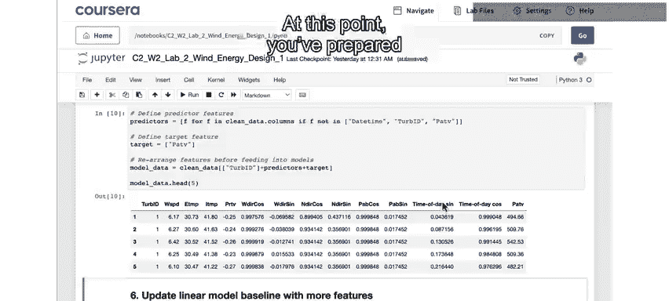

Once again， if you have been following along and have run all the cells in the lab up to this point。

 you can continue from here， but if you're just opening up the lab now。

 be sure to run all the cells up until this point When you run this next cell。

 you can select which features you want to use your model in this pull down menu。

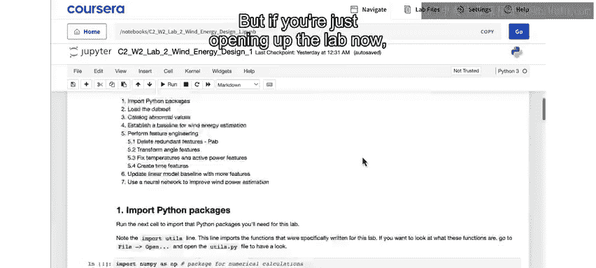

Use shift and click with your mouse or the down arrow to select multiple features。

Then press the runIn button to run the model。

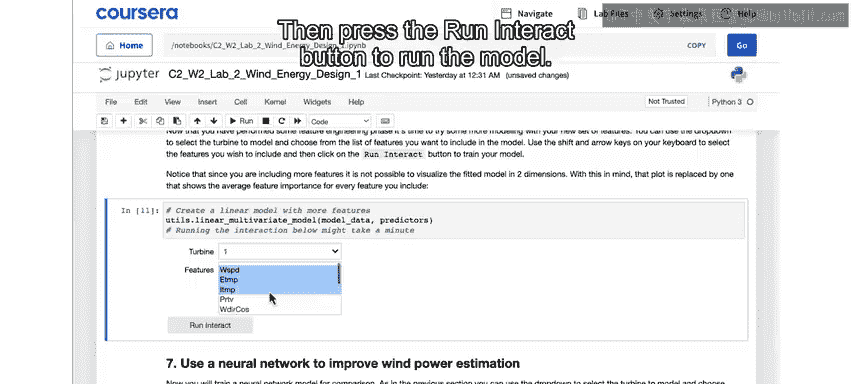

So first I can just run this with wind speed and confirm that I get the result I saw in the baseline model above a simple linear model and so we looked at turbine 3 with the baseline model so that you can confirm here that you get the same mean absolute error that you saw above。

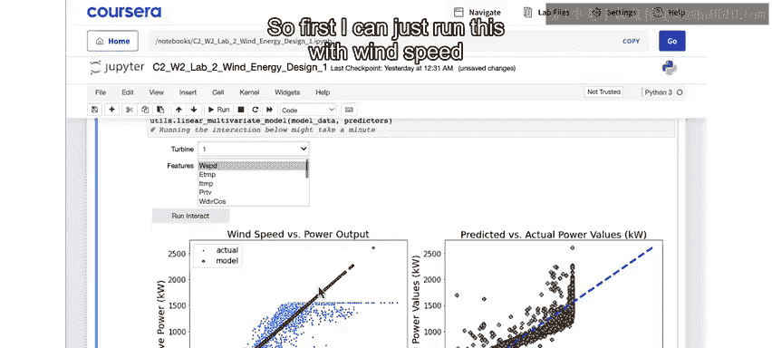

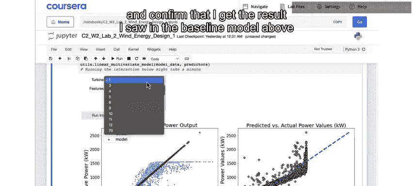

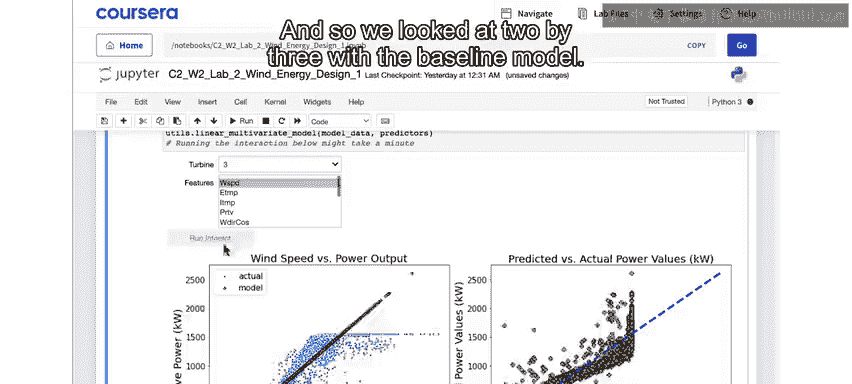

And putting in these kinds of spot checks and redundancies is really important in any data analysis。

So here you can see what's plotted again is the real data in blue and your model as this line of points in orange。

And on the right， the actual versus the predicted power output。

But then you can go back up here and now you can select more than one feature from this list and run the model again。

So here you can select more than one feature by clicking on one and then using the shift key and keyboardarrow to select more。

 so I'm going to go ahead and select all the features to see how that goes。

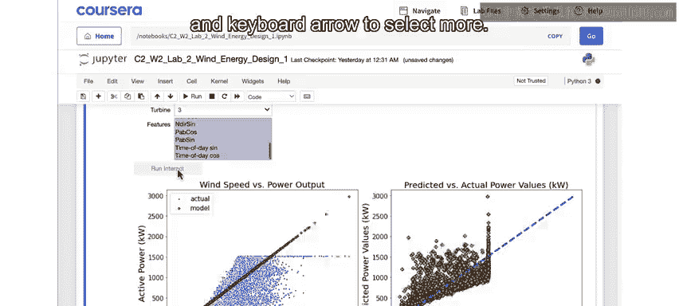

Now， you will see that your model， again represented by the orange points here。

 is not following a straight line in this two dimensional space of wind versus power output。

 and that's because it's drawn out information from more features In this case。

 all the features in the data set， and that's allowing you to make a slightly better prediction。

You can now see that the mean absolute error is a bit lower than when you just were using wind speed。

 we're now at about 135 and so this indicates that your model is doing a better job at estimating power output now that you're using all of the features。

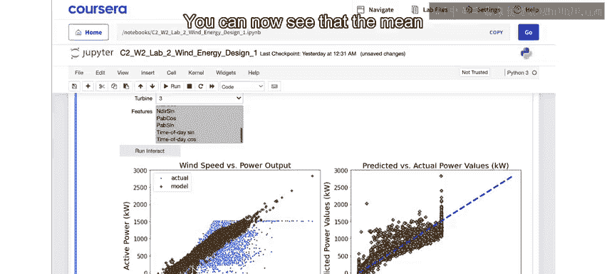

And then when you use multiple features down here， you have something called feature importance and in machine learning。

 feature importance is a score or a ranking of how much each feature contributed to a given prediction。

Here you can see that wind speed is the most important feature， unsurprisingly。

 but the pitch angle of the blades is also important。

 These are the sign and coaddin representations of that feature。

 as well as the internal and external temperatures。The rest of your features however。

 didn't add much in terms of predicted value， but it's important to note that this feature importance of values shouldn't be taken too literally and they will depend on the kind of model that you've chosen so for now try running your linear model for different turbines and different combinations of features and see how these feature important rankings might change as well as the mean absolute error。

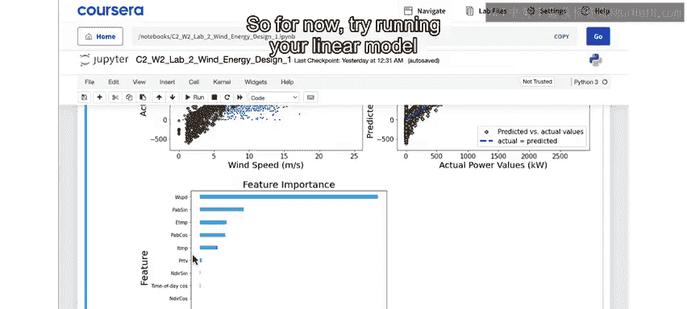

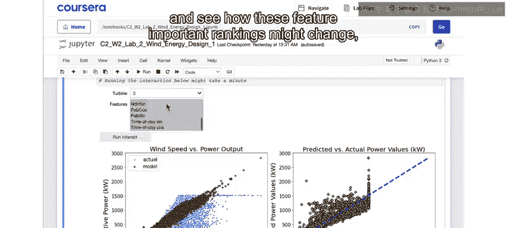

If you took cost one of this specialization， you've already used a neural network to make estimates of air quality。

In the next part of this lab， you'll use a very similar technique to make estimates of wind power。

 so join the next lab where we'll use the neural network to make estimates of wind power output from a turbine。

