# 吴恩达《AI for Good专业课程》 AI与公共卫生、气候变化、灾难管理｜中英字幕 - P55：17_风力发电训练神经网络模型.zh_en - GPT中英字幕课程资源 - BV13u411F7xZ

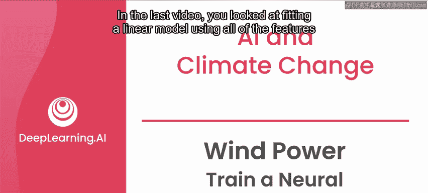

In the last video， you looked at fitting a linear model using all of the features in your data set in order to estimate power output from a wind turbine。

You saw that your estimates were actually a little bit better in terms of the mean absolute error when you were using all of the features compared to using just wind speed alone。

Now you'll try using an neural network， which is capable of learning nonlinear patterns in the data to estimate the power output。

If you took course one of this specialization， then use the neural network to make estimates of air quality and now you will use a very similar technique to make estimates of wind power one way that it might be useful to think about a neural network here is just that it is a stack of multiple linear models when we have a stack or multiple layers of linear models that network can begin to learnlinear relationships and so a neural network is an algorithm that's a relatively simple strategy at its core It's made up of these layers of so-called artificial neurons and as you saw in the previous course not neural network is a computation machine across those neurons where they take in a collection of inputs run a computation and then generate an output So like I said you could think of a single neuron as a simple linear model and then you'll connect a bunch of neurons together and what's called a layer of your neural network and with that you get the beginnings of a model that can represent theseline patterns。

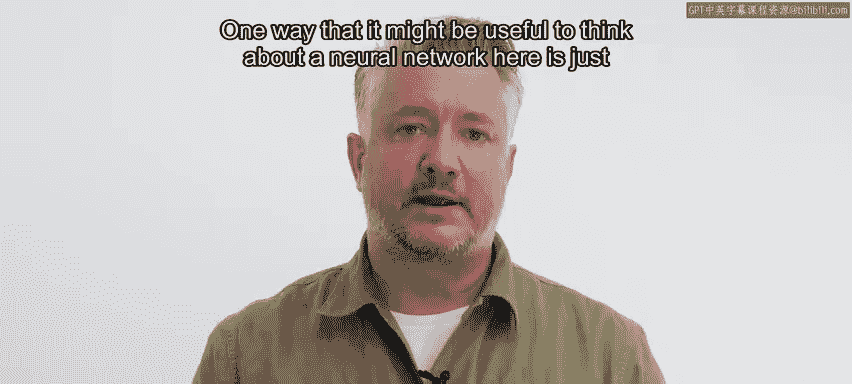

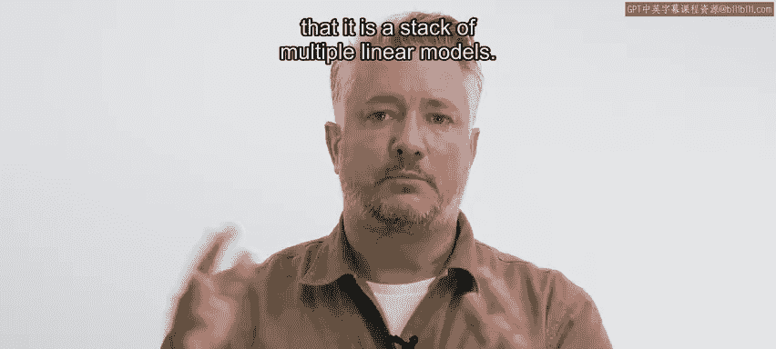

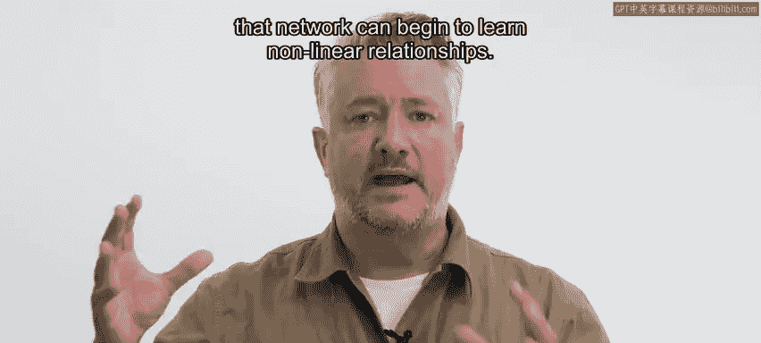

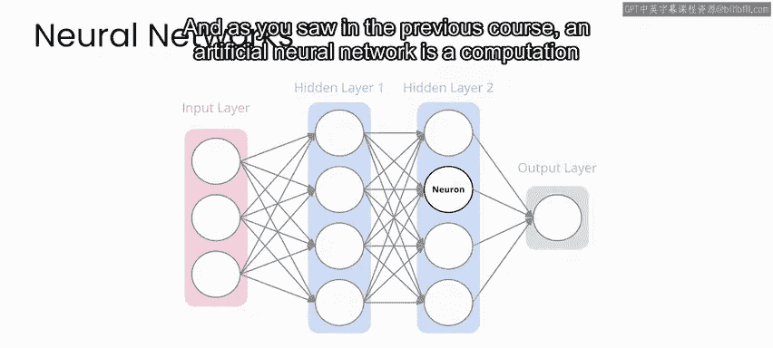

That we've observed in the data。

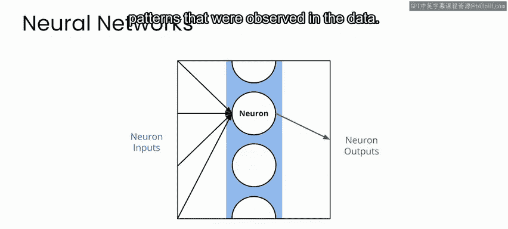

Then when you have multiple layerss in the network， the output from one layer gets fed into the next。

 and that layer generates its own output Eventually you get to the end and the network generates a final output。

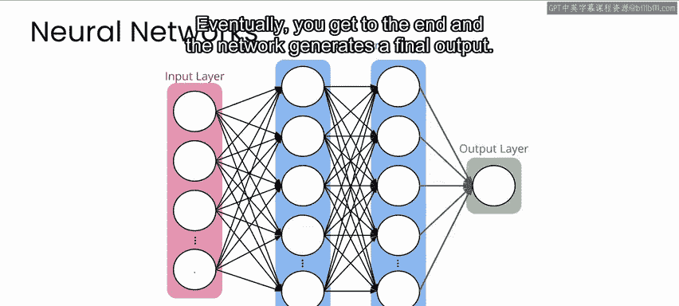

In our case for this project， that output will be a simple number that represents an estimate for the output power from a wind turbine。

So on the left side here， you're going to feed in all the information that you have for each set of measurements。

 namely， the wind speed， time of day and angle features， as well as temperatures。

And then you'll ask the network to make a prediction for output power。

You'll train the network on the historical examples where you think you know what the right answer is。

 and through that exercise， the network will learn to make better predictions。

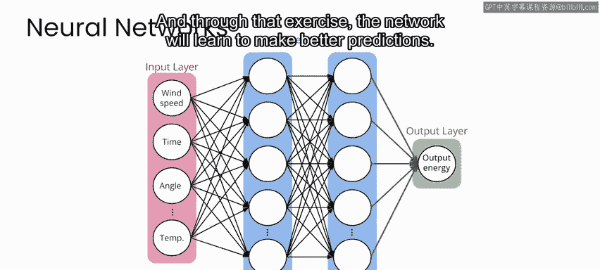

So let's jump back into the lab to see how that works。

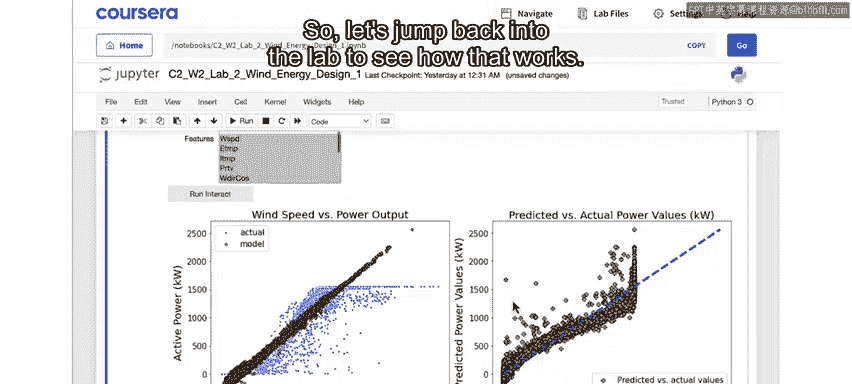

And we're back in the notebook as always， if you've been following along and run all the cells in the lab up to this point。

 you're ready to go， if you're just opening up the lab now。

 be sure to run all the cells right up until here and then you're ready to continue。

Just like before for your linear model here you can select different subsets of features from the pullll down menu and then click the Run Interact button to train your model。

Now you can see some output as the network trains and you don't need to worry too much about the details of this output just that your network is trying to minimize what's called the loss function so that with each training epoch your network is learning。

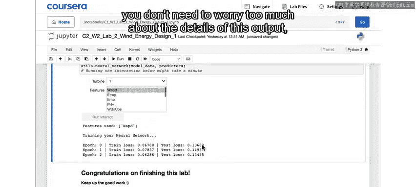

Then down here， you'll see a similar output as you did above。

 where the real data for wind speed versus power output is shown in blue and your model is shown in orange。

What is clear by comparison to your linear model is that your network is doing a much better job in predicting power output。

And that's probably the most evident here on the right。

 where you're looking at the real versus is the predicted power output。

And while there is some noise about the line representing the perfect model here。

 your model looks to be pretty stable and not systematically off in one direction or another across the entire range of output values。

You can also see that the mean absolute error printed here is significantly lower than it was with your linear model。

 but now I can try again with all the features in the data set to see how that goes。

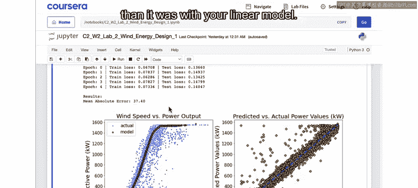

And then down here again， you can look at feature importance。

 which is a measure of the relative importance of each of the features in the data set for this predictive model。

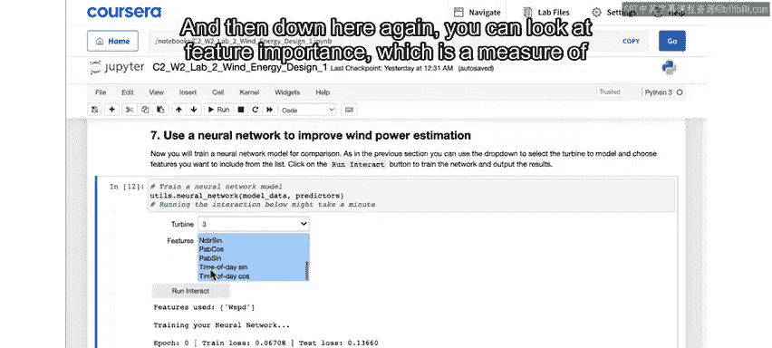

So you can see again that wind speed is the most important feature。

 but that the angle of the blade matters and the temperature matters as well。Again。

 it's important to look at feature importance as just one perspective on why your model is behaving the way it is。

 and it turns out that simply choosing a different model will impact the relative importance of features and you can see that when you compare feature importance between the linear and neural network models here。

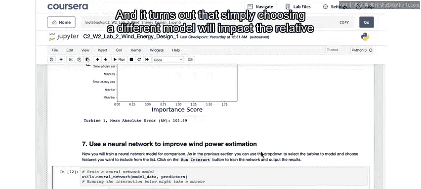

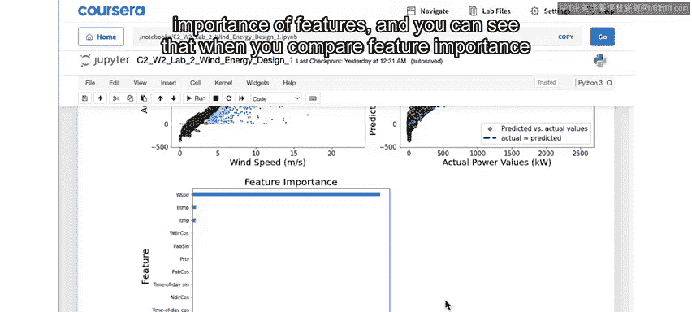

So try this for some different turbines and different combinations of features and see what you get can you drop some features from your model altogether without losing performance in terms of absolute error。

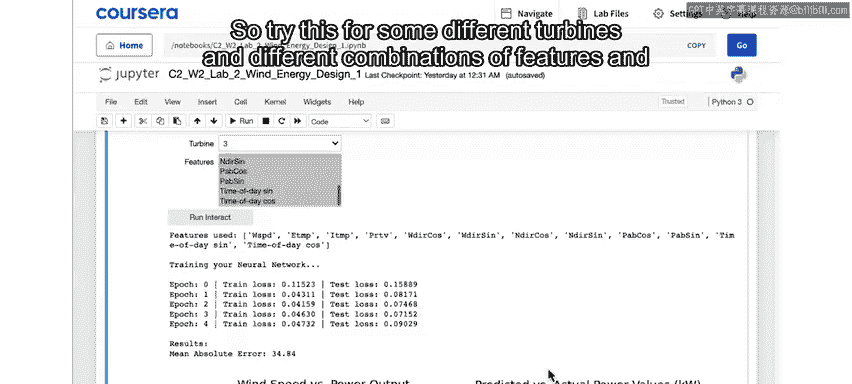

And that's it for the first part of the design phase for wind power forecasting What you've accomplished at this point is demonstrating that if you know how strong the wind is blow in and some things about the configuration of the wind turbine as well as the ambient temperature then you can do a pretty good job of saying how much power at that wind turbine will be generated Keep in mind however。

 that the real challenge here is predicting how much energy will be available in 24 hours and so that's what we're going to do in the next lab join me there in the next video to have a look at how we make forecasts of wind power。

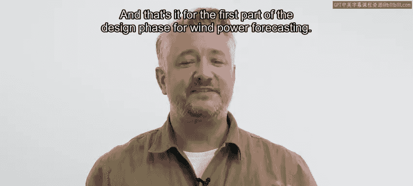

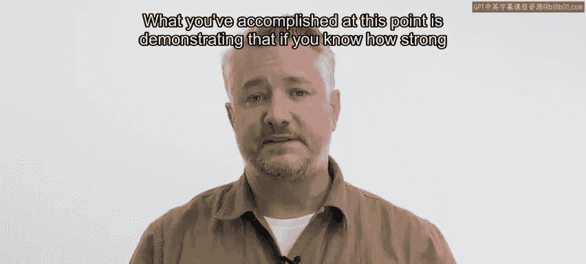

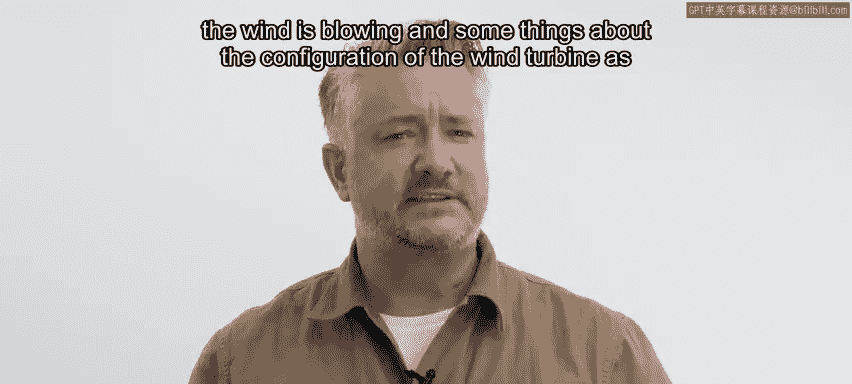

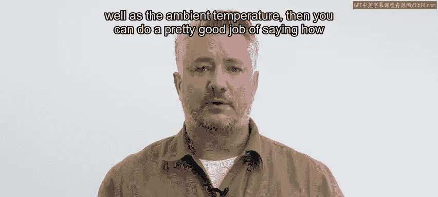