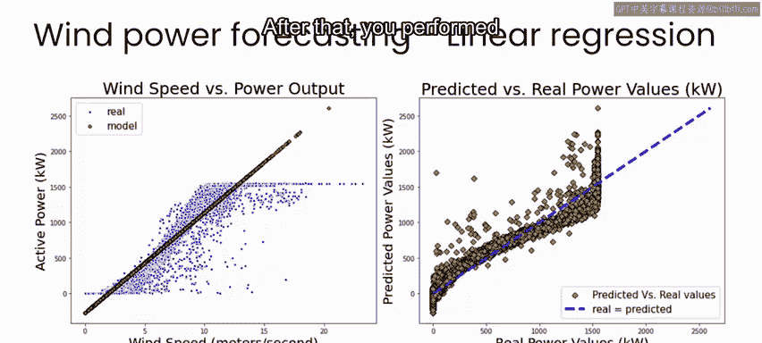
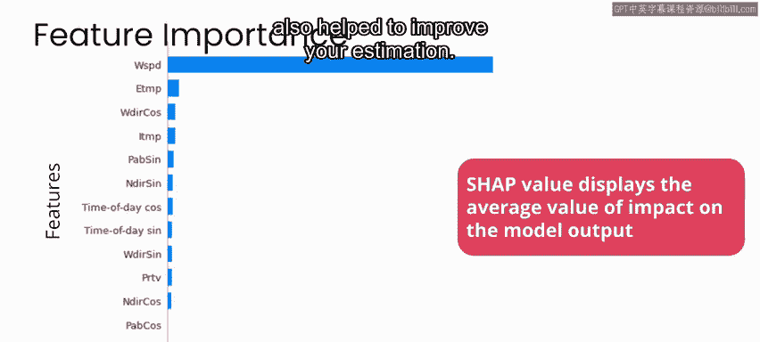
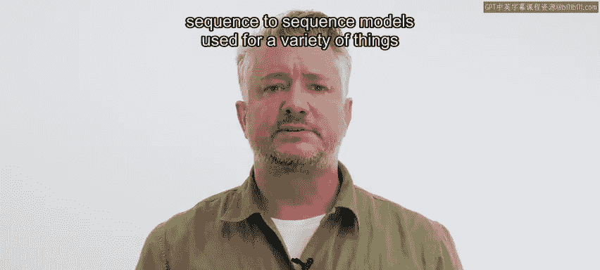
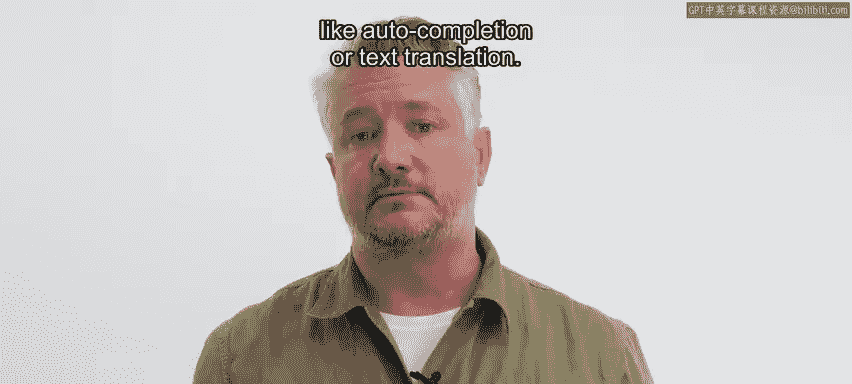
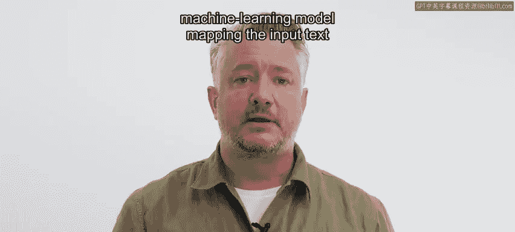
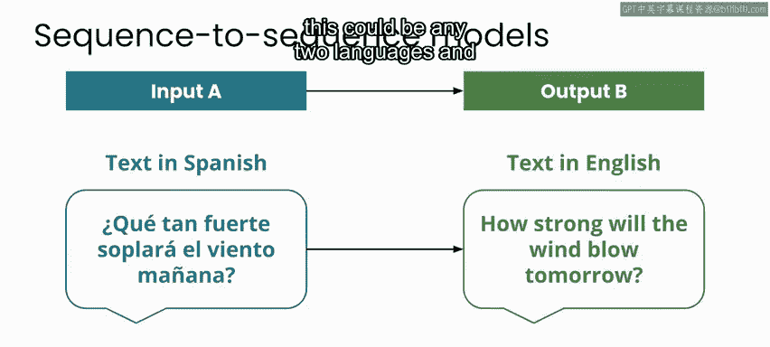
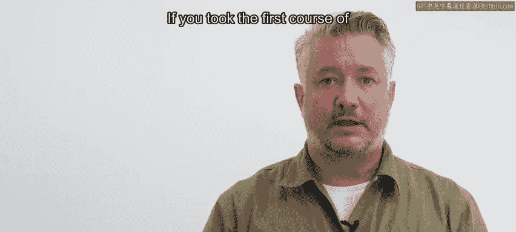
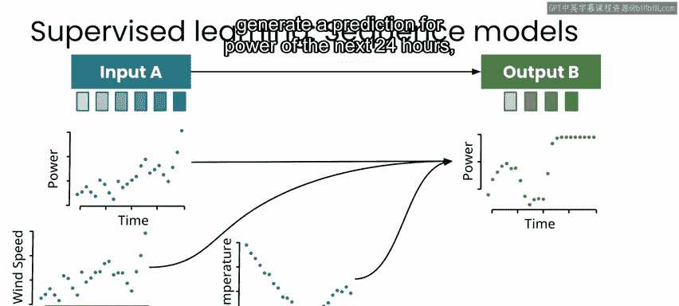
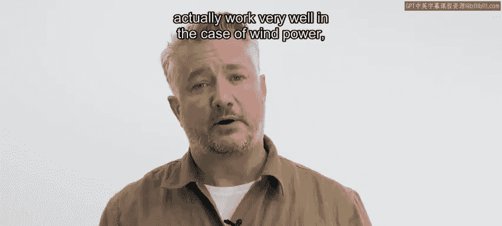
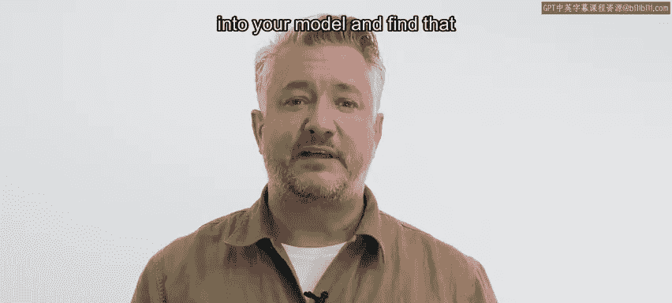

# 吴恩达《AI for Good专业课程》 AI与公共卫生、气候变化、灾难管理｜中英字幕 - P56：18_什么是序列模型.zh_en - GPT中英字幕课程资源 - BV13u411F7xZ

In the previous two videos， we went through the first part of the design phase there。

 you cleaned up the data set and established a baseline by fitting a linear model to wind speed versus power output。

 After that， you performed some feature engineering to prepare your data for use with a more complex model。

 And you found out why you could improve your linear model a little by including all the features in the data。

 A neural network did a much better job of predicting power output from those inputs。😊。

You also saw that keeping in mind the caveats about feature importance that we already looked at。

 wind speed is still the most important feature in your model。The internal and external temperatures。

 as well as the pitch angle of the turbine blades also helped to improve your estimation。

In the next part of the design phase。You'll tackle a challenge of forecasted wind power in the future you'll do this by implementing a series of different models in attempt to predict the next 24 hours of power output from a wind turbine。

You'll start with some simple baseline models to see how well you can do without implementing anything complicated。

 then you'll try a type of neural network model known as a sequence to sequence model in the world of AI models。

 sequence to sequence models used for a variety of things like auto completion or text translation。

You've probably used language translation applications where you can type in one language and immediately get a translation into another this is an example of machine translation where under the hood of the application is a sequence to sequence machine learning model mapping in the input text to the output text。

In this case you have an input sequence in Spanish and an output sequence in English。

 of course these could be any two languages， and while machine translation apps are far from perfect。

 they've made a lot of recent progress especially among widely spoken languages。

These sequence models can also be useful when attempting to make predictions about the future behavior of any variable of interest。

 like in the case of this project， wind power output。

So a sequence model like this can take historical data as well as other features as the input sequence or sequences。

 and then generate predictions as the output sequence。

If you took the first course of this specialization。

 you learn that supervised machine learning models require a set of inputs and outputs to be trained on。

 and sequence of sequence models are another form of supervised machine learning。

To train one of these models， you give it an example of the kind of input sequences you want it to learn from and also examples of output sequences that represent the correct answer。

In the case of wind power， an input sequence could be the power produced per hour over the last 24 hours。

 and the output sequence could be the power produced per hour over the next 24 hours。

 You could also give your model multiple sequences to learn from， like in this case。

 not just the historical power， but also the historical wind speed。

 temperature and the configuration of the wind turbine over the last 24 hours。

These inputs are then combined to generate a prediction for power over the next 24 hours。

You'll try both of these approaches in this next lab and discover that unfortunately using a pass to predict the future doesn't actually work very well in the case of wind power after that you'll incorporate wind speed forecasts into your model and find that things do improve significantly join me in the next video to start the lab on wind power forecasting。

😊。

