# 吴恩达《AI for Good专业课程》 AI与公共卫生、气候变化、灾难管理｜中英字幕 - P57：19_风力发电建立基准预测.zh_en - GPT中英字幕课程资源 - BV13u411F7xZ

In this next lab， you'll get started with making wind power forecasts for 24 hours into the future。

In this video I'll go over the first section of the lab on establishing some baseline models。

 so let's get started by taking a look at how youll prepare the data and test your baseline models。😊。

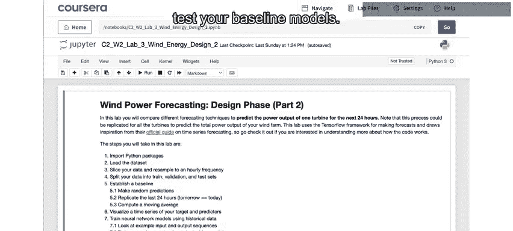

As it says here at the top， you're in the second part of the design lab where you'll be predicting power output from a wind turbine over the next 24 hours。

 so let's jump right into it you'll start as always by running this first cell to import the packages you need for this lab。

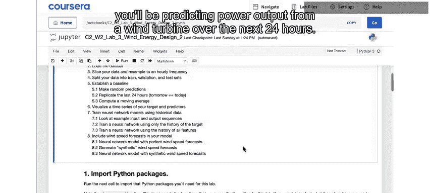

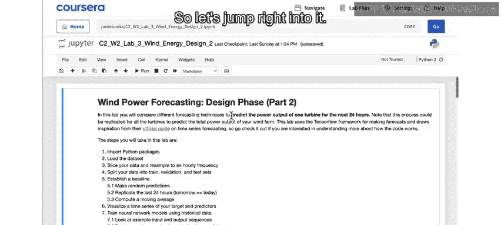

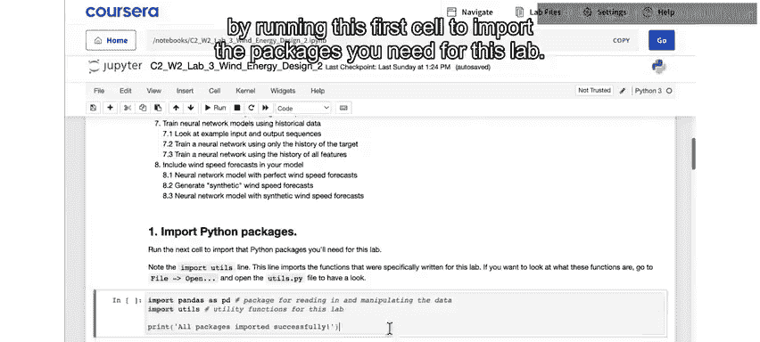

After that， you'll run the next cell to read in the div set。

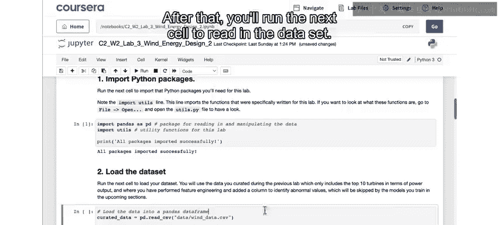

Now here you can see your data set is already set up with all of the feature engineering done from the Los lab。

And this include column if you're a member， indicates which rows contain validator in which contain mu or abnormal values。

Also， this is only the data for the top 10 performing turbines。

 so you can see here that the turbine ID numbers for the ones that are included。

As a first step to prepare your data for this particular lab。

 you'll need to reduce it further to include just one turbine from here on down。

 you'll be running your analysis for just this one turbine which is currently set to number six。

 but you can change this to any of the other top 10 turbines and principle your analysis could be extended to any of the turbines in the wind farm。

With this prepared data function， you'll also downsample your data to be on an hourly cadence。

 which is down from recordings which are every 10 minutes in the original data set This is just to simplify the analysis a little bit。

 but you could just as well run all these steps that follow on a 10 minute cadence。

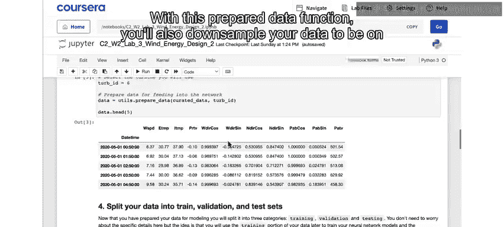

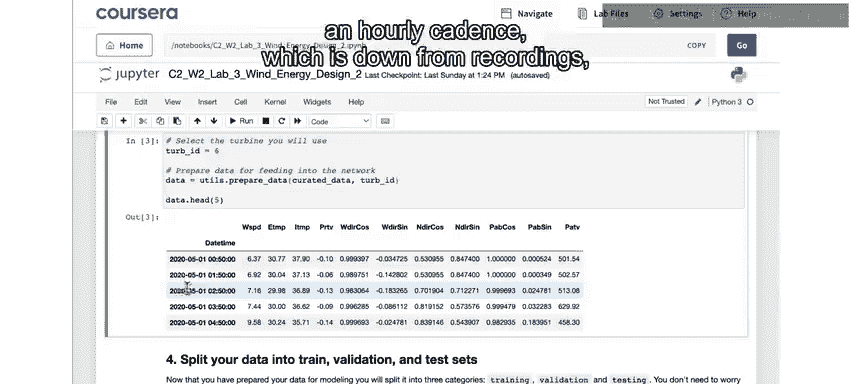

And finally， you've dropped the turbine ID column and the include column after replacing missing or abnormal values with dummy values to indicate to your model that they should be ignored。

The next step is to separate your data into the training， validation and test sets。

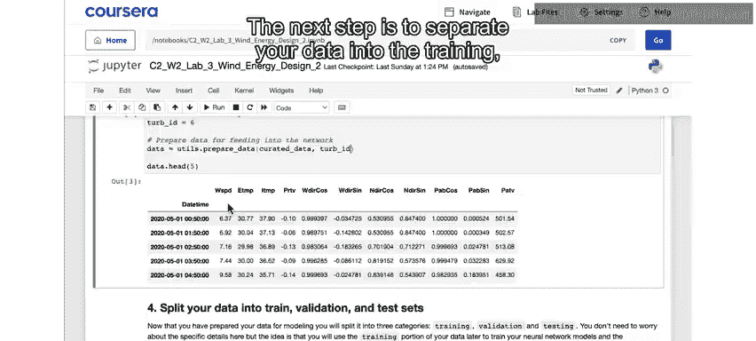

For the baseline modeling that you'll run next， you don't actually need these data sets separated out。

 but we separate them here so that you can test baselines against the same data as you later test your neural network model on。

You'll also normalize your data here， and in this case it just means scaling all the values of the columns to the same range。

Your first baseline will be a very naive model of just making a random guess of what the power output might be over the next 24 hours and you can test that model by running this next cell。

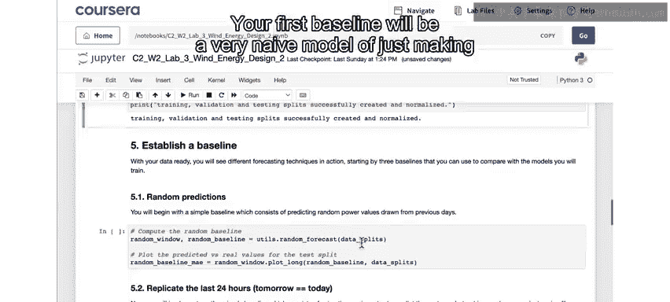

Here in the plot， you'll see in the prediction of your model shown in yellow compared to the actual power output shown in green。

 And this is for your test data set covering this period of a few weeks in December 2020。 Now。

 your guesses here aren' exactlyly completely random them。

 There are guessing values drawn from the actual distribution of active power values in your data set。

 So you'll see in the plot here that your guesses span the range of actual data。

 And this might not seem like much of a model。 But what this can serve as now is a sort of worse case scenario。

 that mean absolute area here is telling you how far off your model is on average from the true values in the units of the target variable that you're trying to predict。

 which in this case is the power output in kilowatts。

So here you're off by around 380 kilowatts on average。

 and that's your worst case scenario with random predictions drawn from the actual data distribution。

So this is the mean absolute error that we're reporting here and depending on the application you're working on some other errormetric like mean squared error or root mean squared error might be more appropriate and this case will chosen mean absolute error because intuitive for this lab it's a measure of how well your model is doing in this sense that the error can be read directly as the units of the thing that you're trying to predict and in this case the kilowats so here you're off by an average of 380 kilowats in your estimates which might be enough to power solar village any other model will have to at least better than this random guessing model next you'll try running another simple but slightly more clever baseline model in this case your model will take the past 24 hours of wind output and make that your prediction for the next 24 hours so you can run this cell to test that model baseline。

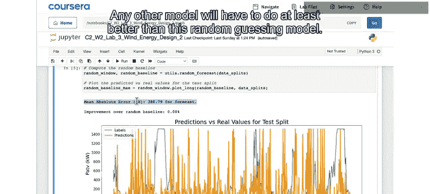

Again， here your model is plotted in yellow and the actual values in green again for your test set data cover in part of December 2020。

And so you can see your model is just making a prediction by shifting natural values forward 24 hours in time。

This is indeed a very simple model， but you can see that it performs okay on certain days where the power output is similar from one day to the next。

😊，With that being said， the mean absolute error printed here indicates that on average。

 you're still off by around 335 kilowatts in your predictions。

 so that's not a lot better than random guessing。And so one way to look at this is that predicting from one day to the next is only around 12% better than a completely random baseline in terms of the error reduction。

You also have the option to use this slider to try predicting fewer hours into the future。

 so it's currently 24， but I can slide it back。

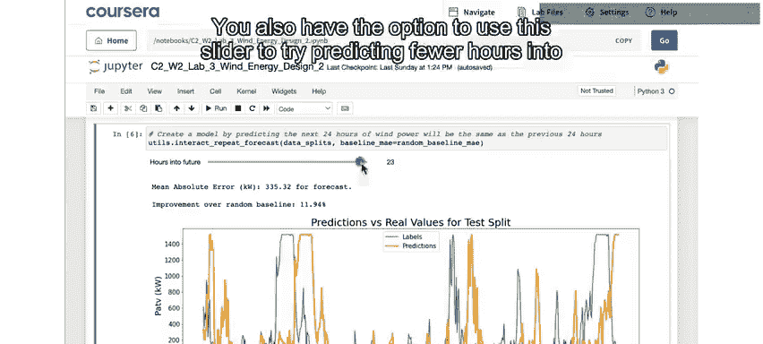

So what's happening here is that with this baseline now instead of guessing that the power is the same 24 hours out。

 we're guessing that it is the same 12 hours out and you can see that your error is reduced overall。

Now with predicting just 12 hours into the future， you're capturing these big spikes a little better。

But you're getting those low output days almost exactly wrong。

If you reduce this to just one hour into the future meaning your model just says that wind power an hour from now will be the same as what is currently measured then the results look amazing。

 we've gone from about a 12% improvement of the baseline at 24 hours to about an 80% improvement just one hour into the future and this should give you a good intuition for how hard it is to predict wind power one day out compared to just one hour out。

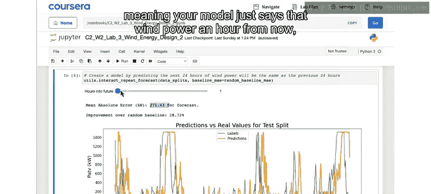

So run this next cell to try a different baseline where you're computing a moving average of historical data to predict the future。

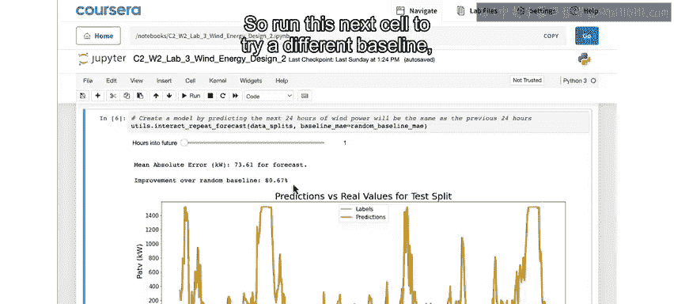

Here you now taking an average over the past 24 hours to make your future prediction and you can use this slideer to what your predictions would look like from one to 24 hours in the future。

 you can see that this model is also not a lot better than random guessing and when you're predicting 24 hours into the future it actually does worse than your last baseline。

 and if you run this slider down to one， then you're using the average of the past 24 hours to predict one hour into the future。

 and that does better than predicting 24 hours out。 So again。

 it seems just easier to predict one hour out than 24 hours out but this model isn't doing any better than the previous baseline overall。

 and in fact， this is also a little worse than just predicting from the most recent hour。

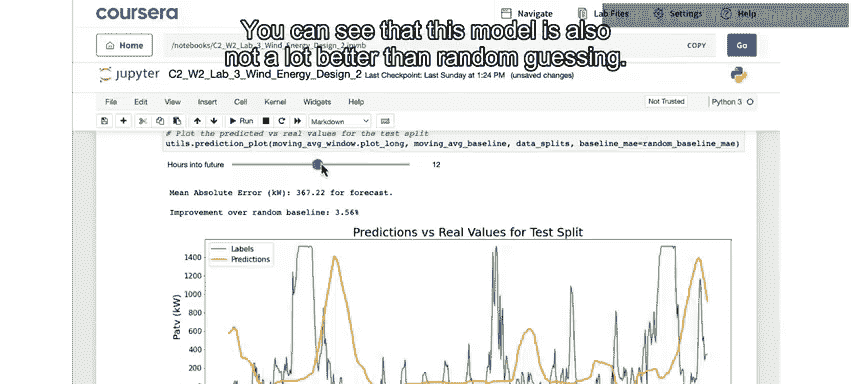

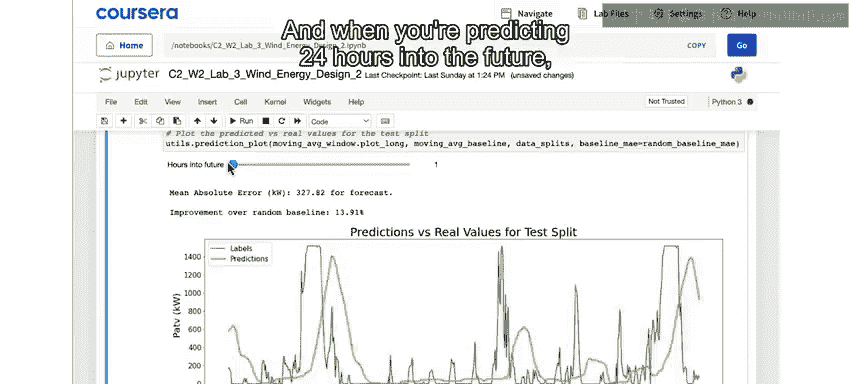

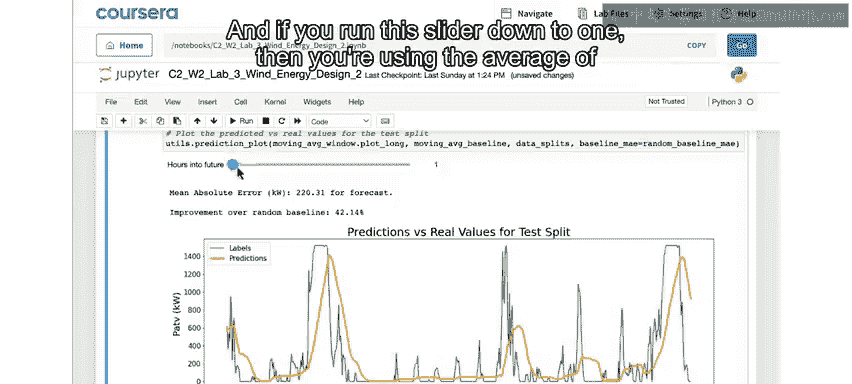

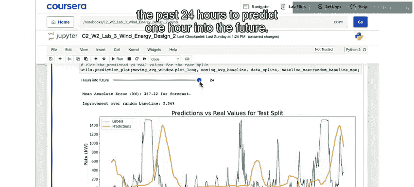

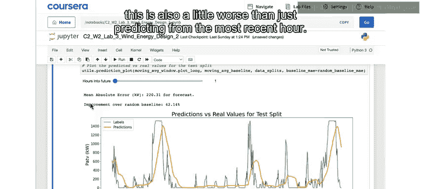

And that's it for baseline modeling you now have a sense of what the worstcase scenario forecast might look like in terms of mean absolute error and you've seen that this is not much better than random chance you've tested a couple of models for comparison。

 found that they didn't do much better but don't lose heart because once we started to incorporate the other variables we will see these values improve so please join me in the next video to start testing some sequence models。

😊。