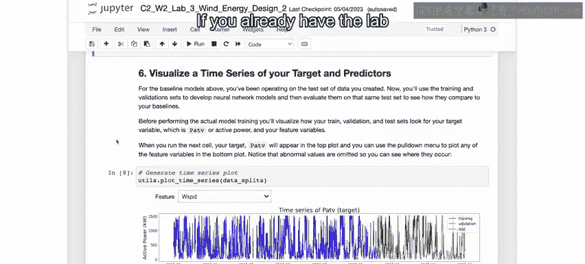
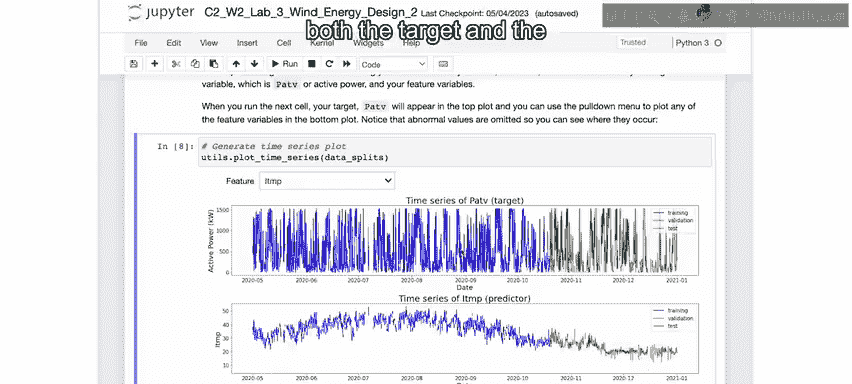
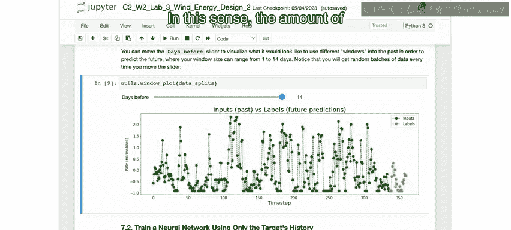
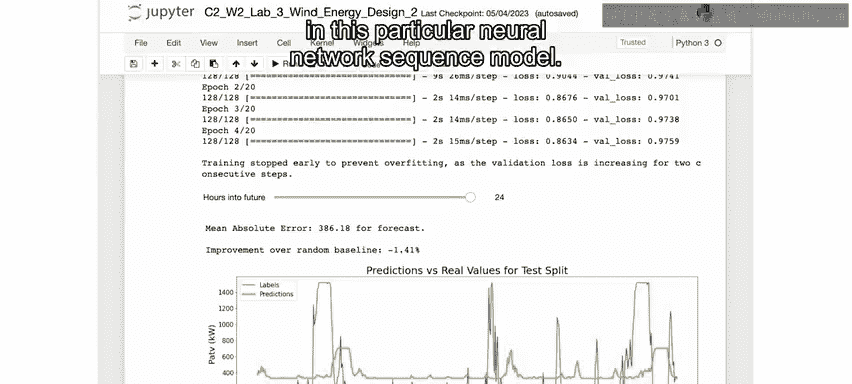
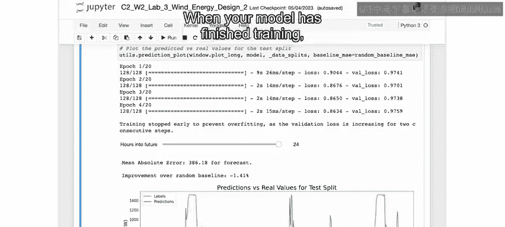
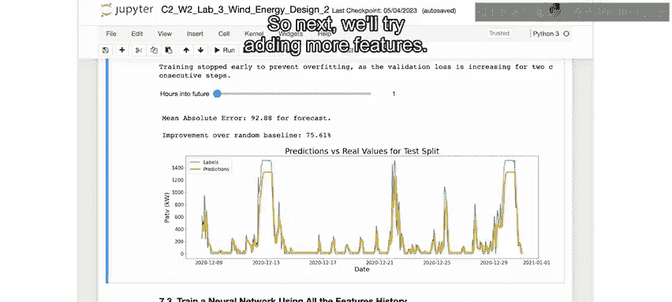
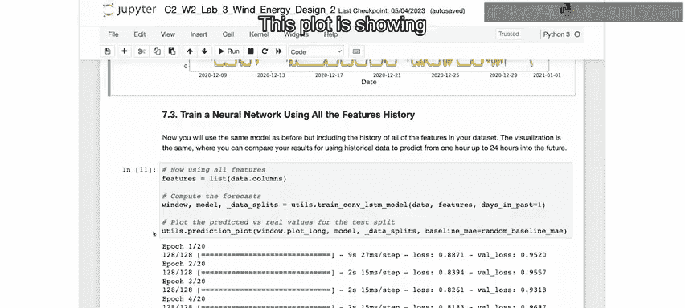
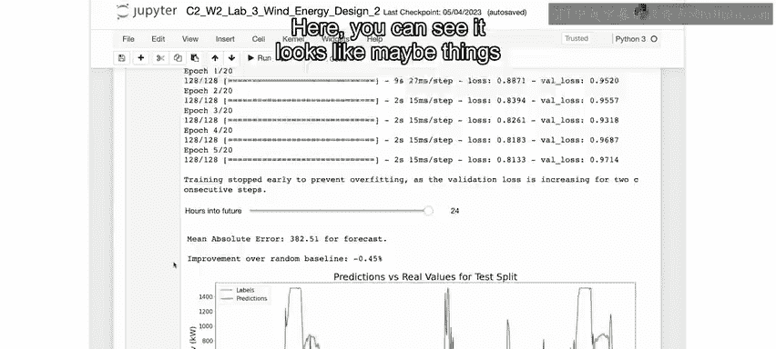

# 吴恩达《AI for Good专业课程》 AI与公共卫生、气候变化、灾难管理｜中英字幕 - P58：20_风力发电用序列模型改进性能.zh_en - GPT中英字幕课程资源 - BV13u411F7xZ

In the first section of this lab of windpower forecasting。

 you prepared your data set and establish some baseline models for comparison Next we'll pick up where we left off and start moving towards some more sophisticated sequence models。

If you already have the lab open and you run all the cells up to this point。

 then you can start right here and follow along as you go through this next session if you've just open up this lab。

 then be sure to start at the top and run other cells up until this point。

Before training in testing your models， youll run these next two cells to visualize your training。

 validation and test data to get a better idea of how you're going to approach training a sequence model。

This first cell just creates versions of your dataset sets that are a bit easier to visualize with missing or abnormal values masked out。

When you run this next cell to visualize your data， you'll see two plots。

On top here is power output from this particular turbine over an entire eight month period contained in this data set。

And so this is the variable that you aim to predict。With your first model。

 you'll simply be using a history of power output in an attempt to predict future power output after that you'll include other features in your input to make those predictions。

And so down below here， you have a plot of one of those other features， in this case， we can speed。

And you can change which features you're looking at in the second plot using this pull down menu here。

In the blue and green here， you have your training and validation sets。

 which you'll use in the training process for your neural network。

And in red is the test set that you've already been using to test baselines and that you're use to test the performance of each of your neural network models for a comparison。

So the way this is split up is that the first five months or so of the data are going to be used for training then the next two months or so for validation and the final month for testing the main takeaway here is that your own network will be attempting to learn from their history at each of these variables。

Both the target and the predictors in order to predict the future and the learning process will include training on the data shown in blue and irriably evaluating on the data shown in green。

 you'll stop training when the model doesn't seem to be getting any better and then test on the data shown in red。

 which the model has never seen during the training process。

In order to visualize a little better how the training process works。

 run this next cell to see an example of an input and output sequence as they would be used in training。

So here you are looking at 24 hours of data shown here on the left in green and another 24 hours of data shown on the right in orange。

For your target variable of active power or power output， as we've been calling it。So in this case。

 the input to your network would be this sequence of data on the left in green and the output you wanted to predict is the sequence on the right in orange。

In the training process， you will show your a network many examples like this in order for it to learn any patterns that might help inform how to predict what will happen in the next 24 hours。

Here you're just looking at an example of what it would look like to use the last 24 hours of active power to predict the next 24 hours。

 but you can also include the last 24 hours of other variables like wind speed。

 temperature and the configuration of the turbine as inputs， and you'll see examples of that below。

With this slide， you can see what it would look like to use more historical data during your training。

 say up to 14 days。And so this is just showing you that you could use this whole sequence of 14 days of data shown in green here to again predict this sequence of the next 24 hours in orange on the right。

In this sense， the amount of historical data that you use in the input sequence is essentially just another parameter of your model。

 Similarlyly， you can decide you want to train a model to predict fewer or more than 24 hours into the future。

And with that， you are ready to train your first neural network model。

Run this next cell to train only using the history of the target variable， active power。

This parameter days in the past is set to one by default here。

 but you can change it to another value to try to use more history to train with。

And if you're a Python programmer， you can check out the UL's file and look at this Tracom LSTM model function to let more but worse going under the hood in this particular neural network sequence model you'll notice the model started training count't enough the epochs of one of 202 or 20 and so on and then it stopped after just four and so this is because with these particular models it's easy to overfit the data meaning just fitting exact patterns in the training data rather than more general patterns in the data so you'll see this printout here that says training stopped early to prevent overfitting because the validation loss increased for two consecutive steps so in other words while the loss was going down on the training data held out validation data was telling us that this loss was going down because of overfitting not because the model was getting more accurate。

And you can see here in Val loss where the validation loss is printed out and is going up in consecutive steps You don't need to worry too much about what that means if you're not an AI practitioner。

 but I just wanted to mention it so it's not confused in or mysterious what's going on here with why the training stopped early。

Once your model is finished training， you'll see a plot here where your model predictions are shown in yellow and the ground truth in green。

And what you find is that predicting 24 hours into the future your model isn't doing that great。

 in fact it's no better than your baseline models， so this is a good example where unfortunately a complex model is making essentially no improvement over the simple baseline where you predicted the next 24 hours will be the same as the past 24 hours。

😊，And you can run this slider again down to just having the model predict one hour into the future。

 and you will see that it does better， but our goal here。

 remember is to predict 24 hours into the future So next we'll try adding more features Run this next cell to train a new sequence model using the history of all the features in your dataset again。

 you can try changing the end days variable by using more history in each training set。

This plot is showing the same output as you looked at before。

 here you can see it looks like maybe things have not gotten any better predicting 24 hours out。

So it turns out that using the past to predict the future， at least in this case。

 has not been very successful。Thankfully， in a real world scenario for wind power forecasting。

 you would also have access to weather forecasts， and this would allow you to improve the predicted power of your models。

As you saw in the previous lab， both wind speed and temperature were important features for predicting power output。

 and it's possible that other meteorological factors could also have an impact。

