# 吴恩达《AI for Good专业课程》 AI与公共卫生、气候变化、灾难管理｜中英字幕 - P59：21_风力发电包括风速预测.zh_en - GPT中英字幕课程资源 - BV13u411F7xZ

In the previous video we walked through the lab section on training sequence models using historical data in your data set and what you found is that with only the pastor's input。

 it's hard to predict the future， perhaps this doesn't come as much of a surprise given that wind power output is strongly dependent on the wind and knowing how the wind behaved today doesn't tell you that much about how the wind might behave tomorrow。

In the original special dynamic wind power forecasting competition data set。

 they did not include weather forecasts， but for the next part of this lab here。

 we can simulate what it might be like to include wind speed predictions in your model。

And here we are back in our notebook again， if you're just opening up the lab now。

 be sure to start at the top and run all the cells down to this point and once you're here we're ready to jump right back in。

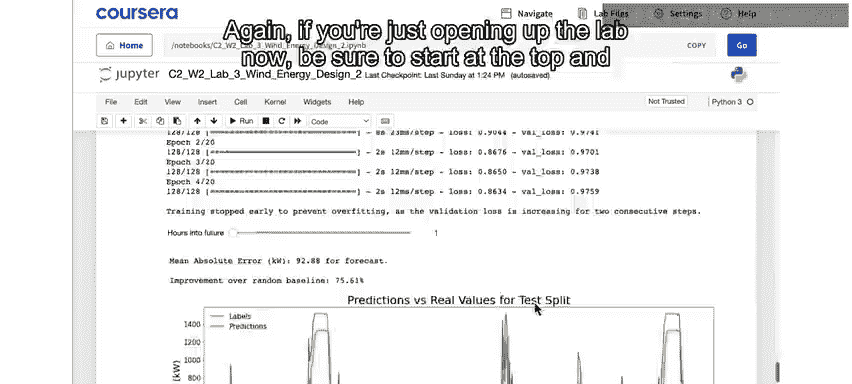

As a first step towards adding wind forecasts to your model。

 you can run this Excel cell to simulate what it would look like to have a perfect wind speed prediction included in your model training。

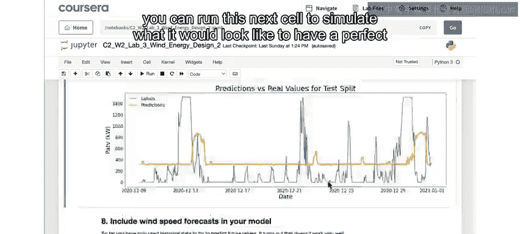

The way you're doing this is that in addition to the historical data。

 you will include the next 24 hours of actual recorded wind speeds in your training。

This is essentially cheating， of course， because there's nowhere way you could have a future wind measurement to using your model training。

😊，But what you can see is that your model now does a much better job with your random guessing baseline model at the top of this lab。

 you established a sort of worst case scenario， and now you might think of this example as a sort of best case scenario where you have perfect information about the next 24 hours of wind speeds。

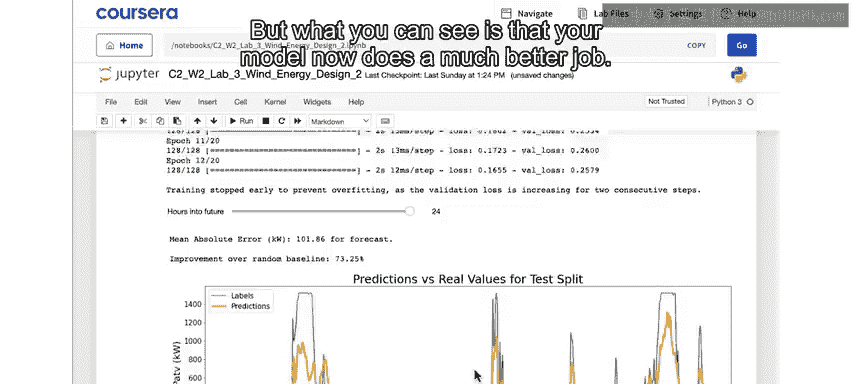

Keep in mind， though， that you might be able to do even better if you're able to include temperature。

 pressure and perhaps some other meorological data in your model。 Now， of course。

 you won't have perfect wind forecasts in the real world。 So next。

 you'll simulate a more realistic forecast by adding noise to the wind speed data。

 But first end on how we might think about generating a realistic synthetic forecast。😊。

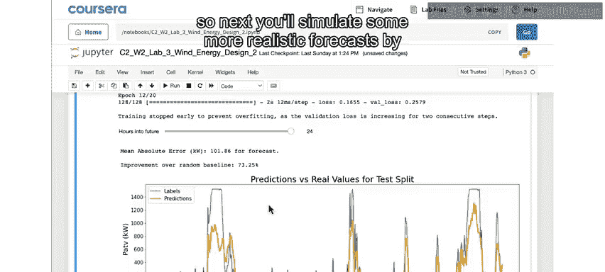

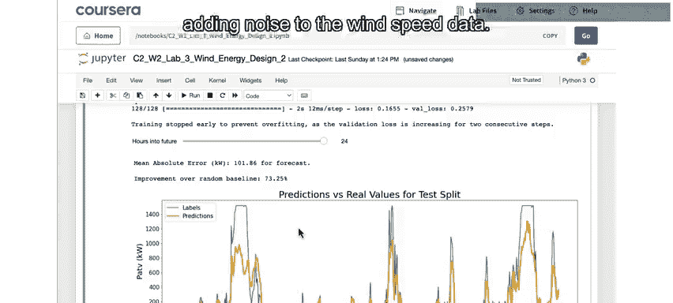

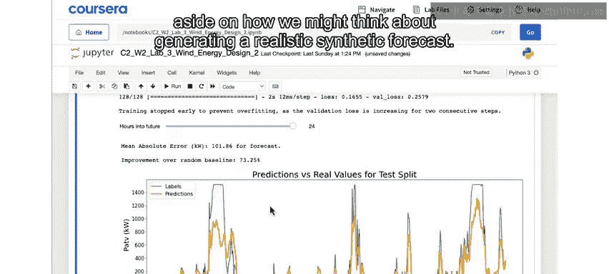

As I mentioned before， the original data set did not contain wind forecast information and the location of the wind farm where the data was collected was not disclosed。

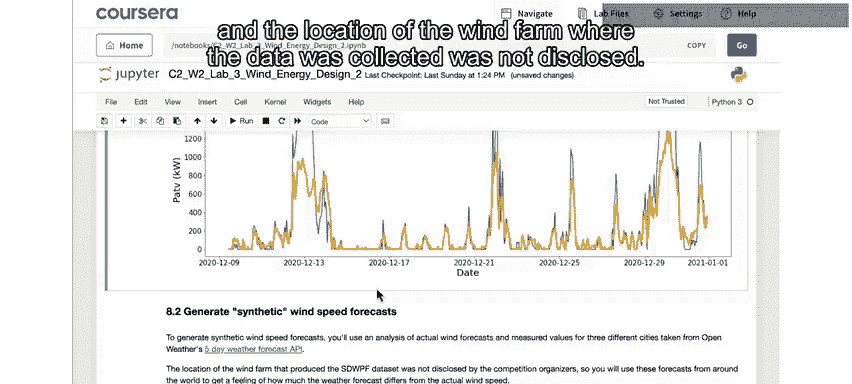

And if you look at the original participants in this competition， you'll find that just like you。

 they weren't able to make very accurate predictions into the future。Here。

 looking at synthetic data that we might want to import from elsewhere。

 we can look at wind data from some actual places on Earth where there are wind farmgs。

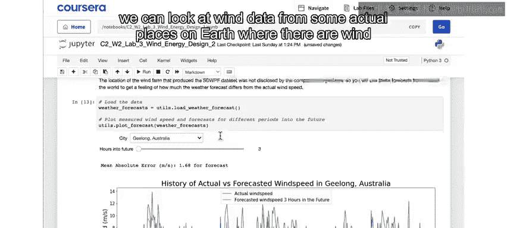

Jelong， Australia is one example of such a place。 and what you're looking at in the plot here is a plot of actual wind speed shown in blue versus forecasted wind speed。

 shown in orange over some dates in December 2022。 In this case。

 you are looking at actual versus predicted wind speed for three hours into the future。

 And with this slider， you can see what that same comparison looks like for forecasts further into the future。

 And in this case， up to five days or 120 hours into the future。

 we put this example together using data from the Open weatherather API。

 And we are grateful to the Open weatherather tin， which gave us permission to use the data as part of this course。

😊。

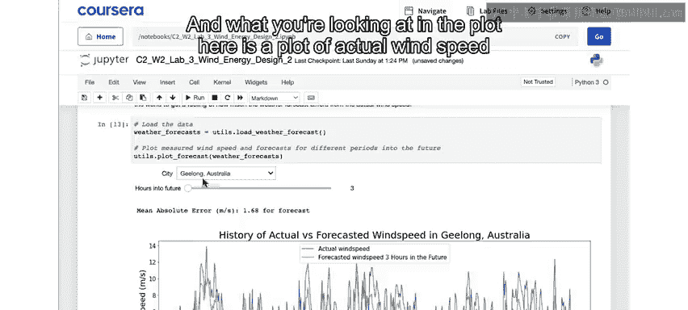

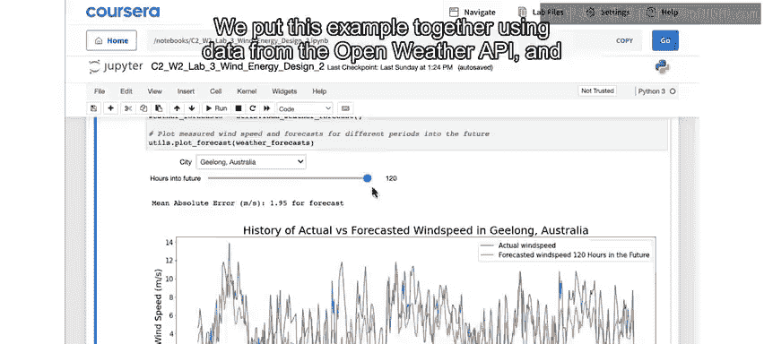

The Open weatherather API offers wind forecasts up to five days in the future and on a three hour cadence。

We recorded those future predictions， and then we also retrieve the actual recorded wind speeds after those days had passed。

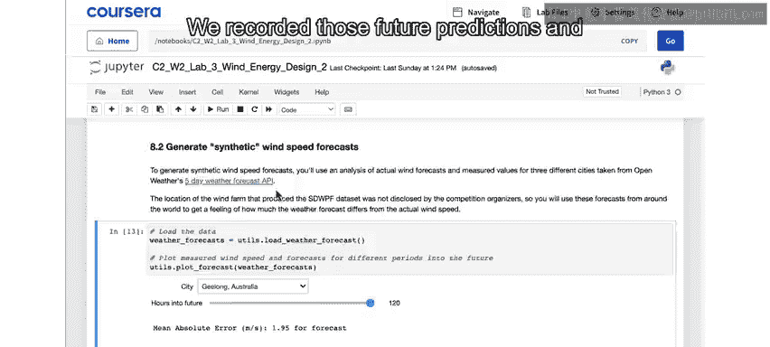

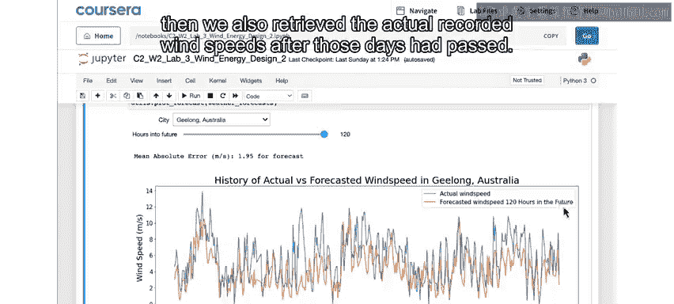

And we also did this for some other locations， and you can use this pull down to look at the same comparison for Porto O Lereb。

 Brazil or Pittsburgh， Pennsylvania in the United States。

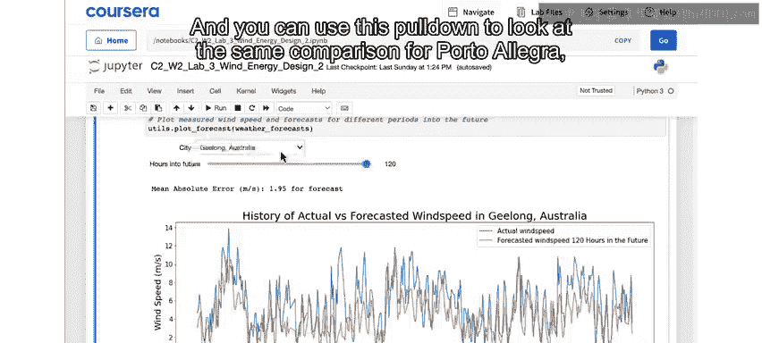

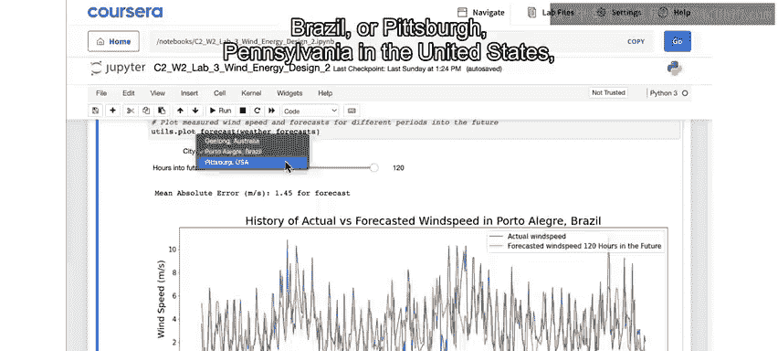

Both of which are other locations with large wind farms。What you can see is that in general。

 the forecasts are at least qualitatively better for nearer times in the future than predicting further out。

 which makes intuitive sense。

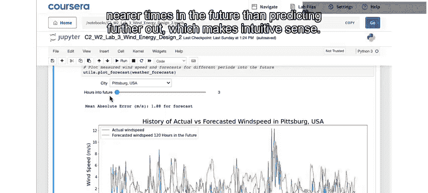

You can now run this Nel for a more quantitative look at the accuracy of wind speed forecasts。

Where now you have hours into the future on the horizontal axis and mean absolute error in forecasts for that number of hours into the future on the vertical axis。

And again， you can choose between the three locations that you're looking at above。

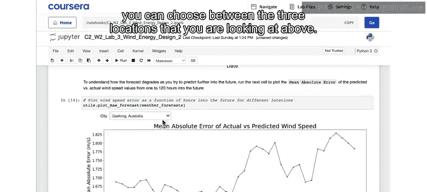

And so you can see that it looks a little different depending on the location， but in general。

 the predictions are off on average by something like one to2 metters per second and tend to get worse or further out than you are predicting with this knowledge about the typical error let's go ahead and simulate wind forecasts by adding a similar amount of noise to the actual data that you found from the open weather data above。

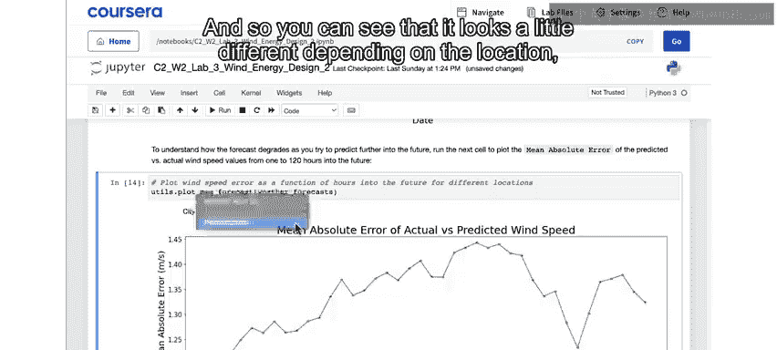

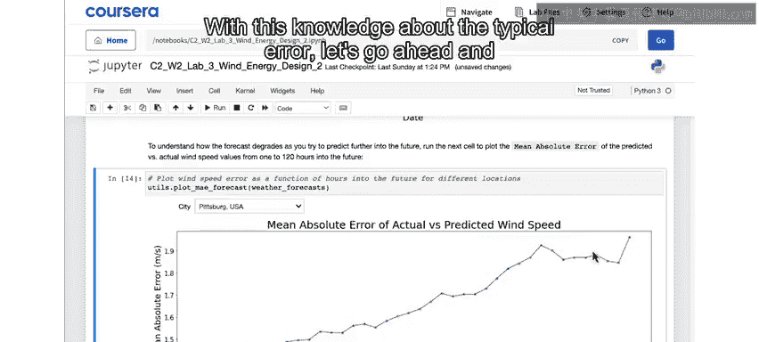

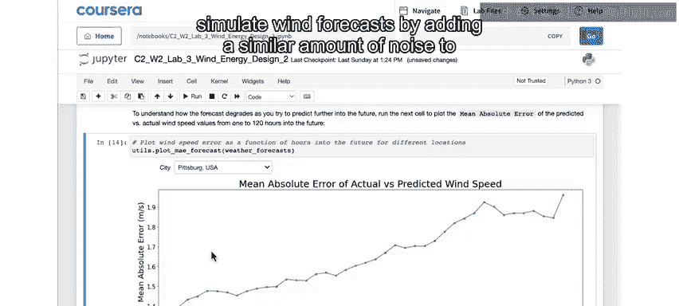

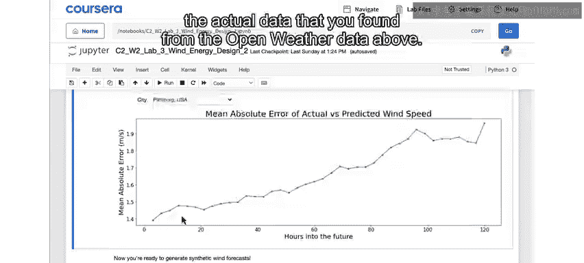

Run the Excel cell to visualize the actual wind speed values and the simulated noisy forecast。

You can move this slider to see how the synthetic forecast would look for adding a range of different noise values from essentially zero up to more than2 meters per second average error。

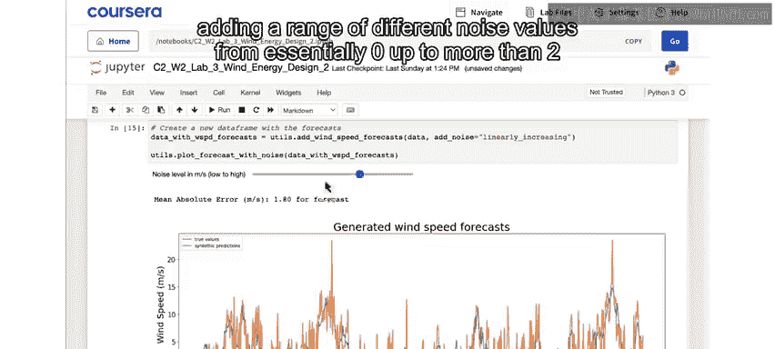

And finally， it's time to train one last sequence model now using your synthetic wind forecasts as well as the historical data。

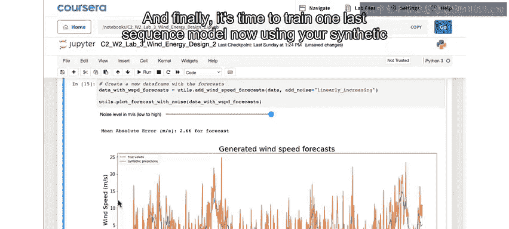

Here you can see that predicting 24 hours into the future， you are doing pretty well。

 in this case a reduction of nearly 70% in the era compared to your baseline models。

You can use this slider to see what it would look like to predict less than 24 hours into the future and similar to the examples above。

 you can generally do better when predicting fewer hours into the future and this is because your synthetic wind forecast has less noise for those instances。

As you can see， this is a big improvement of your previous sequence models that were based only on historical data。

 so weather forecast will be a key component of any wind power forecasting model。

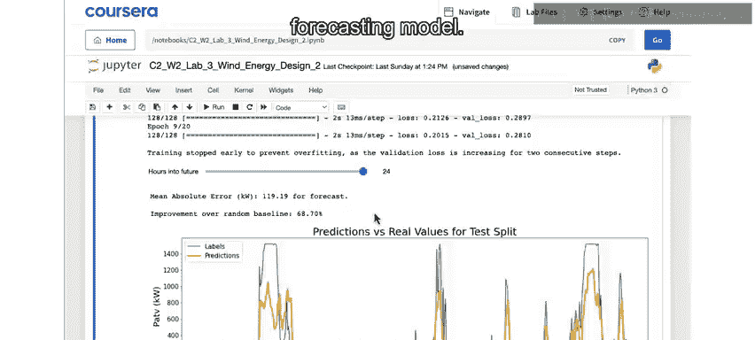

In a real world scenario， you would likely be incorporating many more aspects of a weather forecast into your prediction model。

 like the temperature， the humidity， seasonal changes。

 because in this data set were only have about eight months and perhaps some other meorological variables。

For the purposes of this course， you have a working model and a working knowledge of some of the challenges associated with wind power forecasting。

 so nice work。Next up， we'll conclude the design phase by addressing the question you to be thinking about before you head into the implementation of your solution。

 so join me in the next video to wrap up the design phase for wind power forecasting。

