# 吴恩达《AI for Good专业课程》 AI与公共卫生、气候变化、灾难管理｜中英字幕 - P5：4_快速概括什么是人工智能.zh_en - GPT中英字幕课程资源 - BV13u411F7xZ

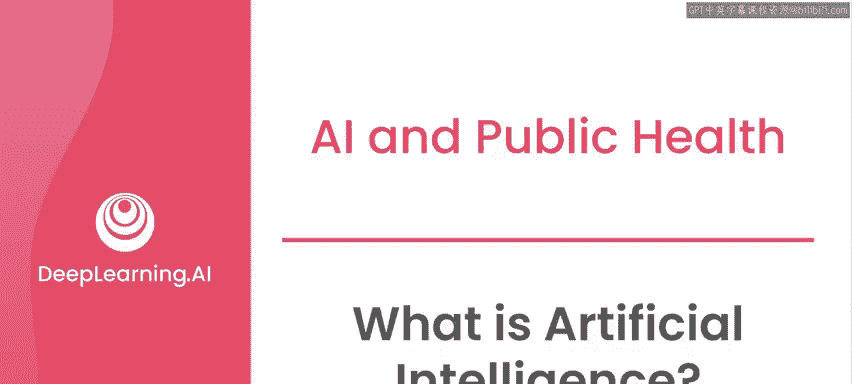

U this point， we've been thrown around the phraseAI for good and starting to define what that means as compared to AI for anything else。

 but just so that we're all on the same page， I want to back up a step at this point and focus for a moment on what AI is。

 what it can and cannot do and some of the terminology that you might run into when you're hearing about AI in the news or elsewhere。

First off， artificial intelligence today refers to a rather simplistic form of intelligence or decision making based on patterns in data。

For a great overview of what AI is and how it's impacting organizations。

 I recommend that you check out the AI for Everyone course from Deep learninging AI。

 which provides a great foundation for many of the concepts that you'll encounter in these courses。😊。

Within the framework you'll be applying to the case studies in these courses。

 you'll be considering data at every stage of development from data quality and availability to data privacy and security concerns。

 right to how you'll use your data within an AI model。

 while not every problem requires AI as part of the solution， if you're going to use AI。

 then you'll almost certainly need good data and plenty of it。

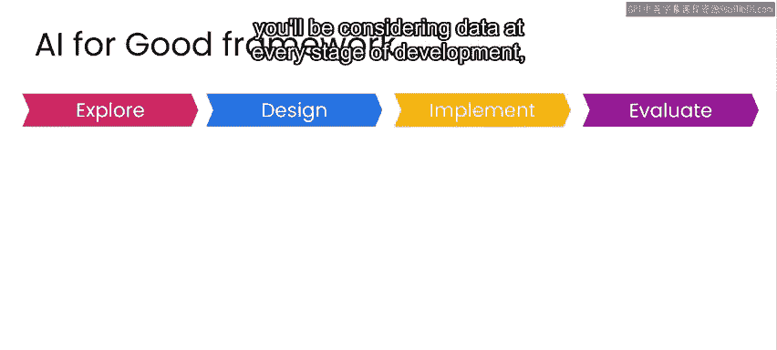

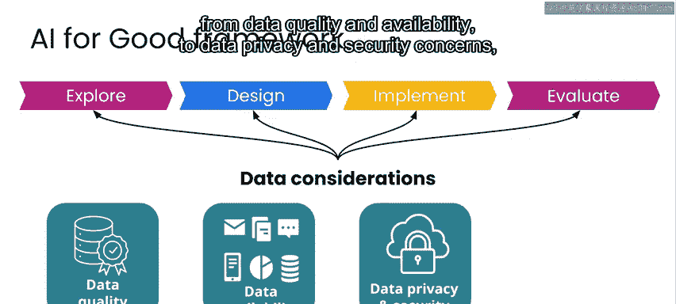

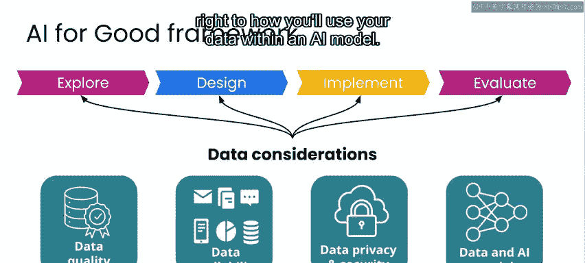

For our purposes here， you can think of AI as applying a set of rules or other mechanisms for the purpose of making inferences based on data Many of the applications you hear about in the news or run into on a daily basis using apps in your phone or on the internet。

 are examples of machine learning which is a subfield of AI in which algorithms actually learn to recognize patterns in data rather than being explicitly program to make decisions based on a fixed set of criteria the most commonly applied machine learning algorithms are so-called supervised machine learning algorithms。

 where the goal is to map some input which here I'll call a to output which here I'll call B for more concrete example。

 if your input A is an image of an animal， your output B might be the type of animal an application for identifying what's in an image like this would be an example of image recognition and you'll see this in action in course to。

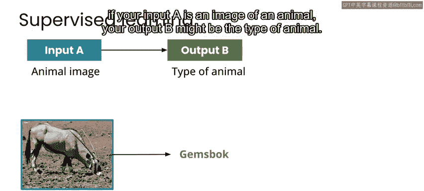

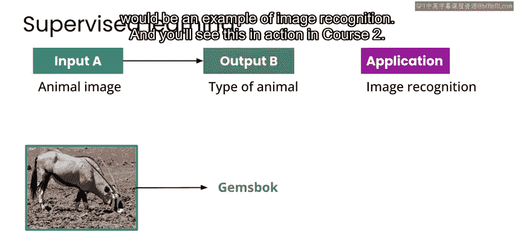

Another example of supervised machine learning is translate in text from one language to another。

 say from Haitian Creole in this example to English as the output。

 but of course this could be between any two or more languages and this is an example of what's called machine translation and this is a type of supervised learning that you'll see more of in the third course。

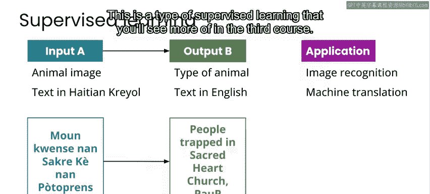

Like you saw in the project spotlight video， the input could be a recording of the cry baby and the output could be a medical diagnosis and so this is actually an example that could be considered quite similar to speech recognition。

 the same kind of application that's running on your smartphone or smart device when you speak to it and ask it to give you。

 for example， restaurant recommendations or a weather forecast。

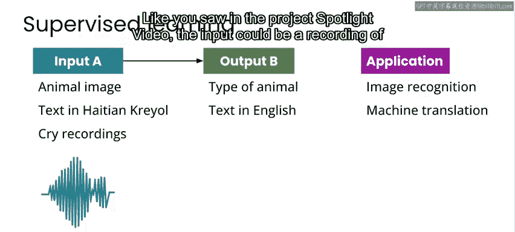

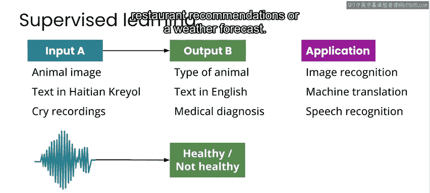

In one of the case studies in this course on renewable energy。

 you'll see the mapping of input a of predicted wind speed and turbine sensor measurements to an output B that is energy generated from a wind turbine。

 and this is an example of prediction based on historical data。

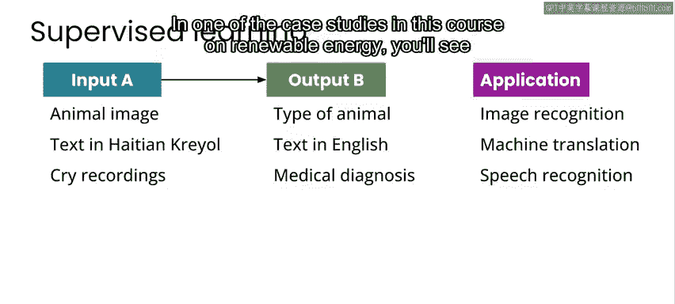

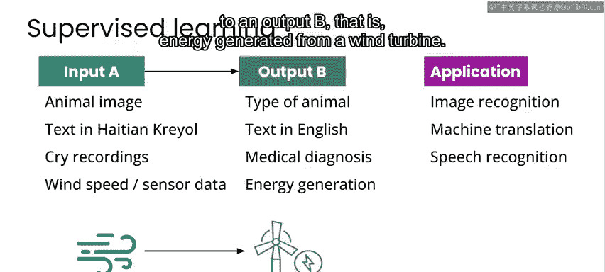

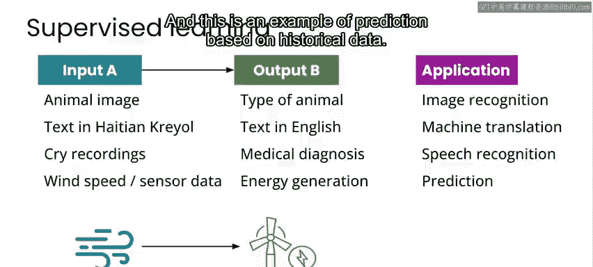

While these might look like wildly different applications and they are。

 they're also all examples where the applications use a mapping of an input A to an output B。

 and so this means they are all potential use cases of supervised machine learning。😊。

In addition to AI and machine learning， you might have also heard the phrase deep learning when it comes to algorithms learning to recognize patterns and data deep learning just refers to a particular kind of machine learning algorithm called a neural network so in some sense deep learning is a subfield of machine learning and AI。

In these three courses， you'll see a number of examples of using supervised machine learning In general。

 these examples illustrate situations where either AI can do a job better than a human or it can improve a task over human alone。

 However， it's important to remember that this does not mean AI represents some superior form of intelligence On the contrary。

 AI is good at repetitive tasks like analyzing thousands of lines of data for a particular problem or being able to quickly reference large volumes of information for the purposes of search or text generation or other kinds of statistical inference。

 So for a concrete example， a smart speaker or phone might be able to understand。

 say more than10 different languages more than any person can but it also might not understand the speech in any of those languages as well as another human code。

Or as another example， an AI algorithm might be able to provide medical information about thousands of diseases。

 given a description of symptoms， but will not be able to provide the depth of analysis and diagnoses of a human medical specialist in their area of expertise。

Yeah， algorithms can perform almost amazingly in some tasks。

 but it's also important to keep in mind that it's not the algorithm itself in most of these cases。

 any AI application is only as good as the data used to develop the model and the humans behind the code used to run that model what we haven't talked about yet is how machine learning algorithms learn from data and that's what we'll do next so in the next video you'll see examples of how supervised learning works so join me in the next video。

