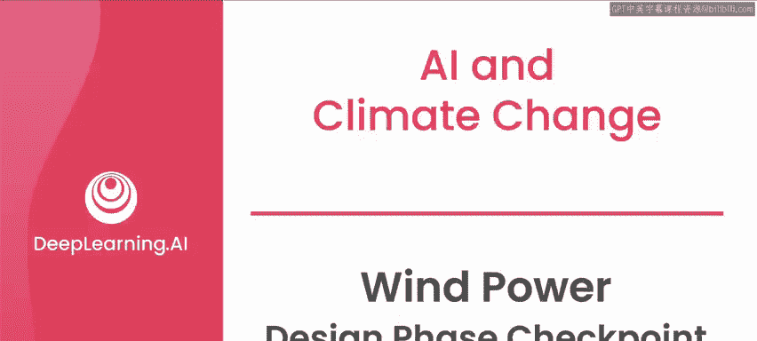
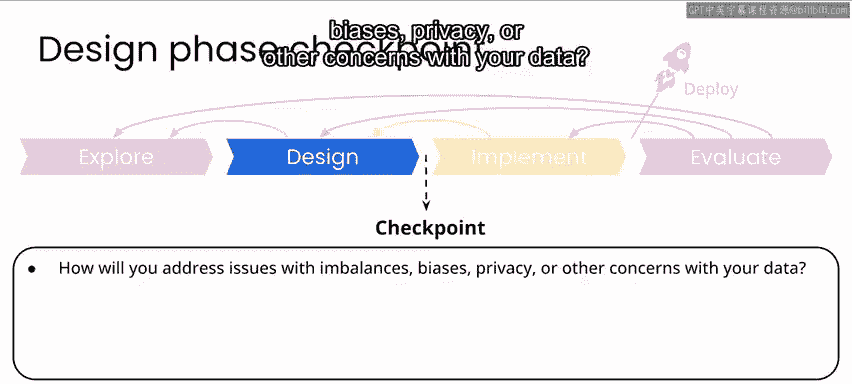
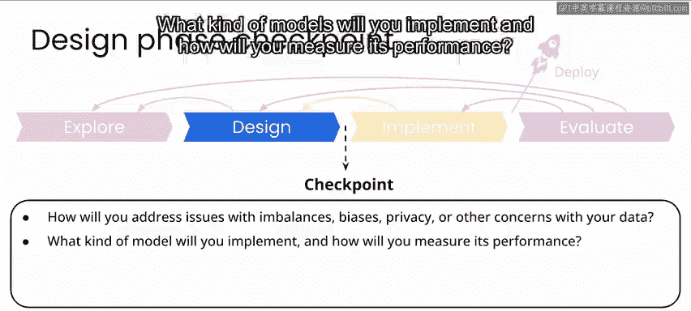
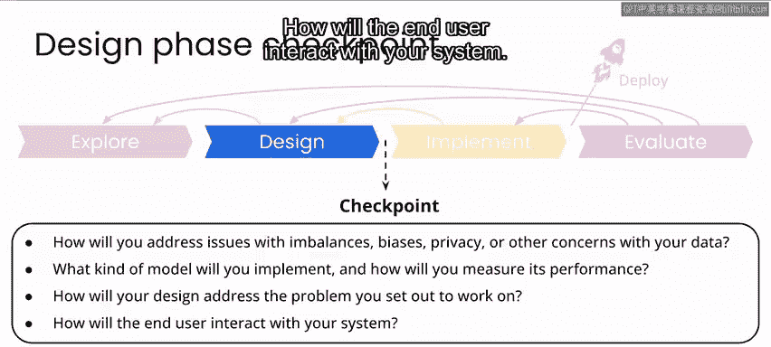
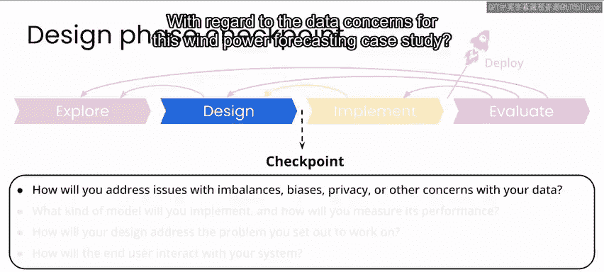
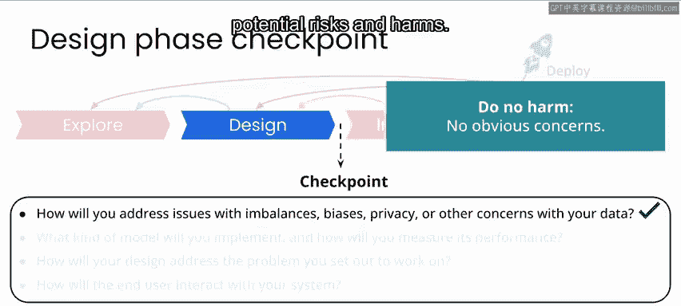
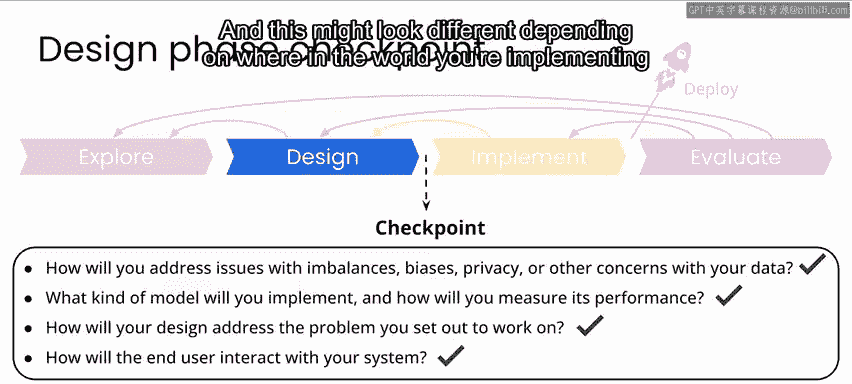

# 吴恩达《AI for Good专业课程》 AI与公共卫生、气候变化、灾难管理｜中英字幕 - P60：22_风力发电设计阶段检查点.zh_en - GPT中英字幕课程资源 - BV13u411F7xZ

Once you have a working in design for windpower forecasting。

 then following along with our AI for Good project framework。

 it's time to check whether you're ready to move onto the implementation phase by addressing the following questions。

How you address issues with imbalances， biases， privacy， or other concerns with your data？

What kind of models we implement and how you measure its performance？

How will your design address the problem that you set out to work on？

How will the end user interact with your system？

With regard to the data concerns for this wind power forecasting case study。

 the competition data set that you work with has a number of issues regarding missing data。

 abnormal values and no weather forecast data， so to move this project forward in the real world。

 you would need at least the weather forecast data and it would also help to have better historical data。

From a du no harm perspective， there were no obvious concerns from biases or privacy perspective。

 however， there are concerns in related wind power installations。

 and so this is an area where you would need to speak to various stakeholders and people have worked on this problem in the past to identify where there might be potential risks and harms。

In terms of what kind of model you aim to deploy， again， in a real world scenario with better data。

 you might likely spend a long time in the design phase testing out different model implementations and assessing the trade offs。

With wind power forecasting， even a 1% improvement on the accuracy of your predictions could have a tremendous impact in terms of the reduction of fossil fuel consumption。

For the purposes of this case study， you've got a working model and you're measuring its performance in terms of mean absolute error。

 and you can demonstrate this is about a 70% improvement of random guessing。

They're problem be set out to address。Is。😊，Electric utility companies need reliable predictions of wind power output at least 24 hours in advance in order to plan the balance of power sources into the electrical grid。

With the caveats that you could get a better result。With better and possibly more data。

 your design addresses this problem。Given the resources available for this project。And finally。

 the end user in this case is a person or group at the electriclectric utility company。

 and likely you would not be designed in a user interface for them to interact with your design。

 but rather serving up your model predictions in a way that integrates smoothly into whatever platform or user interface that they are already working with。

 and this might look different depending on where in the world you're implementing your solution and who will be working with that data。

And so that's it for the design phase of this project there's no lab for the implement phase in this case study and this is for the reason that the implementation of the solution would largely involve deploying a particular set of technical software components given some very specific circumstances of the project that you're working on however。

 you can still join me in the next video where we'll have a brief discussion of what some of the considerations might be in the implementation and evaluation of your wind power forecasting project。

😊。