# 吴恩达《AI for Good专业课程》 AI与公共卫生、气候变化、灾难管理｜中英字幕 - P61：23_风力发电项目总结.zh_en - GPT中英字幕课程资源 - BV13u411F7xZ

In the last video we wrapped up the design phase for windpower forecasting as a matter of fact。

 groups all around the world are working on this problem right now and developing solutions to some of the challenges that you faced in these labs。

As I mentioned before， there's no lab for you to complete for the implementation phase of this project。

 and that's because in reality， the implementation of a project like this would largely comprise customizing and optimizing your models and integrating with various different existing softwares that are used by different utility companies。

With that being said， I'd like to talk through some of the considerations that you might be faced with in the implementation and evaluation of this project before we move on。

😊，As you saw in your exploration of the data， wind speed is the most important feature when it comes to estimating how much power will be generated by a turbine。

 But other factors like temperature and also at the configuration of the turbine itself come into play。

 You also saw that While the turbines behave similarly in terms of the power output under different conditions。

 Each turbine is a little different。

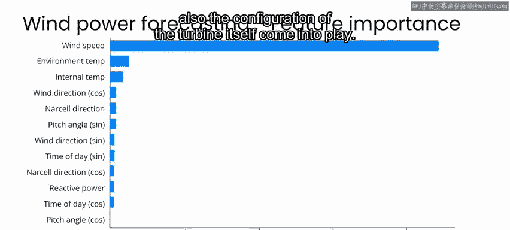

And in reality， there is probably not a one size fit or solution when it comes to modeling power output。

It's easy to imagine that the different turbines are constructed slightly differently。

 or in slightly different environments that are encaptureulated in our features。

 or perhaps they degrade in performance with age。In the implementation phase of a project like this。

 you might actually end up designing a custom model for each turbine。

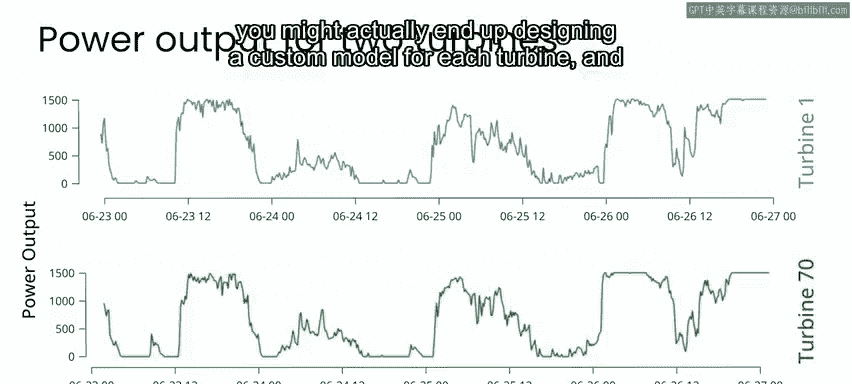

And then that could optimize the accuracy of your predictions。

 One factor that we didn't look at in the labs， but would also be important to consider is whether a turbine's response you change over time。

 It's possible that you need to develop a model that is able to adapt over time as that turbine's behavior changes。

 So， for example， a turbine could degrade over time。 it could have seasonal changes。

 depending on the time of year， or it could improve over time as firmware updates make it more efficient。

 given the wind speed at any given time。If you had a model that accurately described the power output of each turbine。

 given a particular outer weather conditions and turbine configurations。

 you should be well in way to provide in a valuable forecast of wind power。

Reflected again on the AI for Good project framework。

 the two questions you would want to answer in the affirmative to close out a successful implementation of your project would be。

 is your multiple phones acceptable， the end users able to successfully interact with your system？

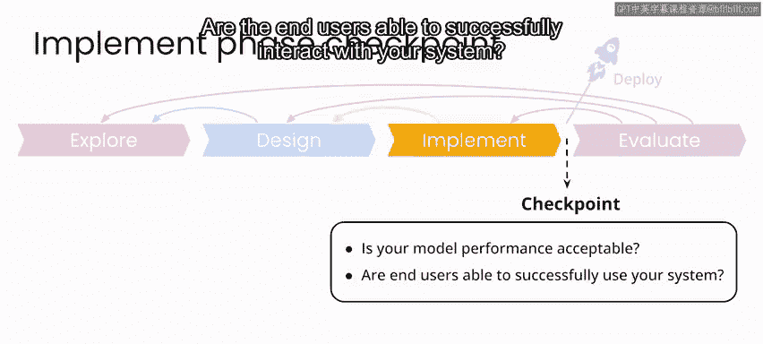

In terms of the evaluation of your project， your model's performance would be one metric of success。

 but at a high level being able to forecast wind power accurately is really just a means to the ends of making wind power a viable alternative to fossil fuels and ultimately reducing fossil fuel consumption。

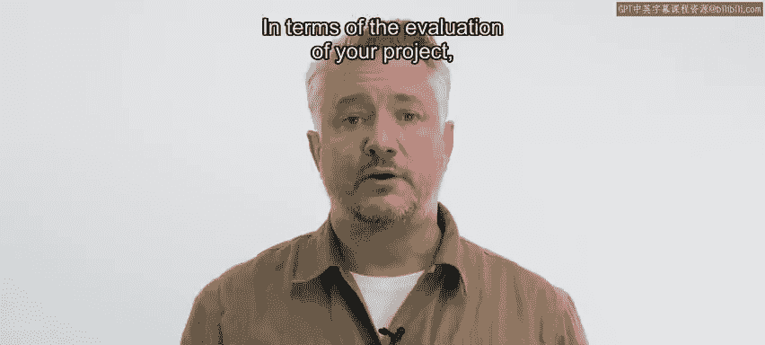

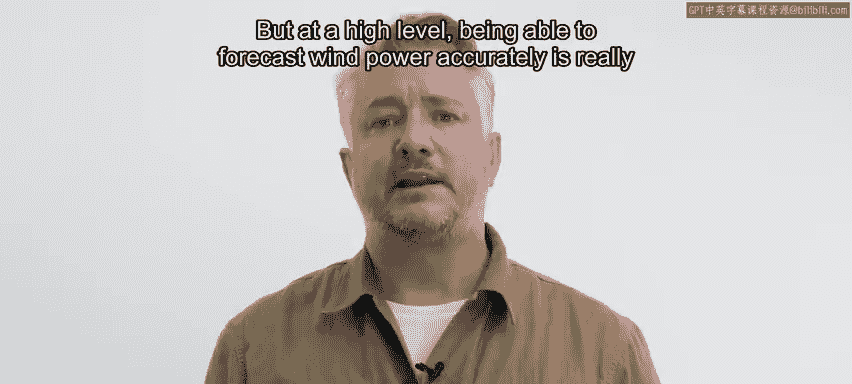

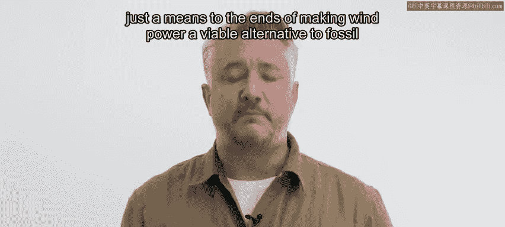

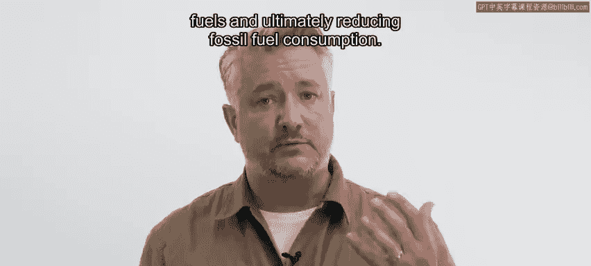

One aspect of viability in this case is the value of wind power generated in terms of real dollars and cents。

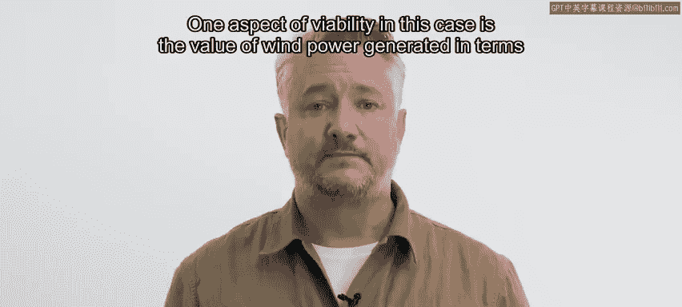

As pointed out by the group at Google's Deepmind in their blog post on increasing the value of wind power。

 using AI to predict wind power and being able to make advanced commitments to the power grid increase the value of wind power on their wind farms by about 20%。

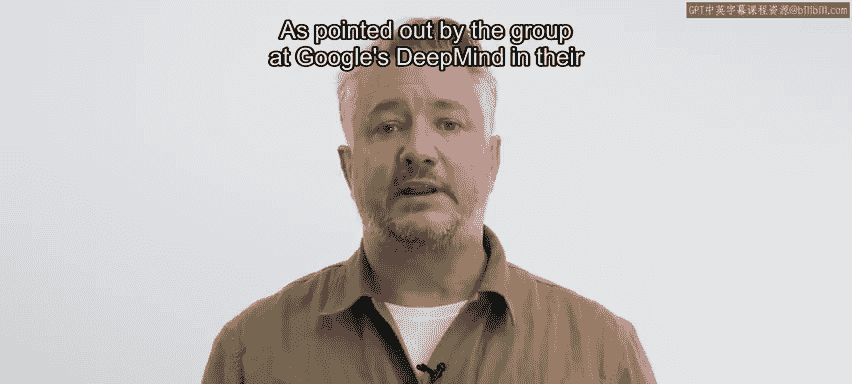

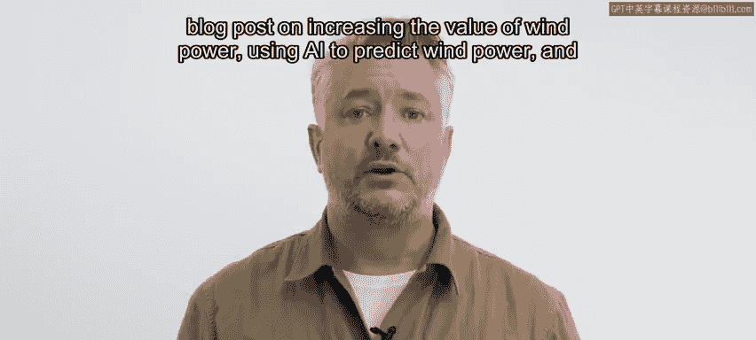

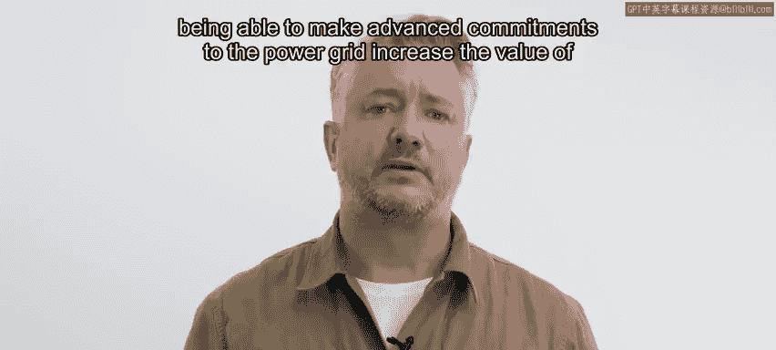

And so this， in turn， makes wind power a more attractive investment and helps speed the transition from fossil fuels to renewable energy。

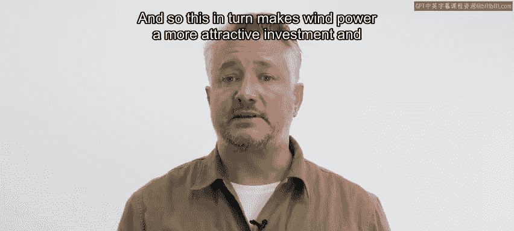

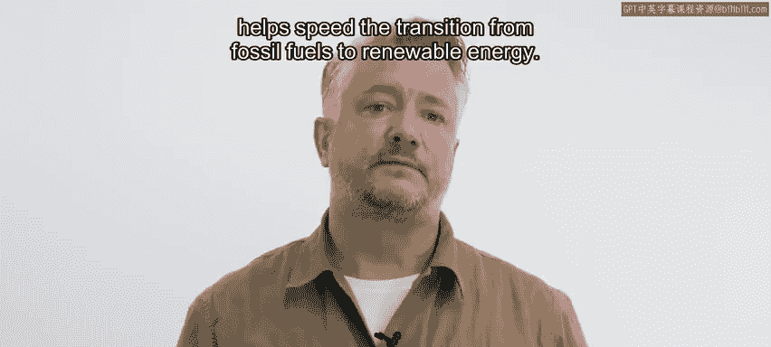

At the end of the day， the most important metric by which you could evaluate your project would be the amount by which you are able to reduce the consumption of fossil fuels。

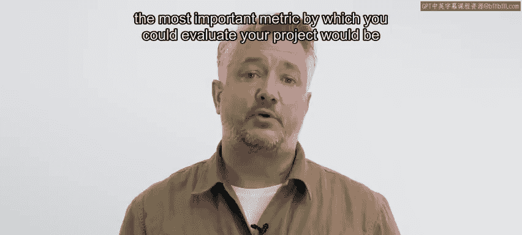

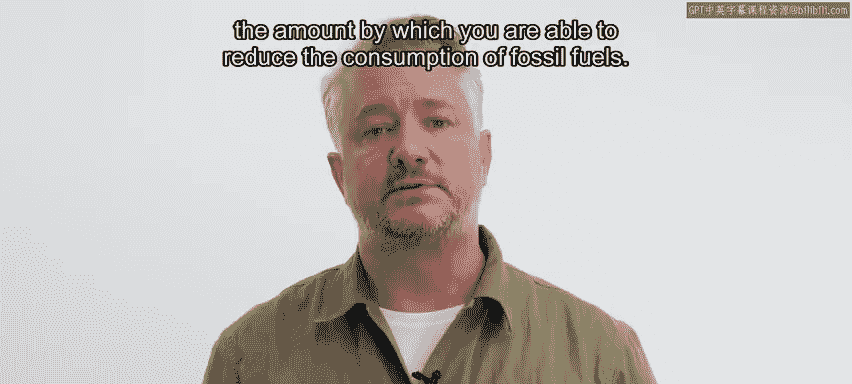

Forecasting weather is a very complicated problem in its own right。

 and while we are not going into the complexities of weather forecasting in this course。

 we do have a project spotlight video coming up for you next on improving subseasonal forecasting with machine learning from a Microsoft researcher and former Stanford professor Lester Mackey。

😊，So check out that next video on weather forecasting and then I'll see you again to wrap up this lesson in the explore phase for windpower forecasting。

😊。