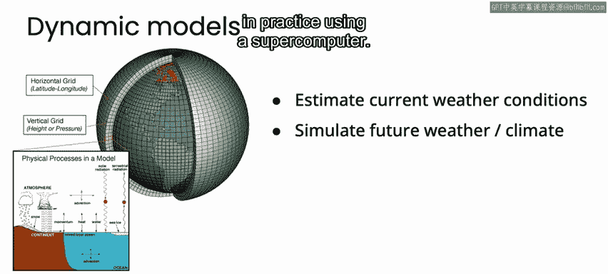
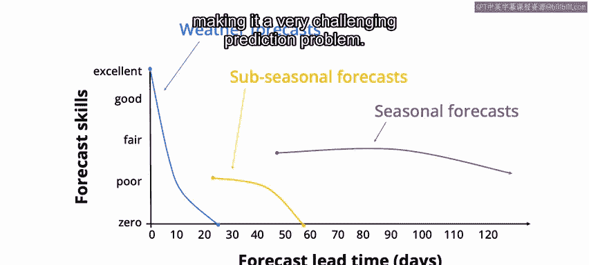
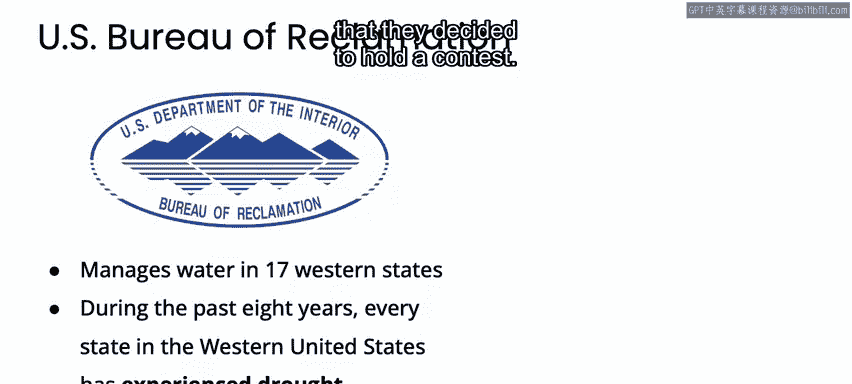
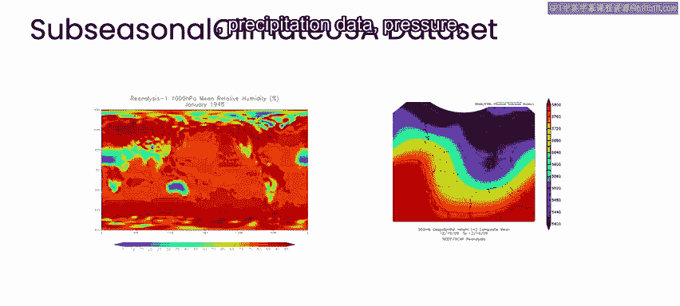
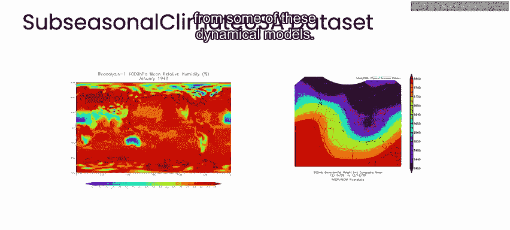

# 吴恩达《AI for Good专业课程》 AI与公共卫生、气候变化、灾难管理｜中英字幕 - P62：24_Lester Mackey气候建模与预测.zh_en - GPT中英字幕课程资源 - BV13u411F7xZ

Hello everyone， my name is Lester Mackey and today I'd like to tell you a story。

It's the story of climate。Of machine learning。And of the Wild West， the story begins with this guy。

 Judah Cohen， Judah is a climmatologist and the director of seasonal forecasting at Atmospheric and environmental research。

 And one day Judah came to me and said，Lster're un concernedcer。

I'm concerned that the community is not making the best use of historical data in weather and climate forecasting。

Instead， the landscape is dominated by these dynamical models。

 these purely physics based models of how the oceans and atmosphere evolve。

 Now I'm no expert in dynamical models， but here's a cartoon。First。

 we need to estimate today's weather conditions， we can measure the weather at certain places。

 and then we estimate it everywhere else。Okay and now we know how physics works。

 we know how the atmosphere evolves， we know how oceans evolved and so we can actually then simulate what future weather is going to look like given today's weather conditions this involves simulating what are called partial differential equations you can never really do this exactly for what you need to do in practice is you break up space into small buckets。

 small grid cells like I've shown you in this globe here and you also discretize time into small increments and then you can actually simulate that in practice using a supercomputer allright so this is what we do in practice today but the accuracy of this approach is limited and this has been known at least since the 1960s its limited by what's called chaos this means that if there are any errors in your inputs then those errors are going to be rapidly amplified so that by the time I'm trying to predict two weeks from now my predictions will be terrible。

Now the community has a couple of ways of trying to get around this the first is called ensemmbling this just means let's run our models what simulate the future using different initial conditions。

 some perturbations of our what we observed today and then get the predictions from each of those models and average them together that's called an ensemble forecast the other thing that's commonly done is called debiasing I take the predictions of my model I look at their predictions over the last 20 years I subtract away the average prediction and I add back the average of the ground truth debiasing and in some cases this is the only way in which historical data is going to enter into the forecast。

Okay and that was concern number one and Judah says I also have a second concern and that's subseasonal forecasts are especially poor What does that mean Well I think we're all pretty familiar with weather forecasts these are short termm predictions of temperature and precipitation typically we trust these weather forecasts if they're about a day out and we don't really trust them anymore if they're 10 days out 14 days out and there's a good reason for that it's because they're very bad but on the other extreme we have what are called climate forecasts these are predictions over months。

 seasons， years， decades and typically we have more skill。

 more accuracy at predicting these climate forecast phenomena because they're averaging over more time so it's a nois is a less noisy target and we can do a better job of predicting it but in between these two regimes weather and climate is what's called subseasonal forecasting this is predicting temperature and precipitation two to six weeks from now。

And here， the predictions are especially bad because the weather models have broken down due to chaos。

 the climate models aren't good yet because you're not averaging over enough time。And also。

 the forecasts that you make two to six weeks from now depend on the weather today， locally。

 and they also depend on weather conditions around the globe。

 making it a very challenging prediction problem。

And it turns out that Judah was not the only person concerned about this around the time that he first approached me。

 the US Bureau of Fcclamation， which is a government agency。

 was also concerned about this problem now the USBR is responsible for managing water in the Western United States。

 they provide irrigation water to farmers through the second largest hydropower producer in the US and they note that in the past decade every state in the Western US has experienced drought in a way that affects both the local economy and the global economy。

And they were so concerned about being able to anticipate this in advance that they decided to hold a contest they call it the subseasonal climate forecast rodeo rodeo because it's the Western US and that's where the Cowboys are and they said if you can do a better job at forecasting temperature and precipitation at the subseasonal scale two to six weeks from now。

 then we'll give you $800，000 in prizes so we decided to enter this contest。

 but a strained aspect of this what you might call a data science challenge was that there was no data provided really the USBR has just said do whatever you want。

 just find some way of predicting temperature and precipitation better So we created our own data set we call it the subseasonal climate USA data it consists of temperature data precipitation data pressure。

 some larger scale phenomenon like the Mad and Julian oscillation。

 the state of El Nino and it even has forecast from some of these dynamical models。

We put it on Azure we update it daily on the cloud and you can access it via the subseasonal data Python package Now on top of this we decided to build some hybrid learning plus physics forecasting models and we found that these models double or triple the forecasting skill of the operational just physicsbased models that are used by the US and also outperformed state of the art machine learning and deep learning methods targeted for this problem and so what I'm showing you here on the top is the CFSV2。

 the climate forecasting system V2 this is the operational subseasonal forecasting system that the US uses and on the bottom I'm showing you are new what we call adaptive bias correction method which blends together forecast from CFSV2 and machine learning corrections and you can see that across the US we're seeing improvements that double or triple its forecasting accuracy this is for temperature and we see the same sort of thing for precipitation again double or tripling of the forecasting skill。

So that's all the time we have today， but if you want to learn more about this work。

 I can point you to any of these papers here we have a few publications in preprints on archive。

 one's called Improving Subseaal forecasting in the Western US with machineine Learning。

 another is called onlineline learninging with Opim and De and finally learned benchmarks for subseasonal forecasting thank you。

