# 吴恩达《AI for Good专业课程》 AI与公共卫生、气候变化、灾难管理｜中英字幕 - P63：25_第2周总结.zh_en - GPT中英字幕课程资源 - BV13u411F7xZ

This week you tackled wind power forecasting， you work with a data set provided by the Longyan Power company through their partnership with Baidu to host a competition for predicting wind power。

You started out with an overview of the problem， namely that electrical utility companies need to fulfill an ever changing demand for electricity by balancing input power sources into the electrical grid。

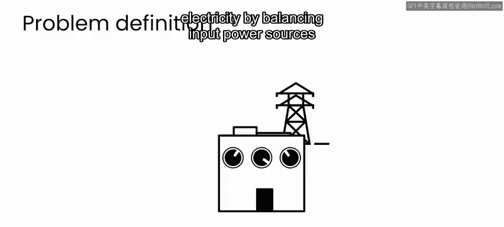

For power sources like fossil fuels and nuclear power。

 the supply can be increased to meet that demand with enough advanced notice。

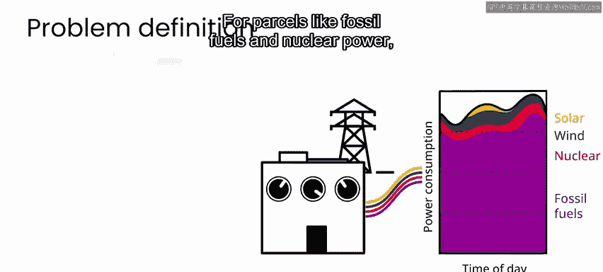

For renewable energy sources like wind and solar to be viable alternatives to fossil fuels or nuclear。

 they need to be made more predictable， such that providers of renewable energy can make advance commitments to the grid for the supply that they will be able to provide。

For this specific use case of wind power， you wrote down a problem statement to describe the scenario that said。

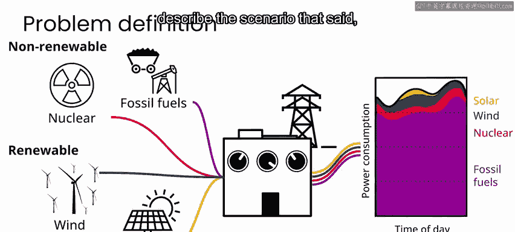

Electrical utility companies need reliable predictions of wind power output at least 24 hours in advance in order to better plan the requirements for other power input sources into the electrical grid。

In your exploration of the data， you found that perhaps unsurprisingly。

 there's a strong correlation between wind speed and power output of a wind turbine， however。

 that this relationship looks a little different for each turbine and that there are correlations between the power output and other variables too。

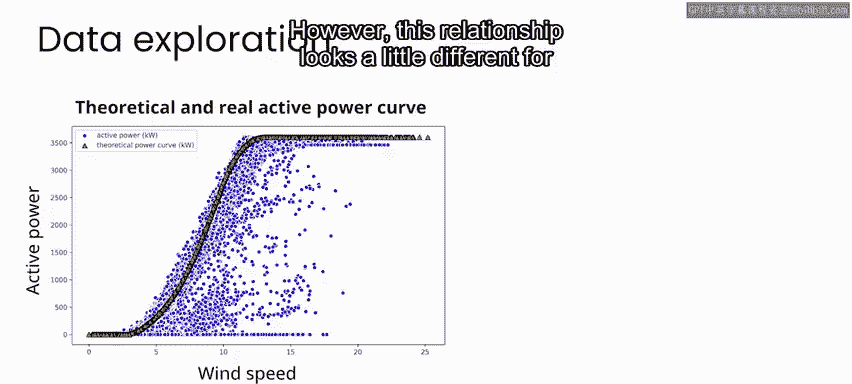

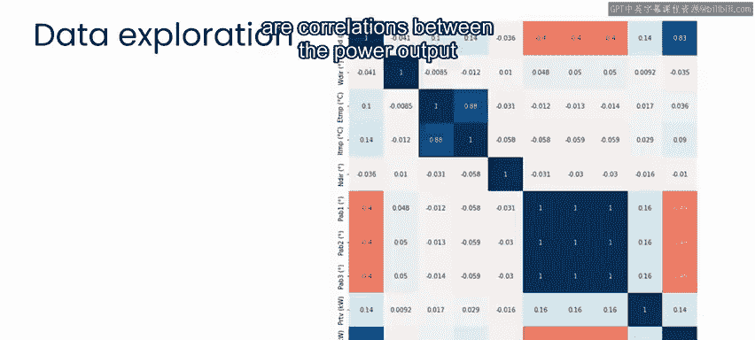

In the first part of the design phase， you confirm that， indeed。

 wind speed is the most powerful predictor of power output and that other factors like temperature and the configuration of the wind turbine itself also play a role in determining power output。

😊，You found that while a linear model could make some headway towards estimating power output。

 given various features in the data set， a neural network did a significantly better job of mapping the features to the power output。

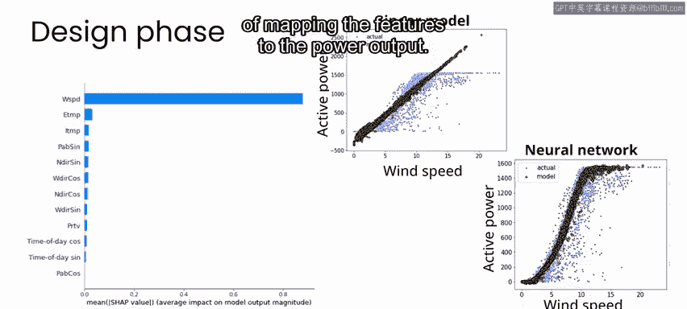

In the second part of the design phase， you started working on the problem of actually forecasting wind power in the future。

You set up a number of baseline models to establish both a sort of worst case scenario。

 in addition to how well you could do with very simple models like predicting the future will equal the past。

You tested a series of sequence to sequence neural network models using different combinations of features in your data set。

 and found that， like most things in life， predicted the future。

 given only knowledge of the past is particularly difficult。To simulate a more realistic scenario。

 you generated synthetic wind speed forecasts and found that including wind forecast as an input to your model。

 improved your predictions significantly。😊。

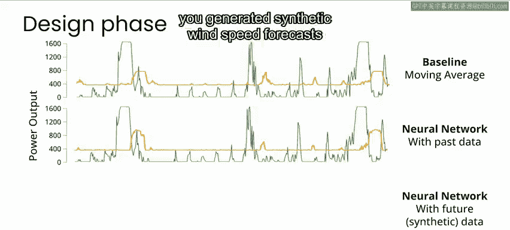

While you could certainly spend much more time in the design phase testing many different models over more of the data。

 we wrapped up the design phase and touched on some of the challenges that you might need to consider in a real-w implementation and evaluation for a project like this in particular。

 your eventual solution would likely need to be customized to each wind turbine and probably accommodate a scenario where turbine behavior is changing over a longer period of time。

Ultimately， the success of your project would depend on the accuracy of the wind power forecasts that you were able to make and how having those forecasts allows wind energy to be a more valuable alternative to fossil fuels and in turn。

 reduce fossil fuel consumption。 I hope you have enjoyed this adventure through wind power forecasting。

 the most important thing to take away from this week's lessons。 however。

 not actually any of the details of exactly what you need to be thinking about for wind power forecasting。

 Rather， what I hope you take away is more a sense of how these same steps and considerations could be applied to any problem that you want to。

😊。

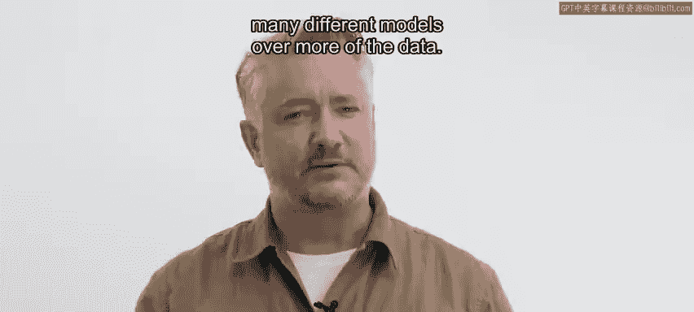

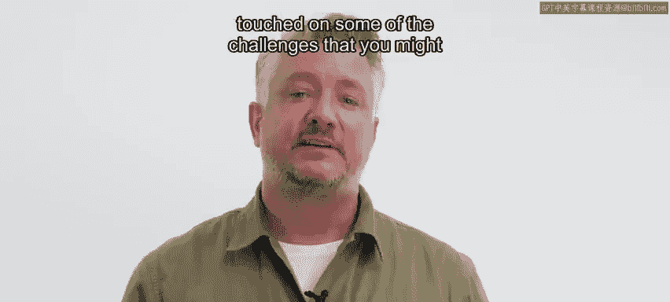

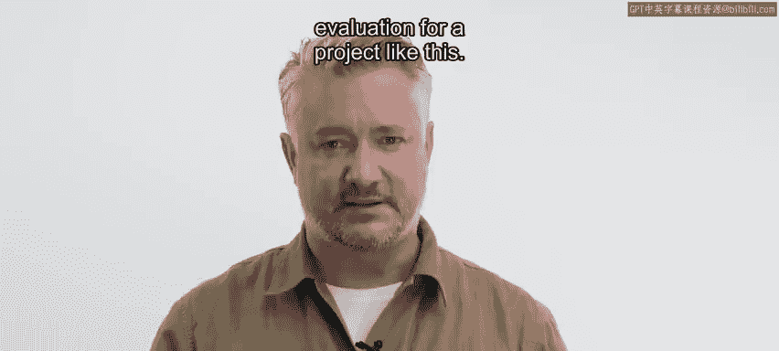

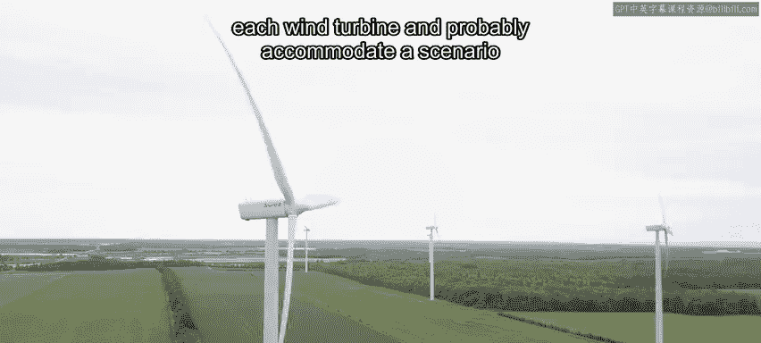

Work on。So obviously in a different project the stakeholders would be different。

 you'd have different harms that you' would be considering。

 you'd have a very different problem statement， a different data set and the details of your design and implementation might have literally nothing in common with what you've been working on for wind power however。

 the underlying process could be essentially the same as you move from exploration to design and implementation and inevitably cycling back a few times So as you reflect on this wind power project think about how you might apply this same framework to a problem that you're interested in addressing and if you're feeling energized jump right into the explore phase for your own project mean。

 in the next week of this course will shift gears towards monitoring biodiversity in the Carwell National Park in South Africa I will see you in the next week of materials。

