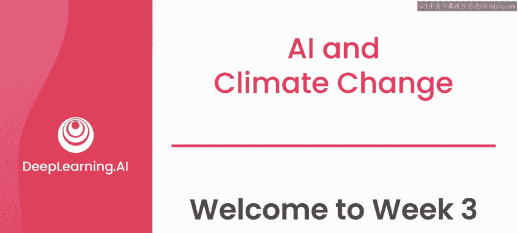
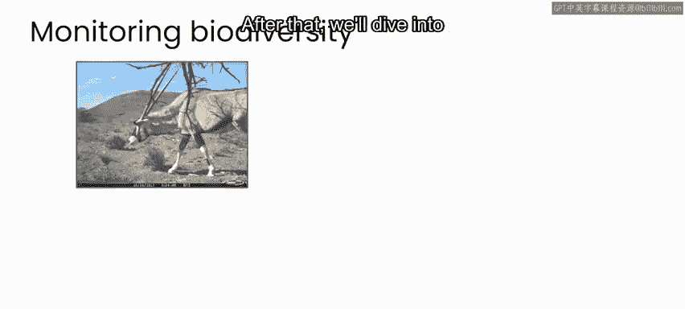

# 吴恩达《AI for Good专业课程》 AI与公共卫生、气候变化、灾难管理｜中英字幕 - P64：26_欢迎来到第3周.zh_en - GPT中英字幕课程资源 - BV13u411F7xZ

Welcome to week three of this course on AI and climate change Throughout this week and the following week。

 you'll be working on a project to use AI methods to monitor animal populations in the Kau National Park in South Africa in the lessons this week willll start off by taking a look at how climate change and biodiversity are interrelated and how climate change is causing a reduction in biodiversity and also that the opposite is true that preserving natural ecosystems and biodiversity is an important tool in the mitigation of climate change After that。

 we'll dive into the final case study for this course。

 monitoring biodiversity in the Kau National park in South Africa This case study is motivated by the fact that climate change and biodiversity indtricately connected and by monitoring biodiversity。

 you can track the impacts of climate change as well as informed policies designed to mitigate climate change。

In the labs this week and next， you will create an application to automatically identify and classify animals and images recorded by camera traps in the National park。

 Object detection and images is a technique used in a wide range of AI applications for modelling trends in animal populations like you'll do in this project to things like machine vision in industry and robotics。

 One of the most exciting aspects of this project is that the cutting edge methods and techniques you'll use are applicable to a wide range of different scenarios。

 You can take the tools that you develop in this course and apply them to a project that you're interested in。

 whether that's monitoring biodiversity in your backyard or working on self-driving cars Up next we'll take a look at how climate change and biodiversity are connected。

 and after that willll look at how AI is being used in projects aimed at monitoring biodiversity to inform policies to protect natural ecosystems。

😊。