# 吴恩达《AI for Good专业课程》 AI与公共卫生、气候变化、灾难管理｜中英字幕 - P65：27_气候变化与生物多样性.zh_en - GPT中英字幕课程资源 - BV13u411F7xZ

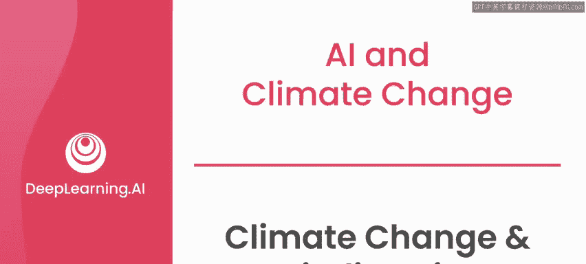

In this video， I'd like to spend some time discussing the connections between climate change and the biodiversity of ecosystems。

 We are now in the middle of what conservation biologists are calling the sixth mass extinction。

 and this refers to the fact that many species of organisms are now going extinct at the fastest rate since the dinosaurs disappeared。

 along with 75% of the plant and animal species on Earth at that time， some 66 million years ago。

In general， this dramatic rise in extinction rates is attributed to human activities over the past couple of centuries。

From hunting and fishing to land development and the pollution of the environment。In recent decades。

 however， the rate of extinction is widely believed to have accelerated due to climate change。

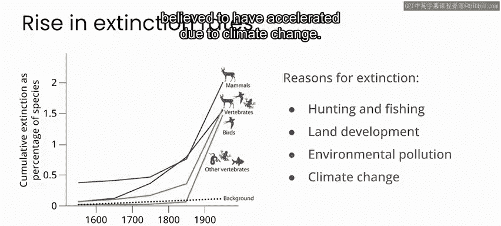

Pltants and animals go extinct when they face external pressure like predation and disease。

 as well as when the ecosystem that they depend on is dramatically altered。

 Well it's hard to say exactly which of the hundreds of plant and animal extinctions in recent decades add specifically to climate change。

 It's not hard to imagine that climate change plays a factor in many of these extinctions。

 In general， changing climate puts stress on plant and animal populations either adapt to new conditions or to move to areas where the conditions more accommodating for plants animals and other organisms on land these stresses might include droughts。

 floods， wildfires， excessive heat or saltwater intrusion into freshwater sources where sea level rise has inundated new areas。

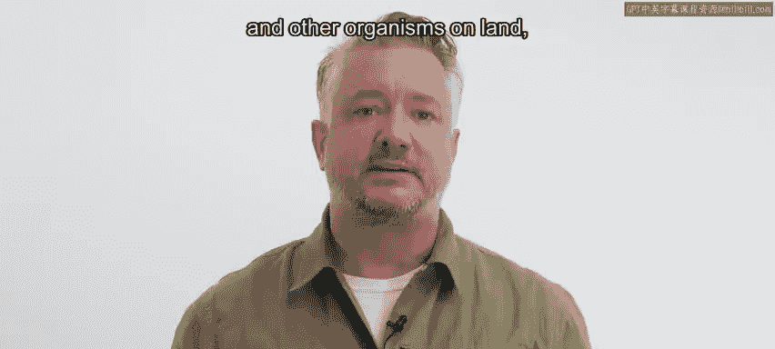

In some of these cases the populations can migrate， indeed。

 recent articles in the Journal of Science and Nature of Climate Change conclude that half of our plant and animal species are on the move。

 Land species are moving towards colder regions at a piece of about 17 kilore per decade and ocean species are moving up to four times faster towards colder water。

This is already having a dramatic impact on ecosystems around the globe。 For example。

 polar bears are threatened with an annual reduction in Arctic sea ice thus is reducing their hunting grounds and forcing them into new areas。

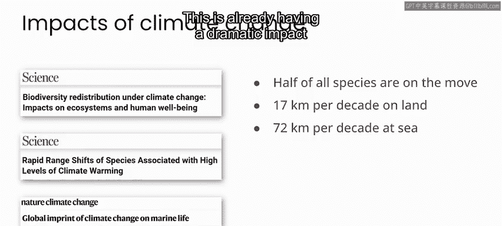

In other cases， species under pressure simply go extinct， like the brremble Key Melanies。

 a small rodent only found on a particular low lying island in the South Pacific。😊。

When rising sea levels inundated the island in recent years。

 it became uninhabitable and the melonie died off。In 2019。

 it became the first species of mammal to officially become extinct due to climate change。

For undersead plants and animals， the primary driver of displacement or extinction is the rising temperature of the oceans。

 Coral reefs are some of the most biologically diverse ecosystems on earth。

 When water temperatures rise above normal levels， coral undergoes a process known as bleaon。

This is where they expel the algae that they normally coexist with and appear white as a result。

Extreme bleaching events result in the death of the coral。

 and this is happening to coral reefs around the world as ocean temperatures rise。

The United Nations Climate Action Group estimates that with just 1。

5 degrees Celsius of global warming， 70 to 90% of the world's coral reefs will die off。

 and with just two degrees or more of warming， more than 99% of the coral reefs will disappear。

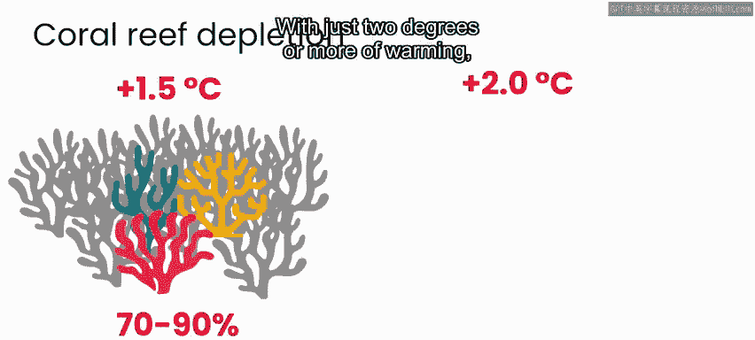

In a paper published in 2022 in the Nature Climate Change Journal。

 a group of researchers estimated that 90% of all ocean。

 plant and animal species could be at risk of extinction by the year 2100 if greenhouse gas emissions are not curbed。

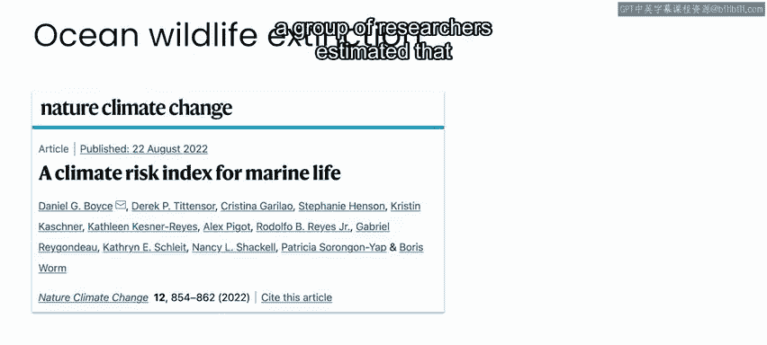

Though they add that much of this risk could be avoided if emissions are cut。

Back to the levels outlined in the 2015 Paris Agreement on climate change。With that being said。

 the plant and animal species that make up natural ecosystems are not just potential casualties of climate change。

 they're also a big part of a potential solution， particularly the plants。

To achieve the goal set out in the Paris agreementg。

 we need to reduce carbon emissions into the atmosphere by 30 gigat per year by 2030。

 and that will be achieved through some combination of reduced emissions from sources of greenhouse gases like burning fossil fuels。

 as well as removal of greenhouse gases from the atmosphere， also known as carbon sequestration。

Plants a carbon dioxide for breakfast， second breakfast，11s lunch and dinner。

 and they currently represent our most robust solution for removing carbon from the atmosphere。

 The UN program for reducing emissions from deforestation and forest degradation。

 estimates that simply by halting deforestation， we can sequester more than three guottons of greenhouse gases per year from the atmosphere。

By actively managing and restoring forests， that number goes up to5 gigattonons per year by 2030 and continues to grow into the future as ecosystems recover。

In another recent report by the UN， they estimated that implementing nature based solutions across all ecosystems could result in up to 11。

7 gigatons of greenhouse gas reduction or removal from the atmosphere annually by 2030。

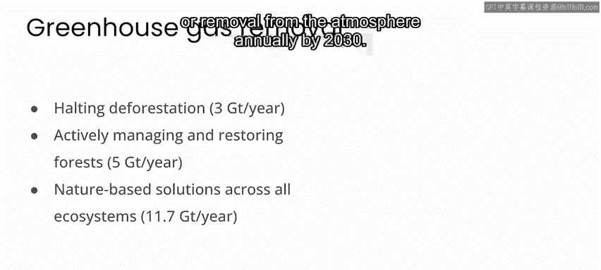

The phrase nature based solutions。For the mitigation of climate change refers collectively to actions to protect。

 sustainably manage and restore natural or modified ecosystems that are natural sinks or reservoirs of carbon。

Note that this does not mean just protecting or restoring some particular plant species or other。

 but instead the preservation of entire ecosystems。

 where biodiversity could be considered a measure of the health of these natural ecosystems。And so。

 in short， the preservation and restoration of biodiversity across all ecosystems is a critical component in our fight against climate change。

 So clearly， climate change and biodiversity are adequately connected。Where both act to influence。

 regulate， or amplify one another。In addition to climate change being a major driver of biodiversity loss。

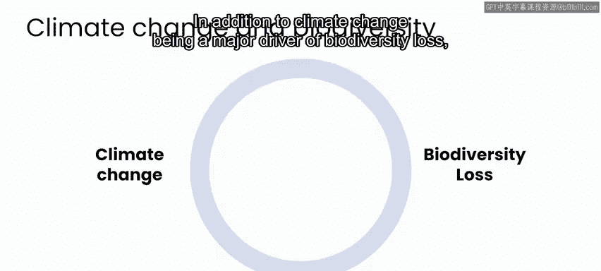

The loss of biodiversity increases our vulnerability to climate change and decreases the natural regulation of climate change。

 For example， extreme weather events such as floods and wildfires lead to the loss of natural ecosystems。

On the other hand， destruction of ecosystems undermines nature's ability to regulate greenhouse gas emissions。

 and so the protection and restoration of ecosystems is critical in the mitigation of climate change。

However， from an adaptation perspective， as well， wetlands。

 forests and coastal ecosystems help protect against floods and other extreme weather events。

 and thus， a loss of natural ecosystems increases our vulnerability to climate change。

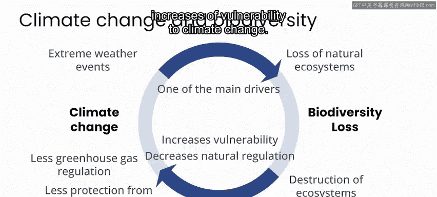

Unfortunately， similar to the problem of air pollution that you looked at in course1。

 the problem of biodiversity loss is already in an alarming state and only getting worse year after year due to human activities and to climate change itself。

 The protection and restoration of biodiversity will be accomplished through policies enacted by governments that can lead to significant shifts in industry practices and cultural norms in order to move toward these future policies。

 it's critical that we take steps now to monitor biodiversity across a wide range of ecosystems and to quantify the current impacts of human activities and climate change and identify opportunities to move the needle in the opposite direction。

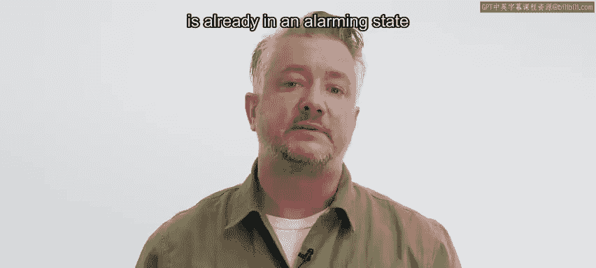

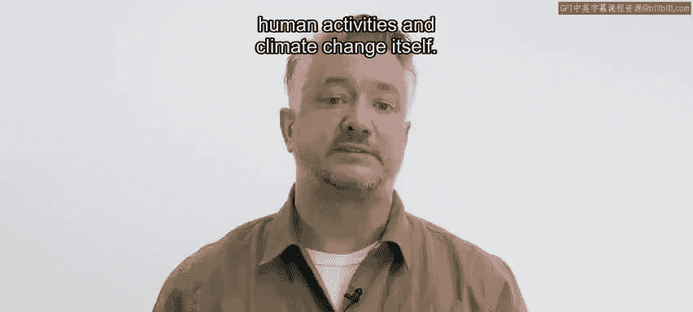

For that reason， groups all around the world are working on projects to monitor biodiversity and in many cases AI is part of that solution joinin me in the next video and we will take a look at some of the exciting work that is going on in the field of biodiversity monitoring。

