# 吴恩达《AI for Good专业课程》 AI与公共卫生、气候变化、灾难管理｜中英字幕 - P66：28_监测生物多样性.zh_en - GPT中英字幕课程资源 - BV13u411F7xZ

Climate change and the health of natural ecosystems are intricately connected。

 such that our efforts to mitigate and adaptive impacts of climate change。

 One key action to be taken is monitoring biodiversity in order to inform policies that can be enacted to protect and restore such ecosystems。

Motoring biodiversity can take many different forms。

 from installing cameras and microphones to observing animal populations on land at sea to airborne or satellite imaging campaigns to track deforestation。

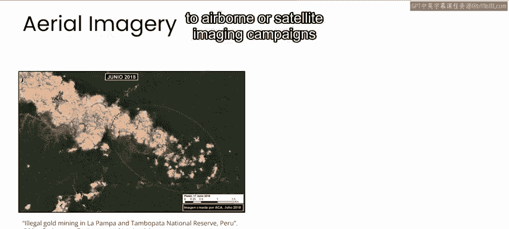

Or the movements of animal populations or even tag in individual animals with geolocation devices to track the movement of populations。

In this video， I'll showcase a few examples of biodiversity monitoring to give you an idea of some of the different approaches being taken and how AI can be part of that effort。

One way to know what kind of animal populations exist in a particular area is to listen to them。

In the field of bioacoustic monitoring， researchers place microphones out in nature in places like the ocean or in the forest to listen for birds or insects or other animals them。

The data can then be analyzedd to determine which animal species were heard in the recordings。

 while it's possible for well trained human to identify different animal or bird sounds in an audio recording。

 these projects are often recording hundreds or thousands of hours of audio across many different locations。

So AI algorithms can be trained to recognize animal and bird sounds in the recordings and automatically catalog animal populations in real time across many locations at a scale that would be insurmountable if it was a pure human effort。

Another approach to monitoring biodiversity is overhead imaging of natural ecosystems， this could be。

 for example， satellite imaging to map out deforestation。😊。

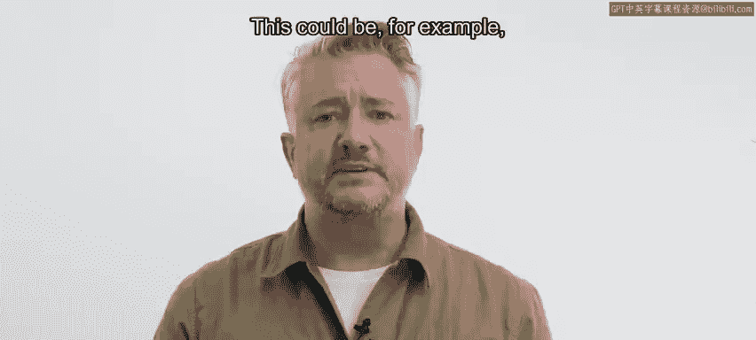

NASA's Earth Observatory has a project where they track the deforestation in the Amazon over time。

 which you can see in this animation。Another example using satellite imaging is the Send to Coral Project。

 where the European Space Agency is monitoring coral bleaching events。

Here you can see what a portion of the Great Barrier Reef looked like on June 8， 2016。

 If you zoom in on the region shown here， you can get a sense of what a healthy reef looks like from space。

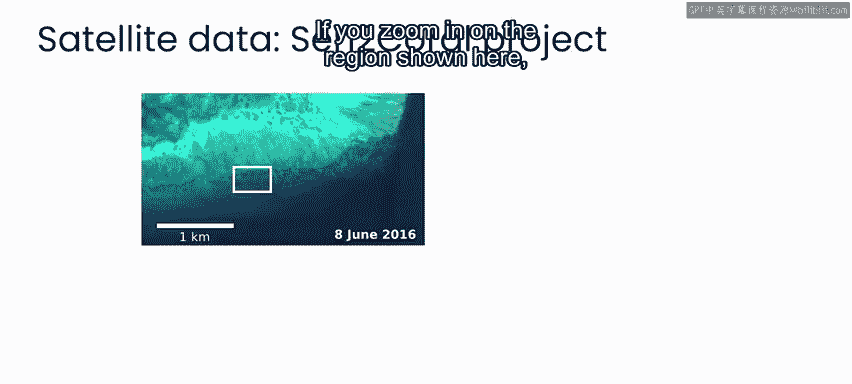

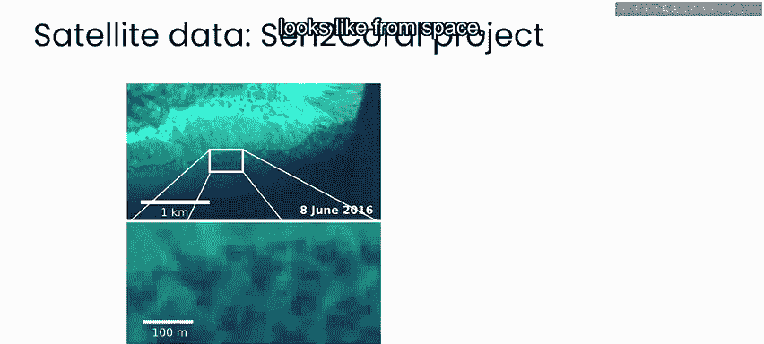

Here is an image of the same area just eight months later。

 where a la section of the reef has undergone bleaching。

Overhead imagingmo can also be taken from airplanes or drones to monitor plant and animal populations。

For example， in Namibia， the Ministry of the Environment。

 forestry and Tourism conducts aerial surveys to track the populations of animals like elephants within parks and conservation areas in the region。

 and in fact this is an area that I've worked in before。

 but it was for identifying animals and potential poachers rather than for monitoring biodiversity。

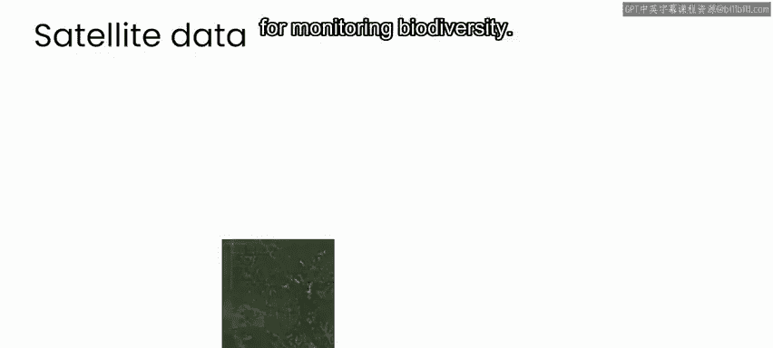

Similar to bio acoustic monitoring， overhead imaging surveys can generate huge amounts of data。

 and AI computer vision techniques are particularly well suited to the automatic detection of objects or mapping the extent of different types of terrain。

Another way of monitoring biodiversity is going out into ecosystems and taking pictures。

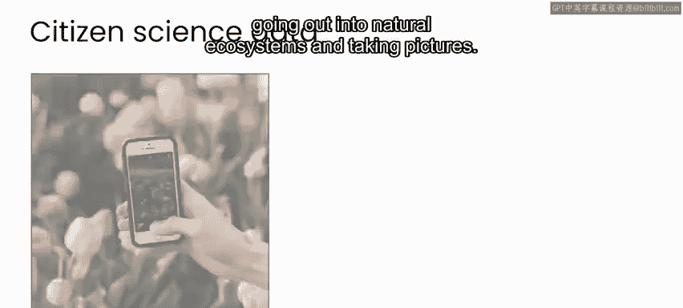

For example， a naturalist is a site where anyone can start a project or participate in an existing project by recording images of the local environment。

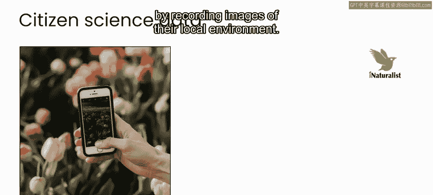

Oneonsat's project is the European plants projects where individuals all over Europe can upload their own pictures of plants。

This map shows where pictures have been taken。 Researchers are then able to use these images for informal tracking of plant and animal species In many areas around the world。

 researchers take an approach of putting in fixed cameras or so called camera traps out of nature that are triggered by motion detectors and automatically captured images of whatever comes by。

😊。

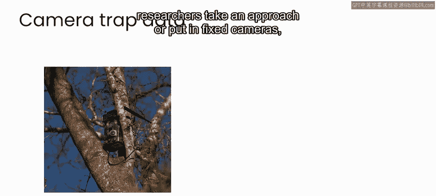

With multiple ch traps capturing images 24 hours a day， seven days a week。

 a project could quickly generate hundreds of thousands or even millions of images。

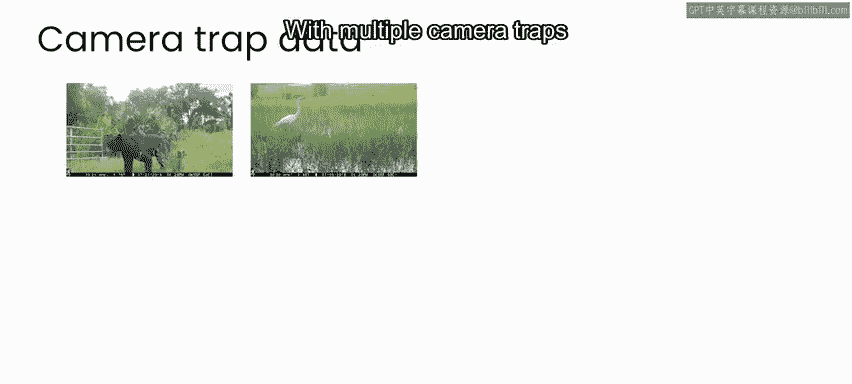

Using AI to automatically recognize what's in those images can be one critical piece in large scale camera trap projects。

😊，The projects I've mentioned here are just a few examples of biodiversity monitoring。

 natural ecosystems are made up of many different species from microbes to megafauna and some of those critters。

 typically the smallest ones can be very hard to observe directly methods for quantifying biodiversity of the tiniest creatures can be computational intensive as well。

 such as this study on using a method of flow cytometry to measure the biodiversity of microbial communities while many of the smallest creatures in nature may exist in relative obscurity monitoring biodiversity of entire ecosystems。

 is critical to understanding how those ecosystems are changing and informing policies to preserve them according to a recent article in the frontiers in ecology and evolution journal。

 in contrast to what we know of the world of plants and animals we have no idea whether global microbial diversity is increasing。

 decreasing or stay the same。

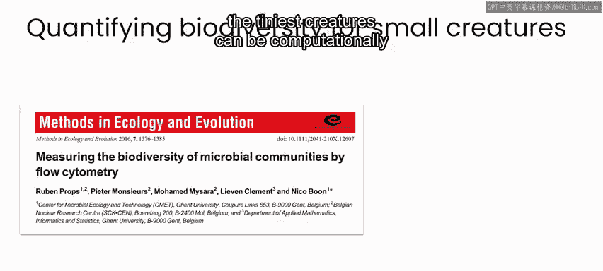

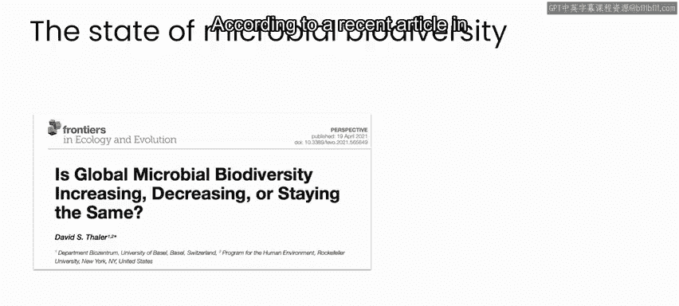

While this may be due in part to the relative difficulty in observing the tiniest creatures。

 it potentially also points to the fact that our understanding may be constrained by the types of organisms that we have chosen to study the most。

In other words， despite the fact that organisms of all shapes and sizes are important to the biodiversity of ecosystems。

 it's typically the pictures of charismatic megafauna that tend to get the most attention when it comes to people's concerns or excitement around biodiverrssity Mon or conservation be that as it may。

 in order to make sure you stay excited throughout the rest of this course we've designed a series of labs for you to work with pictures of some of the most charismatic megafaauuna in the world the large mammals of South Africa in the labs this week and through the rest of this course。

 you'll be working with camera trap data from the snapnapshotot car project which were designed to monitor biodiversity within the Carra National Park in South Africa。

 So join me in the next lesson to take a closer look at snapapshot car。😊。

