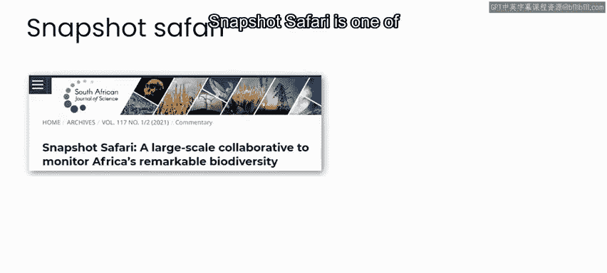
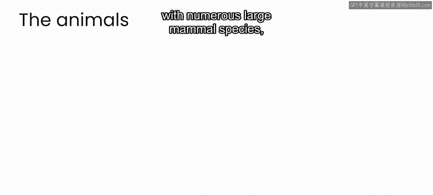
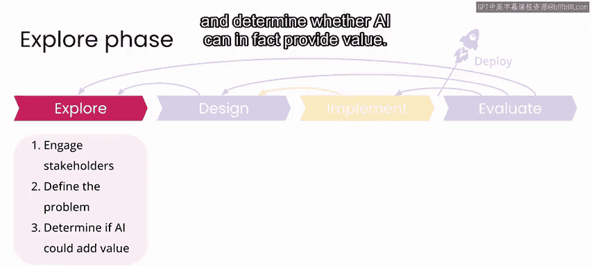
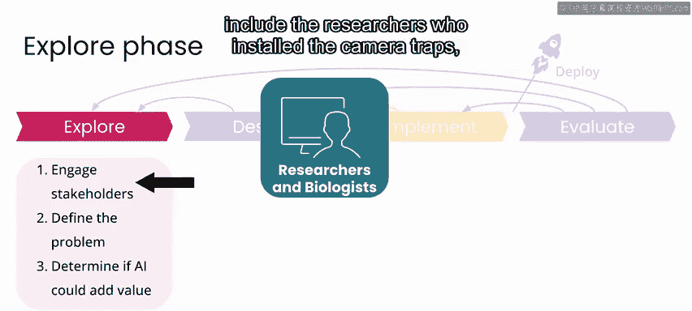
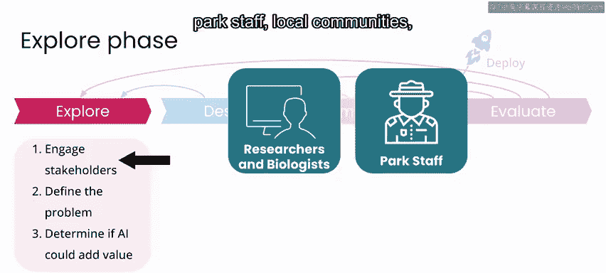
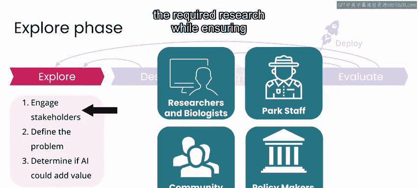
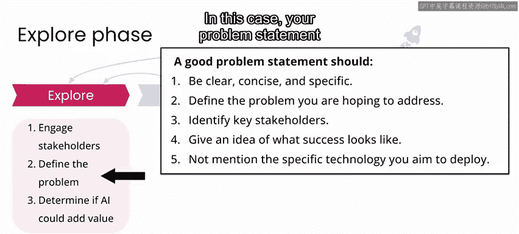
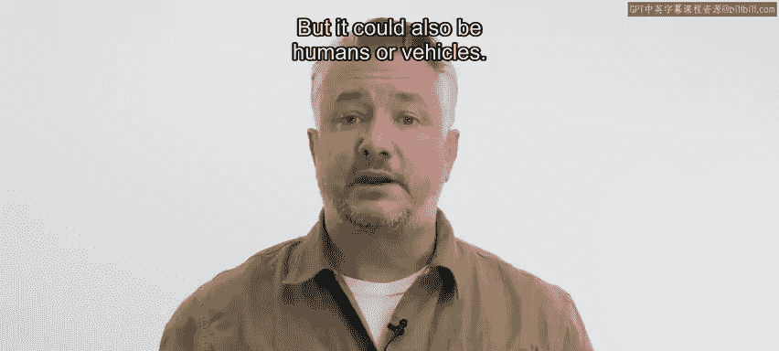

# 吴恩达《AI for Good专业课程》 AI与公共卫生、气候变化、灾难管理｜中英字幕 - P67：29_快照卡罗.zh_en - GPT中英字幕课程资源 - BV13u411F7xZ

The Snapshot camera project is part of a large network of camera traps called the Sapshot Safari Network。

 and this was established for the purpose of measuring baseline biodiversity metrics and trends across a wide range of ecosystems in animal species including many threatened or indeed species Snapshot Safari is one of the largest camera trap networks in the world。

 collecting millions of images annually to track animal populations throughout protected ecosystems across Africa。

 They're partnered with Zonaverse。org to engage citizen scientists in helping to label the data such that AI techniques can ultimately be used for automatic object detection。

The Caroll National Park is a wildlife preserves located in the great Caro region of South Africa。

 The park is a high desert ecosystem with numerous large mammal species， including the Oryx。

 Cape Mountain zebras， Red Huderbest， Southwestern Black rhinoceross and many others。😊。

For the purposes of this project， let's consider a scenario where you are working as part of a team which includes conservation biologists as well as the national park staff。

 and your job is to build a system that will automatically track trends in biodiversity and more populations within the park in order to inform policies that can be enacted to ensure the preservation of the park ecosystems。

In this effort， you'll be working with image data collected from a network of camera traps that are deployed within the National park。

Here are some examples from one particular camera trap。

Your task is to identify which animals appear in any given image。

 having humans manually review and label millions of images impractical。

 The Zverse project that I mentioned before was designed to engage humans in labeling enough data to get started。

 building an automatic animal detector。 And that's where you'll get started in this project。

 where the data set that's been labeled by human volunteers through the Zniverse dot org platform。

 At this point， youre in the explore phase of the project。

 And the key steps you need to take are to engage with the stakeholders define your problem statement and determine whether AI can。

 in fact， provide value。

In this case， the key stakeholders might include the researchers who install the camera traps。

 conservation biologists who hope to study the data， P staff， local communities。

 and policymakers who ultimately need to enact laws or regulations based on the results of your work。

Your role in this project will be providing these stakeholders with the information they need to carry out the required research while ensuring the local community is not impacted in any negative ways by your project。

In terms of a problem statement， as you already know。

 a good problem statement should be clear and concise。

 describe the real world problem that you hope to address and identify key stakeholders and what you need to provide to those key stakeholders and this should be without needing to reference any specific technology that you think might be implemented。

In this case， your problem statement might be something like。

Researchers and conservation biologists need daily information on the number of animals cited at various locations throughout the Caon National Park in order to monitor trends in biodiversity in animal populations to inform policies that can be enacted to protect and preserve park ecosystems from a du harm perspective。

 there are a couple of things you should be considering whenever you're thinking about collecting data in public places like in this case with cameras in a public park。

 the cameras in this case， a design to snap photos of anything that moves by， specifically animals。

 but it could also be humans or vehicles， Any pictures of humans or vehicles have the potential to be the equivalent of personal identifying information because the identity of a person or vehicle owner could be associated with a particular time and place。

Just like any other PAA， the standard should be treated as private， and not stored。

 shared or published without explicit permission from those individuals whose information is revealed in those photos。

Beyond PII concerns you should also be considering what other negative outcomes could arise from your project in this case。

 a number of the species appearing in the photos are endangered due to hunting and poaching。

If your project ended up revealing where endangered species are the most likely to be found in a national park and that enabled poachers to more easily locate them that would certainly constitute harm to the local community and that needs to be avoided In fact。

 when I worked on a similar use case monitoring animals for poaching。

 we deliberately did not make the data public for that very reason With this in mind。

 the next step in the explore phase is to determine whether AI can add value to this project so please join me in the next video to explore the data that you'll be working on in the snapnapshott Caroo project。

