# 吴恩达《AI for Good专业课程》 AI与公共卫生、气候变化、灾难管理｜中英字幕 - P68：30_生物多样性探索数据.zh_en - GPT中英字幕课程资源 - BV13u411F7xZ

In the previous video， you started a project where your task is to monitor biodiversity and animal population trends in Caro National Park in South Africa。

You identified key stakeholders and defined a problem statement。

 and the next step is to determine whether AI can add value as part of your solution。Now of course。

 we've already pointed out many examples of how AI is being used in biodiversity monitoring projects。

 but to determine whether AI can add value in your specific project。

 you need to begin by looking at the data and so that's where we're going next。

 let's head over to the lab and dig into the data。When you first open this lab。

 you'll see this description of the project at the top if you follow this link you can see more information about the CA project and about access to the data。

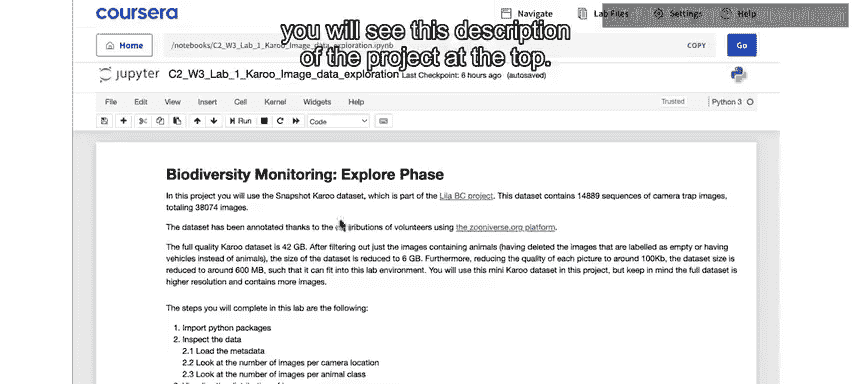

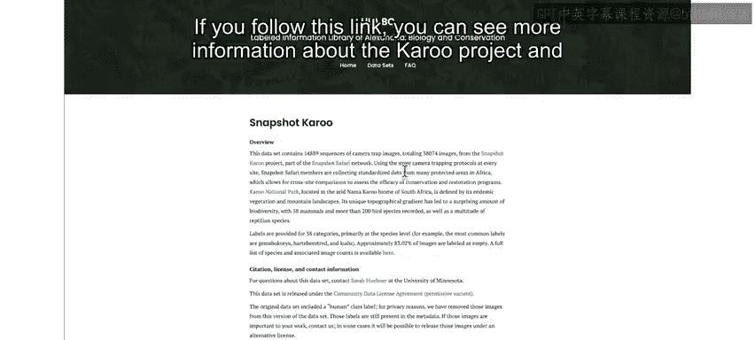

If you follow this other link， you'll arrive at the Zunverse。

org platform where you can learn a little bit more about the Citizen Science Project that helped label the images that you'll be working with。

And now before getting started with running any code。

 I'd like you to head up here and click on the Jupyter icon in the upper left here to open the folder where your lab is。

And from there， I'd like you to open the data folder on， as always。

 you'll find a data sheet in here that describes where the data came from。

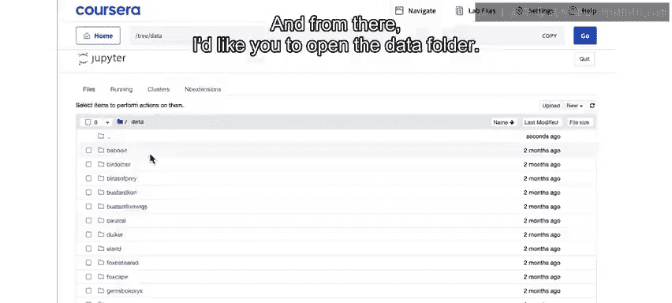

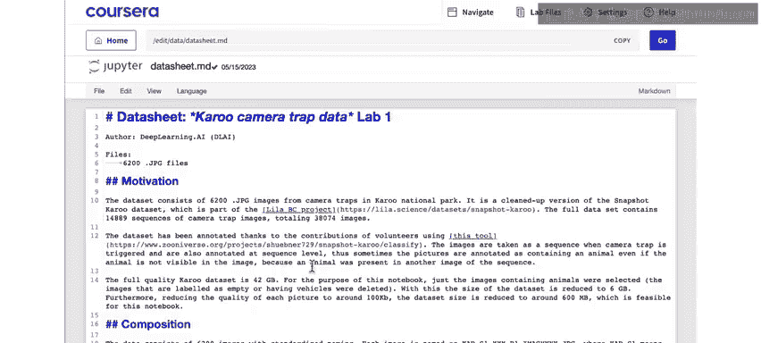

And then what you have here inside the data folder， are more folder is containing images of animals。

And each folder is labeled with the name of the animal that has been identified in the images in that folder。

So for example， here you have a folder with images of baboons。

And you can click on each of the images to see what these pictures look like。

Or you can go to another photo like this one for a gems spotock， which are also known as arts。

And you can have a look at the imagess to see what these pictures look like。

And so I'd like to spend some time in here just manually exploring the data to see what you find。

 see if you can get an intuitive sense of what some of the challenges might be in identifying the animals in these images。

And you'll probably see things like some animals are occluded or barely visible at all。

 and some animals might be far away or because the pictures are taken at night。

 it's not so clear what animal it really is。

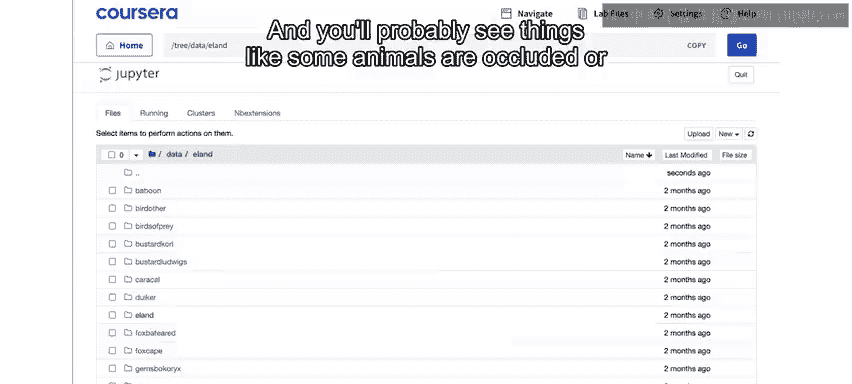

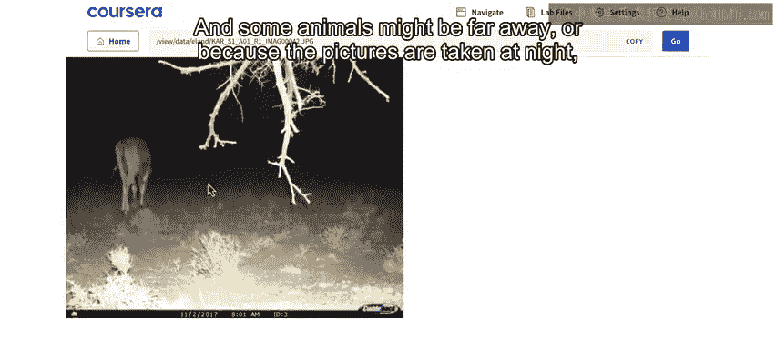

Once you've explored the data a little bit， head back over to the notebook。

And get started by running this first cell up at the top to import all the python packages that you'll need for this lab。

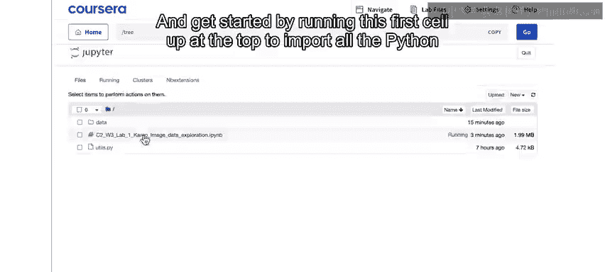

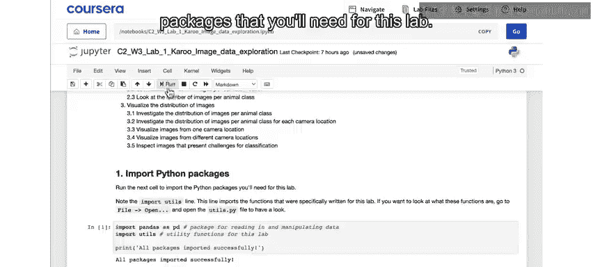

R on this Excel cell to print out a list of the folder names inside your data folder。

 and here you will see the names of the animals again。

 one for each of the folders of images that you have。

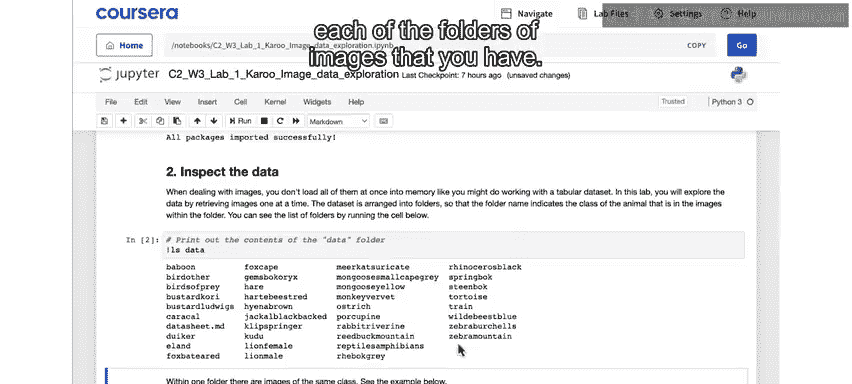

Run this next command here to see an example of printing out the list of image names inside a particular folder。

 in this case， for the black rhinoceros folder。

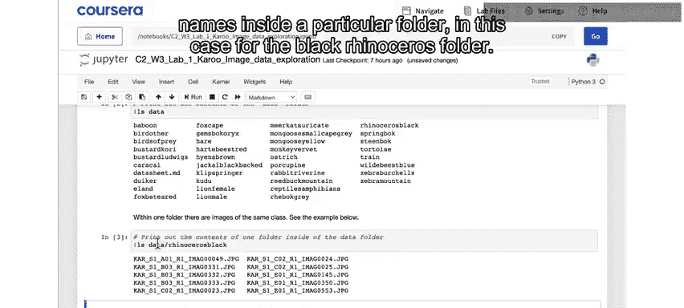

And this spot check will also tell you that there are only 10 images of rhinos here。In this case。

 the file name of each image contains information about where and when the image was recorded。

In this case these KAR underscore S1 and R1 tags just indicate that this is from the Kery data set。

 season one， repetition one and the A01， B03， etca numbers indicate the location of the camera trap so you can see that these pictures were taken from let me count one to three。

For different cameras。 So not a whole lot of variety。

So you can see here that there were four different camera traps which caught images across these  ten0 in total。

And finally， this image tag just gives the number of the image。

 a unique identifier across the entire data set。

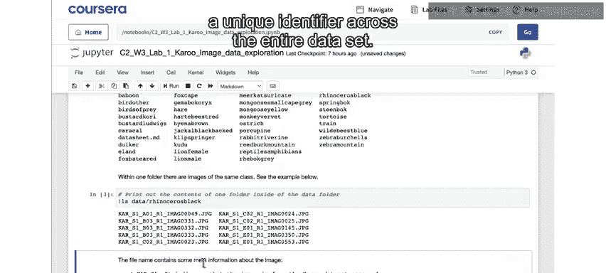

When you run this Excel cell， you'll be running a command that searches through the file structure and extracts a data frame of information for all the images。

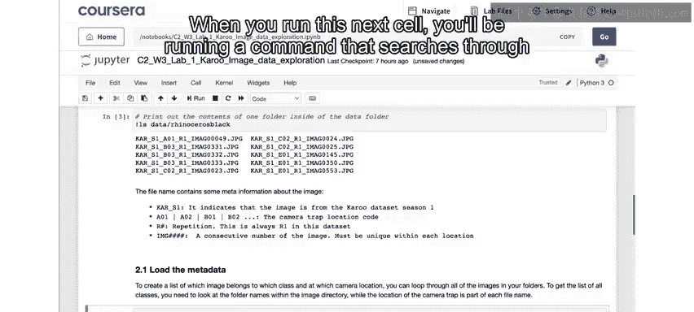

Where now using the file path of each image， you've extracted the camera location。

 which is part of the file name for each image， the name of the animal pitched in that image。

And the file path to that image。You'll use this information throughout the lab to access images automatically。

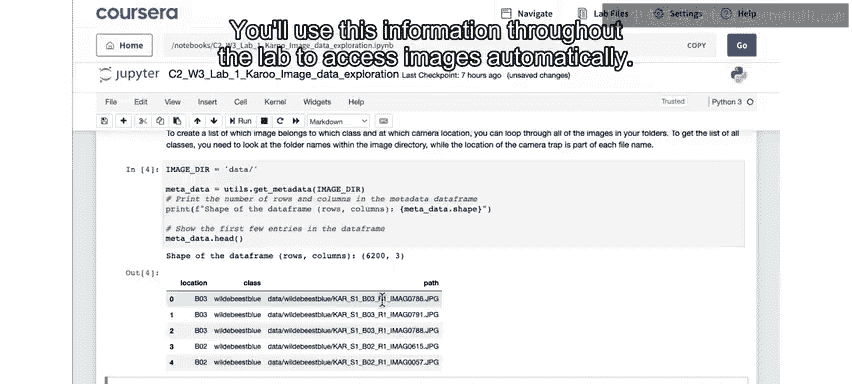

With this next cell， you can take a high level look at the data frame you generated with the last cell to see that it included all the animal names in different camera locations。

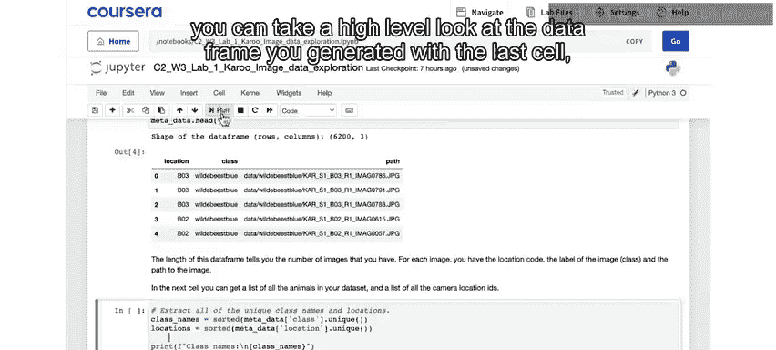

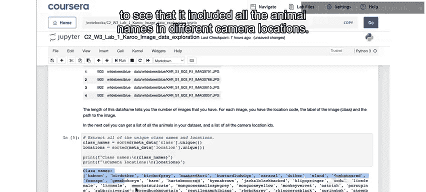

Run this ex so here to count out the number of images for each camera location。

What you can see is that some locations have hundreds of images， while others only have a few。

 and with this next cell， you can count up the number of images for each animal。

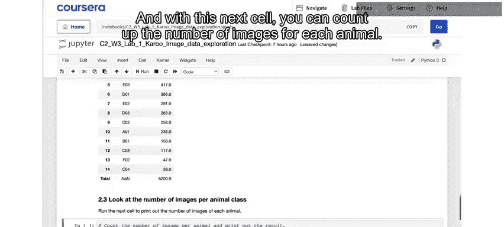

Here again， you'll find that for some animals， there are hundreds of images。

While others have relatively few。 and this is something that we'll come back to throughout this lab where we have few images。

 we would expect the machine learning algorithm to be less accurate。

If you're not familiar with many of these animal names。

 don't worry you'll become familiar with them throughout these labs just note that the names as listed here are sometimes out of order like for example this one is Red Hotterbest。

And this one is Mountain zebra。And this one here is blackbacked Jekyal。And this is curry busted。

 which is a kind of bird。Up here， this one is a gemms bug， which is also known as an Rx。

Another way to visualize the distribution of animals in your data set is by percentage of the total。

 and that's what you'll do when you run this next cell。

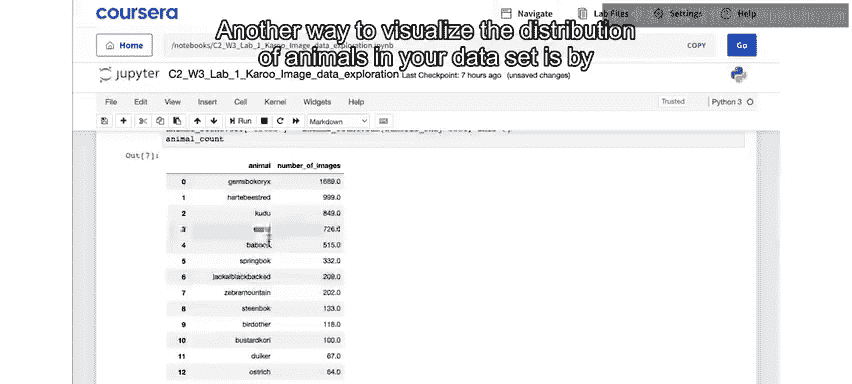

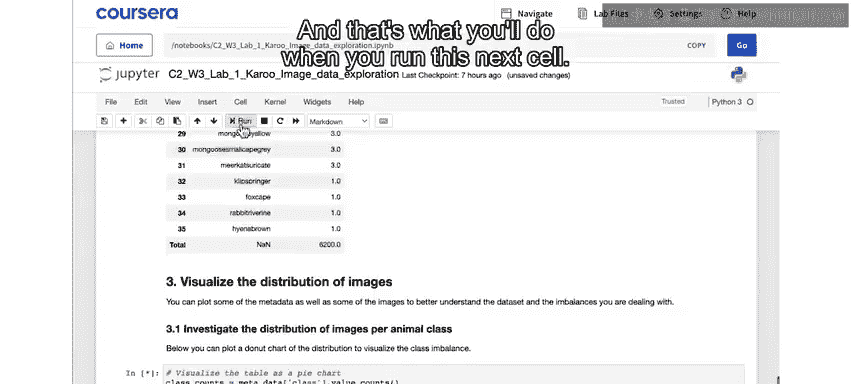

Now， this chart shows the relative percentages of the total number of images that you have of each animal。

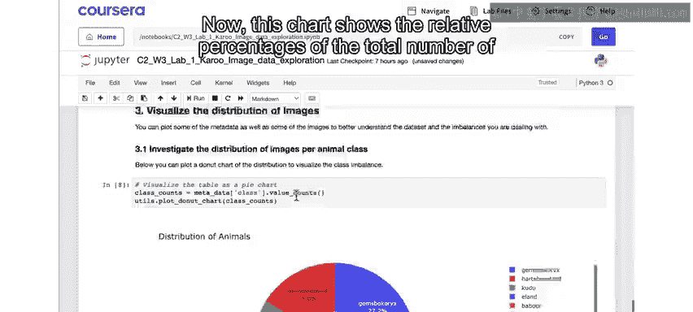

The main thing to take away at this point in your data exploration is that this is an imbalanced data set。

 like we said， your data is not distributed evenly across all the classes of objects。

 types of animals in this case that you hope to identify。

So if you tried to develop models with an imbalanced data set。

 you will run into problems like in this case for example。

 you can see that even a model that just always guessed gemspo RX。

 would be right more than 25% of the time。In the design phase of this project。

 you'll see some approaches to balance it out your data before modelling。

Taking this investigation one step further， you can run this next cell to look at the relative distributions of animals imaged at each individual camera location。

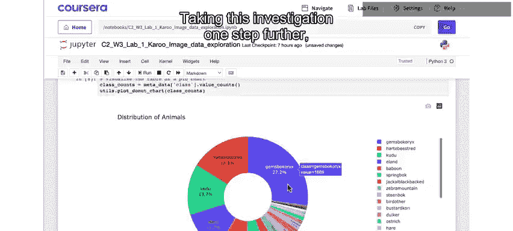

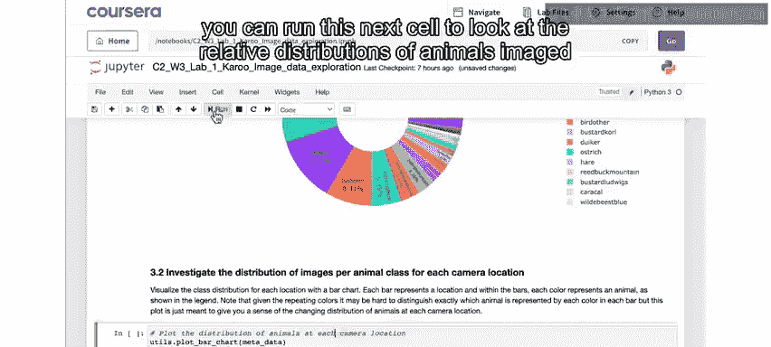

Now here on the horizontal access， you have the list of camera location identifiers。

And on the vertical axis， you have the fraction of each type of animal shown here in the plot legend that appears in images taken at each location。

What you can see is that not only is the relative distribution of animals in your data set imbalanced。

 but not surprisingly， the distribution changes quite dramatically as well based on the camera location。

Those of you who are conservationstelation biologists。

 you might already be able to draw important information from these relative distributions about where the animals are in the park。

 which animals are occupied in the same spaces and so on We're going to move on to looking at the actual images and thinking about an AI solution for an automatic animal detector so please join me in the next video to start looking at the images in this data set。

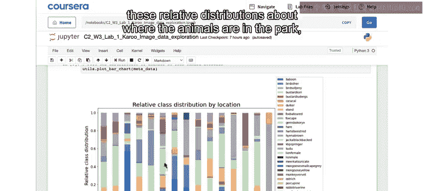