# 吴恩达《AI for Good专业课程》 AI与公共卫生、气候变化、灾难管理｜中英字幕 - P69：31_生物多样性可视化数据.zh_en - GPT中英字幕课程资源 - BV13u411F7xZ

In the previous video you explore the distribution of images taken across different animal species and different camera locations Now it's time to take a closer look at the images themselves and investigate some of the potential challenges with this data set。

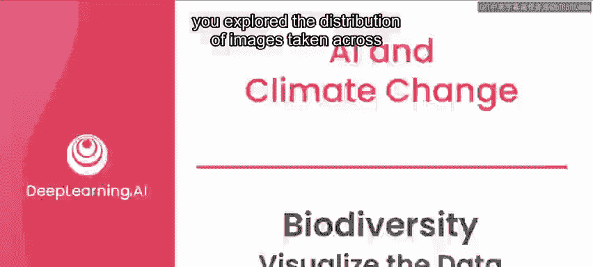

If you're already in the lab and have run all the cells up to this point， you're ready to go。

 but as always， if you're just opening this lab now。

 you'll need to run all the cells right up until this point。

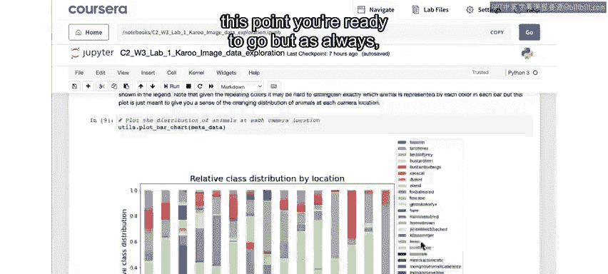

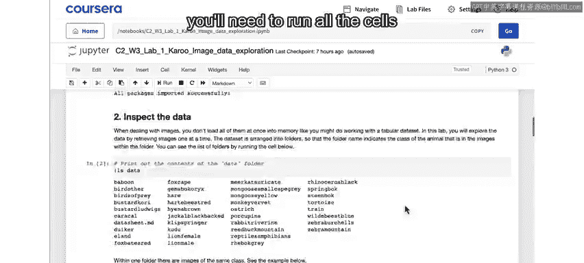

Now here， run this next cell to look at a collection of images taken from the same camera location。

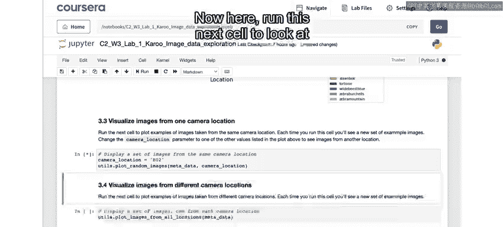

You can run the cell again and again to see another random selection of images from this location。

Look closely at the images。What you'll notice is that depending on the weather and the time of day。

 the images themselves can look quite different even when taken from the same camera location。

Here each image is labeled with the type of animal that was identified in that image。

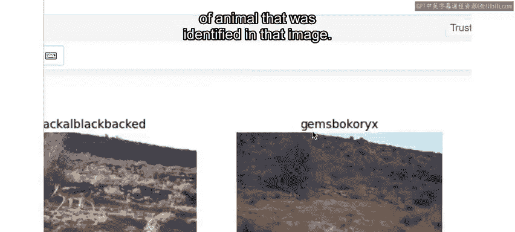

What you'll find is that in some cases it's not obvious where the animal is in the image or maybe you just see a small corner of what looks like an animal。

 and it's hard to imagine how anyone managed to label the image as containing a particular type of animal。

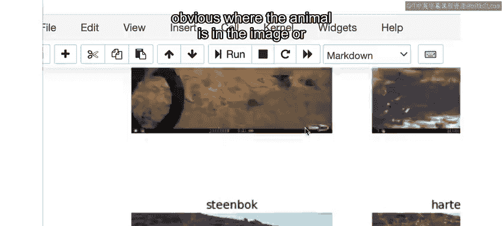

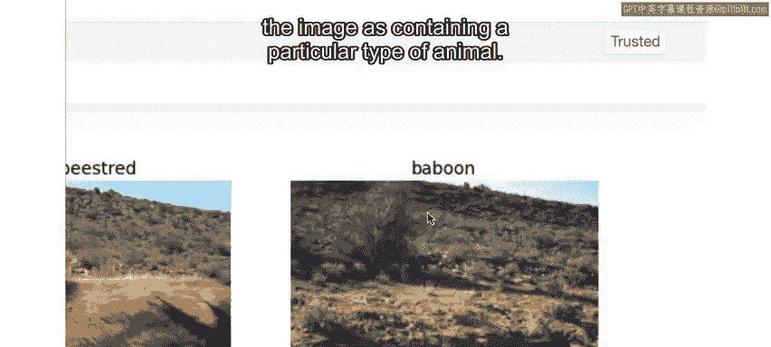

In some cases， at least， the reasons for this is that these images were taken as a sequence。

As that the full sequence might have shown an animal move in from one side of the frame to the other。

 And so it's possible to label some images that contain just a small part of the animal or an animal that is far away or obscured based on seeing the animal in other frames of that sequence in these labs。

 you'll develop an animal detector that works on individual images。

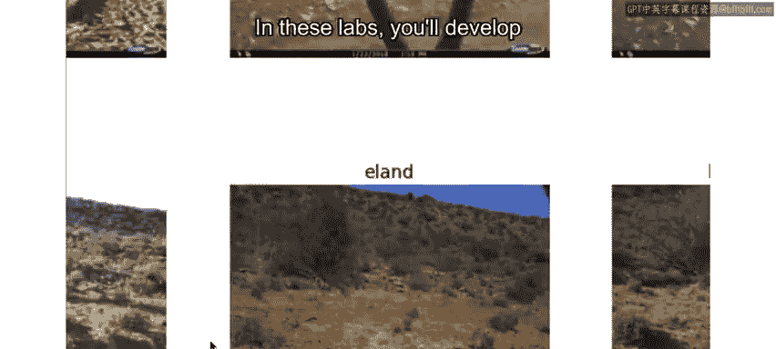

But something that might be worth considering as part of a rule or implementation of your animal detector would be developing a model that could work with sequences of images as well。

 Each time you run this cell， you'll get a new set of images to investigate。

 So try run in it several times to look more closely at the data on this next cell here now to display a selection of images taken from different locations here。

 you can now get a sense of how different environments will look。

Given different locations of ch traps。And here again， each time you run this cell。

 you'll get a new selection of images to investigate。

Run this next cell to take a look at a particular sequence of images from the data set。

This time of a baboon moving through the frame。If you look closely at this third frame。

 it's hard to find the baboon and I think it's maybe not there at all。

 and so this is one of the challenges that you'll face with this data set where images of label is contained in an animal but in many cases it'll be difficult for a human。

 let alone a machine learning algorithm to identify the animal in question。😊。

Run this next cell to see examples of other images that were classified as part of a sequence。

 but where the individual images can be hard to classify on their own。

Looking at your data in detail like this is a critical step in understanding the challenges that you will need to overcome in developing any kind of AI solution。

😊，Well it's not always obvious from the start， just what aspects of your project will present complications for your modeling efforts。

 when working with images， it can be very useful to look at the data and imagine where human real trouble performing the task that you hope your AI can perform。

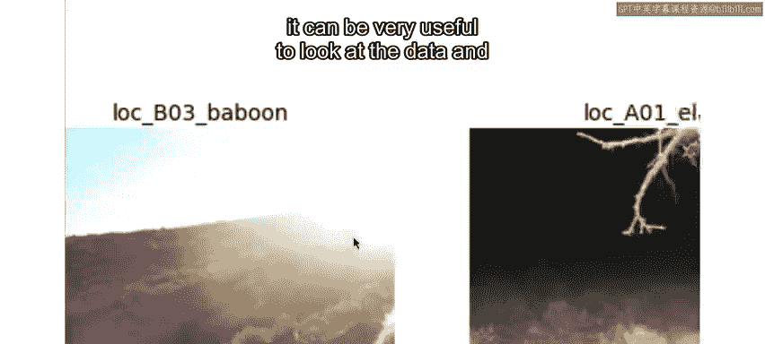

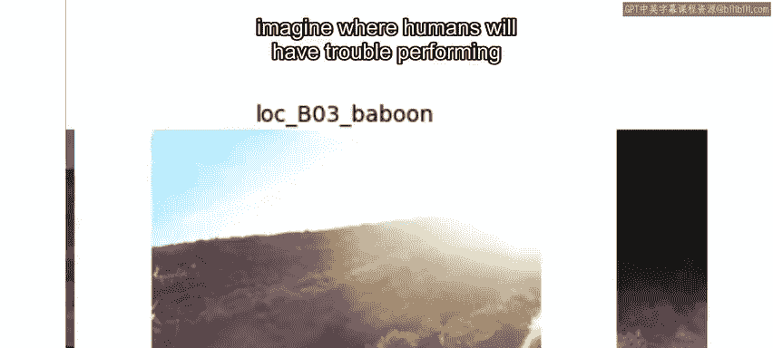

In this case， like I had mentioned before， you will be creating a machine learning powered animal detector that works on individual images。

 not on sequences， so just as it is difficult or impossible for a human to tell what's in some of these images。

You can expect that a machine learning model will also have trouble if it doesn't have the full context of the sequence。

In the design phase of this project， you'll develop a method for removing images from your training data that don't contain any identifiable animals。

One thing that humans are pretty good at， but that AI can struggle with is scanning an image for the object of interest。

 and what I mean by that is that few and me we can look through these images and quickly determine where to focus our attention or whether it appears there's nothing of interest in an image。

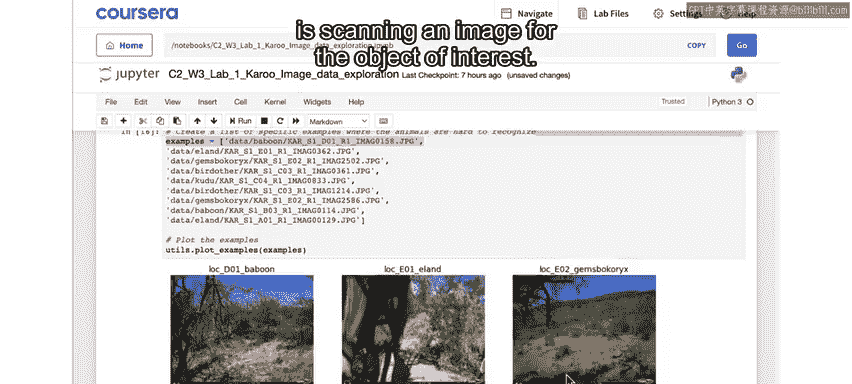

Determining whether there's anything of interest in an image and where to focus your model's attention。

 if there is something to try to identify， these are problems that are fundamental to essentially or biodiversity monitoring projects that employ camera traps。

 As I mentioned before， these camera traps are triggered by motion So that could be an animal walking by or it could be a vehicle or a person or even just a strong gust of wind that causes the trees to swear in this lab you also identified imbalances in the number of images across different animal types as well as different camera locations。

 These types of data imbalances or also a common problem in camera trap projects and you'll aim to mitigate that using a technique called data augmentation in the second part of the design phase。

 Before we wrap up the explore phase。 we have one exciting project spotlight video for you Sarah Bery is a professor at MIt and an expert on biodiversity monitoring with AI techniques in this video。

 you'll set the context for why biodiversity monitoring is important and the challenges。

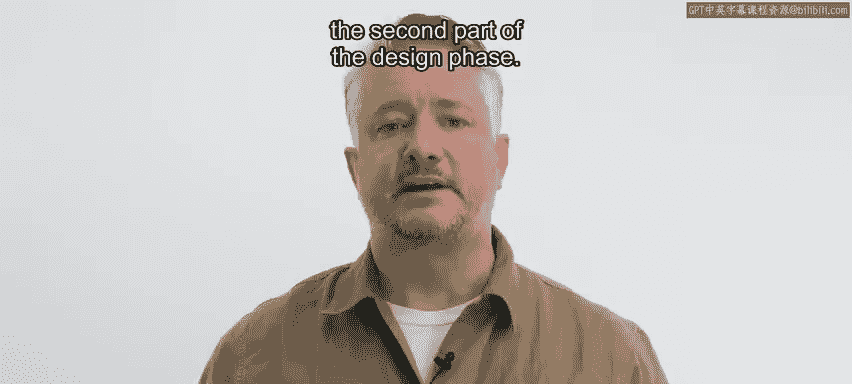

we launch data sets， she'll also introduce you to the mega detector model she developed while at Microsoft。

 and in the next week's lab you'll get the chance to apply the mega detector in your own project。

