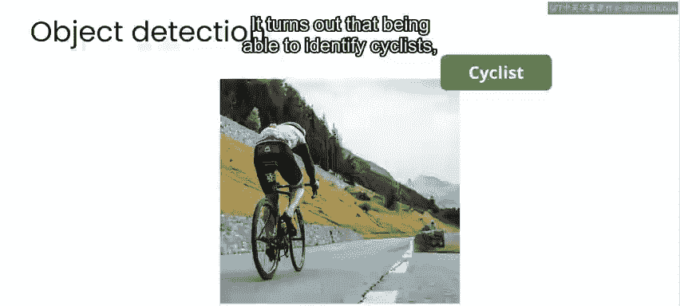
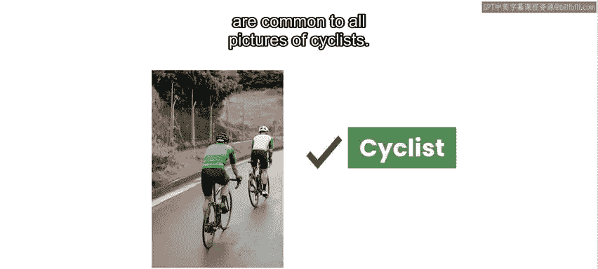
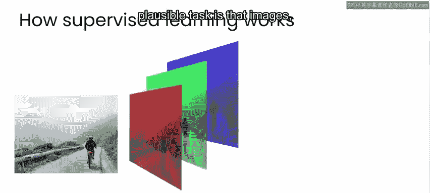
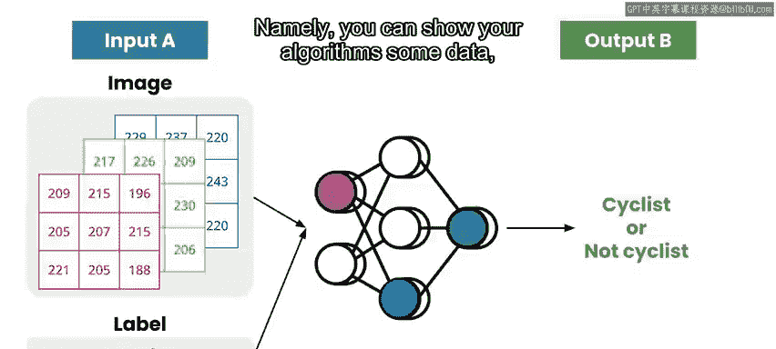
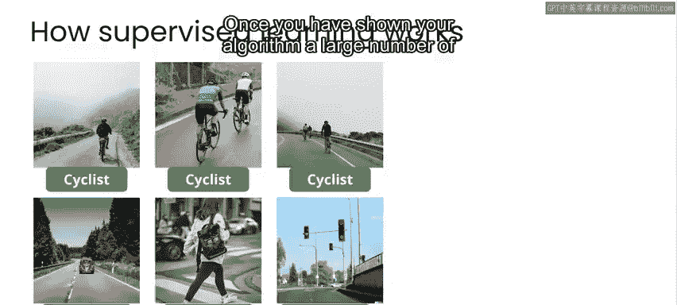
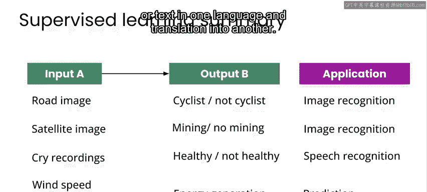

# 吴恩达《AI for Good专业课程》 AI与公共卫生、气候变化、灾难管理｜中英字幕 - P6：5_快速概括监督学习的工作原理.zh_en - GPT中英字幕课程资源 - BV13u411F7xZ

In order to better understand how an algorithm can learn from data。

 let's take a look at an example of recognizing what's in an image。If I show you this image。

 for example you're able to immediately recognize that it's a picture of a cyclist on the road it turns out they've being able to identify cyclists as well as other things like pedestrians and land markings on the road is an important problem for self-driving cars so how do you get an algorithm to do that？

😊。

Now for the record， the way that humans learn and the way that machines learn are very different。

 but qualitatively there are some similarities and those similarities can be helpful when it comes to getting better intuitive understanding of just what's going on the way that you learn to recognize a cyclist in an image like this。

 it was probably because you grew up seen cyclists on the road or maybe you had a bicycle when you were young or you watch cyclone on television。

 in any case， you arrived at the point where you can easily recognize a cyclists in an image。

 even if it's an image you've never seen before of a cyclist you've never seen before on a road you've never seen before。

 because you know what kind of characteristics common to all pictures of cyclists。

So suppose you wanted to train a machine learning algorithm to recognize cyclists in images The key thing that makes this at least a plausible task is that images。

 particularly digital images， are really just another kind of data in the form of a large collection of numbers representing the amount of each color in each pixel。

You can feed this collection of numbers to a machine learning algorithm along with a label cyclist。

And the algorithm can look for patterns in the numbers that make up the image。

This concept is at the heart of supervised machine learning， namely。

 you can show your algorithm some data and also give it a label in this case， the label cyclist。

And then you show it other images that don't contain the cyclist and indicate those with the label of not cyclists Once you have shown your algorithm。

 a large number of examples of cyclists and not cyclists。

 it will begin to be able to identify cyclists in images it has never seen before based on the patterns it has observed in the labeled examples。

You could also trend your algorithm to recognize pedestrians， road signs， lane markings。

 and other cars if you're working on self driving cars。Similarly。

 you could show your algorithm thousands of examples of satellite images that contain evidence of illegal mining operations and train to automatically recognize this activity in previously unseen images。

Or consider a different kind of data audio recordings This is what Charles Uno was describing in his video with the work of Bennoir Health。

 where they'd collected thousands of recordings of baby cries from different regions of the world and labeled them as healthy or not healthy with this labeled data set that are able to create an application that allows a parent or caregiver anywhere in the world to simply record the sound of a baby's cry and use that as one piece of evidence as to whether that baby is healthy So the point here is that you could have any kind of data set where in each example input a is associated with an appropriate output B and again。

 these inputs an outputs might be an input of a pitch and an output of cyclist not cyclist or an input of a satellite image and an output of mine-in or no minein or an input of an audio recording and an output of healthy。

 not healthy or anything else that you're interested in like wind speed and energy。

put or text in one language and translation it into another。

 if you can create such a data set containing these inputs and outputs， that at least in principle。

 you can use that data set to train a machine learning algorithm and evaluate whether that can help in performing in this task while you will be working with various machine learning models in these courses。

 the goal of these courses is not to teach you the technical details of the math and the code behind the machine learning algorithms。

If you do decide that you're interested in diving more into the technical side of things。

 that's great， I can recommend both the machine learning specialization and the deep learning specialization from deep learning AI as excellent foundational courses on the technical aspects of machine learning。

😊，While the potential for machine learning can be impressive。

 it's important to keep in mind that artificial intelligence is not some kind of replacement for human intelligence AI algorithms are only as good as the data that were trained on and they don't come with any built- in ethics or concerns about the impacts of the decision making of how they perform or where they are deployed so if you are working on any kind of project that involves AI even if you're quite optimistic that your work could have a positive impact it's still your responsibility to also investigate and understand the potential negative impacts of the technology that you're thinking about deploying into the world。

😊，Coming up next， I'll go over some of the things you need to keep in mind when it comes to first and foremost。

 doing no harm。