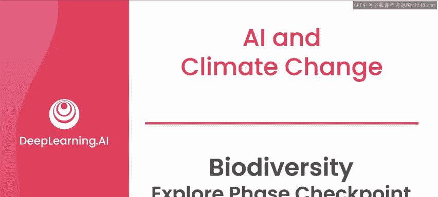
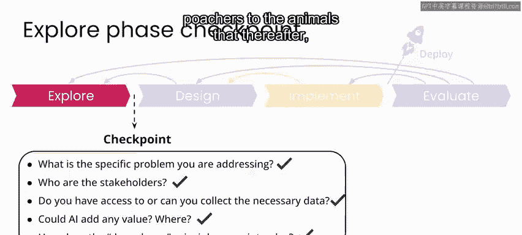
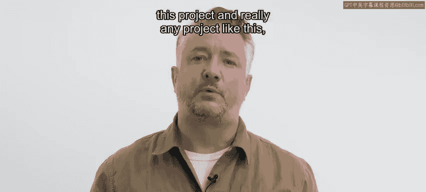
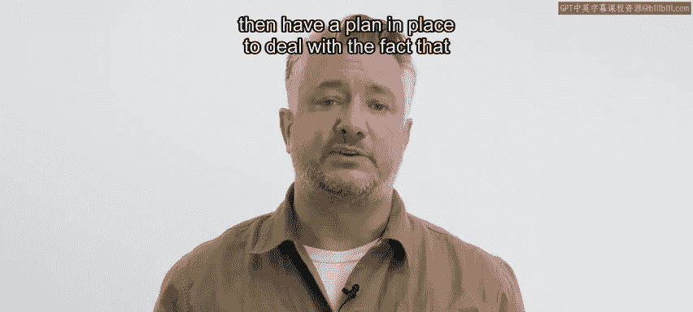
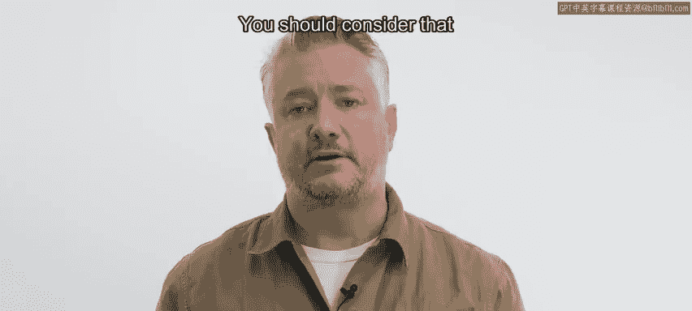
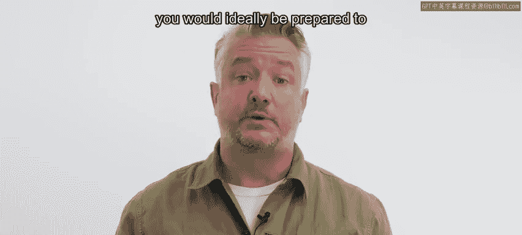
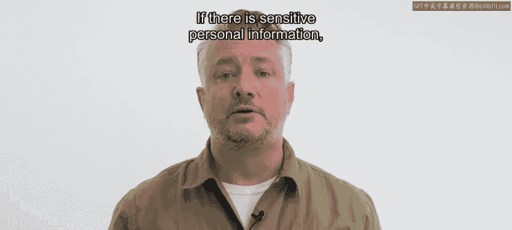

# 吴恩达《AI for Good专业课程》 AI与公共卫生、气候变化、灾难管理｜中英字幕 - P70：33_生物多样性探索阶段检查点.zh_en - GPT中英字幕课程资源 - BV13u411F7xZ

As you heard from Sarah Berry in the previous video。

 the challenges that you identified in your exploration of the snapshot carry data like imbalanced data sample and hard to classify images are common to all camera trap projects。

Now at this point， you have explored various aspects of this project focused on biodiversity monitoring in the Carra National Park in South Africa。

You' have considered who the relevant stakeholders are to find your problem statement and examine the data that you'll be working on to determine whether AI can actually add value in this project。

 Nice work。Now it's time to check in to see whether you have everything you need to move on to the design phase。

 following along with the AI for Good project framework that we've been working with up until this point。

 the questions you and your team need to consider are the following。

What is the specific problem you are addressing， who are the stakeholders。

 do you have access to or can you obtain the necessary data， could AI add value。

 where and how specifically， and how does the do no harm principle come into play here？

For the Carabbiiversity monitoring project。That you're working with here。

 you wrote down the following problem statement。Researchers and conservation biologists need daily information on the number of animals cid at various locations throughout the Kara National Park in order to monitor trends and biodiversity in animal populations to inform policies that can be enacted to protect and preserve park ecosystems。

And just a reminder， these kind of problem statements often take many weeks or months to create。

 we've accelerated it here for this cause。This problem statement does make it clear who some of the key stakeholders are。

 what sort of solution you hope to build， and a sense of what success could look like for the project。

The stakeholders you identified included researchers and conservation biologists， park staff。

 policymakers， and the local communities。You'll explore the data that you have access to and confirm that while there are some issues that you'll need to deal with regarding imbalances and hard to classify images。

 in general you have what you need in terms of labeled examples of the types of images that you expect to be classifiedifying。

With confirmation that the data looks like it has what you need。Indeed。

 it appears that ALA could potentially add value to this project if you can use the data to design and train an automatic image recognition pipeline that will be able to quickly process large batches of images on a daily basis。

With regard to the duno harm principle， you're working with a subset of the original data set in this project that only contains images of animals。

 but if you look into the details of the original data set。

 you will find that in addition to pictures of animals。

 the camera traps in the Car National Park also recorded many images of people in vehicles。

 The images of people were removed from the published data set and for the purposes of this project we also removed images labeled as empty or containing vehicles。

The other potential concern for a project like this where you're recording images of animals that may be the target of poachers is that you would need to be careful not to inadvertently publish information that could help guide poachers to the animals that there'reafter in a real- world implementation of this project and really any project like this where you want to record images or video or audio in a public space you would need to establish whether you can do so legally and ethically and if so then have a plan in place to deal with the fact that you will inevitably be recording people's activities and you should consider that could be sensitive personal information in your implementation of such a project you would ideally be prepared to quickly identify and delete and if this sensitive personal information rather than storeing or publishing it if you are prepared to identify and delete images of people and vehicles from your data set。

 which in this case already been done for you and you're confident that your project does not pose a threat to the local communities in terms of creating incentives for poachers or other negative impacts then you're ready to move on to the design。

です。And with that， you've completed the explore phase for the snapapshot Car Bidiiveversity monitoringor project。

 join me in the next video to wrap up this week of content and then we'll move on to the design and implementation phases in the next week of materials。

😊。