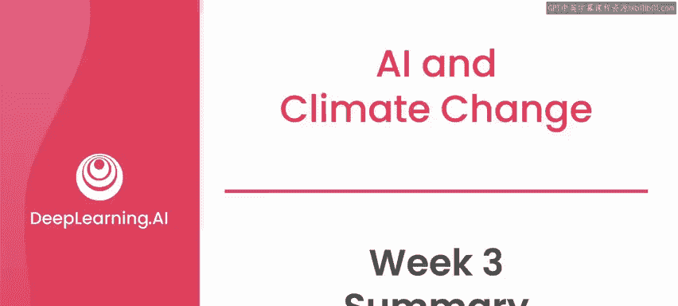
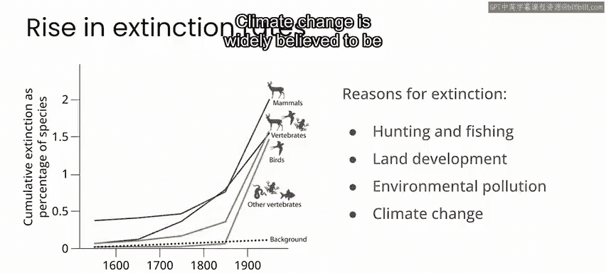
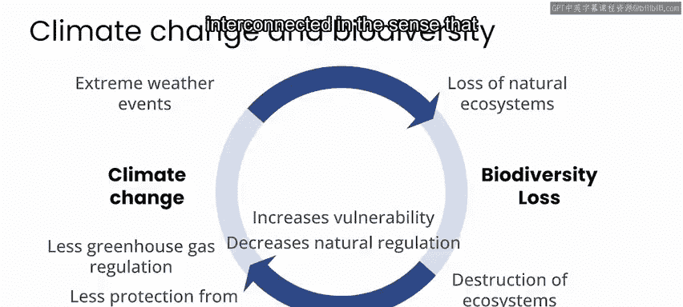
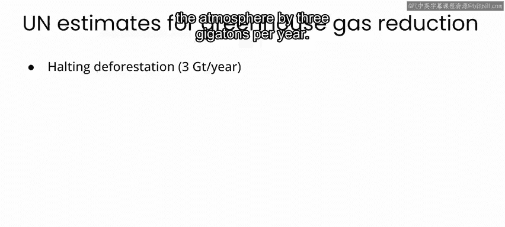
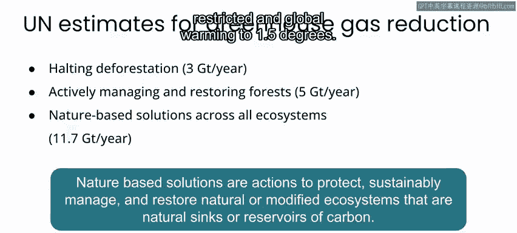
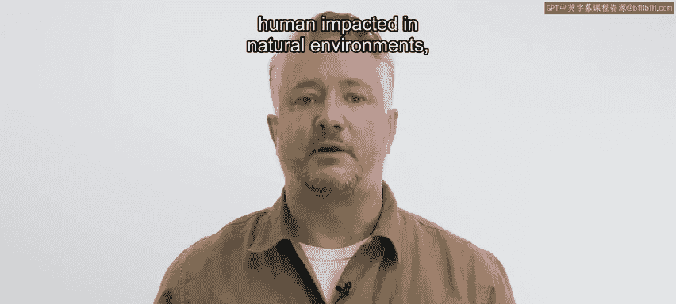
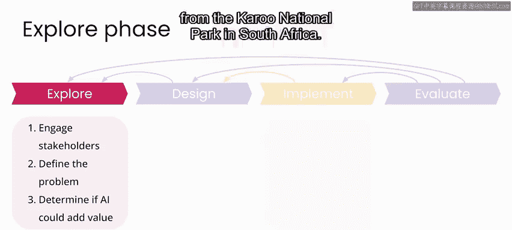
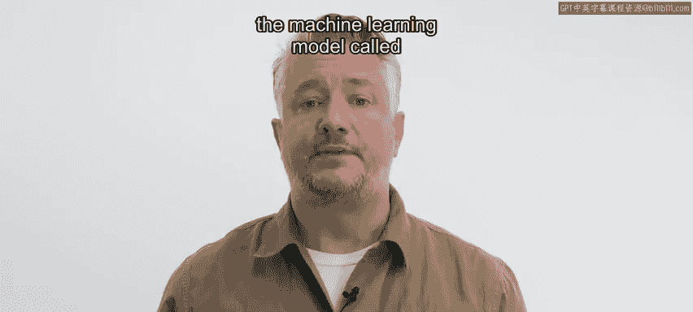

# 吴恩达《AI for Good专业课程》 AI与公共卫生、气候变化、灾难管理｜中英字幕 - P71：34_第3周总结.zh_en - GPT中英字幕课程资源 - BV13u411F7xZ

This week you've been exploring biodiversity monitoring in the context of climate change you learned that we're in the midst of what conservation biologists are calling the sixth mass extinction。

 a reference to the fact that organisms are going extinct now at the fastest rates since the dinosaurs were wiped out along with 75% of all plant and animal species around 66 million years ago。

In general， this rise in extinction rates is attributed to human activities like hunting and fishing。

 land development， and the pollution of the environment。

Climate change is widely believed to be responsible for accelerating the rate of these extinctions。

This， of course， makes intuitive sense when you consider that climate change is stressing and modifying natural ecosystems in dramatic ways that put pressure on plant and animal species。

 In response， many plant and animal species are made into new areas。

 which is in danger in the existing ecosystems in those areas。

 and they're also facing a threat of extinction in their native environments。 I emphasize， however。

 that an accelerating rate of extinction of plants and animals。

 and the resulting loss of biodiversity in natural ecosystems。

 is not simply a casualty of climate change， but rather。

 the climate change and the health of natural ecosystems are deeply interconnected in the sense that each one acts to drive and regulate the other。

😊。

The UN estimates that by simply halting deforestation。

 we could reduce greenhouse gases in the atmosphere by three gigatons per year。

 and that by actively pursuing naturebased solutions across all ecosystems。

 we could see a reduction of around 11。7 gigatons of greenhouse gases per year by 2030。

 and this represents nearly 40% of the required reduction needed to be on track with restricting global warming to 1。

5 degrees。

In addition to the protection and restoration of natural ecosystems being a powerful tool in the mitigation of climate change。

 it is also critical in adaptation to climate change in that wetlands。

 forests and coastal ecosystems help to protect against the floods fires and other extreme weather events driven by climate change。

When it comes to protecting and restoring ecosystems。

 it's not just about focusing on particular species or a set of species。

 but instead on entire ecosystems， where in some sense biodiversity could be considered a measure of the health of those ecosystems as the first step towards the protection and restoration of ecosystems。

 biodiversity monitoring is critical to inform policies that can be enacted to turn the tide on human impacted natural environments。

 and the implication that those impacts have for climate change。

With that， you begin the explore phase for the snapnapshot Caro project。

 where you will build an automatic animal detector using camera trap data from the Caro National Park in South Africa。

In this phase of the project， you can set its stakeholders write down problem statement and explore the data to establish that you have what you need in order to move forward into the design phase of this project。

You heard from Sarah Bery about some of the challenges that come with large scale camera trap projects and how she and her collaborators at Microsoft came up with a machine learning model called the Mega detector to tackle some of these challenges。

 Join me in the next week of materials to begin the design phase where you'll employ the mega detector in your own work for monitoring biodiversity in the Caro National Park。

😊。

