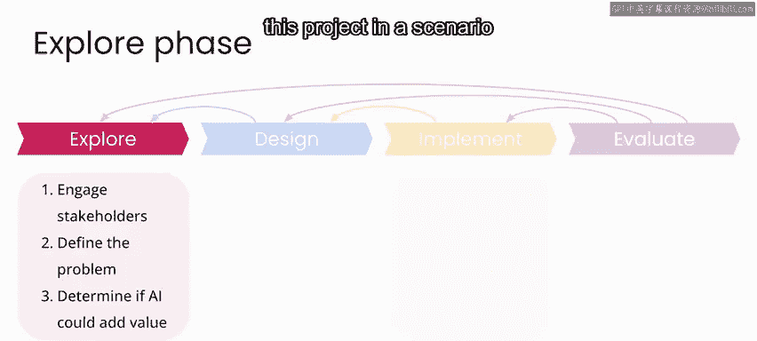
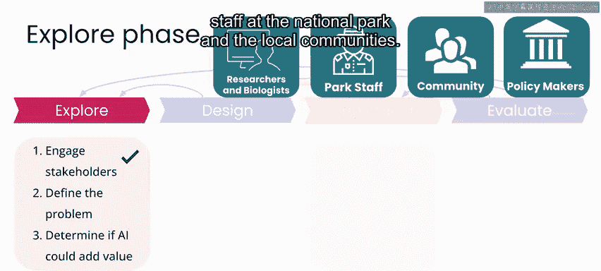
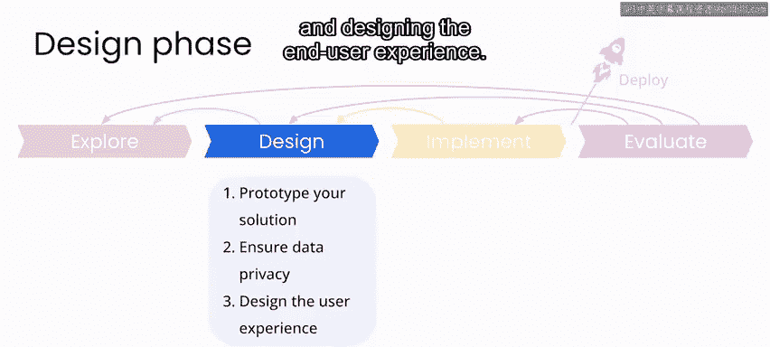
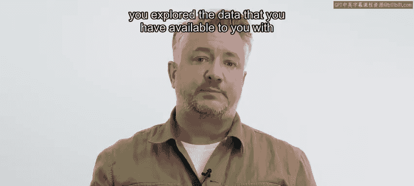
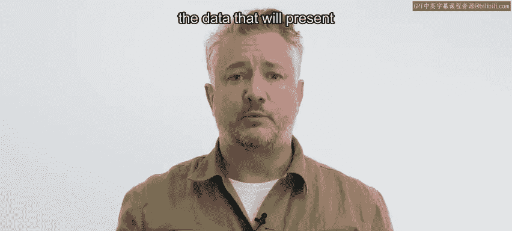
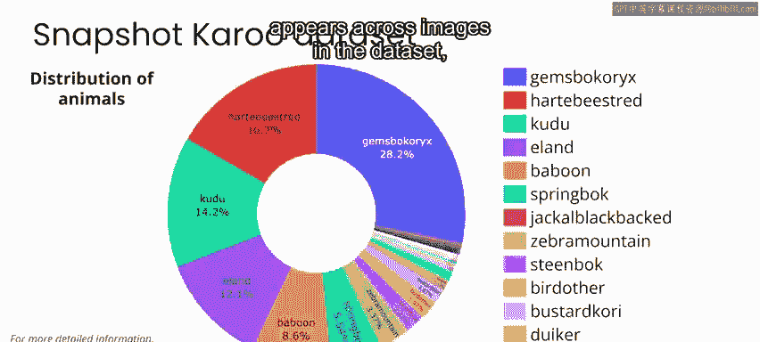
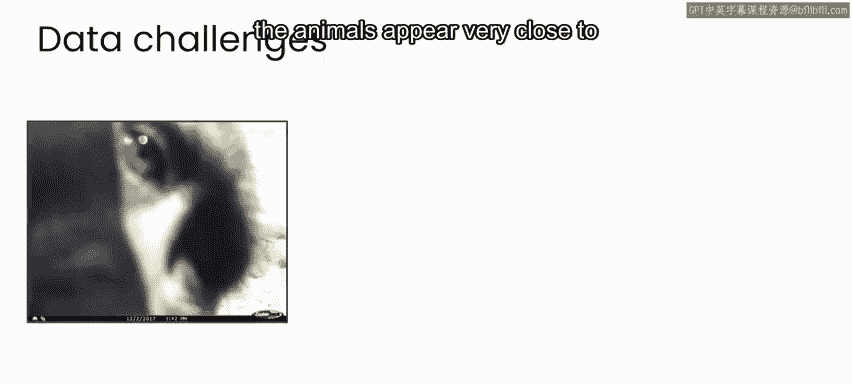

# 吴恩达《AI for Good专业课程》 AI与公共卫生、气候变化、灾难管理｜中英字幕 - P72：35_欢迎来到第4周.zh_en - GPT中英字幕课程资源 - BV13u411F7xZ

Welcome to the fourth and final week of this course on AI and climate change。

 And this week you'll complete a series of labs to design and implement a solution for biodiversity monitoring in Caro National Park。

 South Africa。In the previous week， you completed the explore phase for this project in a scenario where you have connected with the stakeholders which include researchers in the field of conservation biology。

 policymakers concerned about preserving the biodiversity of natural ecosystems。

 staff at the National park and the local communities。

Your goal in this project is to provide researchers with daily reports on the number of sightings of various animal species identified in images recorded by the camera traps distributed throughout the National park。

You'll explore the data and determine that it looks like AI probably can add value in this project。

 and so you're ready to head into the design phase。In the design phase。

 this step that you'll be focused on a prototyping new solution。

 thinking about data privacy and designing the end user experience。

In the previous phase of the project， you explore the data that you have available to you with the night towards building an automated system for animal detection。

And you identified a number of issues in the data that will present a challenge in developing your solution。

 For example， you saw that there is an imbalance among the number of times each kind of animalible appears across images in the data set。

As well as the number and type of animal that appear in each camera location。

Apart from imbalances in the data， you also noted that in some images。

 it would be difficult or maybe impossible to identify an animal in the image。

 and this was due to the fact that many of the images had been labeled as part of a series where an animal may be easily identifiable in some of the frames of that series。

 but harder to identify in others。You also saw that in some cases。

 the animals appear very close to the camera and in other cases very far away。

 and in still other cases， multiple animals appear at the same time in a single frame。

For the purposes of creating an automatic animal detector。

 all of these issues present significant challenges that you will need to address in developing your solution。

It turns out that these challenges that you identified in the data for this project are common among pretty much any project attempting to perform automatic detection of animals with camera trap data。

Overcoming these challenges is one of the main reasons that Sarah Beri and her collaborators at Microsoft developed the mega detector model。

 The mega detector is a model that has been pre traineded on millions of images to be able to automatically detect the most common things that appear in camera trap data。

 namely animals， people and vehicles。

Apart from just being able to tell whether an image contains an animal， person or vehicle。

 the mega detector will identify exactly where that object appears in the image by providing the coordinates of a so called bounding box。

And this bounding box goes around each object。On top of that。

 it can detect multiple objects simultaneously in an image。

 Traing a machine learning model to do this robustly across a wide range of images。

 camera locations and animal types is a massive undertaking。

 and generally not the kind of thing that any one team using data from just a handful of camera traps could accomplish on their own。

So this is why the mega detector is being used by teams around the world on a diversity of projects as a first step in their animal identification pipeline。

In the upcoming lab， you'll get a chance to use the mega detector model on your data。

 and you'll quickly simplify the task of animal identification by first identifying which images do contain animals and where the animals are in those images。

 Jo me in the next video to take a closer look at how you can use the pretrained mega detector model as the starting point for your project。

