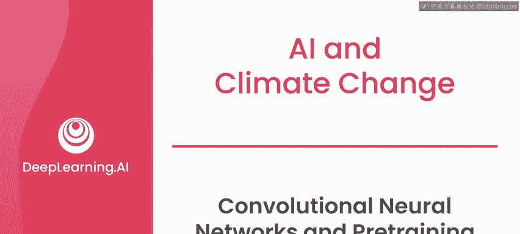
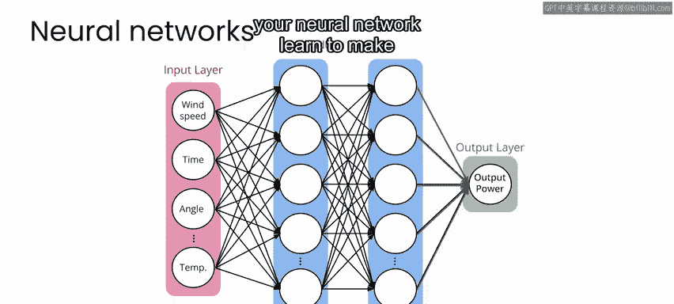
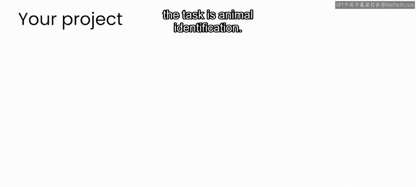
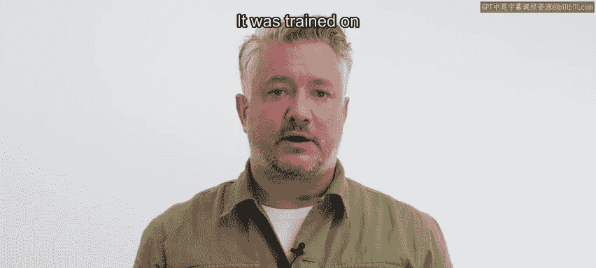
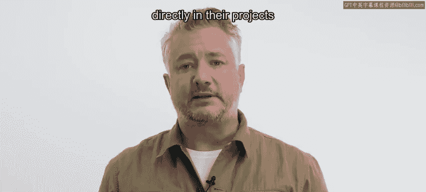
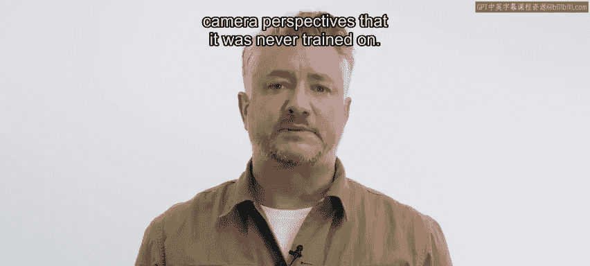

# 吴恩达《AI for Good专业课程》 AI与公共卫生、气候变化、灾难管理｜中英字幕 - P73：36_卷积神经网络与预训练.zh_en - GPT中英字幕课程资源 - BV13u411F7xZ

In week two of this course， you developed a number of different neural network models for the purposes of wind power forecasting。

 If you took course one of this specialization， then you also constructed a neural network model for estimating air pollution levels。

In each of these cases， you trained your model from scratch。

 which is to say you first defined the model structure， how many neurons and layers you wanted。

 then you trained your network by showing many examples of an input A like sensor measurements or meological variables and an output B。

 like wind power output in the second week of the course。Through that training process。

 neural network learn to make better and better predictions of that output。

While training a neural network from scratch is a reasonable approach for many machine learning applications。

 in other cases it can be advantageous to start with an existing model that you or someone else has already trained for some other task。

This is particularly common when dealing with image data where the task is often to recognize what is in an image。

In some cases， if you have access to a model that has been trained to recognize the specific type of object that you're interested in。

 you can simply use that pretrain model for your task。Like here。

 I'm showing the output from a pre traineded object detection model that is freely available on the internet。

And you can check out the website shown here on the slide for more details。

 This model was trained to recognize cars and people and other things in an urban environment。

 And I've used it here to identify these objects in a stock video clip of traffic going through the intersection。

 So if my project were， for example， to monitor a traffic or this particular intersection。

 then I would be able to use this model right out of the box and get a pretty good result。

For your project in these labs， the task is animal identification。

 part of the challenge of doing that task is to first be able to identify whether or not an image contains an animal and then also where in the image that animal is located。

As I mentioned before， these challenges are common to all camera trap projects， and fortunately。

 Sarah Berry and her collaborators at Microsoft developed the mega detector model to address these challenges。

The mega detector was trained on millions of ch trap images to identify whether an image contains animals。

 people or vehicles， It was trained on so many different camera perspectives and different animals that researchers can use it directly in their projects to identify animals that it might never have seen before from camera perspectives that it was never trained on。

As a developer of an AI powered animal detector， the mega detector should make your life a lot easier for your project。

 So join me in the next video to get started using a mega detector model for your project。

