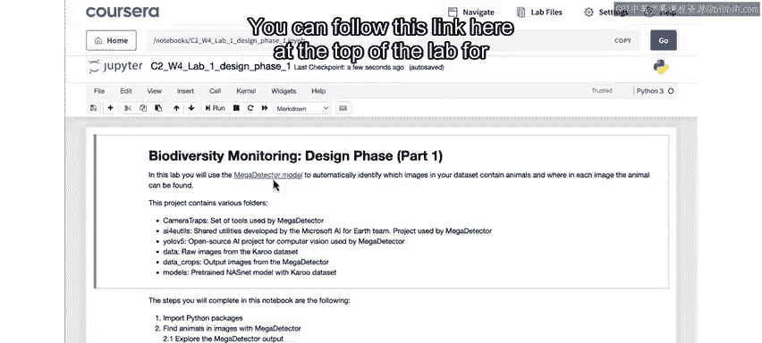
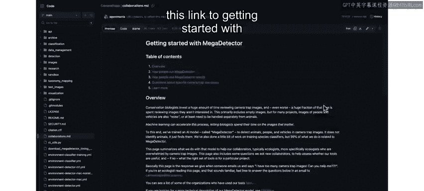
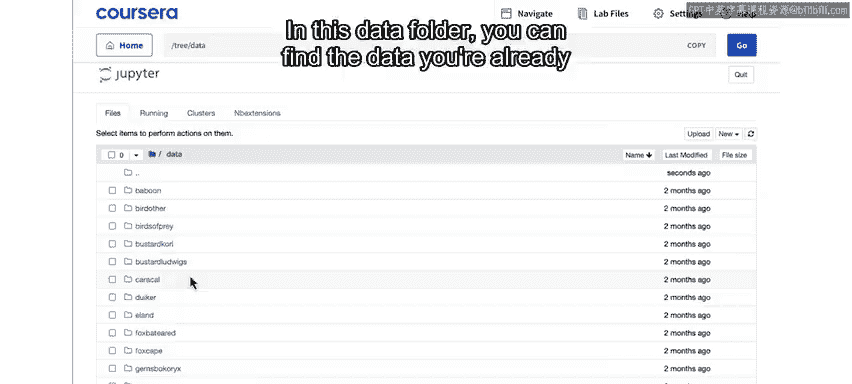
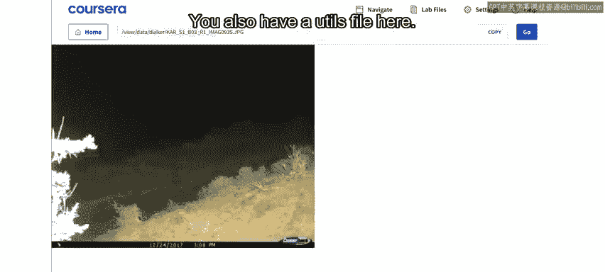
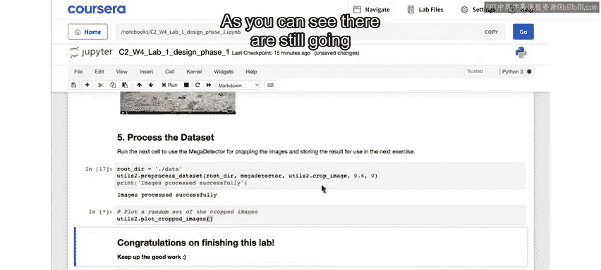
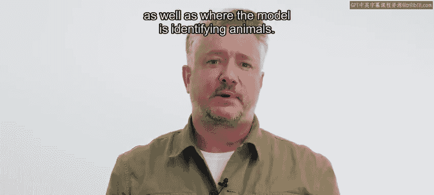

# 吴恩达《AI for Good专业课程》 AI与公共卫生、气候变化、灾难管理｜中英字幕 - P74：37_生物多样性Megadetector.zh_en - GPT中英字幕课程资源 - BV13u411F7xZ

In this video I'm going to step through the first part of the design phase for your biodiversity monitoring project here you will use the megadetect model for identifying which images in your data set contain animals and where in each image the animal can be found For the moment you're not going to worry about identifying the type of animal at each image that will come next So let's head over to the lab to see how the mega detector works。

Here are in the first part of the design phase for this project。

You can follow this link here at the top of the lab for more information on the technical aspects of the mega detector model。

From there， you can also follow this link to get started with Mega detectoror for more information on how to incorporate this model into your project。

Next， take a look at what's in the lab folder by clicking up here on the Jupiter icon。

What you'll find is that there are two notebooks in here。

 these two files that end in I P Y and B and right now you'll be working in the first one The second one will be for the next part of the design phase also included here is the mega detector model。

And in this file， that ends with dotP2。As well as various other photos that include extra software and resources to run the model。

In this data folder， you can find the data you're already familiar with from the previous lab along with the data sheet。

You also have a U file here， as in the previous labs where we've abstracted away some of the code。

To make the notebook easy to interpret。In this case， it's actually called UTs2 dot Pi。

 simply because the name Us was already being used by some of these other libraries that are in here and we wanted to avoid any confusion。

But if you're a Python programmer and you want to understand more of what's going on behind the scenes。

 you can look at this UTils 2。PFle heading back to the notebook， the first step as always。

 is to run this cell at the top where we will import the Python packages that you'll need for this lab。

And all this stuff here is just setting up that you'll be able to use the mega detector model。

 then we will spot check to make sure that our folders of images for the different animals are all there。

With this next cell， you will now read in the mega detector model。Once that is run successfully。

 you can run this next cell to read in and display an example image of a cur busard。

You'll be using this image as your first test case to see how the mega detector model works。

 This is the text output of the mega detector model。

And this is what you'll see each time you run that model over an image where detected objects are located。

So down here， you can see a description of what each component of this text output means。First。

 you have the file， which is just the path name to the image being processed。

Then you have something called Max detections Comf。

This is a confidence estimate on a scale of  zero to1 where you can think of low values as indicating the model has low confidence in that particular detection and the high values where the model has high confidence。

In this case， there's just one detected object or one detected animal。

But if there are multiple detections of objects in this image。

 this max detections conf number would be the value associated with the object that was detected with the highest confidence。

 and there would be a longer list。So here you can see that the highest is confidence。

That was detected was 0。968， which is the same as 96。8% confidence。

There is a long literature on how to detect and refine confidence in machine learning models。

But we will not go into that here， I just want to flag that this is an entire branch of machine learning and in a real world scenario it can be very important that you rely on your confidence estimates。

Next， we you have a list of detections， which will just be empty if nothing is found。

 but may contain multiple items if more than one object， more than one animal was found in the image。

Here， the rest of this text represents just one detection。

Within the detection text you have a category which is one for animal two for human and three for vehicle if you recall we have taken humans and vehicles out of this data set for you but remember that these are sensitive categories and in a real worldl solution。

 you might want to ensure that you delete quickly or never store an image that contains a human or a vehicle。

 and so this is also one good example of why you might want to trust your confidence cause。

Such that beyond a certain level of confidence， you know that you will filter out pretty much all humans and vehicles。

 maybe putting in some to for humans to review without any false negatives getting through and compromising the privacy of individuals so given our data set。

 not surprising that in this case it's a one for animal。

Then here again is the confidence for that detection， in this case。

 the highest confidence detection is also the only detection。

And then there's this Bbox field which contains a list of the four numbers describing a bounding box that fits around the object detected。

These four numbers are first， the x and y position of the upper left hand corner of the box。

And here these values run from 0 to1， describing how far to the right and down from the top of the corner of the bounding box is a fraction of the total size of the image。

 If you're familiar with object detection algorithms。

 you might see this expressed as the specific pixels rather than the percentage。

 but the idea is the same here。 So here the corner is at 0。199 in x。

 which means that it's about 20% or 15th of the way across from left to right。And then y is 0。354。

 meaning the corner is about 35% or roughly a third of the way down from the top of the image。

So an xy position of 00 would be up here in the top left corner and the corner of this detection box is about 0。

2 in x and 0。35 and y。The next two numbers represent the box width and the height respectively。

 again in units of fractional span of the tule image。So here the width is about 0。4。

 meaning from this cornera that was about 0。2， the buck spends another 0。4 to the right。

And then the height is about 0。6。Meaning that from this corner at y of about 0。35。

 the box stretches down another 0。6。 And so with this output。

 the mega detector has told you that it was very high confidence that it found one animal in this image and has provided the coordinates of a box that goes around that animal in the image。

Note， however， that has not given you any indication of what type of animal this is that will come in a later step。

 the mega detector is just a generic animal detector for any kind of animal。

This image here is annotated just to make it clear what the bounding box numbers mean。

But by running this next cell， youll actually draw that bounding box on the original image using the mega detector。

Now at this point， you haven't yet identified what type of animal this is。

 but you've taken a step forward towards being able to do that by first confirming that there is in fact an animal here and where it is located within the image。

Next， you'll run the same process for other random images in your data set。

And you can run this out over and over again to see different examples of。Animals detected in images。

Run this No for an interesting example of what happens when you have multiple animals in the same image。

Here you'll see similar output to what you've seen already。

 but the mega detector has identified three animals。

You can see this here where the detections list has three collections of bounding boxes and animals with confidences associated with them。

 so here you have a detection of category1 for animal at a confidence of 0。

73 and a bounding box  like this。And then another category one detection and a third。In this case。

 these three detections correspond to the three arcs in the picture here that you have boxes drawn around。

If you zoom in here， you can see that there's an extra set of legs。

So it looks likely that the mega detector missed one animal here。But nonetheless。

 this is a pretty impressive result getting three out of four when some were occluded and they're at different distances from the camera。

What you ultimately aim to do with these detections is to crop out the portion of each image that contains an animal so that you can pass just that cropped portion containing the animal to the model that you will work on next。

And this will be the model for identifying which kind of animal you've detected。

One requirement for parsonage crop images to another model is that they all be the same size and shape。

 and this is really just a limitation with current popular image processing technologies。

As you can see， the bounding boxes are not square， but with this next step。

 you'll look at how you'll square these images by extending the bounding box。So for example。

 for this detection where the bounding box for mega detector is taller than it is wide。

You'll extend the box horizontally so that in this case you're adding a little bit more to the image on the left of the animal and on the right you're adding more of the image and then just zeros or all black where the box would go off the edge of the original image Run this exc cell to look at random examples of the mega detector output and the cropped image you will produce for later use in training your classification model。

So you can see here as you run this with random images。In some cases。

 there will be no animals detected and you'll get a message to that effect。

The mega detector output will have an empty list and you'll get a little text output here saying animals will not detected in this picture Once you've looked at some examples。

 you can run this next cell to apply this process to the entire data set that's going to take a little bit of time。

After that， run this next cell to look at a collection of the examples of the output that you generated。

Here again， each time you run this， you'll see a new collection of examples。As you can see。

 there are still going to be some images here that would be difficult for either human or machine learning algorithm to identify。

But by using mega detectors to identify where the animals are in your images and isolate those portion of the images。

 you have made it a lot more straightforward for both a human or an AI algorithm。

Because at least now， you can see that the main thing appearing in each cropped image is an animal or part of an animal。

 and that will make the classification task a lot more tractable and that's it for the first part of the design phase。

With this part of the project you've looked at implementing part of your solution and you've also started looking at parts of what the end user experience might look like。

 For example， you can imagine that apart from reports on the number of animals。

 you might also want to provide a user interface that allows a user to see the original image as well as where the model is identifying animals。

In the next lab， we'll tackle the classification task。

 but first join me in the next video to look at how you will use another kind of pretrained model to be able to identify animals in your data set。

