# 吴恩达《AI for Good专业课程》 AI与公共卫生、气候变化、灾难管理｜中英字幕 - P75：38_迁移学习与微调.zh_en - GPT中英字幕课程资源 - BV13u411F7xZ

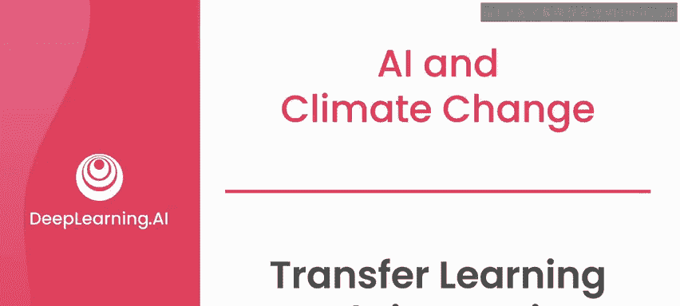

In the previous lab， you used a pre traineded model， a mega detector。

 to identify which of the images in your data set contained animals and where in each of those images and animals found。

You looked at examples of how you could crop out the portion of the image where an animal was detected for use with the classification model。

 This is a huge step forward for your AI powered animal detector project。

The next step is to classify which type of animal was found in each case。With the mega detector。

 the model was pretrained for your exact use case， namely finding animals and images。

 so you are able to use it right out of the box for the subsequent classification task on this or most other projects。

 you typically won have access to a model that is being trained on your exact use case。

 but a common practice and machine learning is still to use an existing model that might have been trained for a different classification task and perform some additional training what's known as fine tunein using your own data set in order to get the best of both worlds combined the knowledge in the existing model with the new data for the task that you want to complete。

So， for example， if you had access to a model that was trained to recognize cars。

 but you wanted a model that recognizes airplanes， the pretrain model that can identify cars might not do very well in identifying airplanes right out of the box。

 but with a little more training on a labeled data set that contains images of airplanes。

 it could quickly learn to identify airplanes much more quickly， In fact。

 than if you had started your training from scratch。

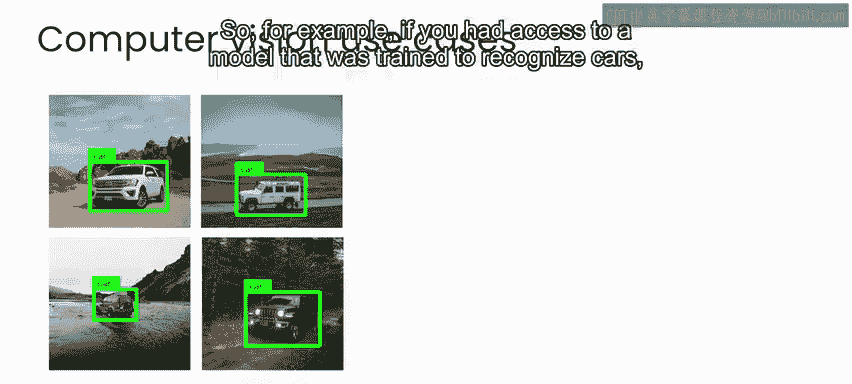

The reason this is possible is that when it comes to a neural network model learning how to perform a task。

 you can think of each layer in the model as learning about different aspects of the task。

When your task is object detection， there are going to be a number of aspects of that task that really have little or nothing to do with exactly what you're trying to identify in an image。

 Instead， much of the learning that machine learning models will do on any object recognition task is learning that is generic to the task of object recognition。

 For example， learning to detect the edge of objects or certain textures。

 And so it's learning that can be useful， no matter what sort of objects that you're hoping to detect。

 So， rather than starting from scratch in training a model for the task that you want to work on。

 it is common to start with a pretrain model where you can then transfer the learning from that network into a similar task and apply it to the task that you want to perform。

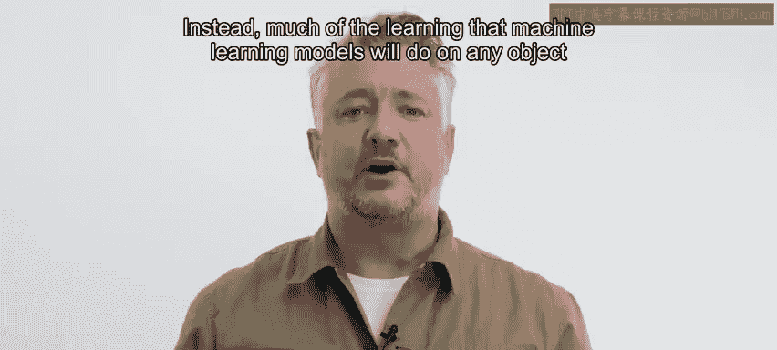

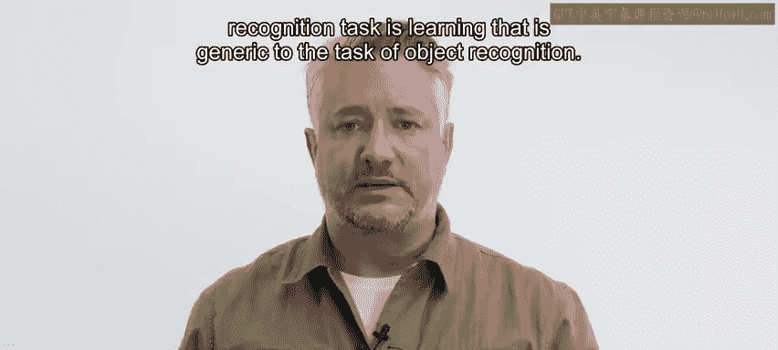

In the War of AI machine learning， this is known as transfer learning。

 which is to say transfer in the learning from one model to another in order to benefit from both。

To get a sense of by this work， let's take a closer look at how neural networks C images。

 Digital images are commonly represented as a grid of numbers where each pixel location。

 there is a number representing help bright or dark that pixel should be displayed。 So， for example。

 in this grayscale image of a fox here。 If we zoom in on a little patch of the image。

 it might look like this。

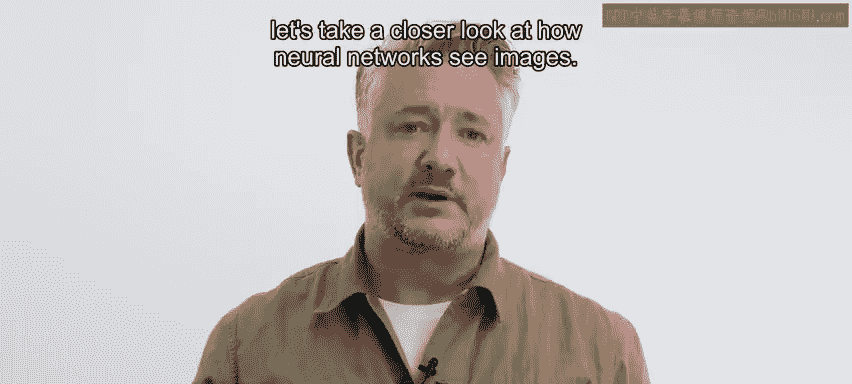

Here you can see that each of these little squares represents a pixel。

 and then inside each of those pixels， you might find this collection of numbers where large numbers represent a color closer to white and smaller numbers represent a color closer to black。

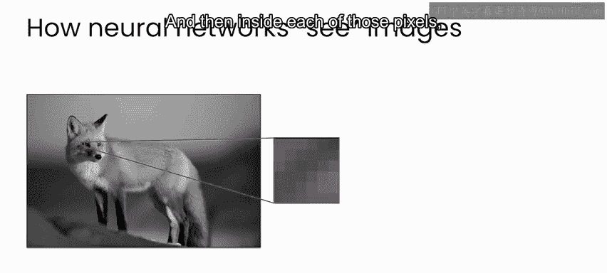

With a color image equivalent， what you're looking at is an image made up of three or sometimes four layers or colored channels where each layer represents how brighton image is in a particular colored channel。

So for this example， where the fox is now in color， you have a blue channel， a green channel。

 and a red channel。

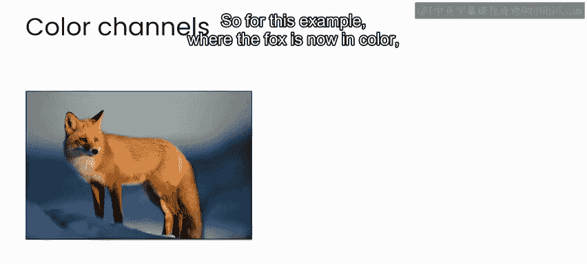

Now， at each pixel location in the original image， you have these three values， one for each red。

 green， and blue， or Igy beef for short。So for example。

 this pixel on the f's nose that is almost black might have very low values across all channels like this。

And this other pixel on the fox's fur might have these values indicating a brighter color closer to white。

When it comes to using images as your input data for a neural network。

 the most common approach is to use what's called a convolutional neural network。

 where each layer of the network runs calculations on little patches of the images and where each little patch of the image contains a collection of numbers。

With a convolutional neural network， you'll take each patch of the image and run to filter over it like this。

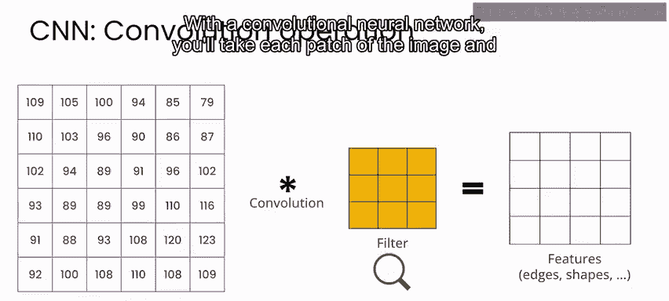

And what that filter is doing is writing calculations with each step in your training process。

 you're rerunning this convolution process and updating the filter values used in the calculations in order to identify the patterns in the images that are important for identifying objects In practice。

 the way this plays out is that the early layers of your network will learn very basic features or patterns like edges and corners and in deeper layers of your network。

 the filters will learn to identify features that are specific to your objective of interest。

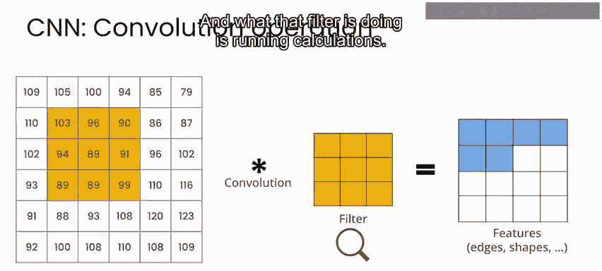

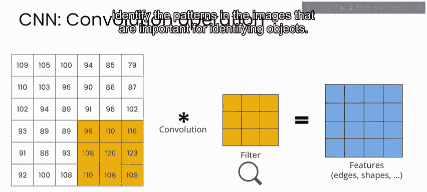

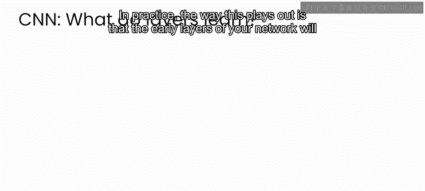

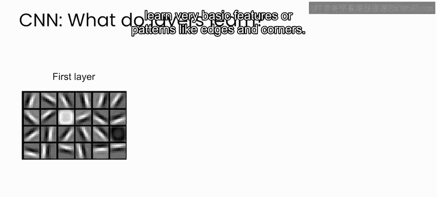

But still rather general in the example shown here， the object of interest is people's faces。

 but here in the middle layers of the network， you can start to see features like eyes。

 noses and mouths that would be generic to any face detection model。

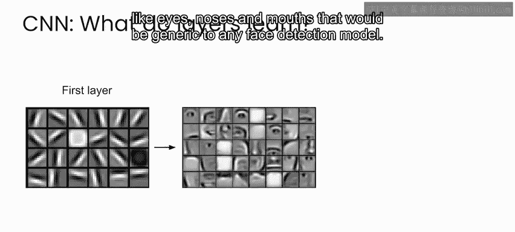

Finally， in the deepest layers of the network， your model learns to identify features that are specific to your objective of interest。

 like here， you can see that filters in the deepest layers are identified in whole faces。

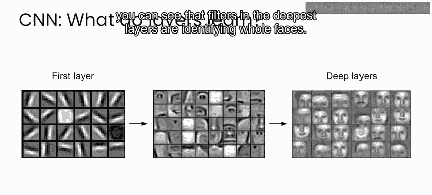

So in the case of detecting specific types of animals。

 you can imagine this might look very similar in the early layers of the network。

 just edges and corners and such being identified。 Then in the middle layers。

 you might have eyes and ears and mouths that are more animal like， as well as horns， tails。

 legs and so on。 Then finally， in the last layers， you'll start to see filters that are looking at the whole animal。

 and that look specific to the types of animals that the network was trained on in the next lab。

 you'll be using a model known as a neural architecture search network or Nasnet for short。

 This is currently a set of the art model。 but this field is developing really rapidly。

 So by the time you're watching this video， there might be some other set of the art model。

 but the intuitions that you have in this lesson here will apply to whatever computer vision model that you are using。

 The model that you will use has been trained on millions of images contained in a wide variety of objects。

 and as such， it has already learned how to identify many objects。😊。

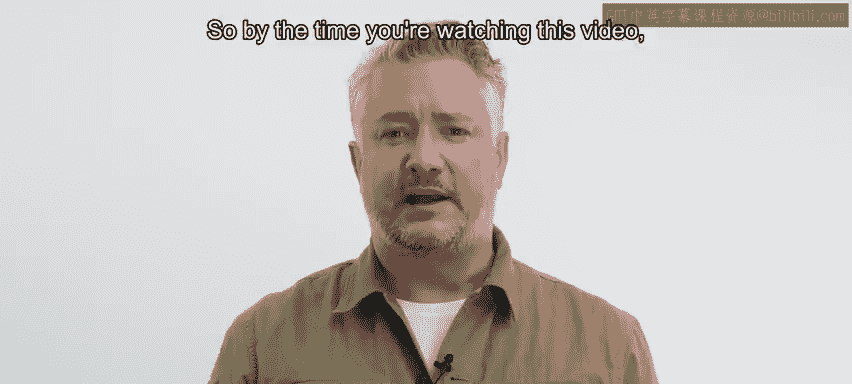

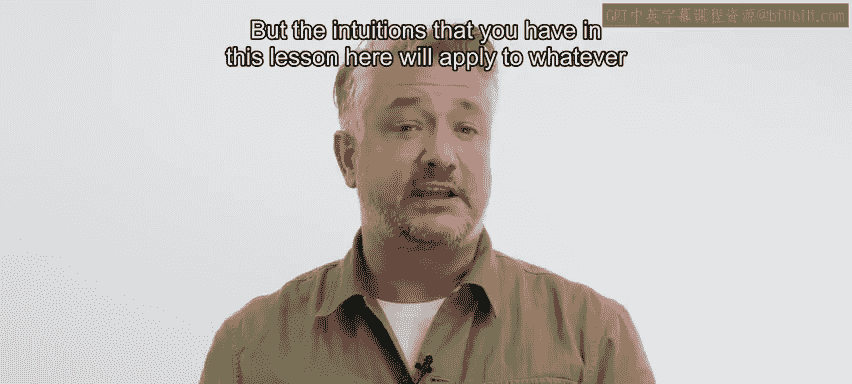

Based on a wide range of features。Well they can't necessarily identify an oryx or a harder beast right out of the box。

 what you'll find is that with a little bit of training。

 you'll quickly learn to tell an oryx from a harder beast or a kuddoo from a currybuted with no trouble at all and that's pretty impressive because I can't tell the difference between most of these animals and Jo aside this should also tell you that okay。

 this is the kind of task that might be able to scale beyond human recognition。😊。

So join me in the next video to dive into transfer learning for animal classification using a pre trained NeSNe。

