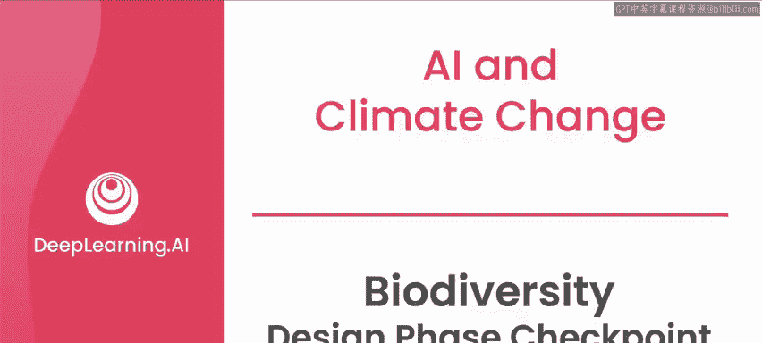
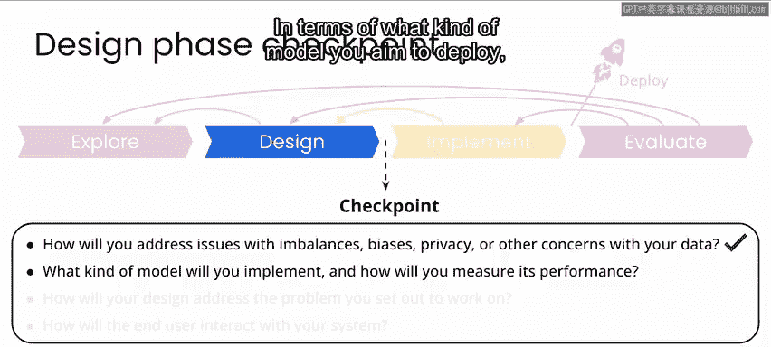

# 吴恩达《AI for Good专业课程》 AI与公共卫生、气候变化、灾难管理｜中英字幕 - P77：40_生物多样性设计阶段检查点.zh_en - GPT中英字幕课程资源 - BV13u411F7xZ

With the last two labs， you have employed pretrain neuralural network models to build an image processing pipeline that you can now use to classify animals in the camera trap images。

At this stage， your model is far from perfect， and in a real- world implementation of this project。

 you would likely spend a lot more time in the design phase， perhaps collecting more labeled data。

 What tweak in your approach to improve your model performance， for the purposes of this project。

 However， you have all the working parts of a design。

 and it's time to check in on whether you have what you need to move forward to implementation by addressing the following questions How will you address issues with imbalances。

 biases， privacy or other concerns with your data。 What kind of model will you implement and how will you measure its performance。

How will your design address a problem that you set out to solve？

And how would the end user interact with your system。

With regards to data concerns for this animal classification project。

 you identified that the data s is imbalanced in the sense that there are many pictures of some animals and relatively few of others。

But also in the sense that the distribution of animals is quite different from one camera location to the next。

😊，In your design， you implemented data augmentation to partially address this problem。

 although collecting more labeled data for underrepresented classes would also help。

In terms of privacy issues， you are aware that for a real world camera trap project。

 you would likely be collecting photos of people and vehicles and that in your data pipeline。

 you would need to treat these images as confidential personal information and delete them as quickly as possible rather than storing or publishing them In addition to that。

 from a dono harm perspective， there is the risk we identifiedified of not allowing your project results to be used by poachers for the purposes of locating animals。

 and in fact， when working on a similar use case in the past。

 this was our main reason for not sharing the data more broadly。 apartpart from that。

 in terms of biases or privacy issues， you should continue to be mindful of any other concerns that could arise among the impact of communities。

In terms of what kind of model you aim to deploy， you first use the popular mega detector pretrain model to identify where animals appear in your images。

And then you find tuned a pre trained Nesnet model to be able to classify the animals identified by the mega detector。

Your model displayed reasonable accuracy on the test data set and you'll explored the confusion matrix as well as individual images to get a sense of where the model was working well and where it was not in order to improve your model performance。

 you would most likely need to collect more training data。

The problem that you set out to address is researchers and conservation biologists need daily information on the number of animals cited at various locations throughout the Carra National Park in order to monitor trends in biodiversity and animal populations to inform policies that can be enacted to protect and preserve park ecosystems。

With the caveat that you could likely get better results with more training data。

 your design would be able to address this problem by automatically classifying hundreds or thousands of images daily and providing the results in a report。

And finally， the end user in this case is likely a researcher。

 OPAC staff member that regularly needs updates on animal sightings within the park and might also like to investigate the image data directly to see how animals are being identified or other details。

In your design so far， you have looked at various ways of displaying images with bounding boxes overlaid to show how images were cropped for classification。

 as well as plots to display how images were classified with various metrics。

 such as confidence and accuracy。These are all potentially interesting visualizations that would be of value to your users as well。

 and you'll explore how you can pull all of them together into a simple user interface in the next part of this project and that's it for the design phase of this project in the implementation phase you'll put together your full image processing pipeline in such a way that you can start with an input image and quickly get classifications for any animal that appears。

