# 吴恩达《AI for Good专业课程》 AI与公共卫生、气候变化、灾难管理｜中英字幕 - P78：41_生物多样性实施阶段.zh_en - GPT中英字幕课程资源 - BV13u411F7xZ

At this point you have other working components of an image processing pipeline you can feed an image into the mega detector model to identify animals and crop out the sections of the image based on what you find Next you can use your fine- tuned NSNe model to provide classification confidences across all of the classes of animals in your data set。

Now， it's time to pull these components together into an image pipeline that could be used for automatic animal detection from camera trap data。

 Now you're in the implementation phase of your project。

 where you'll focus on putting your models into production。

Develop the user experience and testing your system with end users。

 Let's head over to the lab to see how it all comes together。

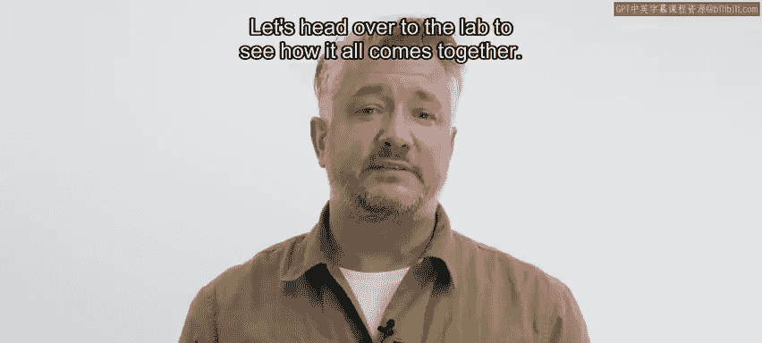

Run the first cell here to import all the Python packages that you'll need and set up your environment for using the models and the data After that。

 run this next cell to prepare some metadata that you would use in running your model and displaying images。

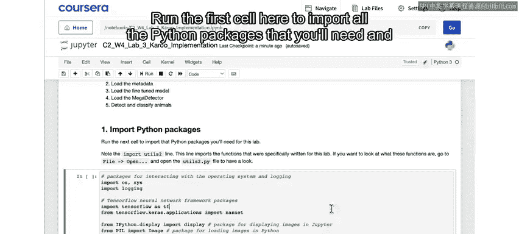

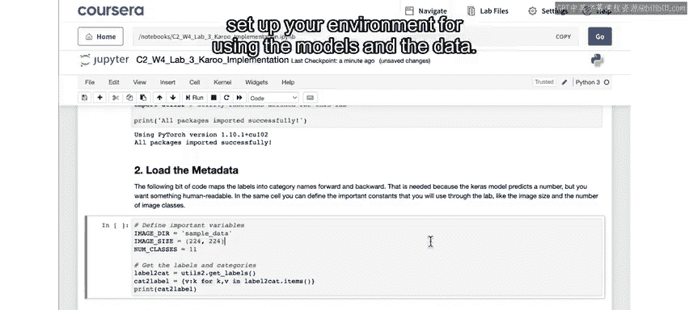

With this Dx cell， you'll now load the mega detector model。

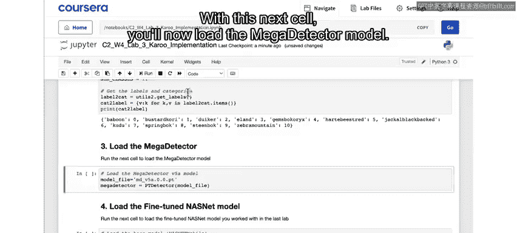

After that， you'll load the NAsSnet model that you find tuned in the design phase and with that。

 you're ready to run your animal detection pipeline。

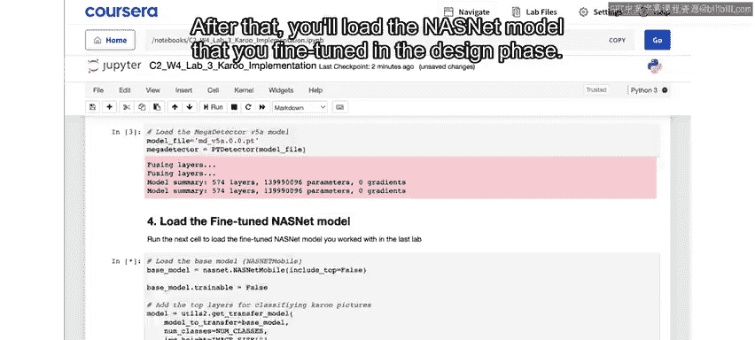

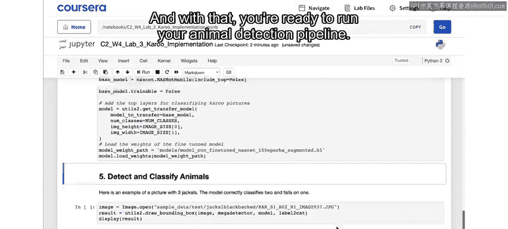

Run this next cell to process an example image with your pipeline。

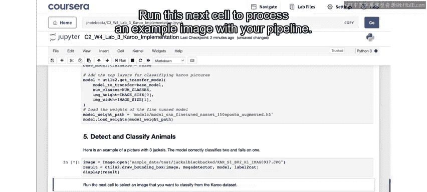

Here you can see the image contains three black backed jackals。

 one of which appears to be rolling on the ground。Above each detection。

 you can see the top three predictions from your model as well as the confidences associated with those predictions。

 and this should be familiar to you from the design phase lab。

Run this next cell to be able to choose any image from your data set and run it through the pipeline When you click the select button。

 you can go into either the test or train folders and select an image。Once you select an image。

 it will take a little time to process， but then if an animal is detected。

 you will see the bounding box， along with the predictions displayed on that image。

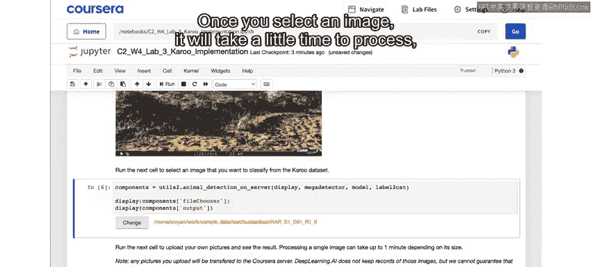

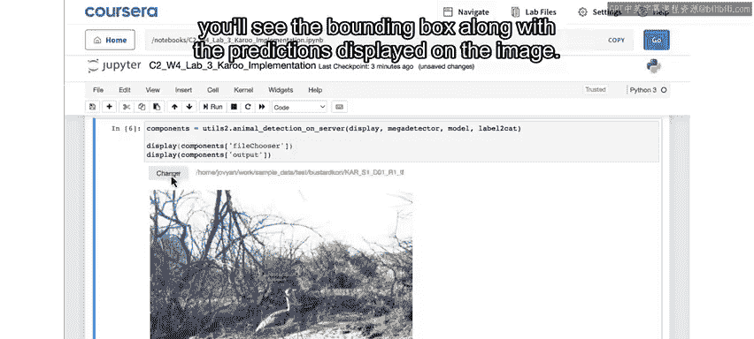

And so the way this is actually going to work in practice is that your camera traps would be uploading new images each time that they are triggered and so to simulate that when you're in this Excel cell。

 youll be able to upload an image of your own。Okay， so here are some pictures of some curry bads。

 and I'll grab one of these， maybe one have multiple birds in it。

I'll ensure that it's creative Commons and save it to my local machine then I'll upload for processing to see what happens Okay。

 so what you can see here is we got it right。

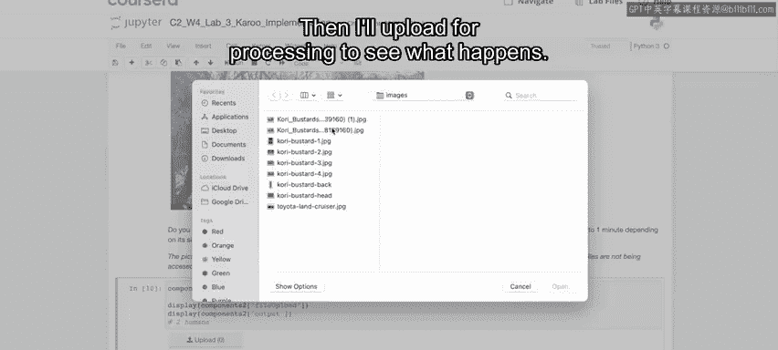

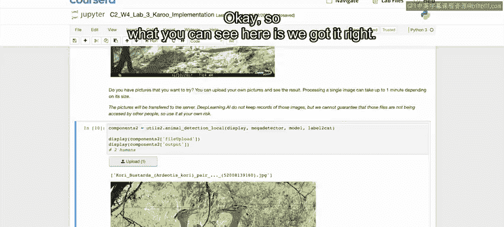

And as a reminder， we were concerned about potentially sensitive images like people or vehicles and the mega detector does identify these。

 so let's see how successful we are here， let's look for an image of the vehicle。

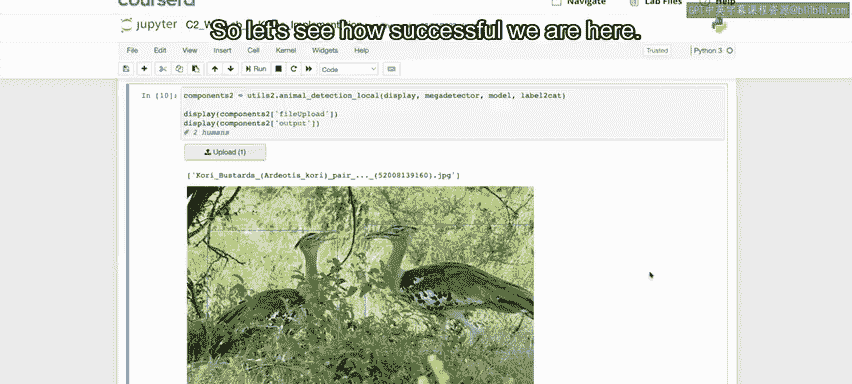

Again， we'll find one that's Creative Commons。We'll download a picture of this vehicle locally and now we'll run it through our system and you can see here that we have identified that this is a vehicle correctly。

And that's it for the implementation phase of this project。 Now， of course。

 there would be a lot more work to do to actually deploy a system like this。

 such that images were automatically uploaded， classified。

 cataloged and added into reports along with making sure that sensitive images were in no way compromise or。

But the key elements of an image process and pipeline for automatic animal detection are all there。

 so join me in the next video to wrap up the implementation phase for this project。

